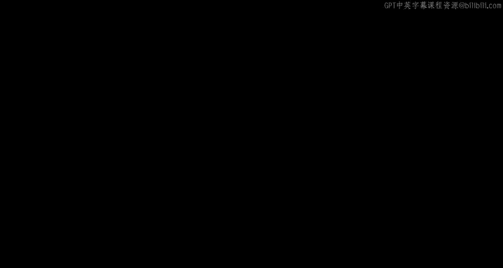
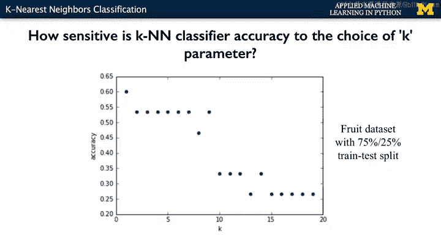

# 课程 6：K近邻分类算法 🍎📏

在本节课中，我们将学习一种流行且易于理解的机器学习算法——K近邻算法。我们将使用一个水果数据集作为示例，训练一个分类器，使其能够根据颜色、大小和质量等特征自动识别未来的水果。

---

## 概述

我们已经初步了解了数据集。现在，我们将使用这个数据集来训练一个分类器。该分类器将基于对象的颜色、大小和质量等可用特征，自动识别未来可能遇到的任何水果。为此，我们将使用一种流行且易于理解的机器学习算法，称为K近邻算法。

K近邻算法可用于分类和回归任务。目前，我们将重点介绍其在分类中的应用。K近邻分类器是基于实例或基于记忆的监督学习的一个例子。这意味着基于实例的学习方法通过记忆训练集中看到的带标签示例来工作，然后利用这些记忆的示例对新对象进行分类。

K近邻中的“K”指的是分类器为了进行预测而检索和使用的最近邻的数量。具体来说，K近邻算法包含三个可指定的步骤。

---

## K近邻算法的工作原理

上一节我们介绍了K近邻算法的基本概念，本节中我们来看看其具体的工作步骤。

以下是K近邻分类器对新实例进行分类的三个步骤：

1.  **寻找最近邻**：当给定一个新的、未见过的待分类实例时，K近邻分类器会在其记忆的训练示例集中，寻找特征最接近的K个示例。我们稍后将讨论“最接近”的含义。
2.  **查找标签**：分类器会查找这K个最近邻示例的类别标签。
3.  **组合标签进行预测**：完成上述步骤后，分类器会组合这些示例的标签，以预测新对象的标签。通常，这通过简单的多数投票来完成。

---

## 可视化示例

让我们看一个基于水果数据集的K近邻分类器可视化示例。

这里，我使用两个特征——宽度和高度——绘制了训练集中的每个水果。这两个特征共同构成了分类器的**特征空间**。图例中的颜色显示了每个数据点的标签。可以看到，有四种不同的颜色，对应数据集中的四种水果类型。

这些大块的彩色区域显示了根据“1-最近邻”规则，任何给定宽度和高度的点将被如何分类。换句话说，这里我设置 **K=1**。

例如，一个高度为6厘米、宽度为9厘米的数据点将被分类为苹果，因为它落在这个红色区域内。或者，如果分类器看到一个高度为4厘米、宽度为7厘米的水果，它将被分类为橘子，因为它落在分配给橘子的决策区域内。

---

## 理解“最近邻”

那么，“1-最近邻”规则意味着什么？这些不同的类别分配最初是如何得出的？

让我们看看这里的苹果例子。对于高度6厘米、宽度9厘米的对象，如果给分类器这个点，它会在所有见过的不同训练示例中搜索，查看哪个点最接近。我们寻找的是**最近**的单个邻居，即 **K=1**。我们试图找到最接近**查询点**（即我们想要分类的点）的那个点。

在这种情况下，我们可以看到特征空间中这个点可能是查询点的最近邻。类似地，如果我们看这里的橘子例子，训练集中最接近查询点的对象是这些点中的一个。

对于特征空间中的任何查询点，例如在柠檬区域这里，这个查询点的最近邻将是这里的这个训练集点。由于训练集点带有标签，我们知道它们的类别。

在1-最近邻的情况下，分类器会简单地将最近邻对象的类别分配给查询点。因为这里的最近邻是苹果，所以这里的查询点将被分类为苹果。如果我们看那边的橘子点，最近的数据点是橘子，因此它将被分类到那个区域。如果我们对每个可能的查询点都这样做，就会得到这种类区域模式。

从一个类别过渡到另一个类别的区域，这条线被称为**决策边界**，因为在线一侧的查询点被映射到一个类别，而在线另一侧的点被映射到另一个类别。

---

## 距离度量与特征权重

我想指出，在这个例子中，我们一直使用普通的欧几里得距离函数来寻找最近邻，该函数给予两个特征相等的权重。我们也可以使用**加权欧几里得距离函数**，在距离计算中给予不同特征不同的权重，这可能会在某些应用中提高准确性。

使用加权距离函数可以显著改变分类器的行为。下面是一个例子。

在左侧，是我们的标准设置，即对高度和宽度特征使用具有相等特征权重的欧几里得距离。在右侧，我改变了距离函数，使宽度特征（Y轴测量值）的权重是高度特征的10倍。

我并没有改变训练数据，所有训练点仍在相同位置。我们改变的是点之间的距离定义。现在，宽度特征的微小变化对分类决策的影响比之前大得多，因为在计算距离时有了10倍的乘数因子。

你可以看到，在右侧，这导致了决策边界和区域现在相当扭曲，并且在宽度方向上相比原始情况有所压缩。这是否是你想要的效果，将取决于你的具体应用。

---

## 加权距离的影响

如果你改用加权欧几里得距离度量，我之前提到的关于使用普通欧几里得距离的K近邻的一些事实也可能改变。

例如，使用加权距离度量，类别之间的决策边界可能发生显著变化。它们可能不再位于连接不同类别训练点的线的垂直等分线上。

让我解释一下。在原始具有相等特征权重的欧几里得距离中，当我们有不同类别点之间的决策边界时，我们可以画一条线连接这两个点，然后决策边界将是垂直于连接这两点的线的等距线。你可以在这里和这里的例子中看到这种情况。

但是，一旦我们切换到加权欧几里得距离，就像你在这里看到的，决策边界不再垂直于连接这两个不同类别点的线的等分线，它现在有些倾斜了。这就是某些事实如何随加权欧几里得距离而变化的一个例子。

---

## 数据标准化的重要性

与此相关的一点是，K近邻对具有不同量纲的特征值可能很敏感。如果你的数据是这种情况，你应该考虑在拟合分类器之前对训练数据进行**标准化**，以确保所有特征都在同一尺度上。我们将在第二周回归模块中介绍如何对数据进行标准化。

---

## 决策边界与K值

因为这是一个K近邻分类器，并且我们看的是 **K=1** 的情况，我们可以看到这里的类别边界，即决策边界。

让我们看这里的一个例子。这里有一个点是橘子，另一个点是柠檬。我们可以看到决策边界，因为它基于欧几里得距离并且我们平等对待各点，所以决策边界正好位于与这两个点等距的位置。它正好在这两个点的中间。因为如果它更靠近这个点，它将被映射到橘子类；如果更靠近那边的柠檬实例，它将被映射到柠檬类。你可以在这里的所有决策边界看到这种模式。这条线与这两个最近的点是等距的。

这基本上就是K近邻分类新实例的方式。你可以想象，对于K大于1的查询点，我们可能会使用一个稍微复杂一点的决策规则。

---

## K>1 时的多数投票规则

让我们看这里的这个例子。假设我们有一个查询点是橘子，并且我们正在进行2-最近邻分类。在这种情况下，两个最近的点是这里的这两个点。

在K大于1的情况下，我们使用简单的**多数投票**。我们取邻居示例标签中最主要的类别。在这种情况下，标签恰好一致，它们都是橘子。因此，在2-最近邻情况下，这个点将被分类为橘子。

当你得到更靠近某个点的点时，例如这边的点，在这种情况下，两个最近邻可能是这里的这些点。在这种情况下，你可以在它们之间随机选择以打破平局。通常K值选择为奇数，这样在 **K=3** 时，情况可能看起来像这样。

你可以看到，这里的三个最近邻是一个红点（苹果）、一个蓝点（橘子）和另一个红点（苹果）。因此，在K=3的情况下，投票将倾向于将其标记为苹果。

这基本上就是K近邻分类器的基本机制。

---

## 使用K近邻算法的四个要素

更一般地说，要使用最近邻算法，我们需要指定四件事：

1.  **距离定义**：我们需要定义特征空间中的距离含义，以便知道如何正确选择附近的邻居。在我刚才展示的水果数据集示例中，我们使用简单的直线距离或欧几里得距离来测量点之间的距离。
2.  **邻居数量K**：我们必须告诉算法在预测时使用多少个最近邻。这个数字必须至少为1。
3.  **邻居权重**：我们可能希望给予某些邻居对结果更大的影响力。例如，我们可能决定，距离我们试图分类的新实例更近的邻居，在最终标签上应该拥有更大的影响力或更多的投票权。
4.  **标签组合方式**：一旦我们有了K个邻近点的标签，我们必须指定如何组合它们以产生最终预测。

---

## 典型参数选择示例

以下是针对这四件事可能做出的一些典型选择的具体示例。

最常用的距离度量，也是Scikit-learn默认使用的，是欧几里得距离或直线距离。从技术上讲，欧几里得度量实际上是更一般的**闵可夫斯基度量**的一个特例，其中有一个参数P被设置为2，就会得到欧几里得度量。当你在笔记本中查看实际设置时，你会看到这是以闵可夫斯基度量的形式完成的。

我们可能会选择使用5个最近邻作为我们的K值。我们可能指定对更近的邻居没有特殊处理，因此我们使用**均匀权重**。同样，默认情况下，Scikit-learn会应用第四个标准，即**简单多数投票**，并预测最近邻中代表最多的类别。

下周的监督学习方法课程中，我们将学习许多其他分类器。

---

## 在Python中应用K近邻分类器

现在，让我们看看笔记本，了解如何在Python中将K近邻分类器应用于我们的示例水果数据集。

提醒一下，你可以在输入方法时使用 `Shift+Tab` 来显示该方法的文档弹出窗口，以帮助提醒你不同的参数选项和语法。

回想一下，我们的任务是正确分类示例案例中的新传入对象（水果）。因此，我们新训练的分类器将接收数据实例作为输入，并为我们提供预测标签作为输出。

在Python中，我们需要做的第一步是加载必要的模块，并将数据加载到Pandas的DataFrame中。完成此操作后，我们可以使用 `head` 方法转储前几行，以检查列名并获取前几个实例的示例。

接下来，我在笔记本中定义了一个字典，该字典以数字水果标签作为输入键，并返回一个字符串值，即水果的名称。这个字典使得将分类器预测的输出转换为人更容易解释的内容（本例中为水果名称）变得更加容易。

对于此示例，我们将定义一个变量 `X` 来保存没有标签的数据集特征。这里我将使用水果的质量、宽度和高度作为特征。这个特征集合称为**特征空间**。我们定义第二个变量 `y` 来保存 `X` 中实例的对应标签。

现在，我们可以将 `X` 和 `y` 传递给Scikit-learn中的 `train_test_split` 函数。通常，分割成训练集和测试集是随机进行的，但为了本次讲座，我希望确保我们都得到相同的结果，因此我将 `random_state` 参数设置为一个特定值（本例中我选择了0）。

`train_test_split` 函数的结果被放入左侧的四个变量中，这些变量标记为 `X_train`、`X_test`、`y_train` 和 `y_test`。在整个课程中，我们将使用这种 `X` 和 `y` 变量命名约定来指代数据和标签。

一旦我们有了训练测试分割，我们就需要创建分类器对象的一个实例，本例中是一个K近邻分类器。然后设置重要参数，本例中是将邻居数量设置为分类器要使用的特定值。

我们通过将训练集数据 `X_train` 和标签 `y_train` 传递给分类器的 `fit` 方法来训练分类器。本例中使用的K近邻分类器是Scikit-learn中称为**估计器**的更通用类的一个例子。所有估计器都有一个 `fit` 方法，该方法接收训练数据，然后改变分类器或估计器对象的状态，以便在训练完成后能够进行预测。换句话说，它更新了这里K近邻变量的状态，这意味着对于K近邻，它将以某种内部存储形式记忆训练集示例以供将来使用。

训练K近邻分类器基本上就是这样。我们可以用这个新训练的分类器做的第一件事是，看看它在一些新的、未见过的实例上可能有多准确。为此，我们可以将分类器应用于我们预留的测试集中的所有实例。由于这些测试实例没有明确包含在分类器的训练中，评估分类器是否可能擅长预测未来未见过的数据实例标签的一个简单方法是，计算分类器在测试集数据项上的**准确率**。

请记住，K近邻分类器在训练阶段没有看到测试集中的任何水果。为此，我们使用分类器对象的 `score` 方法。这将把测试集点作为输入并计算准确率，准确率定义为真实标签被分类器正确预测的测试集项目的比例。

---

## 对新实例进行分类

我们还可以使用新分类器对单个水果实例进行分类。事实上，这本来就是我们的目标——能够获取单个对象实例并为它们分配标签。

例如，这里我输入一个相当小的假设水果的质量、宽度和高度。如果我们要求分类器使用 `predict` 方法预测标签，我们可以看到输出是它预测为橘子。

然后，我可以传递一个不同的例子，可能是一个更大、略长的水果，其高度大于宽度，质量也更大。在这种情况下，对此实例使用 `predict` 方法的结果是，分类器认为这个对象是柠檬。

---

## 可视化决策边界

现在，让我们使用本课程附带的共享实用程序模块中包含的一个名为 `plot_fruit_knn` 的实用函数。这将生成我之前展示过的带有决策边界的彩色图。然后，你可以自己尝试不同的K值，看看对决策边界有什么影响。

我在这里作为最后一个参数传入的 `uniform` 参数是要使用的加权方法。这里我传入字符串 `uniform`，这意味着在组合邻居标签时平等对待所有邻居。如果你愿意，可以尝试将其更改为 `distance` 来尝试距离加权方法。你也可以传递自己的函数，但我们将留到以后再说。

我们还可以看到新分类器在不同K值下的行为。在这一系列图中，我们可以看到随着K从1变化到5再到10所产生的不同决策边界。

我们可以看到，当K值较小（如1）时，分类器善于学习训练集中单个点的类别，但决策边界是碎片化的，变化很大。这是因为当 **K=1** 时，预测对噪声、异常值、错误标记的数据以及单个数据点中的其他变异源很敏感。

对于较大的K值，分配给不同类别的区域更平滑，不那么碎片化，并且对单个点中的噪声更鲁棒，但可能在个别点上犯更多错误。这是所谓的**偏差-方差权衡**的一个例子，我们将在下周的课程中更深入地研究这一现象及其含义。

---

## K值对准确率的影响

鉴于我们改变K时观察到的分类器决策边界的变化，一个自然的问题可能是K值的选择如何影响分类器的准确率。

我们可以使用这段简短的代码轻松地将准确率绘制为K的函数。我们看到，对于这个特定的数据集和固定的单次训练测试分割，较大的K值确实会导致更差的准确率。

但请记住，这些结果仅针对这个特定的训练测试分割。为了获得对特定K值未来可能准确率的更可靠估计，我们需要查看多个可能训练测试分割的结果。我们将在下周深入探讨这个模型选择问题。

一般来说，导致最高准确率的最佳K值可能因数据集而异。通常，对于K近邻，使用较大的K可以抑制噪声个体标签的影响，但会导致分类边界不那么详细。

---

## 总结

在本节课中，我们一起学习了K近邻分类算法。我们首先了解了算法的基本概念和工作原理，包括其三个核心步骤。然后，我们通过可视化示例深入理解了“最近邻”和“决策边界”的含义。

我们探讨了距离度量（特别是欧几里得距离和加权欧几里得距离）对分类结果的影响，并强调了数据标准化的重要性。我们还分析了不同K值（从K=1到更大的值）如何影响决策边界的形状和分类器的鲁棒性，并引入了偏差-方差权衡的概念。

最后，我们在Python中实践了如何使用Scikit-learn库加载数据、分割数据集、训练K近邻分类器、评估其准确率并对新实例进行预测。恭喜你，你刚刚在Python中创建并运行了你的第一个机器学习应用！

在下周的课程中，我们将更深入地研究一些监督学习方法，并超越K近邻，学习如何以及为何将其他类型的分类器应用于机器学习问题。