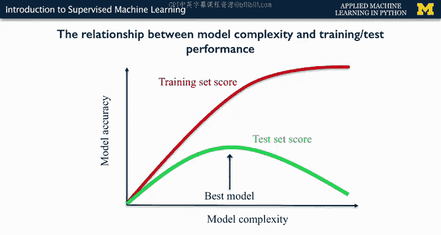

# 课程 7：监督式机器学习导论 🧠


在本节课中，我们将要学习监督式机器学习的基本概念、核心术语以及两种主要任务类型：分类与回归。我们将了解模型如何从数据中学习，并初步探讨模型复杂度与性能之间的关系。

---

## 概述

上一模块中，我们看到了一个使用K最近邻分类器的监督式机器学习基础示例。该示例根据水果的各种物理属性对它们进行分类。

这类机器学习算法被称为**监督学习算法**，因为它们使用训练集中的带标签样本来学习如何预测新的、未见过的样本的标签。

“监督”一词指的是每个训练样本都需要有一个标签，以便算法学习如何对未来样本做出准确预测。这与**无监督机器学习**形成对比，后者的训练数据样本没有标签。我们将在本课程后续部分介绍无监督学习。

本周，我们将更深入地探索监督学习，超越K最近邻分类器，介绍其他几种广泛使用的监督学习算法。

---

## 核心术语与概念

在继续之前，让我们回顾一些基本术语。

### 特征表示

我们将频繁使用的一个术语是**特征表示**。这意味着将一个对象（如一个水果）转换为计算机可以理解的数字。

在数据集中，一个水果的特征表示由这些列组成：质量、宽度、高度和颜色分数。这些将作为各种机器学习算法中的特征，用于预测水果的标签。

通常，数据集中的每一列对应一个与每个实例相关联的不同特征。

### 实例、样本与标签

我使用术语**实例**、**样本**或**示例**，它们大多可以互换使用。通常我会谈论实例或样本。因此，数据集的每一行对应一个水果，或一个特定的数据实例/样本。

在Python中处理这些实例时，我们将遵循一个约定：将所有代表特征的变量放在变量`X`中。因此，大写的`X`指的是所有将作为预测器输入的特征列。

然后，我们有一个非常重要的概念：**标签**。每个实例（每个水果）都有一个标签，在这个例子中是由人类分配的。标签是**目标值**的一个例子。在分类中，目标值是对象的标签；在回归中，它是你可能希望从输入中预测的特定连续值。

在Python中，我们使用小写`y`作为变量名，来保存与每个实例相关联的目标值。

### 训练集与测试集

我们从第一个例子中看到的另一个概念是**训练集**和**测试集**。

这意味着，如果我们把整个数据集看作一个矩形，我们通常会取原始数据集的一部分作为训练集，然后保留（通常较小）一部分作为测试集。Scikit-learn中的默认分割比例通常是75%训练，25%测试。

以下是使用Scikit-learn中`train_test_split`函数的示例代码：

```python
from sklearn.model_selection import train_test_split

X_train, X_test, y_train, y_test = train_test_split(X, y, test_size=0.25)
```

我们将使用`X_train`表示训练集特征，`y_train`表示训练集标签，`X_test`表示测试集特征，`y_test`表示测试集标签。

### 模型拟合与评估

一旦我们将训练数据传递给一个分类器，训练集就被用来估计模型的参数。在Scikit-learn中，有一个称为**估计器**的对象，它可以是分类器或回归器。这个模型的目标是学习如何对新数据实例进行分类或预测目标值。

我们将训练集传入以学习估计器内部参数的过程称为**模型拟合**。模型拟合的结果是一个**训练好的模型**。

以下是K最近邻分类器的拟合代码示例：

```python
from sklearn.neighbors import KNeighborsClassifier

knn = KNeighborsClassifier(n_neighbors=5)
knn.fit(X_train, y_train)
```

拟合完成后，KNN分类器的内部状态已更新，反映了训练数据对其内部参数的影响，现在可以用于预测。

**评估方法**通常是下一步。在拟合模型后，我们想看看它在测试数据上的实际表现如何。在本课程的第四周，我们将详细介绍评估分类器和回归器的不同方法。目前，我们主要看**准确率**。

对分类器应用`score`方法，传入测试数据`X_test`和`y_test`，将输出该分类器在测试集上的准确率。

```python
accuracy = knn.score(X_test, y_test)
```

最后，我们还可以对KNN对象应用`predict`方法，来获取先前未见过的实例的标签。

```python
predictions = knn.predict(X_new)
```

这些术语和变量命名约定将在整个课程中保持一致。

---

## 监督学习的任务类型

监督学习可以分为两种不同类型的任务：**分类**和**回归**。

分类和回归都接受一组训练实例，并学习到目标值的映射。

### 分类

对于分类，目标值是**离散的类别值**。

*   **二分类问题**：有两种类型的目标值，例如0代表负类，1代表正类。检测欺诈性信用卡交易就是一个二分类例子，交易要么有效要么无效。
*   **多分类问题**：目标值不止是“是/否”或“1/0”，而是一组离散值中的一个。例如，我们之前课程中给水果贴标签的例子就是多分类。我们试图预测标签的对象只能拥有一个可能的标签类型，一个东西不能既是苹果又是橙子。
*   **多标签分类**：存在多个目标值。例如，我们可能想给一个网页标注其讨论的所有不同主题。

### 回归

与分类相反，对于回归，我们试图预测的目标是一个**连续值**。例如，一个根据房间数量、位置、占地面积等预测房屋市场价格的模型就是一个回归问题，因为市场价格是连续的，也称为实值变量。

### 如何选择任务类型

你可以通过思考目标值的含义来判断应该对给定问题应用哪种类型的监督学习方法。

如果目标值代表一组互斥的类别值之一（如给水果贴标签或判断交易是否欺诈），那么这就是一个分类问题。

另一方面，如果目标是实值量，如成本、收入或高度，那么它可以被视为回归问题。

最后，我们会看到许多监督学习方法同时具有分类和回归两种形式。例如，我们即将介绍的**支持向量分类器**，也有一个回归版本，称为**支持向量回归**。

在本课程中，我们将涵盖分类和回归方法，但我们将把大部分时间花在分类上，因为它代表了一组重要的机器学习任务，并且分类涉及一些额外的概念和方法（特别是在评估等领域），这些在回归中不那么需要。

---

## 本周将学习的算法

我们将从两个简单但强大的预测算法开始：

1.  **K最近邻**：我们在第一周见过。
2.  **使用最小二乘法的线性模型拟合**。

这两种预测方法代表了监督学习的两种互补方法。K最近邻对数据结构不做太多假设，能给出可能准确但有时不稳定的预测（“不稳定”指的是它对训练数据中的微小变化可能很敏感）。另一方面，线性模型对数据结构做出强假设（即目标值可以仅使用输入变量的加权和——一个线性函数来预测），它能给出稳定但可能不准确的预测。

除了K最近邻和线性模型，我们还将涵盖各种广泛使用的用于分类和回归的监督学习方法，包括**决策树**、**支持向量机**和**神经网络**。

对于每种方法，我们将在较高层次上探索其工作原理，而不深入过多的数学细节。我们还将看看通常需要什么样的特征预处理。对于我们将要研究的大多数监督学习算法，都有一个或多个控制其模型复杂度的参数。因此，我们将看到如何设置这些参数以帮助避免欠拟合和过拟合。最后，我们将讨论每种监督学习方法的优缺点，以帮助理解在哪些场景下最适合（或不适合）应用特定方法。

---

## 模型复杂度与准确性

在我们研究所有这些不同方法时，你将看到一个一致的模式：**模型复杂度**与**模型准确性**之间的关系，如下图所示。


这种关系根据是在**训练集**（此处标记为“训练集分数”）还是**测试集**（此处标记为“测试集分数”）上测量分类器性能而有所不同。

当针对用于训练分类器的同一训练集测量性能时，该图显示，随着模型复杂度增加（例如KNN分类器中K值减小，决策边界越来越可变和详细），模型在训练集上的准确性呈上升趋势，因为更复杂的模型能越来越好地拟合训练数据。

然而，当同一个训练好的模型在留出的测试集上进行评估时，通常随着模型复杂度增加到某个最佳点，测试集准确性会有一个初始的增益，但随后测试集准确性会下降，因为日益复杂的模型开始对训练数据**过拟合**，过于具体，而没有捕捉到能帮助其很好地泛化到未见过的测试数据的更全局的模式。

这些趋势的具体情况会因情况而异，但总体而言，我们将在所研究的监督学习方法中看到这种模式。

---

## 什么是模型？



在本课程中，你会经常听到“模型”这个词。那么，什么是模型？它是一个特定的数学或计算描述，表达了**一组输入变量**与**一个或多个正在研究或预测的结果变量**之间的关系。

在统计术语中，输入变量称为**自变量**，结果变量称为**因变量**。在机器学习中，我们使用术语**特征**来指代输入或自变量，使用**目标值**或**目标标签**来指代输出或因变量。

模型既可以用来理解和探索给定数据集内的结构（正如我们将在无监督学习中看到的），也可以用于开发**预测模型**（在监督学习方法的情况下），其目标是准确预测先前未见过的输入数据的结果（即目标值或标签）。

---

## 总结

本节课中，我们一起学习了监督式机器学习的基础。我们明确了特征、标签、训练集、测试集等核心术语，并理解了模型拟合与评估的过程。我们区分了监督学习的两种主要任务：分类（预测离散标签）和回归（预测连续值）。最后，我们初步探讨了模型复杂度与泛化性能之间的关键关系，即模型需要在拟合训练数据与泛化到新数据之间找到平衡，避免欠拟合和过拟合。在接下来的课程中，我们将深入具体的算法来应用这些概念。