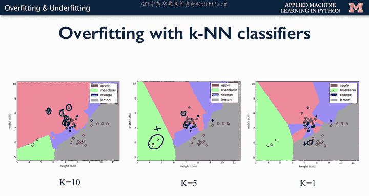

# 63：过拟合与欠拟合问题 🎯

在本节课中，我们将学习监督学习模型构建中的两个核心问题：过拟合与欠拟合。理解这两个概念对于构建能够良好泛化到新数据的模型至关重要。

---

## 概述

当我们构建监督学习模型时，无论是用于分类还是回归，模型的目标不仅是准确预测训练数据中的样本。我们真正期望的是，模型能够对从未见过的未来测试集样本，正确预测其类别或目标值。这种在预留测试集上表现良好的能力，称为模型的**泛化能力**。

机器学习通常假设未来的测试集与训练集具有相同的属性，或者说来自相同的底层分布。这意味着，如果模型在训练集上表现出高准确率，并且训练集与测试集相似，我们通常可以预期它在测试集上也会有良好表现。然而，由于**过拟合**问题的存在，情况并非总是如此。

---

## 什么是过拟合？

非正式地说，过拟合通常发生在我们试图用不足的训练数据拟合一个复杂模型时。过拟合的模型利用其捕获复杂模式的能力，擅长预测训练集中大量特定的数据样本或局部变化，但它常常忽略了训练集中有助于在未见测试集上良好泛化的全局模式。

由于没有足够的数据来约束模型以遵循这些全局趋势，训练集准确率在模型过拟合时，会成为对测试集准确率毫无希望的乐观指标。理解、检测和避免过拟合，或许是应用监督机器学习算法时你需要掌握的最重要方面。

---

## 过拟合与欠拟合的视觉示例

为了更好地理解过拟合现象，让我们看几个视觉示例。

### 回归问题示例

第一个示例涉及回归问题。在下图的X轴上，我们有一个输入变量（例如，房产面积）。在Y轴上，我们有一个目标变量（例如，该房产上房屋的市场售价）。

在回归中，我们试图找到输入变量与目标变量之间的关系，并从一个可能解释这种关系的模型开始。

*   **尝试线性模型**：我们可能尝试拟合一个线性模型，即预测输入变量与目标变量之间存在线性关系。在这种情况下，模型可能对这些点拟合一条直线。此时，模型**欠拟合**了数据。模型对于数据中存在的实际趋势来说过于简单，甚至在训练点（图中蓝点）上表现也不好。因此，它不太可能很好地泛化到测试数据。
*   **尝试二次模型**：如果我们选择一个更好的模型，例如认为这可能是一个二次关系，我们可能会得到一个看起来拟合得更好的结果。这是一个**合理良好模型拟合**的示例。我们既捕捉了点的总体趋势，同时也忽略了可能由噪声引起的小变化。
*   **尝试复杂多项式模型**：第三个示例是，我们可能假设输入变量与目标变量之间的关系是一个具有多个参数的多项式函数。如果我们尝试对这个训练数据集拟合一个更复杂的模型，我们可能会得到一条非常曲折的线。这个更复杂的模型有更多参数，因此能够捕捉更细微的行为，但方差也更高。它更侧重于捕捉训练数据中更局部的变化，而不是试图找到我们人类能从数据中看到的更全局的趋势。这就是**过拟合**的示例。

### 分类问题示例

第二个示例将展示分类中的过拟合。下图展示了一个简单的二维分类问题，每个数据实例由一个点表示，并有两个关联特征。这是一个二分类问题，点被标记为红色或蓝色。

分类问题的目标是找到一个决策边界。

*   **欠拟合模型**：欠拟合模型的一个例子可能是一个过于简单的模型，例如只考虑了一个特征的直线。同样，这是一个过于简单化的模型，它甚至不能很好地捕捉训练数据中类别之间的划分模式，因此不太可能泛化。
*   **良好拟合模型**：一个拟合良好的合理模型可能是一个找到正类（红色）和负类（蓝色）之间总体差异的线性模型。它意识到了这种全局模式（大多数蓝色负类点在左上角，大多数红色正类点更靠近右下角），并且足够稳健，忽略了红色区域偶尔出现蓝点或蓝色区域偶尔出现红点的事实。这是一个**合理拟合的模型**。
*   **过拟合模型**：另一方面，过拟合模型通常是一个具有大量参数、能够捕捉复杂行为的模型。因此，它会试图找到一种非常“聪明”的方式，以高度可变的决策边界完全分离红点和蓝点。这样做的好处（值得怀疑的好处）是它能非常好地捕捉训练数据的类别，几乎完美地预测训练数据的类别。但是，如果类别之间的实际划分是由那个线性模型捕捉的，那么过拟合模型将在它试图过于“完美”的区域犯很多错误。过拟合模型具有高方差，它试图捕捉过多的局部波动，并且没有足够的数据来看到能带来更好整体泛化性能的全局趋势。

---

## K近邻分类器中的K值影响

第三个示例展示了修改K近邻分类器中K参数的效果。这里显示的三张图分别展示了K=10、K=5和K=1时的决策边界。我们再次使用水果数据集，X轴是水果的高度，Y轴是宽度。

*   **K=10**：K=10意味着对于每个我们想要预测的查询点，我们需要查看该查询点的10个最近邻点，并综合它们的投票来预测该点的标签。我们需要训练集中10个不同数据实例的投票来进行预测。
*   **K=5**：当K=5时，我们只需要5个最近邻来进行预测。
*   **K=1**：K=1是最不稳定的情况，对于任何查询点，我们只查看该点的单个最近邻。

降低K近邻分类器中的K值，会增加决策边界的**方差**。因为决策边界更容易受到异常值的影响。在K=1的情况下，一个遥远的点可能对决策边界产生更大的影响，而在K=10的情况下，还需要其他9个邻居的投票。

通过调整K近邻分类器的K值，我们可以在一定程度上控制模型拟合数据集的**程度**。实际效果最佳的K值只能通过在测试集上进行评估来确定。但总体思想是，对于K近邻分类器，随着我们减小K值，**过拟合的风险会增加**。原因如前所述，例如当K=1时，我们试图捕捉决策边界中非常局部的变化，这可能不会对未来数据带来良好的泛化行为。

---

## 总结

本节课中，我们一起学习了监督学习中的两个关键问题：**欠拟合**与**过拟合**。

*   **欠拟合**发生在模型过于简单，无法捕捉数据中的基本模式时，导致在训练集和测试集上表现都差。
*   **过拟合**发生在模型过于复杂，过度捕捉训练数据中的噪声和局部波动，而忽略了全局趋势时，导致在训练集上表现很好，但在未见过的测试集上表现不佳。

我们通过回归和分类的视觉示例，直观地理解了这些概念。最后，我们以K近邻算法为例，看到如何通过调整模型复杂度（如K值）来在欠拟合和过拟合之间寻找平衡。构建机器学习模型的核心目标，是获得良好的**泛化能力**，而理解并避免过拟合与欠拟合是实现这一目标的基础。