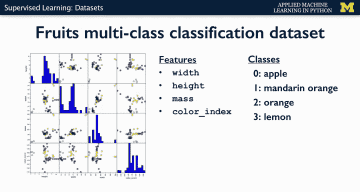

# 课程1-3：监督学习数据集 🧪


在本节课中，我们将学习监督学习中常用的几种数据集类型。我们将从简单的人工合成数据集开始，逐步过渡到更复杂的真实世界数据集，以帮助理解不同算法的工作原理。

## 概述

为了探索不同的监督学习算法，我们将结合使用小型合成数据集作为示例，以及一些较大的真实世界数据集。

Scikit-learn 在其 `sklearn.datasets` 库中提供了多种创建合成数据的方法。这些合成数据集通常用于演示目的。它们通常是低维度的，只使用少量特征（通常是一到两个），这使得它们易于解释和可视化。

另一方面，许多真实世界的数据集具有更高维度的特征空间。换句话说，它们有数十、数百甚至数千、数百万个特征。因此，我们从低维示例中获得的一些直觉并不总能直接应用到高维数据集上，我们稍后会对此进行更多讨论。例如，在某种意义上，高维数据集的大部分数据都位于角落，中间存在大量空白区域，这很难可视化。我们将在课程后面通过一些例子来说明。

尽管如此，低维示例仍然非常有用，可以帮助我们理解诸如模型复杂度如何随某些关键参数变化而变化等问题。

---

## 回归数据集示例 📈

上一节我们介绍了数据集的基本概念，本节中我们来看看用于回归问题的数据集。

对于基础回归问题，我们将从一个简单的问题开始，它有一个信息性输入变量、一个带噪声的线性输出和100个数据样本。下图是一个使用散点图绘制的数据集，每个点用一个圆点表示。X轴显示特征值，Y轴显示回归目标。

要创建这个数据集，我们使用 `sklearn.datasets` 中的 `make_regression` 函数。以下是笔记本中的代码：

```python
from sklearn.datasets import make_regression
X, y = make_regression(n_samples=100, n_features=1, noise=20, random_state=42)
```

---

## 二分类数据集示例 (简单线性可分) ⚖️

为了说明二分类问题，我们将引入一个简单的两类数据集，它包含两个信息性特征。

下图是一个散点图，每个数据实例显示为一个点，第一个特征值对应X轴，第二个特征值对应Y轴。点的颜色表示该数据实例被标记为哪个类别。

我称这个数据集为“简单”，是因为它只有两个特征，并且这两个特征都是信息性的。在这种情况下，这两个类别大致是线性可分的，这意味着在它们之间放置一个基本的线性分类器就能很好地区分两个类别的点。

以下是创建此数据集的代码：

```python
from sklearn.datasets import make_classification
X, y = make_classification(n_samples=100, n_features=2, n_informative=2,
                           n_redundant=0, n_clusters_per_class=1,
                           flip_y=0.1, random_state=42)
```

我们使用了 `sklearn.datasets` 中的 `make_classification` 函数，创建了100个点，大致将数据样本按类别分组为每个类一个簇，并且有10%的概率随机翻转任何点的正确标签，以使分类器的任务更具挑战性。

---

## 二分类数据集示例 (复杂非线性) 🌀

接下来，我们来看一个更复杂的二分类问题。它使用两个特征，但两个类别并非真正线性可分，而是在特征空间的不同部分形成了多个簇。

这个数据集是分两步创建的。首先，使用 `sklearn.datasets` 中的 `make_blobs` 函数，在八个不同的簇中随机生成100个样本。然后，通过使用模2函数转换 `make_blobs` 分配的簇标签（一个从1到8的数字），将其更改为二进制标签，将偶数索引点分配给类别0，奇数索引点分配给类别1。

以下是创建此数据集的代码：

```python
from sklearn.datasets import make_blobs
X, y_blobs = make_blobs(n_samples=100, centers=8, random_state=42)
y = y_blobs % 2  # 转换为二分类标签
```

---

## 多分类数据集示例 🍎🍌🍊🍇

为了说明多分类问题，我们将使用我们熟悉的水果数据集。你可能还记得，它有四个特征和四个可能的目标标签。

在左侧，我展示了我们在第1周看到的散点图矩阵，它显示了所有可能的特征对与类别标签之间的关系，以及每个特征值的分布在对角线上。

---

## 真实世界回归数据集示例 🏙️



为了说明一个真实世界的回归问题，我们将使用一个源自UCI存储库中的“社区与犯罪”数据集的数据集。

我们的数据使用了原始特征和目标值的一个子集，这些数据最初是通过结合几个美国政府数据源（如美国人口普查）创建的。每个数据实例对应一个特定的地理区域，通常是一个城镇或城市的一个区域。

我们使用的这个数据集版本有88个特征，编码了每个位置的各种人口统计和社会经济属性，包含1,994个位置数据实例。我们将尝试预测的目标值是人均暴力犯罪率。

要使用这些数据，我们使用为本课程包含在共享实用程序模块中的 `load_crime_data` 函数。

```python
# 假设存在一个自定义的加载函数
from shared_utilities import load_crime_data
X, y = load_crime_data()
```

---

## 总结

本节课中，我们一起学习了监督学习中几种关键的数据集类型。我们从易于可视化的低维合成数据集开始，了解了用于回归的线性数据集、用于简单二分类的线性可分数据集，以及用于复杂二分类的非线性可分数据集。接着，我们回顾了用于多分类问题的水果数据集。最后，我们介绍了一个高维的真实世界回归数据集——社区犯罪数据，它包含了大量特征和实例。理解这些不同类型的数据集是选择和应用合适监督学习算法的重要基础。在接下来的课程中，我们将学习如何在这些数据集上应用各种算法。