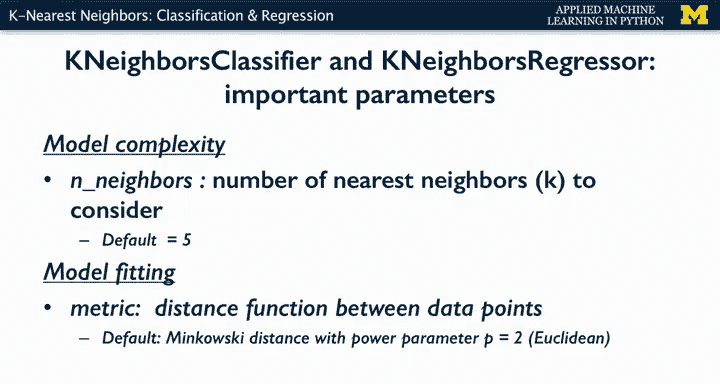

# 65：K近邻分类与回归 🧠📈

在本节课中，我们将学习K近邻模型。这是一种简单直观的监督学习方法，可用于分类和回归任务。我们将通过示例理解其工作原理，并探讨模型复杂度与泛化能力之间的关系。

---

## 回顾K近邻分类器

上一节我们介绍了监督学习的基本概念，本节中我们来看看K近邻分类器。K近邻分类器的工作原理是记忆整个训练集。当需要对新实例进行分类时，它执行以下三个步骤：

1.  在训练集中找到与新实例最相似的K个最近邻实例。
2.  获取这些训练实例的标签。
3.  根据这些邻近训练实例的标签来预测新实例的标签，通常采用简单的**多数投票**方式。

以下是使用K=1（即最近邻）的K近邻分类器在一个简单的二分类合成数据集上进行预测的示意图。

如图所示，类别0的点用黄色圆点标记，类别1的点用黑色圆点标记。整个特征空间根据分类器在每个点的预测结果被划分为不同的决策区域。例如，黄色区域中的点将被分类器预测为类别0，而黑色区域中的点将被预测为类别1。

对于K=1的分类器，要对任何给定的查询点进行预测，分类器只需在训练集中找到距离最近的那个点，并将该点的类别作为预测结果。因此，决策边界会显得非常不规则且具有高方差，这表明模型复杂度较高。在这种情况下，最近邻分类器可能**过拟合**了训练数据，试图对每个训练点都做出正确预测，而忽略了两类数据分布的整体趋势。

---

## 调整K值以控制模型复杂度

上一节我们看到了K=1时可能导致的过拟合问题，本节中我们来看看增加K值的影响。当我们将K从1增加到11时，分类器必须综合考虑11个最近邻点的投票结果，而不仅仅是1个。这使得单个训练数据点对预测的影响不再那么显著。

结果是决策边界变得更加平滑，这代表了一个模型复杂度较低的模型，决策边界的方差也大大降低。实际上，如果我们将K增加到等于训练集中点的总数，结果将是一个单一的决策区域，所有预测都将是训练数据中最频繁出现的类别。

以下是不同K值下训练分数和测试分数的对比：

*   **K=1**：训练分数为完美的1.0，但测试分数仅为0.80。
*   **K=3**：训练分数降至0.88，但测试分数略微上升至0.88，表明模型对新数据的泛化能力更好。
*   **K=11**：训练分数进一步降至0.81，但测试分数更好，达到0.92。

这表明，当K值适中时，模型能够更好地忽略训练数据中的微小变化，捕捉到类别分布更重要的全局趋势，从而获得最佳的泛化性能。

---

## K近邻回归

K近邻方法不仅可用于分类，也可用于回归。以下是针对一个简单回归问题（一个输入特征和对应的目标值）的示意图。

左图显示了原始的训练数据点（绿色圆圈）。中间和右图分别显示了K=1和K=3时K近邻回归算法的预测结果（蓝色三角形）。

K近邻回归的计算方式与分类类似：
*   对于**K=1**，查询点的预测值就是其最近邻训练点的目标值。
*   对于**K=3**，查询点的预测值是其三个最近邻训练点目标值的**平均值**。

为了评估回归模型的拟合效果，我们使用一个介于0到1之间的回归分数——**R平方**（也称为决定系数）。R平方值为1表示完美预测，值为0表示模型始终预测训练目标值的平均值。

---

## 回归中的模型复杂度

与分类情况类似，让我们看看在这个简单回归数据集上，模型复杂度与泛化能力（通过R平方训练值和测试值衡量）之间的关系。

以下是不同K值下K近邻回归的表现：

*   **K=1**：回归模型完美拟合训练数据（R平方训练分数为1.0），但在预测新数据时表现很差（R平方测试分数仅为0.155）。
*   **K增大**：随着K值增加（如3，7，15），模型平滑了局部变化，更能捕捉全局趋势。训练集分数下降，但模型泛化到新数据的能力增强，测试分数上升。
*   **K=15**：在该系列中，K=15的模型具有最佳的测试集性能（R平方分数为0.485）。
*   **K过大（如55）**：当K值过大时，训练和测试集分数都会回落到较低水平，模型开始**欠拟合**，即模型过于简单，即使在训练数据上表现也不好。

---

## K近邻的优缺点与参数

K近邻方法的优点是**简单直观**，容易理解特定预测是如何做出的。它可以作为一个合理的基线，用于比较更复杂方法的性能。

然而，当训练数据有很多实例或每个实例有很多特征时，这会显著降低K近邻模型的性能。因此，如果你的数据有数百或数千个特征，尤其是当数据是稀疏的（即每个实例有很多特征，但大多数为零）时，应考虑K近邻模型的替代方案。

总结来说，K近邻模型（包括回归和分类）的两个关键参数是：

1.  **`n_neighbors`**：控制要考虑的邻居数量，从而控制模型复杂度。
2.  **`metric`**：控制点之间的距离函数，从而决定在寻找邻居时哪些点被认为是“最近”的。本课程未深入探讨此参数，在大多数情况下，默认的欧几里得距离设置对大多数数据集效果良好。

---

本节课中我们一起学习了K近邻模型在分类和回归中的应用。我们理解了其核心机制是通过查找最近邻来进行预测，并深入探讨了K值对模型复杂度及泛化能力的核心影响：较小的K值导致高复杂度可能过拟合，较大的K值降低复杂度但可能欠拟合，需要选择一个适中的K值以获得最佳泛化性能。