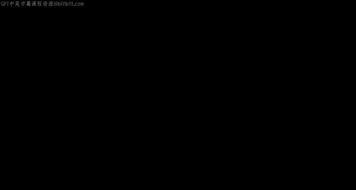
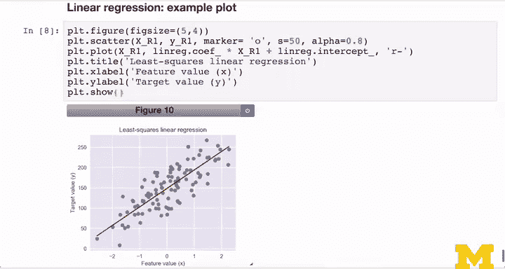

# 课程 11：线性回归与最小二乘法 📈

在本节课中，我们将学习监督学习中最简单的模型之一——线性模型，特别是线性回归。我们将了解其核心概念，并重点介绍一种名为“最小二乘法”的参数估计方法。

---

## 线性模型简介

上一节我们介绍了监督学习的基本概念，本节中我们来看看一种最基础的模型：线性模型。

线性模型通过输入变量的加权和来表达目标输出值。例如，我们的目标可能是预测房屋的市场价值，即其下个月的预期售价。

假设我们有两个输入变量：
1.  地方政府每年评估的房产税金额。
2.  房屋的年龄（年数）。

可以想象，房屋的这两个特征各自都包含有助于预测市场价格的信息。因为在大多数地方，房屋的纳税评估与其市场价值之间存在正相关关系。同时，房屋的年龄与市场价值之间可能存在负相关关系，例如，较老的房屋可能需要更多的维修和升级。

一个线性模型的示例如下：
`预测价格 = 212000 + 109 * 去年纳税额 - 2000 * 房屋年龄`

例如，根据这个线性模型，一栋去年纳税额为10，000美元、房龄为75年的房屋，其估计市场价格约为120万美元。

需要明确的是，这个具体的线性模型只是我作为示例编造的。但一般来说，当我们谈论训练一个线性模型时，我们指的是估计模型的参数（有时也称为系数）的值。在这个例子中，参数就是常数项212000，以及权重109和-2000。我们的目标是，通过这些参数计算出的对不同房屋的结果变量Y（价格）的预测，能够很好地拟合过去实际销售的数据。我们稍后将讨论“良好拟合”的含义。

---

## 线性回归模型

预测房价是使用线性模型进行回归任务的一个例子，这种模型毫不意外地被称为**线性回归**。

更一般地说，在线性回归模型中，可能有多个输入变量或特征，我们将其表示为 x0， x1 等。每个特征 Xi 都有一个对应的权重 Wi。

预测输出（我们记为 ŷ）是特征的加权和，加上一个常数项 b̂。我在这里所有在训练过程中估计的量上都加了一个“帽子”符号。ŵ 和 b̂ 值（我们称之为训练参数或系数）是从训练数据中估计出来的。而 ŷ 是根据输入特征值和训练参数的线性函数估计出来的。

例如，在我们刚才看到的简单房价例子中：
*   ŵ0 是 109，x0 代表纳税额。
*   ŵ1 是 -2000，x1 代表房龄。
*   b̂ 是 212000。

我们称这些 Wi 值为**模型系数**或**特征权重**。b̂ 被称为模型的**偏置项**或**截距**。

---

## 单变量线性回归

让我们来看一个非常简单的线性回归模型形式，它只有一个用于预测的输入变量或特征。

在这种情况下，向量 x 只有一个分量，我们称之为 x0，即输入变量或特征。此时，因为只有一个变量，预测输出 ŷ 简单地等于权重 w0 与输入变量 x0 的乘积，再加上偏置项 b。

所以，x0 是数据提供的值，而我们必须估计的参数是 w0 和 b。这个公式你可能很熟悉，它是一条直线的方程，其中斜率对应于权重 w0，而 b 对应于 y 轴截距（我们称之为偏置项）。

这里模型的任务是接收输入（例如 x 轴上的一个点），通过 w0（斜率）和 b（截距）这两个参数，在特征空间中定义一条直线。重要的是要记住，模型有训练阶段和预测阶段。**训练阶段**使用训练数据来估计 w0 和 b。

---

## 最小二乘法原理

那么，我们究竟如何估计线性模型的 w 和 b 参数，才能使模型良好拟合呢？w 和 b 参数是使用训练数据估计的，根据你对“良好拟合”的定义标准以及控制模型复杂度的方式，有许多不同的估计方法。

对于线性模型，一种广泛使用的方法称为**最小二乘线性回归**，也称为**普通最小二乘法**。

最小二乘线性回归会找到一条穿过数据点的直线，使得模型的**均方误差**最小。模型的均方误差本质上是训练集中所有点的预测目标值与实际目标值之差的平方和。

下图说明了这一点。蓝点代表训练集中的点。红线代表通过这组训练点找到的最小二乘模型。而这些黑线显示了基于某个训练点的 x 位置预测的 y 值与该训练点的实际 y 值之间的差异。

例如，对于 x 值为 -1.75 的这个点，将其代入线性模型的公式，我们在线上的这个点得到一个预测值（大约在60左右）。但训练集中该点的实际观测值可能更接近10。那么，对于这个特定点，预测目标与实际目标之间的平方差就是 (60 - 10)²。

我们可以对训练集中的每一个点进行这种计算，计算训练点观测到的 y 值与线性模型根据该训练点的 x 值预测出的 ŷ 值之间的平方差。每个点的平方差都可以计算出来，然后如果我们把它们全部加起来，再除以训练点的数量取平均值，那就是模型的均方误差。

因此，**最小二乘法的技术**旨在找到斜率 w 值和截距 b 值，以最小化这个平方误差，即均方误差。

关于这个线性回归模型需要注意的一点是，**没有控制模型复杂度的参数**。无论 w 和 b 取什么值，结果始终是一条直线。这既是该模型的优点，也是其弱点，我们稍后会看到。

---

## 在 Scikit-Learn 中实现

现在，让我们看看如何在 Scikit-Learn 中实现这一点。

Scikit-Learn 中的线性回归由 `sklearn.linear_model` 模块中的 `LinearRegression` 类实现。就像我们对 Scikit-Learn 中的其他估计器（如 K 近邻分类器和回归模型）所做的那样，我们首先在原始数据集上使用 `train_test_split` 函数，然后使用训练数据 `X_train` 和相应的目标值 `y_train` 来创建和拟合线性回归对象。

这里请注意，我们通过将 `fit` 方法与新对象的构造函数链接起来，在一行代码中完成了线性回归对象的创建和拟合。

`LinearRegression` 的 `fit` 方法用于估计特征权重 w（它称之为模型的系数），并将其存储在 `coef_` 属性中；以及偏置项 b，它存储在 `intercept_` 属性中。请注意，如果 Scikit-Learn 对象的属性以下划线结尾，这意味着这些属性是从训练数据中推导出来的，而不是由用户设置的量。

如果我们查看这个简单示例的 `coef_` 和 `intercept_` 属性，会发现因为只有一个输入特征变量，`coef_` 列表中只有一个元素，值为 45.7。`intercept_` 属性的值约为 148.4。我们可以看到，这些值确实对应于图中显示的红线，该直线的斜率为 45.7，y 轴截距约为 148.4。

---

## 与 K 近邻回归的比较

既然我们已经了解了 K 近邻回归和最小二乘回归，现在比较一下两者的结果是很有趣的。我们可以看到这两种回归方法代表了两种互补的监督学习类型。

K 近邻回归器对数据的结构不做太多假设，能给出可能准确但有时不稳定的预测，这些预测对训练数据中的微小变化很敏感。因此，与最小二乘线性回归相比，它在训练集上的 R 平方分数相应更高（KNN 为 0.72，最小二乘法为 0.679）。

另一方面，线性模型对数据的结构做出了强有力的假设，即目标值可以通过输入变量的加权和来预测。线性模型给出稳定但可能不准确的预测。然而，在这种情况下，线性模型关于输入和输出变量之间存在线性关系的强假设恰好很适合这个数据集。因此，它更擅长准确预测训练期间未见过的新 X 值所对应的 Y 值。我们可以看到，线性模型在测试集上获得了稍好的分数（0.492 vs KNN 的 0.471），这表明它能够更好地泛化并捕捉这种全局线性趋势。

---

## 总结

本节课中，我们一起学习了线性回归模型的核心思想。我们了解到线性模型通过加权和的形式进行预测，并重点掌握了使用**最小二乘法**来估计模型参数（斜率和截距），该方法通过最小化预测值与真实值之间的**均方误差**来寻找最佳拟合直线。最后，我们比较了线性回归与 K 近邻回归的特点，认识到线性模型结构简单、假设明确，在符合其假设的数据上往往具有更好的泛化能力。