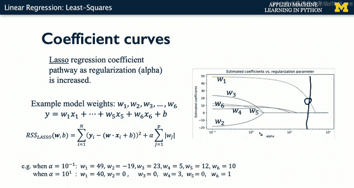

# 课程 12：线性回归进阶：岭回归、Lasso与多项式回归 🧮


在本节课中，我们将学习线性回归的几种高级形式。我们将探讨如何通过**正则化**技术（岭回归和Lasso回归）来防止模型过拟合，以及如何通过**多项式特征变换**来让线性模型捕捉数据中的非线性关系。这些方法能显著提升模型在复杂数据集上的表现。

---

## 岭回归：引入正则化

上一节我们介绍了普通最小二乘法。本节中，我们来看看另一种估计线性模型参数 **W** 和 **B** 的方法，称为岭回归。

岭回归使用相同的最小二乘准则，但有一个关键区别：在训练阶段，它会为过大的特征权重 **W_i** 添加一个惩罚项，如下方公式所示。

**公式**：`目标函数 = 最小二乘误差 + α * Σ(W_i²)`

从数学上看，较大的权重意味着其平方和也较大。一旦岭回归估计出线性模型的 **W** 和 **B** 参数，对新实例的 **y** 值预测就与最小二乘法完全相同：只需将输入特征值 **X_i** 代入常规的线性公式，计算加权特征值之和加上 **B** 即可。

那么，岭回归这样的方法为何有用呢？

这种在学习算法的目标函数中添加惩罚项的做法，被称为**正则化**。正则化是机器学习中一个极其重要的概念，它通过限制模型可能的参数设置来防止过拟合，从而提高模型的泛化性能。通常，正则化限制的效果是降低最终估计模型的复杂度。

对于线性回归，添加参数值的平方和（如上框所示）到最小二乘目标中，意味着具有较大特征权重 **W** 的模型会增加目标函数的整体值。因为我们的目标是最小化整体目标函数，所以正则化项会对那些拥有许多大特征权重的模型施加惩罚。

换句话说，在所有条件相同的情况下，如果岭回归找到两个能同样好地预测训练数据值的线性模型，它会**优先选择特征权重平方和较小的那个线性模型**。

使用岭回归的实际效果是，找到一组在最小二乘意义上能很好拟合数据的特征权重 **W_i**，同时将许多特征的权重设置为非常小的值。在单变量线性回归的例子中我们看不到这种效果，但对于具有数十或数百个特征的回归问题，使用像岭回归这样的正则化线性回归所带来的精度提升可能是显著的。

正则化的强度由 **alpha** 参数控制。较大的 **alpha** 意味着更强的正则化，以及权重更接近 0 的、更简单的线性模型。**alpha** 的默认设置为 1.0。注意，将 **alpha** 设置为 0 对应于我们之前看到的普通最小二乘线性回归的特殊情况。

在 scikit-learn 中，你可以通过从 `sklearn.linear_model` 导入 `Ridge` 类来使用岭回归，然后像使用最小二乘法一样使用该估计器对象。唯一的区别是，你可以使用 **alpha** 参数指定岭回归正则化惩罚的强度，这被称为 **L2 惩罚**。

以下是应用岭回归到犯罪数据集的代码示例：

```python
from sklearn.linear_model import Ridge
ridge_reg = Ridge(alpha=1.0)
ridge_reg.fit(X_train, y_train)
```

现在，你会注意到这里的结果并不那么令人印象深刻。测试集上的 R 平方分数与我们用最小二乘回归得到的结果非常接近。然而，在应用岭回归时，我们可以做一些事情来显著改善结果。

---

## 特征预处理与归一化的重要性

现在，我们简要讨论一下特征预处理和归一化的必要性。

让我们停下来直观地想一想岭回归在做什么。它通过对 **W** 系数的大小施加平方和惩罚来正则化线性回归。因此，增加 **alpha** 的效果是使 **W** 系数向 0 收缩，并彼此靠近。

但是，如果输入变量（特征）具有非常不同的尺度，那么当这种系数收缩发生时，不同尺度的输入变量对 **L2** 惩罚的贡献将不同。因为 **L2** 惩罚是所有系数的平方和。

因此，转换输入特征，使它们都处于相同的尺度，意味着岭惩罚在某种意义上更公平地应用于所有特征，不会因为尺度的差异而不恰当地偏重某些特征。

更一般地说，随着课程的深入，你会发现特征归一化对于许多不同的学习算法（不仅仅是正则化回归）都很重要，这包括 K 近邻、支持向量机、神经网络等。所需的特征预处理和归一化类型也可能取决于数据。

目前，我们将应用一种广泛使用的特征归一化形式，称为**最小-最大缩放**。这将转换所有输入变量，使它们都处于 0 和 1 之间的相同尺度。

为此，我们计算训练数据上每个特征的最小值和最大值，然后对每个特征应用如下所示的最小-最大变换。

**公式**：`X_scaled = (X - X_min) / (X_max - X_min)`

以下是它如何与两个特征一起工作的示例。假设我们有一个特征“高度”，其值落在 1.5 到 2.5 单位之间相当窄的范围内。但第二个特征“宽度”的范围则宽得多，在 5 到 10 单位之间。应用最小-最大缩放后，两个特征的值都被转换到相同的尺度上，最小值映射到 0，最大值映射到 1，其他所有值都映射到这两个极值之间的某个值。

在 scikit-learn 中应用最小-最大缩放，你需要从 `sklearn.preprocessing` 导入 `MinMaxScaler` 对象。要准备使用缩放器对象，你需要创建它，然后使用训练数据 `X_train` 调用 `fit` 方法。这将计算训练数据集中每个特征的最小和最大特征值。

然后，要应用缩放，你调用它的 `transform` 方法并传入你想要重新缩放的数据，输出将是输入数据的缩放版本。在本例中，我们想要缩放训练数据并将其保存到一个名为 `X_train_scaled` 的新变量中，同时缩放测试数据并将其保存到名为 `X_test_scaled` 的新变量中。然后，我们只需使用这些缩放后的特征数据版本，而不是原始特征数据。

请注意，通过使用缩放器的 `fit_transform` 方法，可以更高效地在训练集上一步完成拟合和转换，如下所示：

```python
from sklearn.preprocessing import MinMaxScaler
scaler = MinMaxScaler()
X_train_scaled = scaler.fit_transform(X_train)
X_test_scaled = scaler.transform(X_test)
```

关于如何在包含训练集和测试集的学习场景中应用最小-最大缩放或任何类型的特征归一化，这里还有最后一点非常重要。

你可能已经注意到两件事：首先，我们对训练数据和测试数据应用了相同的缩放器对象；其次，我们是在训练数据上训练缩放器对象，而不是在测试数据上。这两点都是特征归一化的关键方面。

如果你不对训练集和测试集应用相同的缩放，你最终会得到或多或少是随机的数据尺度，这将使你的结果无效。如果你通过向缩放器（或其他归一化方法）展示测试数据而不是训练数据来准备它，这会导致一种称为**数据泄露**的现象，即训练阶段包含了从测试集泄露的信息（例如，测试数据中每个特征的极端值分布），而学习器在训练期间本不应访问这些信息。这反过来又可能导致学习方法在同一个测试集上给出不切实际的好估计。我们将在课程后面更多地讨论数据泄露现象。

执行特征归一化的一个缺点是，基于转换后特征的最终模型可能更难解释。同样，最终应用哪种特征归一化最好，可能取决于数据集、学习任务和要使用的学习算法。我们将在整个课程中继续探讨这个问题。

---

## 应用归一化后的岭回归

好的，在我们添加了输入特征的最小-最大缩放代码后，让我们回到岭回归。

我们可以看到最小-最大缩放对岭回归性能的显著影响。在输入特征被适当缩放后，岭回归实现了明显更好的模型拟合，测试集上的 R 平方值约为 0.6，比没有缩放时好得多，现在也比普通最小二乘法好得多。

事实上，如果你对普通最小二乘回归应用相同的最小-最大缩放，你会发现它根本不会改变结果。一般来说，当你的训练数据量相对于模型中的特征数量较小时，正则化效果特别好。随着你拥有的训练数据量增加，正则化变得不那么重要。

在这个例子中，我们可以通过为 **alpha** 设置不同的值，来观察改变正则化强度对缩放后的训练和测试数据的影响。测试集上最佳的 R 平方值是在 **alpha** 设置为 20 左右时达到的。显著更大或更小的 **alpha** 值都会导致模型拟合显著变差。这再次说明了本讲座前面看到的模型复杂度和测试集性能之间的一般关系，即通常存在一个中间的最佳模型复杂度参数值，不会导致欠拟合或过拟合。

---

## Lasso 回归：另一种正则化方法

另一种你可以用来替代岭回归的正则化回归称为 **Lasso 回归**。

与岭回归类似，Lasso 回归在普通最小二乘目标中添加了一个正则化惩罚项，使模型 **W** 系数向 0 收缩。Lasso 回归使用一个稍有不同的正则化项，称为 **L1 惩罚**，而不是岭回归的 **L2 惩罚**，如下所示。

**公式**：`目标函数 = 最小二乘误差 + α * Σ|W_i|`

**L1** 惩罚看起来与 **L2** 惩罚有些相似，因为它也计算系数的和，但它是 **W** 系数绝对值的和，而不是平方和，其结果明显不同。使用 Lasso 回归时，一部分系数被强制恰好为 **0**，这是一种自动特征选择。因为权重为 0，该特征在模型中基本上被完全忽略。这种稀疏解（只有最重要的特征子集具有非零权重）也使得在输入变量较多的情况下，模型更容易解释。

与岭回归一样，Lasso 回归的正则化强度由参数 **alpha** 控制，默认值为 1.0。同样类似于岭回归，使用 Lasso 回归的目的是估计 **W** 和 **B** 模型系数。一旦完成，预测模型的公式就与普通最小二乘法相同，你只需使用线性模型。

一般来说，如果你认为只有少数几个变量对输出变量有中等或较大的影响，那么 Lasso 回归最有帮助。否则，如果有很多变量贡献了小的或中等的影响，岭回归通常是更好的选择。

让我们在 notebook 中使用犯罪数据集看看 scikit-learn 中的 Lasso 回归。要使用 Lasso 回归，你需要从 `sklearn.linear_model` 导入 `Lasso` 类，然后像使用岭回归这样的估计器一样使用它。

对于某些数据集，你可能偶尔会收到收敛警告，在这种情况下，你可以将 `max_iter` 属性设置为更大的值，通常至少 20000 或可能更多。增加 `max_iter` 参数将相应增加计算时间。

在这个例子中，我们像对岭回归所做的那样，将 Lasso 应用于犯罪数据集的最小-最大缩放版本。你可以看到，当 **alpha** 设置为 2.0 时，只剩下 20 个具有非零权重的特征，因为通过 Lasso 正则化，大多数特征的权重被精确地设置为零。

我已经按照权重降序排列列出了具有非零权重的特征。尽管我们需要谨慎解释像犯罪这样的复杂问题的数据结果，但 Lasso 回归结果确实帮助我们看到了这个特定数据集中输入变量与结果之间的一些最强关系。

例如，查看 Lasso 回归发现的具有非零权重的 top 5 特征，我们可以看到位置因素（如密集住房中的人口百分比，这表示城市地区）和社会经济变量（如一个地区空置房屋的比例）与犯罪率呈正相关。而其他变量，如双亲家庭的百分比，则呈负相关。

最后，我们可以看到调整 Lasso 回归的正则化参数 **alpha** 的效果。就像我们在岭回归中看到的那样，存在一个最佳的 **alpha** 范围，能提供最佳的测试集性能，既不过拟合也不欠拟合。当然，这个最佳的 **alpha** 值对于不同的数据集会有所不同，并取决于其他各种因素，例如所使用的特征预处理方法。

---

## 多项式回归：捕捉非线性关系

假设我们有一组二维数据点，特征为 **x0** 和 **x1**。那么，我们可以通过添加额外的特征来转换每个数据点，这些特征是 **x0** 和 **x1** 的三个唯一的乘法组合：**x0²**、**x0*x1** 和 **x1²**。

这样，我们将原始的二维点转换为一组五维点，这些点仅依赖于二维点中的信息。现在，我们可以写一个新的回归问题，尝试预测相同的输出变量 **ŷ**，但使用这五个特征，而不是两个。这里的关键见解是，这仍然是一个线性回归问题。特征只是加权和中的数字，因此我们可以使用相同的最小二乘技术来估计这五个特征的五个模型系数，就像我们在更简单的二维情况下所做的那样。

那么，我们为什么要做这种转换呢？这被称为**多项式特征变换**，我们可以用它来将问题转换到更高维的回归空间。实际上，添加这些额外的多项式特征允许我们使用一组更丰富的复杂函数来拟合数据。所以你可以直观地认为，这允许用多项式来拟合训练数据，而不仅仅是一条直线，但仍然使用相同的最小化均方误差的最小二乘准则。

我们稍后会看到，这种添加新特征（如多项式特征）的方法在分类中也非常有效，我们将在核化支持向量机中再次看到这种变换。

当我们添加这些新的多项式特征时，我们本质上是通过将它们作为特征添加到线性模型中，增强了模型捕捉不同变量之间相互作用的能力。例如，理论上，房价可能同时是房屋所在地块大小和房产税金额的二次函数。一个简单的线性模型无法捕捉这种非线性关系，但通过向线性回归模型添加多项式等非线性特征，我们就可以捕捉到这种非线性。

更一般地说，除了多项式，我们还可以使用其他类型的非线性特征变换。这超出了本课程的范围，但从技术上讲，这些被称为回归的线性基函数，并且被广泛使用。

当然，添加大量新特征（尤其是当我们取 **K** 个变量的所有可能组合时）的一个副作用是，这些更复杂的模型有过拟合的潜力。因此，在实践中，多项式回归通常与正则化学习方法（如岭回归）结合使用。

以下是使用 scikit-learn 进行多项式回归的示例。在 `sklearn.preprocessing` 模块中已经有一个方便的类叫 `PolynomialFeatures`，它会为我们生成这些多项式特征。

这个例子展示了一个更复杂的回归数据集上的三次回归，该数据集恰好具有变量之间的一些二次交互作用。

*   第一次回归只使用没有多项式特征变换的最小二乘回归。
*   第二次回归创建了 `degree` 设置为 2 的多项式特征对象，然后在原始特征 `X_f1` 上调用多项式特征对象的 `fit_transform` 方法，以生成新的多项式变换特征 `X_f1_poly`。然后代码调用普通最小二乘线性回归。你可以看到过拟合的迹象，在这个扩展的特征表示上，模型的训练集 R 平方分数接近 1，但在测试集上低得多。
*   因此，第三次回归展示了通过岭回归在这个扩展特征集上添加正则化的效果。现在，训练和测试的 R 平方分数基本相同，正则化多项式回归的测试集分数在三种回归方法中表现最佳。

---

## 系数路径图：可视化正则化效果

我想花一点时间向你展示一个非常有用且有趣的图表，它显示了正则化参数 **alpha** 的选择如何影响回归模型的估计系数。我称之为**系数路径图**。

回想一下，如果我们想将正则化回归模型（如岭回归或 Lasso 回归）拟合到一组点，我们还需要指定要使用的特定 **alpha** 值，该值控制优化目标中正则化惩罚的权重。在这部分幻灯片中，我写下了优化目标，你可以看到，我们有正则化参数 **alpha** 来控制目标中正则化部分（这个 **W_j** 平方和）相对于普通最小二乘部分的权重。

我们指定 **alpha**，拟合模型，就像所有回归场景一样，拟合模型的结果将是一组估计系数。在这个例子中，我们假设我们有 6 个模型权重，比如说对应输入中的六个不同特征。我们将分析一个线性模型，该模型估计这六个系数 **W1** 到 **W6**，在本例中我们用岭回归进行拟合。在图中我将忽略系数 **B**，因为它不贡献正则化惩罚。

好的，这是本例中岭回归的系数路径图。在 x 轴上，我们有 **alpha** 的值。注意，我将其绘制在对数刻度上，因为我们在相对较小的值和相对较大的值之间变化 **alpha** 的范围很广，所以请注意这个对数刻度。

在图的 y 轴上，我们有估计系数的值。因为我们有六个系数，我在这张图上绘制了六条曲线。所以每个估计系数 **W1**、**W2** 等对应一条曲线。

这张图表显示了当我们使用不同的 **alpha** 选择拟合模型时，估计系数会发生什么变化。实际上，这个系数路径图显示了 **alpha** 在 10⁻¹ 到 100 之间的所有可能选择，我们平滑地变化，假装我们可以使用任何我们喜欢的 **alpha** 选择来计算无限多个可能的模型，这就创建了一条作为 **alpha** 函数的曲线。

例如，该图显示，对于岭回归，如果我们选择 **alpha** 等于 10⁻¹，那么我们会得到一个模型，其对 **W1** 的估计值将略小于 50。如果我们选择 **alpha** 等于 10，该图显示，结果模型对 **W1** 的估计系数将大约为 28，并且它还显示了其他估计系数的值。

所以你可以看到，随着我们增加 **alpha** 的选择值，估计系数 **W1** 的值变得越来越小，它在收缩。这基本上就是岭回归所做的：它惩罚较大的系数值，使用这个平方惩罚项，从而迫使模型将估计系数向 0 收缩。你给正则化项的权重越大，**alpha** 值越高，你就越强调估计系数必须小。如果我们对所有六个系数都这样做，这个图就显示了随着我们增加 **alpha**，岭回归所具有的收缩效应。

这是同一个线性模型对应的系数路径图，但这次我们使用 Lasso 回归进行拟合，它使用 **L1** 正则化惩罚项。所以你可以在这里看到 **L1** 惩罚项。就像在岭回归中一样，参数 **alpha** 控制目标在正则化部分与普通最小二乘部分之间的权重分配。

注意，当 **alpha** 非常小时，比如 10⁻¹，这里左边得到的估计系数 **W1**、**W2** 等的值实际上与我们在岭回归中看到的相同，因为在这两种情况下正则化惩罚 **alpha** 都非常小，所以我们会得到接近普通最小二乘解的结果。因此，当 **alpha** 非常小时，Lasso 和岭回归将产生具有非常相似估计系数的模型。



但是随着我们增加 **alpha**，我们可以看到对于 Lasso 回归，估计系数的收缩效应与岭回归相比非常不同。我们可以看到 Lasso 回归如何为更高的 **alpha** 值找到稀疏的系数集。例如，这次如果我们选择 **alpha** 为 10，