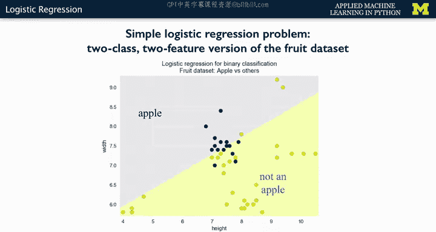

# 68：逻辑回归算法 🧮


在本节课中，我们将学习第二种监督学习方法——逻辑回归。尽管名称中包含“回归”，但它实际上是一种用于分类的算法。我们将从线性回归的基础开始，逐步理解逻辑回归的原理、它与线性回归的区别，以及如何在Python中应用它来解决分类问题。

---

## 从线性回归到逻辑回归

上一节我们介绍了线性回归。本节中我们来看看逻辑回归与它的联系和关键区别。

线性回归基于输入变量（特征）的加权和加上一个常数项来预测一个实数值输出 **Y**。

**公式**：
`Y = B + W₁X₁ + W₂X₂ + ... + WₙXₙ`

其中，`Xᵢ` 是输入特征，`Wᵢ` 是模型系数（权重），`B` 是截距项。线性回归的目标是找到最佳的 `Ŵᵢ` 和 `B̂`，使模型对训练数据的平方误差最小。

逻辑回归与线性回归相似，但有一个关键的增加步骤。

以下是逻辑回归模型的图示说明：


逻辑回归模型同样计算输入特征 `Xᵢ` 和截距项 `B` 的加权和。但它会将这个线性结果输入一个特殊的非线性函数——**逻辑函数**（或称Sigmoid函数）——以产生输出 `Ŷ`。

**公式**：
`Ŷ = f(B̂ + Σ ŴᵢXᵢ) = 1 / (1 + e^-(B̂ + Σ ŴᵢXᵢ))`

这里的 `f` 就是逻辑函数。它是一个S形曲线，当输入值远大于0时，输出趋近于1；当输入值远小于0时，输出趋近于0。其效果是将线性函数的输出压缩到0和1之间。

因为基本逻辑回归的任务是预测一个二元输出值，所以它可以用于二元分类。我们可以将目标值为0的数据实例视为**负类**，将目标值为1的数据实例视为**正类**。那么，逻辑回归公式的输出 `Ŷ` 就可以解释为：给定输入特征，该数据实例属于正类的**概率**。

---

## 逻辑回归示例：单特征分类

让我们通过一个具体例子来理解逻辑回归的应用。假设我们想根据学生为考试学习的**小时数**这一单一特征，来预测其是否能通过考试。

*   未通过考试的学生被归为**负类**（目标值=0）。
*   通过考试的学生被归为**正类**（目标值=1）。

下图展示了一个示例训练集：



X轴对应学习小时数，Y轴对应通过考试的概率。红色点（目标值0）代表未通过考试的学生及其学习时长；蓝色点（目标值1）代表通过考试的学生及其学习时长。

使用逻辑回归，我们可以估计出 `Ŵ` 和 `B̂` 系数，从而产生一条最能拟合这些训练点的逻辑曲线（如图中S形曲线）。一旦估计出模型系数，我们就有了一个公式，可以根据任何学生给定的学习小时数，来估计其通过考试的概率。

**分类规则**：如果学生通过考试的估计概率 `Ŷ` **大于或等于50%**，则预测其属于正类（通过），否则预测为负类（未通过）。在此例中，学习超过3小时的学生将被预测为通过。

---

## 逻辑回归示例：双特征与决策边界

现在，我们来看一个使用两个输入特征的例子。下图展示了一个包含两个类的训练集，每个数据点有两个特征：

*   **特征1** 对应X轴
*   **特征2** 对应Y轴

红色点（负类）在特征1值低、特征2值高的区域形成簇；蓝色点（正类）具有中等的特征1值和低的特征2值。

我们可以应用逻辑回归，使用与之前考试示例相同的思路来学习一个二元分类器。为此，我们添加第三个维度（垂直的Z轴），对应属于正类的概率。

我们估计出 `Ŵ` 和 `B̂` 参数，得到一个能最佳拟合此训练数据的逻辑函数。不同之处在于，现在的逻辑函数是两个输入特征的函数，因此它在这个空间中形成了一个类似三维的S形曲面。

一旦从训练数据中估计出这个逻辑函数，我们就可以用它来预测任何给定其特征1和特征2值的点的类别成员身份，方法与考试示例相同。

任何逻辑概率估计值 `Ŷ` 大于等于0.5的数据实例都被预测为属于正类（蓝色），否则属于负类（红色）。

如果我们想象一个代表 `y=0.5` 的平面与这个逻辑函数相交，你会发现所有 `y=0.5` 的点都落在一条**直线**上。换句话说，使用逻辑回归会在类别之间产生一个**线性决策边界**。

如果从上方向下俯视左侧的三维逻辑函数，你会得到类似右侧的视图。在逻辑函数上 `y≥0.5` 的点位于直线右侧区域（图中右侧虚线右侧），而 `y<0.5` 的点则位于该虚线左侧。

---

## 在Scikit-learn中应用逻辑回归

要在Scikit-learn中执行逻辑回归，你需要从 `sklearn.linear_model` 模块导入 `LogisticRegression` 类，然后创建对象并调用 `fit` 方法，就像处理K近邻等其他分类器一样。

**代码示例**：
```python
from sklearn.linear_model import LogisticRegression
logreg = LogisticRegression(C=100).fit(X_train, y_train)
```
此代码还将参数 `C` 设置为100，我们稍后会解释。

我们在此使用的数据是水果数据集的修改版，仅使用高度和宽度作为特征空间中的特征，并将目标类别值修改为一个二元分类问题：预测一个物体是**苹果**（正类）还是**非苹果**（负类）。

下图展示了结果：
*   X轴对应高度特征，Y轴对应宽度特征。
*   黑点代表正类（苹果）训练点。
*   黄点代表训练集中所有其他水果的实例。
*   灰色决策区域表示：根据逻辑回归函数，一个水果被估计为苹果的概率大于0.5，从而被分类为苹果的高度和宽度特征空间区域。
*   黄色决策区域对应被估计为苹果的概率小于0.5的物体的特征空间区域。

你可以看到应用逻辑回归产生的线性决策边界，即灰色区域与黄色区域相接的地方。实际上，逻辑回归的结果通常与线性支持向量机（我们将在分类中探讨的另一种线性模型）得到的结果非常相似。

---

## 逻辑回归中的正则化

与岭回归和Lasso回归类似，正则化惩罚也可以应用于逻辑回归的模型系数，并通过参数 `C` 进行控制。

事实上，用于岭回归的相同 **L2正则化惩罚** 默认在逻辑回归中是开启的，默认值 `C=1`。请注意，对于支持向量机和逻辑回归，**`C` 值越高对应正则化程度越轻**。


*   **`C` 值较大**：逻辑回归会尽可能好地拟合训练数据。
*   **`C` 值较小**：模型会更努力地寻找更接近0的模型系数，即使该模型对训练数据的拟合稍差一些。

在此可视化图中，你可以看到改变逻辑回归的正则化参数 `C` 的效果。我们使用相同的苹果分类器，让 `C` 值从左到右分别为0.1、1.0和100.0。

虽然正则化的真正威力在我们拥有更高维特征空间的数据时才会变得明显，但你可以从中了解到在依赖更简单模型（在此例中更强调两个特征中的一个）但训练集准确率较低（如左侧 `C=0.1` 的示例）与更好地拟合训练数据（如右侧 `C=100` 的示例）之间的权衡。

你可以在随附的笔记本中找到创建此示例的代码。

---

## 总结

本节课中我们一起学习了逻辑回归算法。我们了解到：

1.  **核心思想**：逻辑回归通过在线性回归的加权和输出上应用**逻辑函数**（Sigmoid函数），将连续值映射到(0,1)区间，从而输出属于某个类别的**概率**。
2.  **与线性回归的区别**：线性回归用于预测连续值，而逻辑回归用于**分类**（特别是二元分类，也可扩展至多类）。
3.  **决策边界**：逻辑回归产生一个**线性决策边界**，通过设定一个阈值（通常为0.5）将概率转换为类别预测。
4.  **在Scikit-learn中的实现**：使用 `LogisticRegression` 类，其用法与其他分类器一致。
5.  **正则化**：通过参数 `C` 控制L2正则化的强度，`C` 值越小，正则化越强，模型更简单，可能有助于防止过拟合。

最后，我们展示了默认开启L2正则化的逻辑回归如何应用于具有更多特征的乳腺癌真实数据集，并实现了96%的训练集和测试集准确率。逻辑回归因其简单、高效且可解释性强，成为分类任务中一个强大而实用的基础工具。