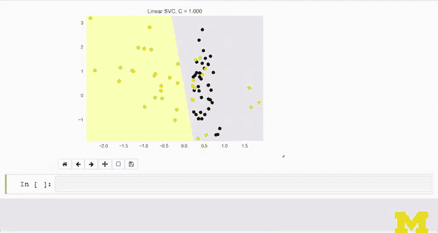

# 课程名称：Python用于数据科学实践（第14课）📊


## 概述：线性分类器与支持向量机

在本节课中，我们将要学习线性模型如何应用于分类任务，特别是支持向量机（SVM）的基本原理。我们将从最简单的二元分类问题开始，逐步理解线性分类器的决策规则、分类间隔的概念，以及如何通过调整参数来优化模型性能。

---

## 线性分类器基础

上一节我们介绍了线性模型在回归问题中的应用。本节中我们来看看线性模型如何用于分类任务，特别是二元分类。

线性分类器的预测方法使用了与回归相同的线性函数形式。但不同于预测连续的目标值，我们取线性函数的输出并应用符号函数（sine function），以产生一个二元输出。这个输出对应两个可能的类别标签。

如果目标值大于0，函数返回+1。如果目标值小于0，函数返回-1。

以下是线性分类器的工作原理：

*   **特征与权重**：每个数据实例由一组特征（如x1, x2）描述。分类器会为每个特征学习一个权重（如W1, W2）。
*   **线性组合**：分类器计算特征的加权和，即 `W1*x1 + W2*x2`，并加上一个偏置项 `B`。
*   **决策函数**：将上述线性组合的结果输入符号函数。若结果大于0，则预测为类别+1；若小于0，则预测为类别-1。

其核心公式可以表示为：
`F(x) = sign(W · x + B)`
其中，`W` 是权重向量，`x` 是特征向量，`B` 是偏置项，`·` 表示点积运算。

---

## 决策边界与分类示例

理解了基本公式后，我们通过一个具体例子来看看分类器如何进行决策。

假设我们有一个简单的二元分类问题，每个数据点由两个特征x1和x2描述。我们定义一条决策边界，其方程为 `x1 - x2 = 0`。这条线实际上就是所有满足 `x1 = x2` 的点构成的直线。

我们可以将这个方程改写为线性分类器的形式：
`决策值 = (1)*x1 + (-1)*x2 + 0`
这里，权重向量 `W = [1, -1]`，偏置 `B = 0`。

现在，让我们对两个点进行分类：

1.  **点A (-0.75, -2.25)**：
    *   计算决策值：`(1)*(-0.75) + (-1)*(-2.25) = 1.5`
    *   由于 `1.5 > 0`，符号函数输出 `+1`。因此，该点被分类为类别1。

2.  **点B (-1.75, -0.25)**：
    *   计算决策值：`(1)*(-1.75) + (-1)*(-0.25) = -1.5`
    *   由于 `-1.5 < 0`，符号函数输出 `-1`。因此，该点被分类为类别-1。

通过这个简单的线性公式，我们可以为特征空间中的任何点生成一个类别预测值。

---

## 分类间隔与最大间隔分类器

我们已经看到线性分类器如何划分数据。那么，如何评价一个分类器的好坏呢？一个核心思想是奖励那些能将两个类别最大程度分开的分类器。为此，我们需要引入**分类间隔**的概念。

简单来说，对于一个给定的分类器，其**间隔**是指决策边界可以向两侧移动（垂直于边界方向）而不碰到任何数据点的最大宽度。这个宽度由离决策边界最近的数据点决定。

在所有能够正确区分两个类别的可能分类器中，**最大间隔分类器**被认为是更优的，因为它对未知数据的泛化能力通常更强。这种寻找最大间隔分类器的算法，就称为**线性支持向量机**。

在Python的scikit-learn库中，我们可以方便地使用线性支持向量分类器。

```python
# 示例代码：使用scikit-learn的LinearSVC
from sklearn.svm import LinearSVC
# 初始化分类器
clf = LinearSVC()
# 使用训练数据拟合模型
clf.fit(X_train, y_train)
```

---

## 处理不可线性分离的数据与正则化参数C

在之前的理想例子中，两个类别可以被一条直线完美分开。但在实践中，数据通常存在噪声或更复杂的结构，使得完美的线性分离变得不可能。不过，线性分类器仍然能在容忍少量错误的情况下，有效分离大多数数据点。

支持向量机在“最大化分类间隔”和“最小化分类错误”之间的权衡，由一个名为 **`C`** 的正则化参数控制。

以下是参数 `C` 的影响：

*   **`C` 值较大**：表示正则化程度较弱。模型会尽可能减少训练集上的分类错误，即使这会导致分类间隔变小。模型更倾向于“拟合”训练数据。
*   **`C` 值较小**：表示正则化程度较强。模型会倾向于寻找一个具有更大分类间隔的决策边界，即使这意味着会错误分类更多的训练数据点。模型更注重“泛化”能力。

通过调整 `C` 值，我们可以在模型的复杂度和对训练数据的拟合程度之间取得平衡。

---

## 应用于真实数据集：乳腺癌分类

最后，让我们将线性支持向量机应用到一个真实世界的数据集上，例如乳腺癌分类问题。实践表明，即使没有进行复杂的参数调优，线性支持向量机也能在该数据集上取得相当不错的准确率。



这体现了线性模型在实践中的实用价值。

---

## 线性模型的优势与特点

在本节课中，我们一起学习了线性分类器，特别是支持向量机的工作原理。作为总结，我们来回顾一下线性模型的主要优势：

1.  **简单高效**：线性模型（包括线性回归、逻辑回归和线性SVM）原理简单，易于训练。
2.  **预测速度快**：由于其预测函数是线性的，进行预测时的计算速度非常快。
3.  **适用于高维数据**：线性模型，包括线性支持向量机，在高维数据集上表现有效，尤其当数据实例是稀疏的时候。
4.  **可扩展性强**：线性模型能够很好地扩展到非常大的数据集。
5.  **内存效率高（针对SVM）**：线性支持向量机在决策函数中只使用一部分训练点（称为**支持向量**），因此算法可以实现很高的内存效率。

---

## 总结

本节课中，我们深入探讨了如何将线性模型用于分类任务。我们从二元分类的基本概念出发，理解了线性分类器的决策规则，引入了分类间隔和最大间隔分类器（即支持向量机）的核心思想。我们还学习了如何通过正则化参数 `C` 来平衡模型的复杂度和拟合度，并了解了线性模型在处理真实数据时的优势和特点。这些知识为我们在数据科学实践中选择合适的分类算法奠定了坚实的基础。