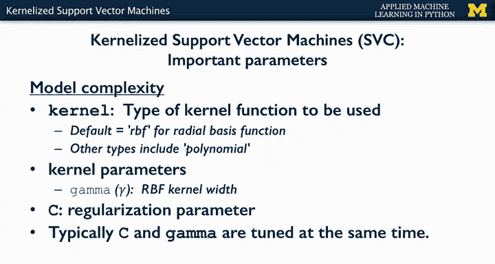

# 课程名称：密歇根大学《Python用于数据科学实践》第16课：核化支持向量机 🧠

在本节课中，我们将要学习一种强大的监督学习模型——核化支持向量机。我们将了解它如何通过将数据映射到高维空间来解决线性模型难以处理的复杂分类问题。

## 概述

上一节我们介绍了线性支持向量机，它通过寻找具有最大间隔的决策边界，在某些数据集上表现良好。线性支持向量机适用于类别线性可分或接近线性可分的简单分类问题，例如左侧的示例。

但在真实数据中，许多分类问题并非如此简单。不同类别在特征空间中的分布方式，使得一条直线或一个超平面无法成为有效的分类器。右侧的示例就是这种情况。对于线性模型（直线或超平面）来说，这个数据集很难或不可能进行良好分类。

因此，为了应对这种情况，我们现在将转向下一种监督学习模型——核化支持向量机。它是线性支持向量机的一个非常强大的扩展。

## 核化支持向量机的基本思想

核化支持向量机（简称SVM）可以提供超越线性决策边界的更复杂模型。与其他监督机器学习方法一样，SVM可用于分类和回归。但由于时间限制，本讲座将只关注分类。我们不会深入探讨SVM运作的数学细节，但会给出一个高层次的概述，希望能抓住该方法最重要的要素。

本质上，理解核化SVM的一种方式是：它接收原始的输入数据空间，并将其转换到一个新的、更高维的特征空间。在这个新空间中，使用线性分类器对转换后的数据进行分类变得容易得多。

以下是一个简单的一维示例来说明这个想法。这是一个二元分类问题，在一维空间中，一组点沿着X轴分布，黑色代表一个类别，白色代表第二个类别。这里的每个数据点只有一个特征，即它在X轴上的位置。如果我们把这个任务交给线性支持向量机，它会毫无困难地找到在不同类别点之间提供最大间隔的决策边界。这里我特意设计了数据点，使得最大间隔决策边界恰好位于x=0处。

现在，假设我们给线性支持向量机一个更困难的问题，其中类别不再是线性可分的。一个简单的线性决策边界没有足够的表达能力来正确分类所有这些点。那么我们能做什么呢？一个非常强大的想法是将输入数据从一维空间转换到二维空间。

例如，我们可以通过将每个一维输入数据实例 `X_i` 映射到一个对应的二维有序对 `(X_i, X_i^2)` 来实现这一点，其第二个新特征是第一个特征的平方值。从某种意义上说，我们并没有增加任何新信息，因为获得这个新的二维版本所需的一切都已经存在于原始的一维数据点中。这可能会让你想起我们在课程早期为线性回归问题添加多项式特征时看到的类似技巧。

我们现在可以在这个新的二维特征空间中学习一个线性支持向量机，其最大间隔和决策边界可能如下图所示，以正确分类这些点。对于任何我们想要预测类别的一维新数据点，我们只需创建其二维转换版本，并使用这个二维线性SVM来预测该二维点的类别。

如果我们应用我们刚才所做变换的逆变换，将数据点带回原始输入空间，我们可以看到二维空间中的线性决策边界对应于抛物线穿过X轴的两个点。

## 从一维到二维问题的扩展

为了让这个非常重要的概念更清晰，让我们从一个一维问题转向一个二维分类问题，并在此处看到同样的强大思想在起作用。

这里我们有两个类别，由黑色和白色的点表示。每个点都有两个特征：`x0` 和 `x1`。两个类别的点都散布在二维平面中的原点 `(0, 0)` 周围。白点形成一个紧挨着 `(0, 0)` 的簇，完全被黑点包围。同样，这对于线性分类器（在二维空间中是一条直线）来说，似乎不可能以任何程度的准确性将白点与黑点分开。

但正如我们在二维情况下所做的那样，我们可以通过添加第三个特征将每个二维点 `(x0, x1)` 映射到一个新的三维点。数学上，第三个特征是 `1 - (x0^2 + x1^2)`。这个变换将点塑造成一个围绕 `(0, 0)` 的抛物面。现在，白点由于靠近 `(0, 0)`，被映射到具有较高垂直Z值（即接近1的新第三特征）的点。而黑点距离 `(0, 0)` 较远，被映射到Z值接近0甚至为负的点。

通过这种变换，就有可能找到一个超平面（例如 `Z = 0.9`），现在可以轻松地将靠近 `Z = 1` 的白色数据点与大部分或全部黑色数据点分开。最终，决策边界由三维空间中抛物面与最大间隔超平面决策边界相交的点集组成。这对应于原始输入空间中一个类似椭圆的决策边界，将白点与黑点分开。

## 核函数与核技巧

将输入数据点转换到一个可以轻松应用线性分类器的新特征空间的想法，是一个非常通用且强大的想法。我们可以对数据应用许多不同的变换，而核化SVM可用的不同核就对应着不同的变换。

在这里，我们将主要关注所谓的径向基函数核（缩写为RBF），并简要了解一下Scikit-Learn的SVM模块中也包含的多项式核。

SVM中的核函数告诉我们，给定原始输入空间中的两个点，它们在新特征空间中的相似度是多少。对于径向基函数核，两个点在转换后特征空间中的相似度是原始输入空间中向量之间距离的指数衰减函数，如下面的公式所示。

**径向基函数核公式：**
`K(x, x') = exp(-γ * ||x - x'||^2)`

那么径向基函数特征变换看起来像什么呢？下面的图表应该能给出一个直观的概念。这是另一个二元分类问题的图形说明。同样，此图仅用于说明目的，只是一个近似表示，但本质上，你可以用类似于我们之前看到的2D到3D示例的方式来思考它。

在左侧，输入空间中有一组样本，圆圈代表一个类别的训练点，方块代表第二个类别的训练点。在右侧，使用径向基函数核将相同的样本显示在转换后的特征空间中。实际上，该核将圆圈类一定距离内的所有点转换到特征空间的一个区域，而将方块类一定半径外的所有点移动到特征空间的另一个区域。深色圆圈和方块可能代表转换后特征空间中支持向量机最大间隔上的点，并且它还显示了原始输入空间中对应的点。

因此，正如我们之前在简单的1D和2D示例中看到的那样，核化支持向量机试图在转换后的特征空间（而非原始输入空间）中使用线性分类器来寻找类别间具有最大间隔的决策边界。线性SVM在特征空间中学习到的线性决策边界，对应于原始输入空间中的非线性决策边界。在这个例子中，就是输入空间中一个类似椭圆的闭合区域。

## 核技巧的优势

核化支持向量机在数学上值得注意的一点（被称为核技巧）是，在内部，算法不必对数据点执行到新的高维特征空间的这种实际变换。相反，核化SVM可以仅根据高维空间中点对之间的相似度计算来计算出这些更复杂的决策边界，而变换后的特征表示是隐式的。这种相似度函数（在数学上是一种点积）就是核化SVM中的“核”。对于某些类型的高维空间，点之间的相似度计算（即核函数）可以具有简单的形式，就像我们在径向基函数计算中看到的那样。这使得在底层变换特征空间复杂甚至是无限维时，应用支持向量机变得可行。

更好的是，我们可以轻松地插入各种不同的核，选择一个适合我们数据特性的核。同样，不同的核选择对应于到那个高维特征空间的不同类型的变换。

## 应用示例与参数

以下是在我们之前看到的那个更复杂的二元分类问题上使用带有RBF核的支持向量机的结果。你可以看到，与线性分类器不同，带有RBF核的SVM找到了一组更复杂且非常有效的决策边界，非常擅长将一个类别与另一个类别分开。请注意，SVM分类器仍然使用最大间隔原则来寻找这些决策边界，但由于数据的非线性变换，这些边界在原始输入空间中可能不再总是与间隔边缘点等距。

现在让我们看一个在Python中使用Scikit-learn实现此功能的示例。要使用SVM，我们只需从 `sklearn.svm` 导入 `SVC` 类，并像使用其他分类器一样使用它，例如，通过调用带有训练数据的 `fit` 方法来训练模型。

`SVC` 对象有一个名为 `kernel` 的参数，允许我们设置SVM使用的核函数。默认情况下，SVM将使用径向基函数核。但也支持许多其他选择。在第二个示例和绘图中，我们展示了使用多项式核而不是RBF核。使用 `kernel='poly'` 设置的多项式核，本质上代表了一种类似于之前二次方示例的特征变换。在讲座中，这个特征空间用原始输入特征的多项式组合来表示，正如我们在线性回归中也看到的那样。多项式核接受一个额外的参数 `degree`，用于控制模型复杂度和此变换的计算成本。

你可能已经注意到RBF核有一个参数 `gamma`。`gamma` 控制单个训练样本的影响范围，进而影响决策边界最终在输入空间中围绕点的紧密程度。较小的 `gamma` 意味着较大的相似度半径，因此距离较远的点也被认为是相似的，这导致更多的点被分组在一起，决策边界更平滑。另一方面，对于较大的 `gamma` 值，核值衰减得更快，点必须非常接近才能被认为是相似的。这导致更复杂、约束更紧的决策边界。你可以在笔记本示例中看到增加 `gamma`（即锐化核）的效果。较小的 `gamma` 值给出更宽、更平滑的决策区域，而较大的 `gamma` 值给出更小、更复杂的决策区域。你可以在创建 `SVC` 对象时设置 `gamma` 参数以这种方式控制核宽度，如代码所示。

你可能还记得线性SVM，SVM还有一个正则化参数 `C`，用于控制在满足最大间隔准则以找到简单决策边界与避免训练集上的错误分类之间进行权衡。`C` 参数对于核化SVM也很重要，并且它与 `gamma` 参数相互作用。笔记本中的这个示例显示了同时改变 `C` 和 `gamma` 的效果。如果 `gamma` 很大，那么 `C` 几乎没有影响。而如果 `gamma` 很小，模型受到的约束就大得多，`C` 的效果将类似于它如何影响线性分类器。通常，`gamma` 和 `C` 是一起调整的，最优组合通常在中间值范围内，例如，`gamma` 在0.0001到10之间，`C` 在0.1到100之间，尽管具体的最优值将取决于你的应用。核化SVM对 `gamma` 的设置相当敏感。

## 数据标准化的重要性

应用SVM时最重要的一点是，必须对输入数据进行标准化，使所有特征具有可比较的单位并处于相同的尺度上。我们之前在其他学习方法（如正则化回归）中也看到过这一点。

让我们将带有RBF核的支持向量机应用于一个真实世界的数据集，看看为什么这种标准化很重要。这里我们将把带有RBF核的支持向量机应用于乳腺癌数据集。请注意，我们没有以任何方式处理输入数据，只是传入原始值。我们可以看到结果：训练集准确率为1.00，测试集准确率为0.63，这表明支持向量机在训练数据上过拟合，在测试数据上表现很差。

现在让我们对训练数据添加一个 `MinMaxScaler` 变换，记住也要对测试数据应用相同的缩放器。应用此缩放器后，所有输入特征现在都位于相同的范围 `[0, 1]` 内。看看这些新结果，测试集准确率要高得多，达到了96%。这说明了标准化训练数据特征对SVM性能的巨大影响。

## 支持向量机的优缺点

让我们回顾一下支持向量机的优缺点。

**优点：**
以下是支持向量机的一些主要优势：
*   支持向量机在一系列数据集上表现良好，已成功应用于从文本到图像等多种类型的数据。
*   支持向量机由于能够指定不同的核函数（包括可能根据数据定制的核函数）而具有潜在的多样性。
*   支持向量机通常对低维和高维数据都有效，包括具有数百、数千甚至数百万稀疏维度的数据。这使其非常适合文本分类等任务。

**缺点：**
以下是支持向量机的一些主要缺点：
*   随着训练集规模的增加，SVM训练阶段的运行速度和内存使用量也会增加。因此，对于具有数十万或数百万实例的大型数据集，SVM可能变得不太实用。
*   正如我们在将支持向量机应用于真实世界数据集时所看到的，使用SVM需要仔细地对输入数据进行标准化以及参数调优。如果特征尚未处于相似尺度，则应进行标准化，使所有特征具有可比较的单位。
*   支持向量机不直接提供预测的概率估计，而某些应用需要这些概率。现在有一些方法可以使用诸如Platt缩放等技术来估计这些概率，该方法通过将逻辑回归模型拟合到分类器分数，将分类器的输出转换为类别上的概率分布。
*   最后，解释支持向量机的内部模型参数可能很困难。这意味着在解释对人类很重要的场景中，支持向量机的适用性可能有限，例如当我们想理解为什么做出特定预测时。

## 关键参数总结

作为提醒，控制核化SVM模型复杂度的主要有三个参数。

以下是需要调整的主要参数：
1.  **核类型**：默认为径向基函数（RBF），但Scikit-Learn的SVC模块中还提供了其他几种常见类型。
2.  **核特定参数**：每个核都有一个或多个核特定参数，用于控制诸如训练点根据其距离的影响等方面。对于RBF核，SVM性能对控制核宽度的 `gamma` 参数设置非常敏感。
3.  **正则化参数 C**：对于任何支持向量机，`C` 正则化参数都起作用，正如我们之前讨论的那样。它通常与核参数（如 `gamma`）一起调整以获得最佳性能。

## 总结

在本节课中，我们一起学习了核化支持向量机。我们了解了它如何通过核技巧将数据映射到高维空间，从而解决线性不可分的复杂分类问题。我们探讨了径向基函数核和多项式核的基本原理，并通过示例看到了参数 `gamma` 和 `C` 对模型的影响。最重要的是，我们认识到数据标准化对于SVM性能至关重要。最后，我们总结了SVM的优势、局限性和关键调优参数，为在实际数据科学项目中应用这一强大工具奠定了基础。