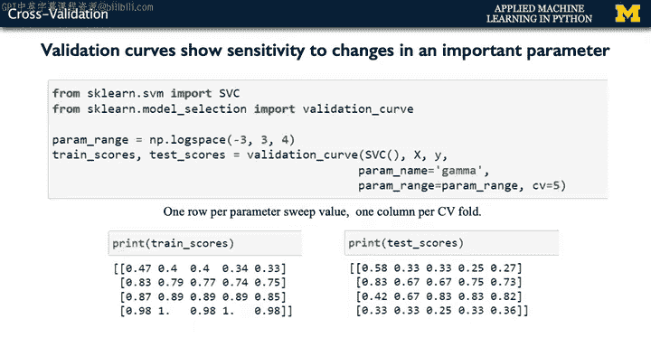

# 课程名称：Python用于数据科学实践（第3课）｜ 第17讲：交叉验证技术 🧪

在本节课中，我们将要学习一种重要的模型评估方法——交叉验证。我们将了解为什么单一的“训练-测试”数据划分可能不够可靠，以及如何使用交叉验证来获得更稳定、更全面的模型性能评估。

## 概述

到目前为止，我们已经学习了许多监督学习方法。在应用这些方法时，我们遵循了一系列一致的步骤。首先，使用 `train_test_split` 函数将数据集划分为训练集和测试集。然后，在训练集上调用 `fit` 方法来估计模型。最后，使用 `predict` 方法为新数据实例估计目标值，或使用 `score` 方法在测试集上评估训练后模型的性能。

我们记得，将原始数据划分为训练集和测试集的原因，是为了使用测试集来估计在训练数据上训练的模型对新的、未见过的数据的泛化能力。测试集代表了在训练期间未见过，但与原始数据集具有相同一般属性的数据。或者用更专业的语言来说，它与训练集来自相同的基础分布。

## 交叉验证的基本原理

上一节我们回顾了传统的单一“训练-测试”划分方法，本节中我们来看看交叉验证如何改进这一过程。

交叉验证是一种超越使用单一“训练-测试”划分来评估单个模型的方法，它使用多个“训练-测试”划分，每个划分都用于训练和评估一个独立的模型。

那么，为什么这比我们原始的单一“训练-测试”划分方法更好呢？你可能已经注意到，例如，在处理某些示例或作业时，通过为 `train_test_split` 函数中的 `random_state` 种子参数选择不同的值，仅仅由于偶然性，运行分类器得到的准确率分数可能会有很大差异，这取决于最终进入训练集的具体样本。

交叉验证通过运行多个不同的“训练-测试”划分，然后对结果取平均值，而不是完全依赖于一个特定的训练集，从而基本提供了关于分类器平均表现如何的更稳定和可靠的估计。

## 交叉验证的实践应用

理解交叉验证在实践中如何使用非常重要。你需要交叉验证的主要场景是，当你有一个特定的分类任务，并且想要比较一种模型（例如支持向量机）与另一种模型（例如朴素贝叶斯）的准确率时。

在这种情况下，为了做好比较，你不应仅仅依赖于单一“训练-测试”划分的准确率数字。因为可能仅仅是偶然，使用那个特定的“训练-测试”划分时，朴素贝叶斯模型碰巧表现得更好，而实际上，它在总体上可能更差。因此，你应该使用交叉验证来创建多个“训练-测试”划分，从而以更可靠的方式比较这两种方法。然后计算这些“折”上的整体平均评估指标。

例如，如果你使用十折交叉验证，这将使用10个不同的“训练-测试”划分来评估这两种方法，而不是单一的划分。与仅依赖单一“训练-测试”划分相比，这将为你提供每个模型可能表现如何的更稳定估计。

一旦你最终决定了使用哪种建模方法，并且没有更多的调整需要做，那么你就可以使用你拥有的所有数据来训练一个最终的生产分类器。

## 交叉验证与模型构建

这里一个可能有点令人困惑的点是，如何使用应用交叉验证产生的多个模型。例如，10折交叉验证将产生10个训练好的模型，每个模型都有自己的一组估计系数。

当你应用交叉验证时，你只是为这10个模型中的每一个计算一个评估指标（如准确率），然后取这10个评估数字的平均值。仅此而已。通过交叉验证，你并不是通过某种方式将这10个模型合并在一起来产生一个新的混合模型。

现在有一些特殊场景可以这样做，那是一个独立的主题，称为模型平均，但我们在这里不会深入探讨。

底线是，如果你想比较两种不同的模型类型，请使用K折交叉验证，并且在计算评估数字时不要仅仅依赖单一的“训练-测试”划分。

## 模型评估与模型调优的区别

同样重要的是，要理解使用交叉验证进行模型评估与使用它进行模型调优之间的区别。

如果你的任务是评估和比较已经单独调优和优化的不同模型类型，你可以使用带有“训练-测试”划分的K折交叉验证。

但是，如果你的任务是调优单个模型，例如当你想为支持向量机找到最佳超参数时，这使用了一个稍微不同的设置。在这个设置中，我们不是仅仅进行“训练-测试”划分，而是将数据分成三个部分，称为训练集、验证集和测试集。

我们将在“模型选择与优化分类器”讲座中介绍如何使用“训练-验证-测试”划分。

## K折交叉验证的工作原理

以下是交叉验证如何在数据上运行的图形说明。

最常见的交叉验证类型是K折交叉验证，最常见的是K设置为5或10。例如，要进行五折交叉验证，原始数据集被划分为五个大小相等或接近相等的部分。这些部分中的每一个都称为一个“折”。

然后训练一系列五个模型，每个“折”对应一个。第一个模型（模型1）使用第2到第5折作为训练集进行训练，并使用第1折作为测试集进行评估。第二个模型（模型2）使用第1、3、4、5折作为训练集进行训练，并使用第2折作为测试集进行评估，依此类推。

当这个过程完成后，我们有五个准确率值，每个“折”一个。

## 在Scikit-learn中实现交叉验证

在Scikit-learn中，你可以使用 `model_selection` 模块中的 `cross_val_score` 函数来进行交叉验证。

参数首先是你要评估的模型，然后是数据集，接着是对应的真实目标标签或值。默认情况下，`cross_val_score` 进行五折交叉验证，因此它返回五个准确率分数，每个“折”一个。如果你想改变“折”的数量，可以设置 `cv` 参数。例如，`cv=10` 将执行十折交叉验证。

通常的做法是计算所有“折”上准确率分数的平均值，并报告平均交叉验证分数，作为我们预期模型平均准确程度的衡量标准。

## 交叉验证的优势与成本

在多个划分上计算模型准确率的一个好处是，与单一划分相比，它为我们提供了关于模型对特定训练集性质的敏感性的潜在有用信息。因此，我们可以查看所有这些交叉验证“折”上多个分数的分布，以了解模型偶然在任何新数据集上表现非常差或非常好的可能性有多大。这样，我们可以从这些多个分数中做出某种最坏情况或最佳情况的性能估计。

这些额外信息确实伴随着额外的成本。进行交叉验证确实需要更多的时间和计算。例如，如果我们执行K折交叉验证，并且不并行计算“折”的结果，那么获得准确率分数所需的时间大约是单一“训练-测试”划分的K倍。然而，我们对模型在未来数据上可能表现如何的了解的增加，通常非常值得这个成本。

## 分层K折交叉验证

在默认的交叉验证设置中，例如使用5折，前20%的记录用作第一折，接下来的20%用于第二折，依此类推。这样做的一个问题是，数据可能以某种方式创建，使得记录被排序，或者至少在类别标签的顺序上显示出一些偏差。

例如，如果你查看我们的水果数据集，数据文件中恰好所有类别1和2（苹果和橘子）的标签都在类别3和4之前。因此，如果我们简单地将前20%的记录作为第一折（将用作评估模型1的测试集），它将仅在类别1和2的示例上评估分类器，而完全不在其他类别3和4上评估，这将大大降低评估的信息量。

因此，当你要求Scikit-learn为分类任务进行交叉验证时，它实际上做的是所谓的**分层K折交叉验证**。

分层交叉验证意味着在分割数据时，每个“折”中的类别比例尽可能接近整个数据集中类别的实际比例，如图所示。对于回归问题，Scikit-learn使用常规的K折交叉验证，因为保留类别比例的概念对于日常回归问题来说并不真正相关。

## 留一法交叉验证

在一个极端情况下，我们可以做一种叫做**留一法交叉验证**的事情，这其实就是将K设置为数据集中数据样本数量的K折交叉验证。换句话说，每个“折”由一个样本作为测试集，其余数据作为训练集。

当然，这使用了更多的计算，但特别是对于小数据集，它可以提供改进的估计，因为它为模型提供了最大可能数量的训练数据，当训练集很小时，这可能有助于模型的性能。

## 验证曲线

有时我们想评估模型的一个重要参数对交叉验证分数的影响。非常有用的函数 `validation_curve` 使得运行这种类型的实验变得容易。

与 `cross_val_score` 类似，`validation_curve` 默认会进行五折交叉验证，但你也可以通过 `cv` 参数进行调整。与 `cross_val_score` 不同的是，你还可以指定一个分类器参数名称和一组你想要扫描的参数值。

所以你首先传入估计器对象（即要使用的分类器或回归对象），接着是数据集样本 `X` 和目标值 `Y`，然后是你想要扫描的参数名称，以及该参数在扫描过程中应取值的参数值数组。

`validation_curve` 将返回两个二维数组，分别对应于在训练集和测试集上的评估。每个数组对于扫描中的每个参数值都有一行，列数是使用的交叉验证“折”的数量。

例如，这里显示的代码将使用径向基函数支持向量机，在对应于四个不同指定的核 `gamma` 参数值的数据子集上拟合四个模型。这将返回两个4x5的数组（四个gamma级别和五个交叉验证“折”），包含训练集和测试集的分数。

你可以绘制来自 `validation_curve` 的这些结果，如图所示，以了解模型性能对给定参数变化的敏感程度。X轴对应于参数值，Y轴给出评估分数（例如分类器的准确率）。

## 总结

本节课中我们一起学习了交叉验证技术。最后，作为一个提醒，交叉验证用于评估模型，而不是学习或调优一个新模型。要进行模型调优，我们将在后续讲座中学习如何使用称为网格搜索的方法来调整模型的参数。