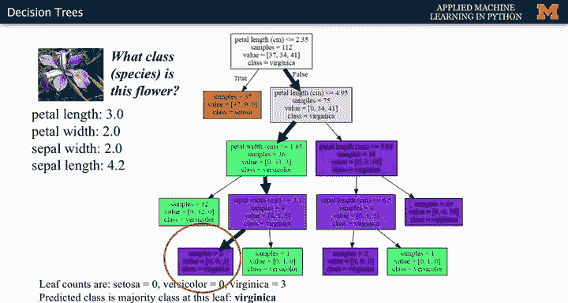
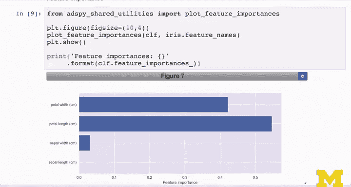
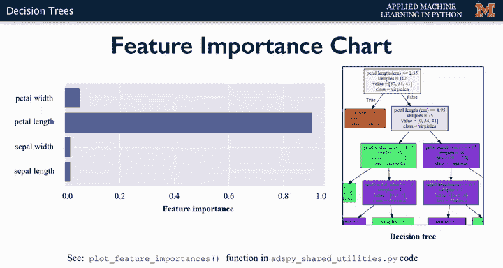
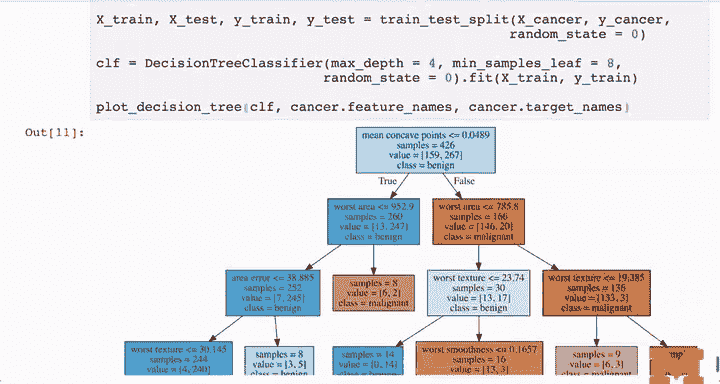
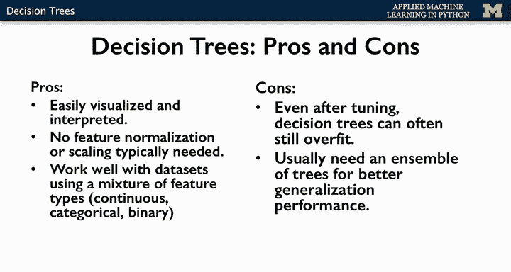

# 73：决策树算法 🌳


在本节课中，我们将要学习决策树算法。这是一种流行的监督学习方法，可用于分类和回归任务。我们将了解其工作原理、如何构建、如何防止过拟合，以及如何解释和可视化决策树模型。

---

## 概述

决策树是一种通过一系列“如果-那么”规则来预测目标值的监督学习方法。它易于理解和使用，常被用于探索性数据分析，以识别数据集中有影响力的特征。

---

## 决策树的基本概念

上一节我们介绍了决策树是一种监督学习方法。本节中我们来看看它的核心思想。

决策树通过学习特征值上的一系列明确的“如果-那么”规则来预测目标值。这类似于一个猜谜游戏：通过提出一系列“是/否”问题，逐步缩小范围，最终确定答案。

以下是决策树构建过程中的核心概念：

*   **节点**：代表一个决策问题（例如，“花瓣长度 > 2.35 厘米吗？”）。
*   **分支**：代表问题的答案（“是”或“否”），连接节点到下一层。
*   **叶节点**：位于树的底部，代表最终的预测结果（例如，花的种类）。
*   **分裂点**：用于划分数据的特征阈值（例如，`花瓣宽度 > 1.2` 中的 `1.2`）。
*   **信息增益**：衡量一次数据分裂效果的数学标准。**信息增益高**的分裂能很好地将一个类别与其他类别分开。

---

## 使用Iris数据集构建决策树

为了理解决策树如何工作，我们使用一个经典数据集：Iris（鸢尾花）数据集。该数据集包含三种鸢尾花的测量数据，我们的任务是基于花的尺寸预测其种类。

以下是Iris数据集的关键信息：

*   **特征**：花萼长度、花萼宽度、花瓣长度、花瓣宽度（均为连续值）。
*   **目标类别**：Setosa, Versicolor, Virginica。
*   **样本数量**：150朵花，每类50朵。

构建决策树的目标是：**找到能以最少的步骤、最高准确率分类数据的提问序列**。算法从寻找能带来最大信息增益的特征和分裂点开始，然后递归地对子集重复此过程，直到叶节点“纯净”（即节点内所有样本属于同一类）或满足停止条件。

对于一个新样本，我们只需从根节点开始，根据其特征值回答问题，沿着分支向下走，直到到达一个叶节点。该叶节点中多数样本的类别就是预测结果。

例如，对于一朵花：
```python
花瓣长度 = 3厘米， 花瓣宽度 = 2厘米， 花萼宽度 = 2厘米
```
根据决策树规则，它最终会到达一个所有样本都是Virginica的叶节点，因此预测为Virginica。

---

## 在Scikit-learn中使用决策树

在Scikit-learn中，我们可以轻松地构建决策树模型。

以下是使用决策树分类器的基本代码步骤：

```python
# 导入必要的库和模块
from sklearn.datasets import load_iris
from sklearn.model_selection import train_test_split
from sklearn.tree import DecisionTreeClassifier

# 加载数据并划分训练集和测试集
iris = load_iris()
X_train, X_test, y_train, y_test = train_test_split(iris.data, iris.target, random_state=0)

# 创建决策树分类器对象并拟合训练数据
clf = DecisionTreeClassifier()
clf.fit(X_train, y_train)

# 评估模型在训练集和测试集上的准确率
print("训练集准确率: {:.2f}".format(clf.score(X_train, y_train)))
print("测试集准确率: {:.2f}".format(clf.score(X_test, y_test)))
```
运行上述代码，你可能会发现训练集准确率是1.0（完美），而测试集准确率稍低。这表明模型可能**过拟合**了训练数据。



---

## 防止过拟合：剪枝

决策树容易生成复杂、过拟合的模型。为了防止过拟合，我们需要控制树的复杂度，这个过程称为**剪枝**。

Scikit-learn的决策树主要支持**预剪枝**，即在树完全生长之前就停止其生长。我们可以通过以下关键参数来控制：

*   **`max_depth`**：树的最大深度。限制分裂次数，是最常用的控制复杂度的参数。
*   **`min_samples_leaf`**：一个叶节点所需的最小样本数。避免基于极少数样本做出决策。
*   **`max_leaf_nodes`**：叶节点的最大数量。间接控制树的整体大小。

例如，设置 `max_depth=3` 可以简化模型：
```python
clf_pruned = DecisionTreeClassifier(max_depth=3)
clf_pruned.fit(X_train, y_train)
# 此时训练集准确率可能略有下降，但测试集准确率可能提升，泛化能力更好。
```

---

## 解释与可视化决策树

决策树的一大优势是易于解释。我们可以将整个树可视化，清晰地看到决策路径。

以下是一个可视化决策树的示例（假设有辅助函数 `plot_decision_tree`）：
```python
# 假设存在一个可视化函数
plot_decision_tree(clf, iris.feature_names, iris.target_names)
```
生成的树形图中：
*   每个节点第一行显示决策规则。
*   第二行显示到达该节点的样本总数。
*   第三行显示这些样本的类别分布。
*   第四行显示该节点的多数类。

通过观察节点大小（样本数），我们可以了解大多数数据遵循的决策路径。颜色深浅通常表示该节点中多数类的纯度。

---

## 特征重要性分析

除了可视化整棵树，另一种强大的分析工具是计算**特征重要性**。它量化了每个特征对模型整体预测准确率的贡献程度，是一个介于0到1之间的值，所有特征的重要性之和为1。

在Scikit-learn中，训练好的决策树模型有一个 `feature_importances_` 属性来存储这些值。

以下是获取和可视化特征重要性的方法：
```python
import matplotlib.pyplot as plt
import numpy as np

# 获取特征重要性
importances = clf.feature_importances_
indices = np.argsort(importances)

# 绘制水平条形图
plt.figure()
plt.title("特征重要性")
plt.barh(range(X_train.shape[1]), importances[indices])
plt.yticks(range(X_train.shape[1]), [iris.feature_names[i] for i in indices])
plt.xlabel("相对重要性")
plt.show()
```
对于Iris数据集，你可能会发现“花瓣长度”具有最高的特征重要性，这与它在决策树顶部作为首要分裂特征的地位相符。

**需要注意的是**：特征重要性低并不绝对意味着该特征与预测无关。它可能只是与另一个高重要性特征高度相关，因此未在早期被选中。

---



## 应用于乳腺癌数据集

让我们将决策树应用于之前使用过的乳腺癌数据集，并观察特征重要性。

以下是应用于乳腺癌数据集的示例代码框架：
```python
from sklearn.datasets import load_breast_cancer
from sklearn.tree import DecisionTreeClassifier



cancer = load_breast_cancer()
X_train, X_test, y_train, y_test = train_test_split(cancer.data, cancer.target, random_state=0)

# 使用预剪枝参数控制复杂度
clf_cancer = DecisionTreeClassifier(max_depth=4, min_samples_leaf=8, random_state=0)
clf_cancer.fit(X_train, y_train)

# 评估并可视化特征重要性
print("测试集准确率: {:.2f}".format(clf_cancer.score(X_test, y_test)))
# ... (绘制特征重要性图)
```
对于该数据集，“平均凹点”和“最差面积”等特征可能显示出较高的重要性。作为练习，你可以尝试移除 `max_depth` 和 `min_samples_leaf` 参数，使用默认设置，观察测试集准确率的变化以及过拟合的加剧情况。

---

## 决策树的优缺点



### 优点 ✅
*   **易于理解和解释**：规则清晰，可视化直观，适合向非专业人士解释。
*   **无需特征预处理**：由于基于特征阈值做决策，对特征的尺度不敏感，可以处理混合类型（连续、分类）和不同尺度的特征。
*   **可用于分类和回归**：通过改变叶节点的预测值（多数类或平均值）即可。

### 缺点 ❌
*   **容易过拟合**：即使进行剪枝，单个决策树仍可能过度记忆训练数据的细节，导致泛化性能不佳。
*   **不稳定**：训练数据的微小变化可能导致生成完全不同的树。
*   **可能不是最优**：其性能有时不如其他更复杂的集成模型。



为了克服过拟合问题，通常的做法是构建**决策树集成**（如随机森林、梯度提升树），这将在后续课程中介绍。

---

## 总结

本节课中我们一起学习了决策树算法。我们了解到：

1.  决策树通过一系列“如果-那么”规则进行预测，核心在于寻找信息增益最大的分裂点。
2.  在Scikit-learn中，可以使用 `DecisionTreeClassifier` 轻松构建模型。
3.  决策树容易过拟合，必须通过**剪枝**（如设置 `max_depth`, `min_samples_leaf`）来控制模型复杂度。
4.  决策树的**可解释性极强**，可以通过可视化树形图或分析**特征重要性**来理解模型如何做出决策。
5.  决策树对数据预处理要求低，但单个树容易过拟合，常作为集成方法的基础组件。


通过调整关键参数并利用可视化工具，决策树成为了解数据特征和建立初始预测模型的强大工具。