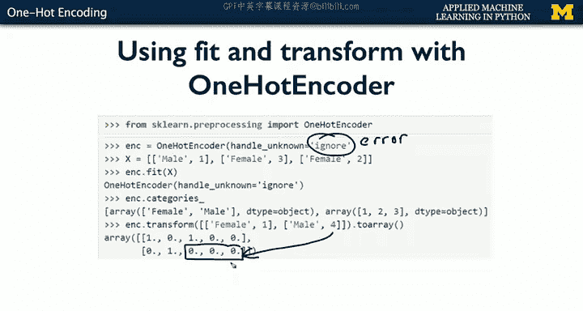

# 74：19_独热编码（选修）📊


在本节课中，我们将要学习如何处理机器学习中的分类特征或分类标签。许多入门级的机器学习示例都假设所有特征都是数值型的，但在实际应用中，我们经常会遇到分类特征，或者数值与分类特征混合的情况。本节视频将讨论如何处理这种特定情况。

## 处理分类变量

上一节我们介绍了分类变量的概念，本节中我们来看看一个具体的例子。假设我们正在处理一个数据集，其中有一个“颜色”特征，颜色可以是红色、黄色、绿色等若干可能值中的一个。这是一个典型的分类变量，它属于一组可能值中的一个，而不是一个数值。

许多预测模型无法直接处理这种分类输入。例如，线性回归、逻辑回归或支持向量机无法直接使用包含“红”、“黄”、“绿”值的颜色特征。虽然像决策树这类方法可以直接处理分类变量，但当你使用的预测方法无法直接处理它们时，你就需要找到解决方案。

需要注意的是，有些分类数据可能被编码为数字（例如，红色=1，黄色=2）。因此，即使数据中的某一列看起来是数值特征，它实际上也可能是用数字编码的分类特征。

## 独热编码解决方案

一种广泛使用的处理分类变量的解决方案叫做**独热编码**。它的作用是将单个分类值转换为一个二进制值向量。

以下是独热编码的工作原理：
1.  查看你的分类特征。
2.  列出该特征所有可能取值的列表。在这个例子中，我们假设只有三种可能的颜色值：红、黄、绿。
3.  为了得到“红色”的独热编码，我们遍历所有可能的类别，在代表“红色”的列中存储1，在所有其他类别列中存储0。

之所以称为“独热编码”，是因为在生成的向量中，恰好有一列是1（代表被选中的类别），其余列都是0。

让我们看另一个例子。假设我们要为第四行编码“绿色”这个值。在独热编码版本中，红色列对应0，黄色列对应0，绿色列对应1。这是一个非常简单的概念，在统计学中也被称为虚拟编码、K之一编码或指示变量。

这样，你就将分类值转换成了类似线性回归这样的模型可以处理的01值向量。

## 在Python中实现独热编码

在Python中，无论是使用Pandas还是Scikit-learn，将分类值转换为独热编码都非常容易。

### 使用Pandas

在Pandas中，有一个名为 `get_dummies` 的函数。这个名称源于统计学中将独热编码称为虚拟变量。`get_dummies` 可以将分类变量转换为虚拟指示变量。

以下是一个示例代码：
```python
import pandas as pd

# 创建一个包含分类值的列表
data = [‘A‘, ‘B‘, ‘C‘, ‘A‘]
df = pd.DataFrame(data, columns=[‘Category‘])

# 使用get_dummies进行独热编码
one_hot_encoded_df = pd.get_dummies(df[‘Category‘])
print(one_hot_encoded_df)
```
在这个例子中，Pandas首先会遍历并列出所有可能的值（A, B, C）。然后，对于每个条目，它会标记对应的列。例如，条目‘A’会使A列等于1，其余列设为0，依此类推。在Pandas中实现起来超级简单。

### 使用Scikit-learn

在Scikit-learn中实现同样简单，但需要考虑两种情况。

**第一种情况：分类变量是特征**
也就是说，它位于特征矩阵X中。在这种情况下，你需要使用 `sklearn.preprocessing.OneHotEncoder` 来为该特征的每一行创建独热编码向量。

以下是操作步骤：
1.  使用 `fit` 方法：分析数据，找出该特征列中所有唯一的值。
2.  一旦独热编码器被拟合，并找到了该特征列中所有可能的唯一值，你就可以调用 `transform` 方法来实际创建该特征列的独热编码向量。

默认情况下，这些独热编码向量是稀疏的，即该方法默认产生一个稀疏矩阵。如果需要，你可以通过设置 `sparse=False` 来改变这一点，但默认实现是稀疏的。

**第二种情况：预测目标是分类变量**
也就是说，标签是分类变量。例如，你可能想将一个多分类标签（如预测颜色）转换为一系列二分类问题。为此，你需要使用 `LabelBinarizer` 类。

它的使用方式与独热编码器类似，也是通过 `fit` 和 `transform` 方法。需要注意的是，在当前Scikit-learn的实现中，默认情况下它产生的是密集矩阵。当然，如果你希望得到稀疏的二进制标签集，也可以关闭此选项并选择稀疏输出。

总之，在Scikit-learn中，当你想将独热编码用作特征或标签时，就分别使用这两种情况下的对应类。

## 代码示例：OneHotEncoder的fit与transform

以下是一个代码示例，展示了如何配合OneHotEncoder对象使用 `fit` 和 `transform` 方法。

和Scikit-learn中的通常步骤一样，第一步是创建对象。在这个例子中，我们还传递了 `handle_unknown` 选项，稍后会讨论它的作用。

假设我们有一些初始数据，包含3行和2列：
*   第一列是“男性”或“女性”。
*   第二列是整数1、3或2。

当我们调用 `fit` 方法时，Scikit-learn的OneHotEncoder对象会分析这些数据，并找出第一列和第二列中的唯一值。
*   第一列的唯一值将是“女性”和“男性”。
*   第二列的唯一值将是1、2、3。

我们可以通过查看调用 `fit` 方法后设置的 `categories_` 属性来确认这一点。它会告诉我们，在第一列中找到了“女性”和“男性”作为类别，在第二列中找到了1、2、3作为唯一值。

在了解了每个类别的唯一值之后，我们就可以进行转换了。我们可以要求Scikit-learn为第一列创建一个独热编码向量，然后紧接着为第二列创建独热编码向量。

如果你有两个连续的分类值列，并要求Scikit-learn进行转换，它会将第一个值转换为独热编码，然后拼接第二个值的独热编码向量。

现在，我们要求它转换一个新的小表格，其中第一行是“女性”和数字1，第二行是“男性”和数字4。让我们看看输出是什么。

首先，它会为“女性”创建独热编码。注意，它最初找到的类别是“女性”和“男性”，所以独热编码中只有两列：“女性”列和“男性”列。因为我们有分类值“女性”，所以它正确地将“女性”列设为1，“男性”列设为0。在这个迷你数据集的第二行，你可以看到“男性”被映射到了独热编码向量 `[0, 1]`，即“男性”类别对应的第二列被设为1。

接下来，看看它为数值列所做的独热编码。它将这里的数值列视为一组编号的类别。当第二列的值为1时，它被转换为对应的独热编码向量 `[1, 0, 0]`。确实，输出也是如此。

但第二个例子很有趣。它要求为一个从未见过的类别（数字4）创建独热编码向量。在它为那些数字找到的唯一值集合中，并没有4。这就是 `handle_unknown` 设置发挥作用的地方。

如果将 `handle_unknown` 设置为 `‘ignore‘`，那么当它遇到一个在 `fit` 方法期间从未见过的值，并尝试为其创建独热编码时，它只会简单地在该条目处放入0。因此，在这里它将数字4转换为一个实际上没有1的独热编码向量，结果全是0。这就是当你在测试集中遇到一个训练期间从未见过的类别时会发生的情况（使用 `handle_unknown=‘ignore‘` 选项）。它会创建一个全零的独热编码向量。

`handle_unknown` 设置的另一个选项是 `‘error‘`。如果这样做，那么对于未知的类别值，它不会默默地创建全零向量，而是会在代码中引发错误并停止执行。

以上就是OneHotEncoder的基本操作。

## 应用独热编码的重要规则



最后，这里有一些规则，以确保你正确应用这个独热编码步骤。

**首先，先分割数据集**
与Scikit-learn中许多其他类型的转换一样，你**必须首先**分割训练集和测试集，然后再拟合独热编码器对象。你使用训练数据来拟合独热编码器对象，而不是传入包含测试集的整个数据集。你必须在分割之后才能进行拟合，这样独热编码器就不会获得测试集中的任何信息。

**然后，使用相同的编码器进行转换**
一旦你使用训练数据拟合了独热编码器，你就可以使用 `transform` 函数将这个刚刚拟合好的相同独热编码器应用到训练数据和测试数据上。

你需要确保对训练和测试使用相同的独热编码器，并且确保只使用训练数据来训练它。这可以保证虚拟变量在训练和测试数据之间匹配，并且所有类别都得到表示。

**处理未知类别**
一个常见的问题是：如果测试集中有我们在训练期间没有见过的额外类别，会发生什么？这对应着我刚才展示的情况：当我们被要求为数字4创建独热编码时，而用于拟合独热编码器的数据只有值1到3。

在这种情况下，你有两个选择：
1.  你可以创建一个特殊的“其他”类别，将测试集中的任何额外类别映射到“其他”。
2.  或者，你可以忽略它们，并允许为该测试集中的特定项创建一个全零的独热向量。

---

本节课中我们一起学习了如何处理机器学习中的分类变量。我们介绍了独热编码的概念，它通过将分类值转换为二进制向量，使得许多模型能够处理这类数据。我们探讨了在Pandas中使用 `get_dummies` 函数以及在Scikit-learn中使用 `OneHotEncoder` 和 `LabelBinarizer` 的具体方法，并通过代码示例加深理解。最后，我们强调了正确应用独热编码的关键规则，特别是先分割数据再拟合，以及如何处理训练集中未出现过的测试集类别。掌握这些技巧，能让你更有效地在数据科学项目中使用包含分类特征的数据。