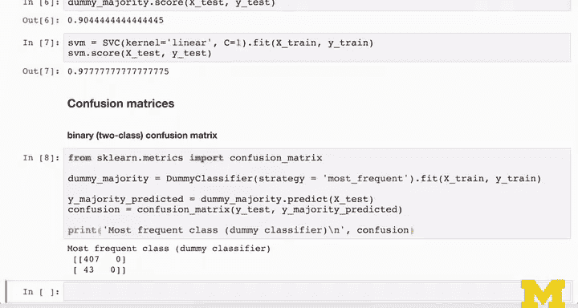

# 密歇根大学《Python用于数据科学实践》第20课：模型评估与选择 📊


## 概述

在本节课中，我们将要学习为什么仅使用准确率来评估监督学习模型是不够的。我们将探讨准确率这一简单易懂的指标存在的局限性，并学习一系列更全面的评估指标。这些指标能帮助我们更深入地理解模型的性能，并为特定应用场景选择最合适的模型。

## 为什么准确率可能不够？

上一节我们介绍了监督学习的基本流程。本节中我们来看看为什么仅依赖准确率进行评估可能存在问题。

当我们开始使用监督机器学习方法时，我们使用准确率来评估分类器的性能。准确率，你可能还记得，是**被正确分类的样本所占的比例**。也就是说，分类器预测的标签与正确或真实标签相匹配的样本比例。

对于回归模型，我们通常使用默认的R平方指标来评估性能。在本模块中，你将了解到这些简单易懂的度量指标也存在缺点，它们无法完整地描绘监督学习模型的性能，并且可能不是衡量你应用成功与否的正确指标。

因此，我们将介绍几种超越准确率的额外评估指标。我们将看到它们是如何定义的，使用它们的动机是什么，以及如何在Scikit-learn中使用它们，以便更好地了解监督模型在给定数据集上的表现。

你还将学习如何为你的应用选择合适的评估指标，这可以帮助你选择最佳模型或找到最优参数。

## 评估在机器学习工作流中的角色

让我们回顾一下本课程早些时候介绍的这个工作流程图。你可以看到，评估是应用机器学习开发周期中的关键部分。

一旦模型被训练，评估步骤就会提供关于训练模型性能特征的关键反馈，特别是那些对你的应用可能很重要的特征。例如，评估步骤的结果可能帮助你理解哪些数据实例被错误分类或预测，这反过来可能建议在特征和模型优化阶段，为你的学习模型提供更好的特征、不同的核函数或其他改进。

正如我们之前讨论的，在训练阶段优化的目标函数可能是一个不同的、所谓的**代理指标**，它在实践中比评估指标更容易用于优化目的。例如，一个商业搜索引擎可能使用一个排名算法，该算法被训练来推荐与查询最匹配的相关网页。换句话说，试图预测页面的相关标签。这可能是训练阶段的目标。

但在评估阶段，有许多评估方法可以用来衡量该搜索引擎使用该排名算法的性能的各个方面，这些方面对搜索公司的业务很重要。例如，系统每天有多少独立用户，或者典型用户搜索会话的时长等等。

因此，评估指标是最终用于在不同训练好的模型或设置之间进行选择的指标。实际上，商业搜索应用通常使用多个评估指标的记分卡来做出重要的业务决策或开发决策，以选择使用哪些模型。

所以，选择与你的应用目标相匹配的评估方法非常重要。

## 准确率的局限性：不平衡类别示例

在开始为二分类定义和使用一些评估指标之前，让我们先看一个例子，说明为什么仅仅看准确率可能不足以很好地了解分类器在做什么。它还将向我们展示，更多地了解学习算法所犯的错误类型如何帮助我们更好地了解模型的预测性能。

首先，考虑我们有一个二分类任务的情况，其中有很多实例被标记为负类，但只有少数实例属于正类。例如，我们可能在在线搜索或推荐系统中看到这种情况，系统必须预测是否显示广告或产品建议，或者根据用户的查询和他们过去点击的内容等，在页面上显示可能相关的查询建议或项目。所以这些将是正例。但当然，有很多很多不相关的项目属于负类，向用户展示这些项目没有意义。这被称为**不平衡类别场景**。

另一个例子可能是信用卡交易数据集，其中绝大多数交易被归类为正常而非欺诈，只有少数交易可能被归类为欺诈。这些情况也适用于多类分类问题，涉及具有不平衡类别的数据集。不平衡类别在机器学习场景中非常常见，因此了解如何处理它们很重要。

具体来说，假设我们有一个电子商务应用，对于每1000个随机抽样的产品项目，其中一个是与用户需求相关的，其他999个不相关。

回想一下，在一组实例上计算的准确率，只是分类器标签预测正确的实例数量除以实例总数。假设你开发了一个用于预测相关电子商务项目的分类器。开发完成后，你在测试集上测量其准确率为99.9%。乍一看，这似乎好得惊人，对吧？它非常接近完美。

但是，让我们将其与一个总是只预测最可能类别（即不相关类别）的虚拟分类器进行比较。换句话说，无论实际实例是什么，虚拟分类器总是预测一个项目不相关。

所以，如果我们有一个包含1000个项目的测试集。平均而言，其中999个无论如何都是不相关的。因此，我们的虚拟分类器将正确预测所有这些999个项目的“不相关”标签。所以虚拟分类器的准确率也将是99.9%。

实际上，我们自己的分类器性能一点也不令人印象深刻，它甚至不比不看数据就总是预测多数类更好。

## 使用Notebook演示不平衡类别

让我们使用我们的Notebook查看另一个在真实数据集上使用不平衡类别进行分类的示例。

我将从这里开始使用手写数字数据集，该数据集包含标记有10个类的手写数字图像，代表数字0到9。正如我们通过加载数据集，然后使用NumPy的`bincount`方法计算每个类中的实例数量所看到的，每个类中的实例数量大致相同，因此这个数据集具有平衡的类别。

然而，使用这个数字数据集，我们现在要做的是创建一个具有两个不平衡类别的新数据集，方法是将所有不是数字1的数字标记为标签0的负类，将数字1标记为标签1的正类。

以下是创建新二进制标签的代码片段：
```python
# 假设 y 是原始标签（0-9）
y_binary = (y == 1).astype(int)
```

现在，当我们使用`bincount`时，我们可以看到大约有1600个负例，但只有182个正例。所以，我们确实有一个类别不平衡的数据集，或者正如预期的那样，负例与正例的比例几乎是9:1。

现在让我们在这个不平衡集上创建一个训练测试分区。然后使用径向基函数作为核，用这些二进制标签训练一个支持向量机分类器。

我们使用`score`方法获得准确率。我们可以看到这刚刚超过90%。再次，乍一看，分类器90%的准确率似乎相当不错。然而，现在让我们创建一个正确反映类别不平衡的虚拟分类器，看看90%是否真的那么令人印象深刻。

Scikit-learn使得创建虚拟分类器变得很容易，只需使用`DummyClassifier`类，如下所示。虚拟分类器之所以被称为“虚拟”，是因为它们甚至不看数据来进行预测。它们只是使用你在创建它们时指示它们使用的策略或经验法则。

实际上，当你创建分类器时，你设置`strategy`参数来告诉它使用什么经验法则来进行预测。所以这里我们将其设置为`most_frequent`策略来预测最频繁的类。

这里的虚拟分类器的使用方式与常规分类器一样。因此，为了准备进行预测，我们在包含训练集实例和标签的`X_train`和`y_train`变量上调用`fit`方法。现在，这个虚拟分类器实际上不会查看这些变量中的单个数据实例，但它确实使用`y_train`变量来确定训练数据中哪个类最频繁。

最后，就像常规分类器一样，我们可以调用`predict`方法对测试集进行预测。这个例子显示了虚拟分类器预测的输出。正如所承诺的，你可以看到，它总是为测试集中的每个实例预测0或负类。

现在我们可以调用通常的`score`方法来获得虚拟分类器恒定负预测的准确率。我们可以看到它也是大约90%，与我们之前使用径向基函数核的支持向量机分类器相同。

所以那个支持向量分类器的性能实际上只比虚拟分类器好一点点。虚拟分类器提供了所谓的**零准确率基线**，即总是选择最频繁类所能达到的准确率。

你不应该将虚拟分类器用于实际的分类问题，但它确实提供了一个有用的合理性检查和比较点。

还有其他类型的虚拟分类器，它们提供了与`strategy`参数其他选择相对应的零基线，如下所示：
*   `most_frequent`：我们刚刚看到的策略，总是预测最频繁的标签。
*   `stratified`：与恒定的最频繁预测不同，这是一种基于类别分布的随机预测。例如，如果正类在训练集中出现90%的时间，那么分层虚拟分类器将以90%的概率输出正类标签，否则将输出负类标签。这有助于确保可以计算依赖于正类和负类预测结果计数的指标。
*   `uniform`：另一种随机预测方法，将均匀随机生成类别预测。也就是说，所有类被输出的机会均等，而不是根据它们在训练集中的频率进行加权。这个策略可能有助于准确估计每个类最常见的预测错误类型。
*   `constant`：在计算一些指标（如我们稍后将介绍的F分数）时可能很有用。为什么？当我们有一个二分类任务，其中最频繁的类是负类时，使用`most_frequent`策略将永远不会预测正类，并且永远无法计算正确预测的正实例数量。因此，这种正确预测的正实例的总数将为0。所以，正如你稍后将看到的，这反过来会导致一些重要指标（如F分数）始终为零。因此，使用`constant`策略，我们可以强制虚拟分类器始终预测正类，即使它是类别集合中的少数类，这将导致F分数的计算更有意义。

## 理解混淆矩阵

现在，让我们更仔细地看看使用二分类器时可能看到的不同类型的结果。这将让我们深入了解为什么仅使用准确率无法完整地描绘分类器的性能，并将推动我们定义和探索额外的评估指标。

对于正类和负类，有四种可能的结果，我们可以将其分为两种情况，对应于这个矩阵的第一行和第二行。

如果实例的真实标签是负的，分类器可以预测负（这是正确的，称为**真阴性**），或者它可以错误地预测正（这是一个错误，称为**假阳性**）。

如果实例的真实标签是正的，分类器可以预测负（这是一个错误，称为**假阴性**），或者它可以预测正（这是正确的，称为**真阳性**）。

也许记住这个的一个快速方法是：这些矩阵单元格中的第一个词如果是分类器错误就是`false`，如果是分类器成功就是`true`。第二个词如果真实标签是负的就是`negative`，如果真实标签是正的就是`positive`。

假阳性的另一个你可能从统计学中知道的名字是**第一类错误**。假阴性的另一个名字是**第二类错误**。

我们将使用这些两个字母的组合，TN、FN、FP和TP，作为定义一些新评估指标时的变量名。我们还将在这里使用大写N来表示实例的总数，即矩阵中所有值的总和，也就是我们正在查看的数据点的数量。

这个包含预测标签和真实标签所有组合的矩阵称为**混淆矩阵**。我们可以将任何分类器对数据实例的预测与这些矩阵单元格中的一个关联起来，具体取决于实例的真实标签和分类器的预测标签。这也适用于多类分类，除了我在这里展示的二分类特殊情况。在多类情况下，有K个类，我们只需有一个K×K矩阵，而不是2×2矩阵。

Scikit-learn使得为你的分类器计算混淆矩阵变得很容易。让我们看看Notebook。这里我们从`sklearn.metrics`导入`confusion_matrix`类。我们将使用之前创建的具有二进制不平衡标签的数字数据集的相同训练集。

要获得混淆矩阵，我们只需传入测试集的真实标签`y_test`和预测标签集`y_predicted`，然后打印输出。这里小矩阵输出的单元格顺序与我刚刚在幻灯片上展示的相同。真阴性和假阴性在第一列，真阳性和假阳性在第二列。特别是，分类器的成功预测在对角线上，即真实类别与预测类别匹配的地方。对角线外的单元格代表不同类型的错误。

在这里，我们为问题的不同分类器选择计算混淆矩阵，这样我们可以看到它们如何随着模型的不同选择而略有变化。这让我们深入了解每种分类器观察到的成功和失败的性质。

所以首先，我们将应用我们之前看到的最频繁类虚拟分类器。我们在这里可以看到，代表分类器预测正类情况的右列全为零，这对于这个虚拟分类器来说是有道理的，因为它总是预测最频繁的类（负类）。我们看到有407个实例是真阴性，有43个错误是假阴性。




这里我们应用分层虚拟分类器，它根据训练集中标签的比例给出随机输出。现在，右列不再全为0，因为这个虚拟分类器偶尔会预测正类。如果我们把右列的数字加起来，我们看到32 + 6 = 38次分类器预测了正类。在这些次数中，有6次（右下角对角线）是真阳性。

在下一个案例中，我们将应用一个支持向量分类器，其线性核和C参数等于1。我们注意到，与上面的分层虚拟分类器相比，沿着对角线看，分层虚拟分类器总共有375 + 6 = 381个正确预测，而支持向量分类器在相同数据集上有402 + 38 = 440个正确预测。

同样，我们可以应用逻辑回归分类器，并获得与支持向量分类器相似的结果。最后，我们可以应用决策树分类器，并查看由此产生的混淆矩阵。我们注意到的一件事是，与具有平衡的假阴性和假阳性数量的支持向量机或逻辑回归分类器不同，决策树产生的假阴性错误（实际上是17个）是假阳性错误（有7个）的两倍多。

## 总结

本节课中我们一起学习了模型评估与选择的核心概念。我们了解到，仅使用准确率评估模型，尤其是在面对不平衡数据集时，可能会产生误导。我们引入了**虚拟分类器**作为性能基线，并深入探讨了**混淆矩阵**，它揭示了模型预测中真阳性、真阴性、假阳性和假阴性等不同结果。理解这些基本构件是掌握更高级评估指标（如下一节课将介绍的AUC、精确率、召回率和F1分数）的关键。通过选择合适的评估指标，我们能够更准确地衡量模型性能，并做出更好的建模决策。