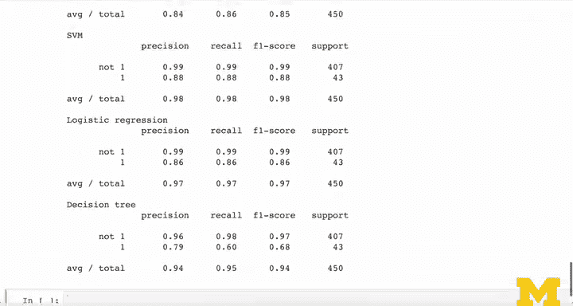

# 76：混淆矩阵与基础评估指标 📊

## 概述

在本节课中，我们将学习如何超越简单的准确率，使用混淆矩阵来深入分析分类器的性能。我们将探讨如何从混淆矩阵中计算出多种评估指标，并理解它们在不同应用场景中的意义。

---

## 混淆矩阵回顾

上一节我们介绍了分类结果的基本概念，本节中我们来看看如何用具体数据填充混淆矩阵。

我们回到二元分类的可能结果矩阵。这次，我们用笔记本中决策树输出的实际计数来填充它。我们创建这个矩阵的原始动机是为了超越单一的准确率数字，从而更深入地了解给定分类器在不同类型预测上的成功与失败。现在我们有了这四个数字，可以手动检查和比较。

让我们可视化地查看这个分类结果，以帮助我们把这四个数字与分类器的性能联系起来。

我在这里绘制了数据实例，使用的是构成手写数字数据集中每个实例的64个特征值中的两个特定特征值。图中的黑点是真实类别为正的实例，即数字1。白点的真实类别为负，即除1以外的所有其他数字。黑线显示了一个假设的线性分类器的决策边界，决策边界左侧的任何实例都被预测为正类，决策边界右侧的所有实例都被预测为负类。

真正例是那些位于正预测区域内的黑点。假正例是那些位于正预测区域内的白点。同样，真负例是位于负预测区域内的白点。假负例是位于负预测区域内的黑点。

---

## 从混淆矩阵衍生的评估指标

我们已经见过一个可以从混淆矩阵计数中推导出的指标，即准确率。分类器的成功预测，即预测类别与真实类别匹配的情况，位于混淆矩阵的对角线上。因此，如果我们将对角线上的所有计数相加，就会得到所有类别的正确预测总数。将这个总和除以实例总数，就得到了准确率。

但让我们看看从这四个数字中还能计算出哪些其他评估指标。

一个有时会使用的、非常简单的相关数字是分类错误率。它是非对角线上的计数之和，即所有错误，除以总实例数。在数值上，这等价于 `1 - 准确率`。

**公式：**
`分类错误率 = (假正例 + 假负例) / 总实例数 = 1 - 准确率`

现在，让我们看一个更有趣的例子。假设回到我们的医学肿瘤检测分类器，我们想要一个评估指标，它不仅能给实现大量真正例的分类器更高分数，还能避免假负例，即很少漏检真正的癌性肿瘤。

召回率，也称为真正例率、灵敏度或检测概率，就是这样一个评估指标。它通过将真正例的数量除以真正例与假负例之和得到。

**公式：**
`召回率 = 真正例 / (真正例 + 假负例)`

从这个公式可以看出，有两种方法可以获得更大的召回率数值：第一，增加真正例的数量；第二，减少假负例的数量，因为这将使分母变小。在这个例子中，有26个真正例和17个假负例，得到召回率为0.6。

---

## 精确率与召回率的应用场景

学习精确率和召回率时，一个自然而然的问题是：何时应用它们？在决定使用什么指标时，一个关键问题是：在你的场景中，避免假正例和避免假负例哪个更重要？

一般来说，当我们的目标是**最小化假正例**时，使用**精确率**作为指标。当目标是**最小化假负例**时，使用**召回率**。

以下是一些具体场景的说明。

以下是可能说明避免过多假正例很重要的场景：

*   **执法场景**：执法部门使用视频识别算法在特定区域寻找可能的罪犯。在这种情况下，假正例意味着逮捕一个无辜的人，这可能被认为比假负例（即让潜在的罪犯逍遥法外）造成的损害大得多。因此，这是一个以精确率为导向的任务，应最小化假正例。

另一方面，以下是我们可能希望最小化假负例的场景：

*   **法律调查场景**：律师事务所作为诉讼的一部分，搜索提及某个事件或个人的所有可能电子邮件。如果我们认为分类问题的正类是找到包含关键信息的电子邮件，我们希望避免将电子邮件错误标记为不包含关键信息的分类错误，换句话说，我们希望避免假负例。这是因为即使漏掉一封关键电子邮件也可能遗漏有价值的证据。因此，像这样撒更大的网会找到更多的假正例，即实际上不相关的电子邮件，但在这个场景中是可以接受的，因为我们有专家可以在后期过滤它们。因此，这是一个以召回率为导向的任务，应最小化假负例。

---

## 精确率详解

精确率是一种反映上述“避免假正例”情况的评估指标。它通过将真正例的数量除以真正例与假正例之和得到。

**公式：**
`精确率 = 真正例 / (真正例 + 假正例)`

因此，要提高精确率，我们必须要么增加分类器预测的**真正例**数量，要么减少分类器错误预测负类实例为正类的**错误**数量（即假正例）。这里，分类器犯了7个假正例错误，因此精确率为0.79。

另一个有用的相关评估指标称为**假正例率**。它给出了分类器错误识别为正类的所有负类实例的比例。

**公式：**
`假正例率 = 假正例 / (假正例 + 真负例) = 假正例 / 所有负类实例`

这里我们有7个假正例，总共有407个负类实例，假正例率为0.02。通常称为**特异度**的统计量就是 `1 - 假正例率`。

---

## 可视化理解精确率与召回率的权衡

回到我们的分类器可视化图。让我们看看如何解释精确率和召回率。这里混淆矩阵中的数字来源于这个分类场景。

我们可以看到，精确率0.68意味着在决策边界左侧的正预测区域中，大约68%的点（19个实例中的13个）被正确标记为正。召回率0.87意味着在所有真实正类实例（即图中所有黑点）中，正预测区域“找到”了大约87%（15个中的13个）。

如果我们想要一个偏向更高精确率的分类器，就像在搜索引擎查询建议任务中那样，我们可能希望决策边界看起来像这样。现在，正预测区域中的所有点（7个中的7个）都是真正例，给我们完美的精确率1.0。但这需要付出代价，因为在总共15个正类实例中，有8个现在是假负例，换句话说，它们被错误地预测为负类。因此，召回率下降到 `7 / 15 = 0.47`。

另一方面，如果我们的分类任务像肿瘤检测例子，我们希望最小化假负例并获得高召回率，那么我们会希望分类器的决策边界看起来更像这样。现在，所有15个正类实例都被正确预测为正类，这意味着这些肿瘤都被检测到了。然而，这也带来了代价，因为假正例的数量（例如，检测器触发为可能肿瘤但实际上不是的情况）增加了。所以召回率是完美的1.0分，但精确率下降到 `15 / 42 ≈ 0.36`。

这些例子说明了机器学习应用中经常出现的经典权衡：你通常可以提高分类器的精确率，但缺点是可能会降低召回率；或者你可以提高分类器的召回率，但代价是降低精确率。

以召回率为导向的机器学习任务包括医疗和法律应用，在这些应用中，未能正确识别正例的后果可能很严重。在这些场景中，通常会部署人类专家来帮助过滤掉那些在高召回率应用中几乎不可避免地增加的假正例。

正如我刚才提到的，许多面向客户的机器学习任务通常以精确率为导向，因为在这里假正例的后果可能很严重，例如，通过提供不正确或无用的信息来损害客户在网站上的体验。例子包括搜索引擎排名和分类文档以用主题标签进行标注。

---

## F1分数与F分数

在评估分类器时，计算一个称为**F1分数**的量通常很方便，它将精确率和召回率结合成一个数字。在数学上，它基于精确率和召回率的调和平均数，使用以下公式。

**公式：**
`F1 = 2 * (精确率 * 召回率) / (精确率 + 召回率)`

经过一些代数运算，我们可以用混淆矩阵中的量（真正例、假负例和假正例）来重写F1分数。

**公式：**
`F1 = 2 * 真正例 / (2 * 真正例 + 假正例 + 假负例)`

这个F1分数是一个更通用的评估指标**F分数**的特例，它引入了一个参数 `beta`。通过调整 `beta`，我们可以控制在评估中给予精确率与召回率的强调程度。例如，如果我们有以精确率为导向的用户，我们可能设 `beta = 0.5`，因为我们希望假正例比假负例更损害性能。对于以召回率为导向的情况，我们可能将 `beta` 设为一个大于1的数字，比如2，以强调假负例应该比假正例更损害性能。`beta = 1` 的设置对应于我们刚刚看到的F1分数特例，它平等地权衡精确率和召回率。

---

## 使用Python（Scikit-learn）计算评估指标

现在让我们看看如何使用Python和Scikit-learn计算这些评估指标。Scikit-learn的metrics模块提供了计算准确率、精确率、召回率和F1分数的函数，如笔记本中所示。这些函数的输入是相同的：第一个参数（这里是 `y_test`）是测试集数据实例的真实标签数组，第二个参数是测试集数据实例的预测标签数组。这里我们使用一个名为 `tree_predicted` 的变量，它是使用前一个笔记本步骤中决策树分类器的预测标签。

在分析分类器性能时，一次性计算所有这些指标通常很有用。因此，`sklearn.metrics` 提供了一个方便的 `classification_report` 函数。像之前的评分函数一样，`classification_report` 将真实标签和预测标签作为前两个必需参数。它还接受一些控制输出格式的可选参数。这里，我们使用 `target_names` 选项来标记输出表中的类别。你可以查看Scikit-learn文档以获取有关其他输出选项的更多信息。最后一列“support”显示测试集中具有该真实标签的实例数量。

这里我们展示了四个不同分类器在二元数字分类问题上的分类报告。第一组结果来自虚拟分类器，我们可以看到，正如预期的那样，正类的精确率和召回率都非常低，因为虚拟分类器只是随机猜测，预测正类实例为正类的概率很低。

---

## 总结

本节课中，我们一起学习了混淆矩阵及其在评估分类模型中的核心作用。我们深入探讨了准确率、精确率、召回率、F1分数等关键指标的计算方法和应用场景，并通过可视化理解了精确率与召回率之间的经典权衡关系。最后，我们掌握了如何使用Scikit-learn库在Python中方便地计算这些指标并生成分类报告。理解这些基础评估指标是有效分析和改进机器学习模型性能的重要一步。