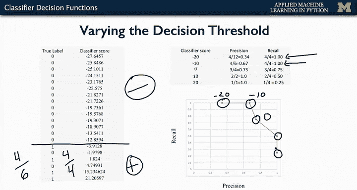

# 课程3：分类器的决策函数与概率预测 📊


在本节课中，我们将学习分类器如何通过决策函数和预测概率来提供预测的不确定性信息，以及如何利用这些信息来全面评估分类器的性能。

---

## 分类器的不确定性输出

许多Scikit-learn中的分类器可以提供与特定预测相关的不确定性信息。这主要通过两种方法实现：`decision_function`方法和`predict_proba`方法。

### 决策函数（decision_function）

当给定一组测试点时，`decision_function`方法会为每个点提供一个分类器得分。这个得分表示分类器预测**正类**的置信度。

*   对于被预测为正类的点，得分通常是**较大**的正值。
*   对于被预测为负类的点，得分通常是**较大**的负值。

以下是一个使用逻辑回归分类器的示例代码，展示了分类问题中前几个实例的决策函数得分：

```python
# 假设 clf 是一个已训练好的逻辑回归分类器
decision_scores = clf.decision_function(X_test)
print(decision_scores[:10])
```

我们可以观察到，属于负类的实例通常具有较大绝对值的负得分，而属于正类的实例则具有正得分。

### 预测概率（predict_proba）

`predict_proba`方法则提供样本属于各个类别的**预测概率**。通常，分类器会选择概率更高的类别。在二分类问题中，即选择概率大于50%的类别。

调整这个决策阈值会影响分类器的预测结果。**提高阈值**意味着分类器需要更有把握才预测某个类别。例如，我们可能只在估计类别1的概率超过70%时才预测它为类别1，这将得到一个更保守的分类器。

以下是获取同一逻辑回归分类器对测试实例预测概率的示例：

```python
predicted_probabilities = clf.predict_proba(X_test)
print(predicted_probabilities[:10])
```

可以看到，许多真实标签为1（正类）的条目具有很高的概率（如0.995），而许多负类标签的实例预测概率则非常低。

**请注意**：并非所有模型都能提供这种有用的概率估计。例如，一个对训练集过拟合的模型可能会给出过于乐观的高概率，而这些概率实际上并不准确。

---

## 利用得分或概率进行全面评估

上一节我们介绍了分类器如何输出决策得分和预测概率。本节中，我们来看看如何利用这些信息来获得更全面的分类器性能评估图景。

对于一个特定的应用，我们可以根据需求（例如，希望分类器在误报或漏报方面更保守还是更激进）来选择一个特定的决策阈值。

然而，在开发新模型时，我们可能并不完全清楚哪个决策阈值是合适的，以及这个选择将如何影响精确率和召回率等评估指标。

因此，更好的做法是观察分类器在**所有可能**的决策阈值下的表现。下面的例子展示了这是如何工作的。

---

### 理解阈值如何影响预测

假设我们有一个测试实例列表，包含它们的真实标签和分类器得分（来自`decision_function`）。

```
实例 | 真实标签 | 分类器得分
-----|----------|-----------
 A   |    负    |   -25
 B   |    正    |   -15
 C   |    负    |    -5
 D   |    正    |     5
 ... |   ...    |   ...
```

如果我们设定一个决策阈值，例如 **-20**：
*   所有得分**高于**-20（即大于-20）的实例将被预测为**正类**。
*   所有得分**低于或等于**-20的实例将被预测为**负类**。

通过这种方式划分测试点后，我们可以为被预测为正类的点计算精确率和召回率。

---

### 计算不同阈值下的性能指标

以下是针对不同决策阈值计算精确率和召回率的步骤：

**1. 阈值设为 -20**
*   被预测为正类的实例总数：12个。
*   其中真正为正类（真阳性）的实例：4个。
*   **精确率** = 4 / 12 ≈ 0.34
*   **召回率** = 4 / 4 = 1.0 （因为所有4个正类实例都被找到了）

**2. 阈值设为 -10**
*   被预测为正类的实例总数：6个。
*   其中真正为正类（真阳性）的实例：4个。
*   **精确率** = 4 / 6 ≈ 0.67
*   **召回率** = 4 / 4 = 1.0

**3. 阈值设为 0**
*   被预测为正类的实例总数：4个。
*   其中真正为正类（真阳性）的实例：3个。
*   **精确率** = 3 / 4 = 0.75
*   **召回率** = 3 / 4 = 0.75

---

### 绘制精确率-召回率曲线

当我们为许多不同的阈值计算出一系列（精确率， 召回率）数据对后，就可以将它们绘制在图表上。

*   阈值 -20 对应点 (0.34， 1.0)
*   阈值 -10 对应点 (0.67， 1.0)
*   阈值 0   对应点 (0.75， 0.75)

将这些点连接起来，就形成了一条曲线。通过这种方式，我们可以通过变化阈值，更完整地了解分类器输出的精确率和召回率如何随决策阈值的变化而变化。

这条最终的曲线被称为 **精确率-召回率曲线**。我们将在下一节课中对其进行更详细的研究。

---

## 总结



本节课中，我们一起学习了：
1.  分类器通过`decision_function`和`predict_proba`方法提供预测的不确定性信息。
2.  决策阈值的选择直接影响分类器的预测结果和保守程度。
3.  通过计算分类器在所有可能阈值下的精确率和召回率，我们可以绘制出**精确率-召回率曲线**，从而获得对分类器性能更全面、更深入的理解，而不仅仅依赖于单一阈值下的指标。