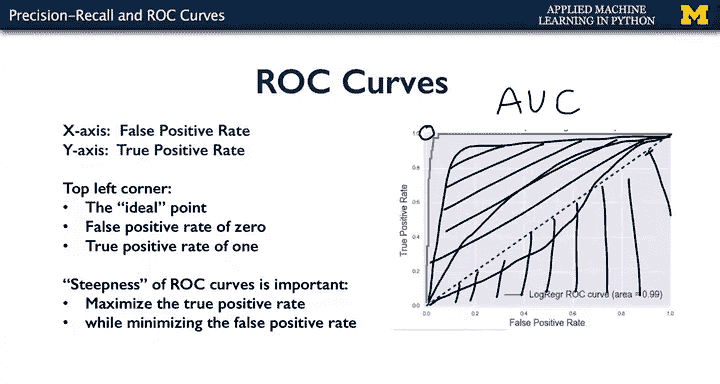

# 78：精确率-召回率与ROC曲线 📊

在本节课中，我们将要学习两种广泛使用的机器学习模型评估方法：精确率-召回率曲线与ROC曲线。我们将了解它们如何可视化分类器的性能，以及如何解读这些曲线。

---

### 精确率-召回率曲线

上一节我们介绍了精确率和召回率的概念，本节中我们来看看如何将它们可视化。

精确率-召回率曲线是一种非常广泛使用的机器学习评估方法。正如我们在示例中所见，X轴表示精确率，Y轴表示召回率。一个理想的分类器能够达到1.0的完美精确率和1.0的完美召回率。因此，最佳点位于图表的右上角。通常，精确率-召回率曲线越接近右上角，其性能越优，在精确率和召回率之间提供的权衡也越有利。我们已经看到许多分类器在这两个指标之间存在权衡关系的例子。

以下是生成精确率-召回率曲线的核心步骤：

1.  获取分类器的决策函数输出。
2.  应用不同的决策阈值。
3.  计算每个阈值下的精确率和召回率。
4.  将结果绘制成曲线。

下图是一个使用以下笔记本代码生成的实际精确率-召回率曲线示例。红色圆圈表示当决策阈值为0时达到的精确率和召回率。

幸运的是，Scikit-learn内置了一个函数，可以计算精确率-召回率曲线，这正是我们在笔记本中使用的。在这个特定应用中，存在一个总体下降趋势：随着分类器精确率的上升，召回率趋于下降。在这个案例中，曲线并不完全平滑，存在一些锯齿状区域，并且随着我们接近最大精确率，跳跃幅度会变得更大。

这是由精确率和召回率的计算公式决定的。它们使用了包含**真正例**数量的离散计数。随着决策阈值的提高，被预测为正例的点越来越少。为这些较小数字计算的分数会随着决策阈值的微小变化而发生显著变化。这就是为什么精确率-召回率曲线的尾部边缘在绘制时可能显得有些参差不齐。

---

### ROC曲线

了解了精确率-召回率曲线后，我们来看看另一种重要的可视化工具。

ROC曲线，即接收者操作特征曲线，是一种广泛使用的可视化方法，用于说明二分类器的性能。ROC曲线的X轴显示分类器的**假正率**，范围从0到1.0。Y轴显示分类器的**真正率**，范围也从0到1.0。值得注意的是，ROC曲线图的Y轴就是召回率指标。

ROC空间中的理想点是分类器达到**假正率为0**且**真正率为1**的位置，即左上角。ROC空间中的曲线代表了随着分类器决策阈值变化而产生的不同权衡，就像在精确率-召回率曲线中一样。当我们改变决策阈值时，会得到不同数量的假正例和真正例，从而可以在图表上绘制。

下图中的虚线表示一个仅随机猜测二分类标签的分类器所产生的ROC曲线，这基本上就像抛硬币。因此，这条虚线被用作基线。一个糟糕的分类器其性能将是随机的，甚至可能比随机更差。一个相当好的分类器会给出一个始终优于随机猜测的ROC曲线。一个优秀的分类器则会像这里展示的那样，曲线大幅向左上角凸起。这个特定示例是使用您见过的笔记本示例中的逻辑回归分类器生成的。

曲线的形状也很重要。我们希望分类器能最大化真正率，同时最小化假正率。接下来我们将看到，我们可以通过观察曲线下的面积来量化分类器的“优良”程度。

---

### 曲线下面积

上一节我们看到了ROC曲线的形状，本节中我们用一个单一指标来总结它。

我们使用一种称为**曲线下面积**的指标。这是一个单一数字，用于衡量ROC曲线下的总面积，以此总结分类器的性能。随机分类器下方的面积将是0.5。随着分类器曲线向左上角凸起，曲线下的面积会变得越来越大，并趋近于1。因此，AUC为0代表一个非常糟糕的分类器，AUC为1则代表一个最优的分类器。

像任何其他评估指标一样，AUC也有优点和缺点。

以下是AUC的主要优点：

*   AUC提供一个单一数字，便于比较不同分类器。
*   AUC不需要指定特定的决策阈值。你可以将AUC视为分类器在所有可能决策阈值下性能的总结。

另一方面，像任何其他单一数字指标一样，AUC会丢失关于分类器权衡和ROC曲线形状的信息。可能两个分类器具有相似的AUC，但它们的ROC曲线形状不同，在不同区域有交叉。例如，在某个特定的真正率范围内实现非常低的假正率可能很重要，但仅使用AUC可能无法检测到这些更细微的性能差异。

---

### 总结

本节课中我们一起学习了两种关键的模型评估可视化工具。我们探讨了**精确率-召回率曲线**，它展示了精确率和召回率之间的权衡，最佳点位于右上角。接着，我们学习了**ROC曲线**，它以假正率和真正率为轴，理想点位于左上角，并引入了**曲线下面积**作为量化ROC曲线下整体性能的单一指标。理解这些曲线及其含义，对于选择适合特定应用场景的模型和决策阈值至关重要。