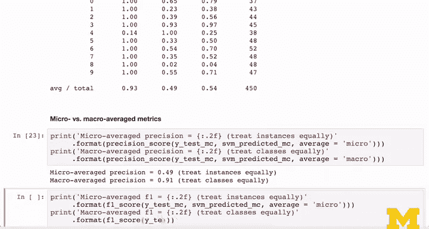

# 课程名称：Python用于数据科学实践 - 第24课：多类别评估方法 📊


在本节课中，我们将要学习如何评估多类别分类器。我们将探讨如何将二元分类的评估方法扩展到多个类别，理解混淆矩阵在多类别场景下的应用，并学习两种重要的平均计算方法：宏平均与微平均。

---

上一节我们介绍了二元分类器的评估方法。本节中，我们来看看更普遍的多类别分类是如何进行评估的。

在许多方面，多类别评估是二元评估方法的直接扩展。区别在于，我们处理的不再是两个类别，而是多个类别。因此，多类别评估的结果相当于**每个类别**的真实结果与预测结果的二元对比集合。

正如我们在二元案例中看到的，你可以在多类别案例中生成混淆矩阵。当存在多个类别时，混淆矩阵尤其有用，因为一个真实类别被预测为另一个类别会导致多种不同类型的错误。我们稍后会看一个例子。

我们在二元案例中看到的分类报告，也很容易为多类别案例生成。

现在，值得进一步研究的一个领域是**跨类别的平均计算是如何进行的**。我们将很快介绍平均多类别结果的不同方法。此外，**支持度**（即每个类别的实例数量）也是需要考虑的重要因素。正如我们在二元案例中关心如何处理类别不平衡一样，在多类别中考虑各类别支持度可能存在的巨大或微小差异也同样重要。

还存在一种**多标签分类**的情况，其中每个实例可以有多个标签（例如，一个网页可能被标记为来自预定义集合的不同主题或兴趣领域）。本讲座不涵盖多标签分类，我们将**专门聚焦于多类别评估**。

---

## 多类别混淆矩阵 🔍

多类别混淆矩阵是二元分类器2x2混淆矩阵的直接扩展。

例如，在我们的手写数字数据集中，数字有10个类别（0到9）。因此，10类混淆矩阵是一个10x10的矩阵，其中**行索引代表真实数字类别**，**列索引代表预测数字类别**。

与2x2情况一样，分类器的正确预测（真实类别与预测类别匹配）都位于对角线上，而错误分类则位于对角线之外。

以下是基于线性核支持向量分类器的代码生成的混淆矩阵示例：

```python
# 示例代码：生成并显示多类别混淆矩阵
from sklearn.metrics import confusion_matrix, ConfusionMatrixDisplay
import matplotlib.pyplot as plt

# 假设 y_true 和 y_pred 是真实标签和预测标签
cm = confusion_matrix(y_true, y_pred)
disp = ConfusionMatrixDisplay(confusion_matrix=cm, display_labels=class_names)
disp.plot(cmap=plt.cm.Blues)
plt.show()
```

在这个例子中，我们可以看到大多数预测都是正确的，只有零星几个错误分类。这里最常见的错误类型是将真实的数字8错误预测为数字1，这种情况发生了三次。总体准确率很高，约为97%。

有时，将混淆矩阵显示为热力图有助于突出显示不同类型错误的相对频率。为此，我在这里包含了生成热力图的代码。

为了对比，我在同一数据集上包含了第二个混淆矩阵，它来自另一个表现差得多的支持向量分类器（仅将核函数从线性核改为RBF径向基函数核）。

从混淆矩阵下方约49%的准确率数字可以看出，这个分类器的表现比线性核差得多。但仅凭这个数字无法深入了解原因。然而，观察混淆矩阵可以发现，对于每个真实的数字类别，都有相当一部分结果被预测为数字4。这相当令人惊讶。例如，在第二行（真实数字2）的44个实例中，17个被正确分类，但27个被分类为数字4。

显然，这个模型存在问题。我选择第二个例子只是为了展示当事情出错时可能看到的极端情况。这个手写数字数据集是成熟且没有问题的，但特别是在使用新数据集进行开发时，在混淆矩阵中看到这样的模式可以为你提供关于可能问题（例如特征预处理）的宝贵线索。

因此，作为模型评估的一部分，一个通用的经验法则是：**始终查看分类器的混淆矩阵**，以深入了解它对每个类别犯了哪些类型的错误，包括某些类别是否比其他类别更容易出现特定类型的错误。

---

## 分类报告与平均方法 📈

接下来，就像在二元案例中一样，你可以获得一份分类报告，该报告总结了多类别分类器的多个评估指标，并为每个类别计算了一个平均指标。

我即将描述的内容也适用于二元分类情况，但在观察具有多个类别的多类别分类问题时更容易理解。

让我们使用水果数据的特定示例来看看微平均与宏平均的区别。

以下是计算宏平均与微平均的示例数据：

| 真实类别 | 预测类别 |
| :--- | :--- |
| 橙子 | 橙子 |
| 橙子 | 柠檬 |
| 橙子 | 苹果 |
| 橙子 | 柠檬 |
| 橙子 | 苹果 |
| 柠檬 | 柠檬 |
| 柠檬 | 苹果 |
| 苹果 | 苹果 |
| 苹果 | 苹果 |

### 宏平均

使用宏平均，我们在整体计算中**将每个类别视为具有相同的权重**。

以下是计算宏平均精度的步骤：
1.  我们首先为每个类别单独计算指标（本例中是精度）。
2.  为每个类别计算完成后，我们**对所有类别的结果进行平均**，得到最终的宏平均精度数值。

具体到本例：
*   **橙子类**：分类器预测为“橙子”的案例中，有1次正确（共5次预测），精度 = 1/5 = 0.2。
*   **柠檬类**：分类器预测为“柠檬”的案例中，有1次正确（共2次预测），精度 = 1/2 = 0.5。
*   **苹果类**：分类器预测为“苹果”的案例中，有2次正确（共2次预测），精度 = 2/2 = 1.0。

然后，宏平均精度 = (0.2 + 0.5 + 1.0) / 3 ≈ 0.57。

### 微平均

另一方面，使用微平均，我们**赋予数据集中每个实例相等的权重**。这意味着**实例最多的类别（最大的类别）对最终的微平均数影响最大**。

以下是计算微平均精度的步骤：
我们不再需要单独考虑每个类别，而是可以简单地**聚合所有类别的所有结果**，并在聚合结果上计算精度。

具体到本例：
我们总共有9个示例。我们查看有多少次预测类别与真实类别匹配。这里有4次正确预测。因此，微平均精度 = 4 / 9 ≈ 0.44。

### 如何选择与解读

*   如果各类别的实例数量大致相同，宏平均和微平均将大致相等。
*   如果某些类别比其他类别大得多（拥有更多实例），并且你希望你的指标向最大的类别倾斜，请使用**微平均**。
*   如果你希望你的指标向最小的类别倾斜，请使用**宏平均**。
*   如果微平均远低于宏平均，则应检查较大的类别是否存在较差的指标性能。
*   如果宏平均远低于微平均，则应检查较小的类别，看看它们为何指标性能较差。

在Scikit-learn中，你可以使用评分函数上的`average`参数来指定平均方法：

```python
from sklearn.metrics import precision_score, f1_score

# 计算微平均精度和宏平均精度
micro_precision = precision_score(y_true, y_pred, average='micro')
macro_precision = precision_score(y_true, y_pred, average='macro')

# 计算微平均F1和宏平均F1
micro_f1 = f1_score(y_true, y_pred, average='micro')
macro_f1 = f1_score(y_true, y_pred, average='macro')
```

---



现在我们已经了解了如何计算这些指标，接下来让我们看看如何使用它们来进行模型选择。

---


本节课中我们一起学习了多类别分类器的评估方法。我们了解到多类别混淆矩阵是分析错误模式的重要工具，它能揭示分类器在各类别上的具体表现。同时，我们深入探讨了宏平均与微平均这两种关键的平均计算方法：宏平均平等对待每个类别，而微平均则平等对待每个实例，因此受大类别影响更大。理解这些概念并正确选择平均方法，对于在多类别场景下准确评估和比较模型性能至关重要。