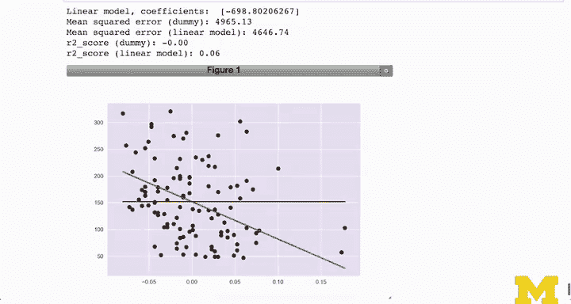

# 课程名称：Python用于数据科学实践（1-3课／共5课）｜Applied Data Science with Python
## 课程编号：P80 - 回归模型评估 📊

在本节课中，我们将要学习如何评估回归模型。我们将探讨回归评估与分类评估的区别，介绍几种关键的回归评估指标，并学习如何使用虚拟回归器建立性能基准。

---

我们之前看到，对于分类问题，在某些场景下（例如医疗诊断预测或面向客户的网站功能），假阳性和假阴性带来的后果截然不同。因此，区分这些错误类型并进行更详细的分析是有意义的。

例如，在评估分类器时，我们查看了精确率-召回率曲线等图表，这些图表可以展示分类器在两种错误类型之间所能达到的权衡。

理论上，我们可以将应用于分类的同类错误分析和更详细的评估方法应用于回归问题。

例如，我们可以分析回归模型的预测，并将错误分为两类：一类是回归模型的预测值远大于目标值，另一类是预测值远小于目标值。

然而，在实践中，对于大多数回归应用而言，区分这些不同类型的错误并不那么重要。

这大大简化了回归的评估。在大多数情况下，默认的**R平方分数**（在Scikit-learn中可用）足以满足大多数任务的需求，它总结了模型对未来实例的预测能力。

作为提醒，完美预测器的R平方分数是**1.0**。对于总是输出相同常数值的预测器，R平方分数为**0**。

尽管R平方分数的名称中有“平方”二字，暗示它总是正数，但对于拟合不佳的模型（例如将非线性函数拟合到数据时），它确实有可能变为负数。

除了R平方分数，您还应该了解一些其他回归评估指标，它们的工作原理略有不同。

以下是几种常见的回归评估指标：

*   **平均绝对误差**：计算目标值与预测值之间绝对差异的平均值。在机器学习术语中，这对应于**L1范数损失**的期望值。例如，在时间序列分析中，有时会用它来评估回归的预测结果。
    *   **公式**：`MAE = mean(|y_true - y_pred|)`
*   **均方误差**：计算目标值与预测值之间平方差异的平均值。这对应于**L2范数损失**的期望值。它广泛用于任何回归问题，较大的误差会以平方形式对平均误差做出更大的贡献。与平均绝对误差一样，均方误差不区分高估和低估。
    *   **公式**：`MSE = mean((y_true - y_pred)^2)`
*   **中位数绝对误差**：一种常见情况是数据中存在**异常值**，这可能会对整体的R平方或平均分数值产生不良影响。因此，在那些忽略异常值很重要的情况下，您可以使用**中位数绝对误差分数**。它对异常值的存在具有鲁棒性，因为它使用误差分布的中位数而不是平均值。
    *   **公式**：`MedAE = median(|y_true - y_pred|)`

---

上一节我们介绍了回归评估的核心指标，本节中我们来看看如何为回归模型建立一个简单的性能基准。

我们曾看到，使用虚拟分类器可以为我们提供一个简单但有用的基线，以便在评估分类器时进行比较。回归也存在相同的功能。有一个**虚拟回归器**类，它使用不查看输入数据的简单策略来提供预测。

本讲笔记本中的回归示例展示了一个基于单个输入变量（沿X轴绘制）的数据散点图，数据来自糖尿病数据集。这些点是测试集分割中的数据实例，形成了一个看起来可能略微向右下方倾斜的点云。

绿色的线，标记为“拟合模型”，是拟合到训练点的默认线性回归。我们可以看到，它对测试数据的拟合效果并不是特别强。标记为“虚拟均值”的红线显示了一个线性模型，它使用的策略是始终预测训练数据的平均值。这就是一个虚拟回归器的例子。

您可以查看笔记本以了解虚拟回归器的创建和使用方式与常规回归模型相同：创建、用训练数据拟合，然后在测试数据上调用`predict`方法。不过，再次强调，就像虚拟分类器一样，您不应该将虚拟回归器用于实际问题，它的唯一用途是提供一个比较基准。

查看线性模型与虚拟模型的回归指标输出，我们可以看到，正如预期的那样，虚拟回归器实现了**R平方分数为0**，因为它总是在不看输出的情况下做出恒定预测。在这个例子中，根据均方误差和R平方分数，线性模型提供的拟合效果仅比虚拟回归器略好一些。

除了始终预测训练目标值平均值的策略外，您还可以创建其他几种类型的虚拟回归器，例如始终预测训练目标值的中位数、这些值的特定分位数，或者您提供的特定自定义常数值。

---

虽然回归的评估需求通常比分类更简单，但仔细检查以确保您为回归问题选择的评估指标能以反映业务、组织或用户需求后果的方式惩罚错误，是非常值得的。

本节课中我们一起学习了回归模型的评估方法。我们了解到，与分类不同，回归评估通常不需要严格区分高估和低估的错误。我们介绍了R平方分数、平均绝对误差、均方误差和中位数绝对误差等核心评估指标，并理解了它们各自的适用场景。最后，我们学习了如何使用虚拟回归器为模型性能建立一个有意义的基准，以便更好地判断我们模型的真实有效性。