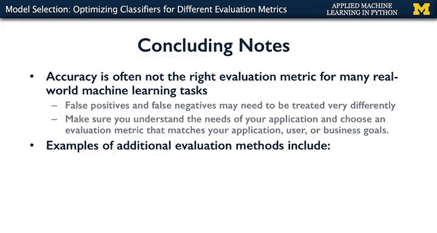

# 课程3：模型选择与分类器评估指标优化 🎯


在本节课中，我们将学习如何应用不同的评估指标作为选择最佳分类器的标准，即模型选择。我们将回顾已有的评估框架，并重点介绍如何在交叉验证和网格搜索中使用这些指标来优化模型性能。

---

## 回顾评估框架

上一节我们介绍了多种用于二分类和多分类的评估指标。本节中，我们来看看如何将它们作为模型选择的标准。

在之前的课程中，我们已经看到了几种不同的模型选择评估框架。

首先，我们简单地在同一数据集上进行训练和测试。但众所周知，这通常会导致严重的过拟合，并且对新数据的泛化能力较差。不过，这可以作为一个有用的完整性检查，以确保你的软件工程和特征生成流程正常工作。

其次，我们经常使用单一的训练-测试分割来产生单一的评估指标。这种方法虽然快速简便，但无法真实地估计模型在未来新数据上的表现，也无法让我们了解在不同测试集上进行预测时评估指标可能产生的方差。

第三，我们使用了K折交叉验证来创建K个随机的训练-测试分割，并将评估指标在多个分割上进行平均。这能产生在未见数据上更可靠的模型。特别是，我们还可以在每次交叉验证折叠中使用网格搜索（例如 `GridSearchCV` 方法），来寻找模型相对于评估指标的最优参数。

`cross_val_score` 或 `GridSearchCV` 默认使用的评估指标是准确率。

---

## 在模型选择中应用新指标

那么，如何应用你在这里学到的新指标，如AUC呢？在模型选择中，Scikit-Learn 使这变得非常简单。你只需添加一个 `scoring` 参数，将其设置为代表你想要使用的评估指标名称的字符串。

让我们先看一个在交叉验证中使用 `scoring` 参数的例子，然后我们再看模型选择的另一种主要方法——网格搜索。

在下面的代码中，我们有一个交叉验证的例子，我们使用线性核且C参数设为1的支持向量分类器运行5折交叉验证。

```python
# 使用默认准确率作为评估指标
scores_default = cross_val_score(svc, X, y, cv=5)

# 使用AUC作为评估指标
scores_auc = cross_val_score(svc, X, y, cv=5, scoring='roc_auc')

# 使用召回率作为评估指标
scores_recall = cross_val_score(svc, X, y, cv=5, scoring='recall')
```

第一个 `cross_val_score` 调用仅使用默认的准确率作为评估指标。第二个调用使用 `scoring` 参数，设置为字符串 `'roc_auc'`，这将使用AUC作为评估指标。第三个调用将 `scoring` 参数设置为 `'recall'` 以使用召回率作为评估指标。你可以看到每个指标产生的五个评估值列表（每个折叠一个）。

这里我们没有进行任何参数调优，我们只是在多个折叠上简单地评估模型的平均性能。

---

## 网格搜索中的指标优化

现在，在这个网格搜索的例子中，我们使用一个使用径向基函数核的支持向量分类器，这里的关键参数是 `gamma` 参数，它直观地设置了核的影响半径或宽度。

我们使用 `GridSearchCV` 来寻找在两种情况下优化给定评估指标的 `gamma` 值。

```python
# 优化平均准确率
param_grid = {'gamma': [0.001, 0.01, 0.1, 1, 10]}
grid_acc = GridSearchCV(svc_rbf, param_grid, cv=5, scoring='accuracy')
grid_acc.fit(X_train, y_train)

# 优化AUC
grid_auc = GridSearchCV(svc_rbf, param_grid, cv=5, scoring='roc_auc')
grid_auc.fit(X_train, y_train)
```

在第一种情况下，我们只优化平均准确率。在第二种情况下，我们优化AUC。在这个特定的例子中，`gamma` 的最优值恰好相同，都是0.001。但正如我们稍后将看到的，在其他情况下，根据用于优化的评估指标，最优参数值可能完全不同。

你可以通过运行以下代码来查看 `scoring` 参数支持的评估指标的完整名称列表，该代码使用了从 `sklearn.metrics` 导入的 `SCORERS` 变量。

```python
from sklearn.metrics import get_scorer_names
print(get_scorer_names())
```

你可以看到分类指标，如代表微平均精确率的字符串 `'precision_micro'`，以及回归指标，如用于R平方回归损失的 `'r2'` 指标。

---

## 决策边界如何随优化指标变化

让我们看一个具体的例子，它展示了当为不同的评估指标进行优化时，分类器的决策边界如何变化。

这个分类问题基于我们在整个笔记本中一直用作示例的相同二进制数字分类器训练集和测试集。

在这些分类可视化示例中，正例（数字1）显示为黑点。正类预测区域显示为决策边界右侧的浅色或黄色区域。负例（所有其他数字）显示为白点，在这些图中，负类预测区域位于决策边界的左侧。数据点使用数字数据集64个特征值中的两个进行绘制，并添加了一点抖动（即我添加了一点随机噪声），以便我们更容易地看到特征空间中示例的密度。

以下是生成此图的Python代码。我们在这里应用网格搜索来探索可选的 `class_weight` 参数的不同值，该参数控制训练期间给予两个类别各自的权重。事实证明，针对不同的评估指标进行优化会导致 `class_weight` 参数的不同最优值。

随着 `class_weight` 参数的增加，将更加强调正确分类正类实例。

我们在这里看到的以精确率为导向的分类器（`class_weight` 为2）努力减少假阳性，同时增加真阳性。因此，它专注于右下角的正类点簇，那里相对较少的负类点。在这里，精确率超过50%。

相比之下，以召回率为导向的分类器（`class_weight` 为50）努力减少假阴性的数量，同时增加真阳性。也就是说，它试图找到大多数正类点作为其正类预测的一部分。

我们还可以看到，以F1为导向的分类器的决策边界具有最优的 `class_weight` 值2，介于以精确率和召回率为导向的分类器的最优 `class_weight` 值之间。从视觉上看，我们可以看到以F1为导向的分类器在决策边界上也处于以精确率和召回率为导向的决策边界之间的中间位置。这是有道理的，因为F1是精确率和召回率的调和平均数。

以AUC为导向的分类器（最优 `class_weight` 为5）具有与以F1为导向的分类器相似的决策边界，但略微偏向更高的召回率。

对于这个分类场景，我们可以非常清楚地看到精确率-召回率的权衡，以及在同一数据集上针对准确率进行优化并使用 `class_weight` 参数的 `balanced` 选项的默认线性核支持向量分类器的精确率-召回率曲线。

让我们看一下生成此图的代码。

花点时间想象一下，这条精确率-召回率曲线上极右下方的部分代表了一个高度以精确率为导向的决策边界，位于分类图的右下角，那里有一簇正例。随着决策阈值被调整得越来越不保守，沿着曲线向上和向左移动，分类器变得越来越像以召回率为导向的支持向量分类器示例。

同样，红色圆圈代表在零分数标记处实现的精确率-召回率权衡，这是为训练好的分类器选择的实际决策边界。

---

## 训练-验证-测试：避免数据泄漏

为了简单起见，我们经常在展示评估评分的例子中使用单一的训练-测试分割。然而，仅使用交叉验证或测试集进行模型选择或参数调优，仍可能导致更微妙形式的过拟合，从而对未来未见数据产生过于乐观的评估估计。

对此的一个直观解释可能如下：请记住，在测试集上进行评估的全部目的是估计学习算法在未来未见数据上的表现。我们在选择模型时，作为重复交叉验证过程的一部分，看到的关于数据集的信息越多，任何潜在的保留测试数据对选择最终模型（而不仅仅是评估它）的影响就越大。这有时被称为**数据泄漏**，我们将在另一个模块中详细描述这种现象。

因此，除非我们承诺保留一个测试分割，直到评估的最后阶段才让任何过程看到，否则我们就没有用真正保留的测试集进行评估。这就是实践中实际所做的。

有三个数据分割：
1.  **训练集**：用于模型构建。
2.  **验证集**：用于模型选择。
3.  **测试集**：用于最终评估。

通常首先划分出训练集和测试集。然后使用训练数据运行交叉验证来进行模型和参数选择。同样，测试集直到评估过程的最后阶段才被看到。

机器学习研究人员非常认真地对待这个协议。训练-验证-测试设计是一个非常重要、普遍应用的框架，用于有效评估机器学习模型。

---

## 总结与延伸思考

这把我们带到了机器学习评估课程部分的结尾。

你现在应该理解为什么准确率只能提供分类器性能的部分图景，并且更加熟悉重要替代评估方法和指标（如混淆矩阵、精确率、召回率、F1分数和ROC曲线下面积）的动机和定义。



你也看到了如何应用和选择这些不同的评估指标替代方案，以优化分类器的模型选择或参数调优，从而最大化给定的评估指标。

最后，我想留给你几点思考。

首先，简单的准确率可能并不总是你特定机器学习应用程序的正确目标。正如我们在肿瘤检测或信用卡欺诈中看到的那样，假阳性和假阴性可能对用户或组织结果产生非常不同的现实影响。因此，选择一个能反映这些用户、应用或业务需求的评估指标非常重要。

其次，还有一些其他维度可能对评估你的机器学习算法很重要，我们在这里没有涉及，但你需要意识到。

我在这里特别提两个：
1.  **学习曲线**：用于评估机器学习算法的评估指标如何随着算法获得更多训练数据而变化或改进。学习曲线可以作为成本效益分析的一部分。以标记示例的形式获取训练数据通常耗时且昂贵。因此，能够估计如果你投资将训练数据量翻倍，你的分类器可能获得的性能改进，是一个有用的分析。
2.  **敏感性分析**：相当于观察当对重要模型参数进行微小调整时，评估指标如何变化。这有助于评估模型对参数选择的稳健性。执行这一点可能很重要，特别是如果存在其他成本，例如运行时效率，这些是部署与不同参数值（例如，决策树深度或特征值阈值）相关的操作系统时的关键变量。通过这种方式，对不同性能维度之间可实现的权衡有一个更全面的了解，可以帮助你为机器学习模型做出最佳的实际部署决策。

---

本节课中，我们一起学习了如何利用不同的评估指标进行模型选择，掌握了在交叉验证和网格搜索中应用这些指标的方法，并理解了避免数据泄漏的“训练-验证-测试”框架的重要性。记住，没有“放之四海而皆准”的最佳指标，选择哪一个取决于你的具体应用场景和业务目标。