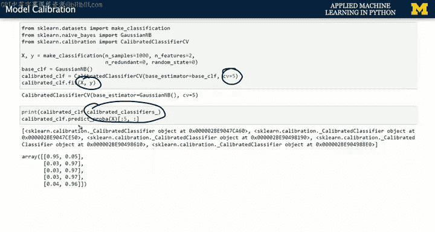

# 82：模型校准（选修）📊


## 概述

在本节课中，我们将要学习模型校准的概念、重要性以及如何在实践中实现它。模型校准是确保机器学习模型输出的概率预测与现实世界观察到的概率相匹配的过程。这对于依赖概率进行决策或计算的场景至关重要。

---

## 什么是模型校准？🤔

上一节我们介绍了模型校准的重要性，本节中我们来看看模型校准的具体定义。

一个经过校准的模型，其输出的预测概率与现实世界中观察到的实际概率非常接近。我们可以用一个熟悉的例子来理解这个概念：天气预报。

假设气象学家在所有预测100%会下雨的日子里，实际上只有50%的时间真的下雨了。那么，气象学家预测的100%概率与现实观察到的50%比例并不匹配。因此，我们说气象学家的预测概率是未经校准的。

如果气象学家的预测是经过校准的，那么在所有他预测有R%概率会下雨的日子里，实际下雨的比例也应该是R%。

我们可以将同样的概念应用于机器学习模型。对于一个二元分类问题，其中实例 `Xi` 的标签 `Yi` 可以是0或1。我们说一个预测器 `F(Xi)` 是经过校准的，如果对于所有预测器以R%的概率预测属于类别1的数据点，这些数据点实际属于类别1的比例也恰好是R%。

用数学公式表示，对于一个校准良好的模型，我们希望满足以下等价关系：

对于所有预测器 `F` 预测概率为 `p` 的数据点 `Xi`，其真实标签 `Yi` 的期望值（即经验概率）应等于 `p`。

**公式**：
`E[Yi | F(Xi) = p] = p`

其中，`E` 表示期望值，可以理解为在预测概率为 `p` 的所有数据点上，真实标签 `Yi` 的平均值。

---

## 为什么模型校准很重要？⚖️

上一节我们定义了模型校准，本节中我们来看看为什么确保预测概率准确如此重要。

在许多依赖准确概率预测的场景中，模型校准至关重要。

以下是几个关键原因：

*   **决策支持**：如果分类器被用于重要的决策过程（例如司法系统中的再犯风险评估），那么其输出的概率或置信度估计必须准确反映现实。
*   **计算期望值**：在机器学习中，我们经常需要计算重要量的期望值或平均值（例如，搜索结果的预期点击次数、广告的预期点击次数）。要确保这些期望值的计算有效，就需要输入计算的概率是准确的。
*   **模块化概率系统**：现代大型系统通常是模块化和概率化的。系统中的各个模型通过概率“语言”进行通信。如果一个模块输出的概率不准确，会影响下游所有依赖该概率的模块。保持每个模块的概率准确性，可以避免重新校准整个系统。

当然，在某些场景下，校准可能不那么重要。例如，如果你的目标只是对一组事物进行排序（如搜索结果排名），那么排序的准确性是关键，而每个文档的具体相关概率可能不需要精确计算。然而，鉴于统计方法在许多系统中的普遍应用，理解并确保使用概率模块的部分输出经过良好校准的概率，是非常重要的。

---

## 如何诊断模型校准情况？📈

在审视一个预测模型的校准情况时，第一步通常是进行可视化。我们使用一种称为**校准曲线**或**可靠性曲线**的工具。

校准曲线展示了预测概率与经验概率之间的关系。在X轴上，我们放置分类器预测的概率（例如，将所有预测概率为0.4的实例放入一个“分箱”中）。在Y轴上，我们计算并展示对应的经验概率（即，在预测概率为0.4的所有实例中，实际属于正类的比例）。

**代码**：在Scikit-learn中，可以使用 `calibration_curve` 函数来计算校准曲线数据。

一个完美校准的分类器，其校准曲线应该是一条直线 `y = x`。这意味着预测概率完全等于经验概率。

校准曲线偏离 `y = x` 线的程度，反映了模型校准的优劣。偏离越大，校准越差；越接近这条线，校准越好。

例如，支持向量机（SVM）的校准曲线（图中绿色最上方的线）可能显示，当它预测概率为0.6时，实际观察到的经验概率接近0.8，这表明它低估了真实概率。而逻辑回归（图中蓝色线）的校准曲线非常接近 `y = x` 线，说明它本身已经校准得很好。

---

## 如何校准模型？🛠️

上一节我们学会了如何诊断校准问题，本节中我们来看看如何修复校准不佳的概率。

一个广泛使用的方法是将原始预测模型视为一个“黑盒”。我们训练一个**校准函数** `G`，来学习纠正或改进现有预测器的原始输出分数，将其转换为校准后的预测概率。

我们有一个原始预测函数 `F(x)`，它产生原始输出（可能是概率，也可能是分数）。我们假设这个原始输出是未经校准的。我们不修改原始模型，而是取其输出，学习一个转换函数 `G`，将原始预测输出转换为校准后的预测概率。

我们使用一个**校准集**来学习这个转换函数 `G`。这个数据集必须与用于训练原始模型的数据集不同，以防止过拟合。

一个好的校准函数 `G` 应该是严格单调递增的，以保持原始预测的排序关系。

以下是两种广泛使用的学习转换函数 `G` 的方法：

### 1. Platt缩放（Sigmoid校准）

这种方法假设原始预测分数与经验概率之间的关系符合S型（Sigmoid）曲线。它通过拟合一个Sigmoid函数来学习这种关系。

**公式**：
`P_calibrated = 1 / (1 + exp(A * s_raw + B))`
其中 `s_raw` 是原始预测分数，`A` 和 `B` 是通过拟合学习到的参数。

Platt缩放对于支持向量机（SVM）或提升树等最大间隔方法特别有效，因为这些方法本身的预测概率往往具有S型的失真。

### 2. 等渗回归

这是一种更通用的校准方法。它不假设特定的函数形式（如Sigmoid），而是使用**等渗回归**来获得函数 `G`。等渗回归拟合一个单调递增的分段常数函数（阶梯状函数）来捕捉原始分数与经验概率之间的关系。

与Platt缩放相比，等渗回归可以拟合更复杂的形状，功能更强大。但它也更容易过拟合，因此建议在拥有较大数据集（例如超过1000个数据点）时使用。

---

## 在Scikit-learn中实现模型校准 🐍

Scikit-learn提供了便捷的工具来实现模型校准。

主要的类是 `CalibratedClassifierCV`。你需要传入想要校准的基础分类器，设置校准方法（`method` 参数，可选 `'sigmoid'` 或 `'isotonic'`）以及用于调优的交叉验证折数（`cv` 参数）。

`CalibratedClassifierCV` 支持我们刚才描述的两种方法。Scikit-learn也提供了 `calibration_curve` 函数来计算校准曲线数据，以及 `CalibrationDisplay` 函数来绘制校准曲线。

以下是两种常见的使用场景：

### 场景一：校准一个已训练好的分类器

如果你已经训练好了一个分类器（例如逻辑回归或SVM），只想校正其输出分数或概率，可以按以下步骤操作：

1.  确保你有一个独立的**校准集**，该数据集未用于训练原始模型。
2.  创建 `CalibratedClassifierCV` 对象，将已训练好的分类器作为 `base_estimator` 传入，并设置 `cv='prefit'`。
3.  在 `CalibratedClassifierCV` 对象上调用 `.fit()` 方法，并传入独立的校准集数据。

**代码示例**：
```python
from sklearn.calibration import CalibratedClassifierCV
from sklearn.model_selection import train_test_split
from sklearn.naive_bayes import GaussianNB

# 假设 X, y 是原始数据
X_train, X_calib, y_train, y_calib = train_test_split(X, y, test_size=0.2, random_state=42)

# 1. 在训练集上训练原始模型
base_clf = GaussianNB()
base_clf.fit(X_train, y_train)

# 2. 使用校准集来校准模型
calibrated_clf = CalibratedClassifierCV(base_estimator=base_clf, cv='prefit', method='sigmoid')
calibrated_clf.fit(X_calib, y_calib)

# 现在 calibrated_clf 可以输出校准后的概率
calibrated_probs = calibrated_clf.predict_proba(X_new)
```

### 场景二：同时进行训练和校准（使用交叉验证）

如果你还没有训练分类器，希望同时进行模型训练和校准，可以按以下步骤操作：

1.  创建 `CalibratedClassifierCV` 对象，传入未训练的基础分类器。
2.  设置 `cv` 参数为你想要的交叉验证策略（例如 `cv=5` 表示5折分层交叉验证）。
3.  在 `CalibratedClassifierCV` 对象上调用 `.fit()` 方法，并传入全部数据。它会内部进行交叉验证：在每一折的训练集上训练基础分类器，在验证集上拟合校准函数。

默认情况下（`ensemble=True`），最终预测的概率是各折校准分类器预测概率的平均值。

**代码示例**：
```python
from sklearn.calibration import CalibratedClassifierCV
from sklearn.naive_bayes import GaussianNB

# 基础分类器
base_clf = GaussianNB()

# 创建校准分类器对象，使用5折交叉验证和等渗回归方法
calibrated_clf = CalibratedClassifierCV(base_estimator=base_clf, cv=5, method='isotonic')

# 拟合数据（内部完成训练和校准）
calibrated_clf.fit(X_train, y_train)

# 预测校准后的概率
calibrated_probs = calibrated_clf.predict_proba(X_test)
```



---

## 工作流程与总结 🎯

在本节课中，我们一起学习了模型校准的完整知识。最后，我们来总结如何将校准步骤整合到你的工作流程中。

**决定是否需要校准**：首先，判断校准是否对你的应用重要。如果你工作在概率框架下、概率输出的准确性有重要影响（例如用于决策的置信度或风险评估），或者你需要计算重要的期望值，那么就应该考虑使用校准。

**关键步骤**：
*   **使用独立数据集**：**始终**在一个独立的验证集上运行校准步骤，这个数据集必须与最初训练分类器所用的训练集不同。否则，校准步骤可能会加剧可能存在的过拟合问题。
*   **可视化诊断**：使用校准可靠性曲线来初步评估你的模型校准情况。
*   **选择方法**：根据你的模型和数据情况，选择 Platt 缩放（Sigmoid）或等渗回归方法。
*   **实施校准**：使用 Scikit-learn 的 `CalibratedClassifierCV` 类来实施校准。

**其他技术考量**（高级）：
理想的校准函数除了严格单调递增外，还应最小化“严格适当评分规则”，并最大化“锐度”属性（即预测应远离全局概率平均值）。对于大多数应用，遵循上述关键步骤更为重要。


总而言之，模型校准是概率模型中极其重要的一环，你不能假设开箱即用的机器学习模型都是经过良好校准的。我建议使用校准可靠性图来初步评估模型的校准情况，并应用本节课描述的方法来潜在地提高你的机器学习模型输出概率估计的准确性。