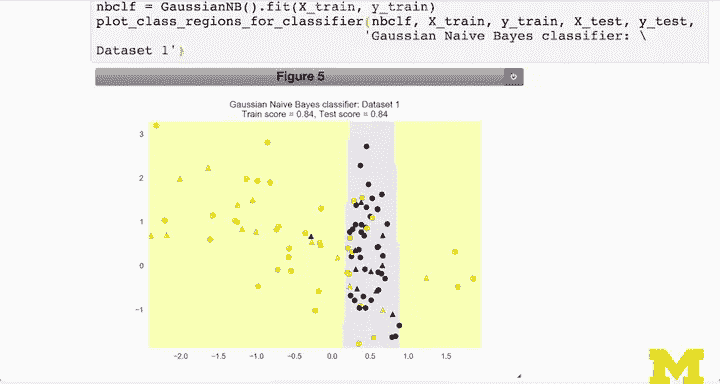

# 83：朴素贝叶斯分类器 🧮


在本节课中，我们将要学习监督学习模型的另一个家族——朴素贝叶斯分类器。我们将了解其基本原理、不同类型以及在Python中的实现方式。

---

## 概述

朴素贝叶斯分类器是一类基于概率模型的监督学习模型。它们通过假设数据在每个类别中是如何生成的来进行分类。尽管其核心假设在现实中通常不成立，但这类模型因其训练速度快、对高维数据有效而广受欢迎。

上一节我们介绍了线性分类模型，本节中我们来看看与之相关的朴素贝叶斯家族。

---

## 核心概念与“朴素”假设

朴素贝叶斯分类器之所以被称为“朴素”，是因为它们做了一个简化的假设：**在给定类别的情况下，一个实例的每个特征都与其他所有特征相互独立**。

在实践中，特征之间通常存在相关性。例如，在预测房屋售价是否会高于业主报价时，室内面积可能与土地大小或卧室数量相关，而这些特征又可能与房产位置相关。

这种“朴素”的简化假设带来两方面影响：
*   一方面，学习一个朴素贝叶斯分类器非常快，因为只需要为每个特征独立地估计和应用简单的、基于类别的统计量。
*   另一方面，这种高效性的代价是，朴素贝叶斯分类器的泛化性能通常比其他更复杂的方法（甚至线性分类模型）稍差一些。

尽管如此，**对于高维数据集，朴素贝叶斯分类器在某些任务上的表现常常能与支持向量机等其他复杂方法相竞争**。

---

## Scikit-learn中的三种朴素贝叶斯模型

以下是Scikit-learn库中提供的三种主要朴素贝叶斯模型：

*   **伯努利朴素贝叶斯模型**：使用一组**二元出现特征**。例如，在文本分类中，可以用一个二元特征来表示某个词在文本中是否出现。
    ```python
    # 特征示例：[词A出现？, 词B出现？, ...]
    ```
*   **多项式朴素贝叶斯模型**：使用一组**基于计数的特征**。每个特征会考虑特定词（或其他特征）在训练样本（如文档）中出现的次数。
    ```python
    # 特征示例：[词A出现次数, 词B出现次数, ...]
    ```
*   **高斯朴素贝叶斯模型**：假设特征是**连续的或实数值的**。这是本课重点，适用于一般数值数据。

伯努利和多项式模型特别适合文本数据，我们将在专项课程的文本挖掘部分深入探讨。本节课将聚焦于高斯朴素贝叶斯分类器。

---

## 高斯朴素贝叶斯分类器原理

高斯朴素贝叶斯分类器假设**每个类别的数据都是由一个简单的、特定于该类的高斯（正态）分布生成的**。

**训练时**，分类器会为每个特征估计每个类别的**均值（μ）和标准差（σ）**。

**预测时**，分类器将待预测数据点的特征与每个类别的特征统计量进行比较，并选择**最可能生成该数据点的类别**。从数学上讲，这对应于估计每个类别的高斯分布生成该数据点的概率，然后选择概率最高的类别。

其决策边界通常是一条抛物线。在特殊情况下，**当每个特征在两个类别中的方差相同时，决策边界将是线性的**。

---

## 在Python中使用高斯朴素贝叶斯

在Python中使用高斯朴素贝斯分类器非常简单：

```python
from sklearn.naive_bayes import GaussianNB

# 1. 实例化模型
gnb = GaussianNB()

# 2. 在训练数据上拟合模型
gnb.fit(X_train, y_train)

# 3. 进行预测
y_pred = gnb.predict(X_test)
```



值得注意的是，朴素贝叶斯模型是Scikit-learn中少数支持 **`partial_fit`** 方法的分类器之一。当处理无法一次性装入内存的巨大数据集时，可以使用此方法进行增量训练。对于`GaussianNB`类，没有控制模型复杂度的特殊参数。

---

## 性能与适用场景

在一个简单的二分类示例中，高斯朴素贝叶斯分类器可以取得很好的性能。然而，当类别不再容易区分时，与线性模型类似，其性能会下降。

在一个真实世界的数据集（如乳腺癌数据集）上，高斯朴素贝叶斯分类器也表现良好，与其他方法（如支持向量分类器）具有竞争力。

**典型应用场景**：
*   **高斯朴素贝叶斯**：适用于**高维数据**，每个实例有数百、数千甚至更多特征。
*   **伯努利/多项式朴素贝叶斯**：适用于**文本分类**，其中不同单词作为特征的数量非常庞大，且特征向量是稀疏的（因为任何给定文档只使用总词汇的一小部分）。

---

## 总结与优缺点

本节课中我们一起学习了朴素贝叶斯分类器。从数学上可以证明，朴素贝叶斯分类器与线性模型相关，因此线性模型的许多优缺点也适用于它。

**优点**：
*   训练和预测速度**快**。
*   非常适合**高维数据**（包括文本）和涉及**大型数据集**的应用，在这些场景下效率至关重要，计算成本可能排除了其他分类方法。

**缺点**：
*   当特征之间的**条件独立假设不成立**时（即特征间存在显著协方差，许多真实数据集正是如此），其他能够考虑这些依赖关系的、更复杂的分类方法可能会优于朴素贝叶斯。
*   在获取与预测相关的置信度或概率估计时，朴素贝叶斯分类器给出的估计通常**不可靠**。


尽管如此，朴素贝叶斯分类器在某些任务上表现依然极具竞争力，并且通常作为**基线模型**非常有用，可以与之比较更复杂模型的性能。