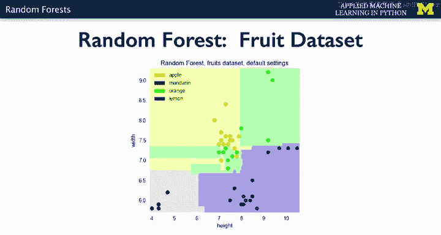

# 课程名称：密歇根大学《Python用于数据科学实践》第29课：随机森林算法 🌲🤖


## 概述

在本节课中，我们将要学习一种在机器学习中广泛使用且非常有效的方法——集成学习，并重点介绍其核心应用之一：随机森林算法。我们将了解其工作原理、优势、局限性以及如何在Python中应用它。

---

## 什么是集成学习？

集成学习是一种机器学习方法，它通过组合多个独立的“学习模型”来创建一个更强大的“聚合模型”。这个聚合模型的预测能力通常优于其中任何一个单独的模型。

**核心公式**：`聚合模型 = 模型1 + 模型2 + ... + 模型N`

---

## 为什么集成学习有效？

上一节我们介绍了集成学习的概念，本节中我们来看看它为何有效。

集成学习有效的主要原因在于，不同的学习模型虽然各自可能表现良好，但它们倾向于在数据集上犯不同类型的错误。这通常是因为每个单独的模型可能对数据的不同部分“过拟合”。

通过将不同的模型组合成一个集成模型，我们可以平均掉它们各自的错误，从而在保持强大预测性能的同时，降低过拟合的风险。

---

## 随机森林：决策树的集成

随机森林是集成学习思想应用于决策树的一个具体例子。它在实践中被广泛使用，并在各种问题上取得了非常好的效果。

在Scikit-learn中，我们可以通过`ensemble`模块中的`RandomForestClassifier`类将其用作分类器，或使用`RandomForestRegressor`类进行回归。

正如我们之前所见，使用单一决策树的一个缺点是它容易对训练数据过拟合。随机森林通过在训练集上创建大量（通常是几十或几百棵）独立的决策树来解决这个问题。

---

## 随机森林如何工作？

随机森林的目标是让森林中的每棵树都能较好地预测训练集中的目标值，但同时要以某种方式与其他树有所不同。这种差异是通过在构建每棵决策树的过程中引入随机性来实现的。

以下是构建过程中的两个关键随机步骤：

1.  **随机选择数据**：每棵树使用一个“自助采样”数据集进行训练。
2.  **随机选择特征**：在树的每个节点进行分裂时，只从所有特征的一个随机子集中寻找最佳分裂点。

**代码示例**：创建随机森林分类器
```python
from sklearn.ensemble import RandomForestClassifier
# n_estimators 控制树的数量
# max_features 控制每次分裂时考虑的特征数量
rf_model = RandomForestClassifier(n_estimators=100, max_features='sqrt', random_state=0)
```

---



## 关键参数解析

以下是使用随机森林时需要了解的一些关键参数及其作用：

*   **`n_estimators`**：设置森林中树的数量。默认值为10。对于更大的数据集，增加这个数字几乎总是一个好主意，因为集成更多树可以平均误差，减少过拟合。但请注意，增加树的数量也会增加训练的计算成本（时间和内存）。
*   **`max_features`**：这个参数对性能有很强的影响，它决定了森林中树的多样性。对于分类，默认值是总特征数的平方根（`sqrt`）；对于回归，默认值是总特征数以2为底的对数（`log2`）。在实践中通常效果很好。较小的`max_features`值倾向于减少过拟合。
*   **`max_depth`**：控制集成中每棵树的深度。默认设置为`None`，意味着树节点会一直分裂，直到所有叶子节点都属于同一类，或者包含的样本数少于`min_samples_split`参数值（默认为2）。
*   **`n_jobs`**：告诉算法使用多少个CPU核心并行训练模型。设置为`-1`将使用系统所有核心。通常可以获得接近线性的加速。
*   **`random_state`**：鉴于随机森林的随机性，如果你想获得可重现的结果，为这个参数设置一个固定值（例如`0`）尤其重要。

---

## 随机森林的预测过程

一旦随机森林模型训练完成，它通过以下方式对新实例进行预测：
1.  首先，让森林中的每棵树都做出一个预测。
2.  **对于回归任务**，总体预测通常是所有树预测值的**平均值**。
3.  **对于分类任务**，总体预测基于**加权投票**。每棵树为每个可能的类别标签给出一个概率，然后对所有树的每个类别的概率进行平均，概率最高的类别就是最终的预测类别。

---

## 实践应用与示例

让我们将随机森林应用到一个具有更多特征的大型数据集上，以便与其他监督学习方法进行比较。我们将再次使用乳腺癌数据集。

**代码示例**：在乳腺癌数据集上应用随机森林
```python
from sklearn.datasets import load_breast_cancer
from sklearn.model_selection import train_test_split

# 加载数据
cancer = load_breast_cancer()
X_train, X_test, y_train, y_test = train_test_split(cancer.data, cancer.target, random_state=0)

# 创建随机森林分类器，约有30个特征，设置max_features=8
rf = RandomForestClassifier(n_estimators=100, max_features=8, random_state=0)
rf.fit(X_train, y_train)

print("训练集精度: {:.3f}".format(rf.score(X_train, y_train)))
print("测试集精度: {:.3f}".format(rf.score(X_test, y_test)))
```

我们可以看到，随机森林在不进行特征缩放或大量参数调优的情况下，就能在此数据集上取得非常好的测试集性能。事实上，它的表现与我们目前见过的所有其他监督方法（包括需要更仔细调优的核支持向量机和神经网络）一样好，甚至更好。

---

## 优势与局限性

**优势**：
*   **强大且性能优异**：在各种问题上都能提供出色的预测性能。
*   **无需特征缩放**：与许多其他监督学习方法不同，通常不需要对特征数据进行仔细的缩放或其他预处理。
*   **易于并行化**：尽管构建许多不同的树需要相应的计算量增加，但随机森林的构建可以轻松地在多个CPU上并行进行。

**局限性**：
*   **可解释性差**：随机森林模型对人类来说可能非常难以解释，很难看清特征的预测结构或了解决策的具体原因。
*   **不适用于高维稀疏特征**：对于像文本分类这样具有非常高维稀疏特征的任务，随机森林不是一个好选择，而线性模型可以提供更高效的训练和快速、准确的预测。

---

## 总结

本节课中我们一起学习了随机森林算法。我们了解到，随机森林是一种基于决策树的强大集成学习方法，它通过引入数据采样和特征选择的随机性来构建多棵不同的树，并通过集体决策（投票或平均）来提高预测精度并减少过拟合。它在实践中易于使用，通常无需复杂的预处理和调参就能获得优秀的表现，但其“黑箱”特性也带来了可解释性上的挑战。