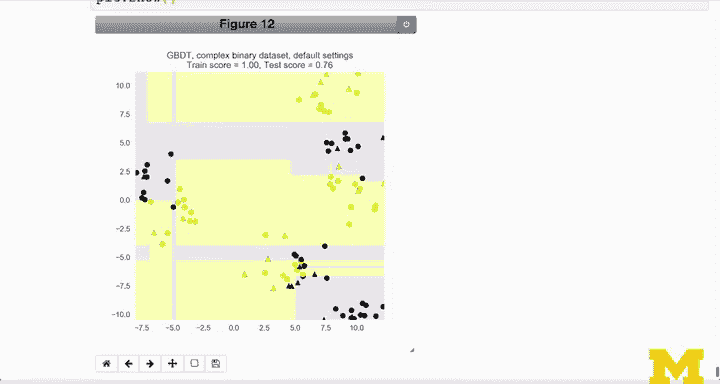

# 85：梯度提升决策树 🌳➡️🚀


在本节课中，我们将学习梯度提升决策树。这是一种基于树的集成方法，在现实世界的应用中获得了广泛使用。我们将了解其核心思想、关键参数，并通过代码示例展示其应用。

## 概述

梯度提升决策树与随机森林类似，都使用多棵树的集成来构建更强大的分类和回归预测模型。然而，它们的构建方式有根本不同。上一节我们介绍了随机森林，本节中我们来看看梯度提升决策树是如何工作的。

## 核心思想

与随机森林并行构建并组合多棵随机不同的树不同，梯度提升决策树的核心思想是**按顺序构建一系列树**。其中，每一棵后续的树都经过训练，旨在**纠正前序树在系列中犯下的错误**。

通常，梯度提升树集成使用许多浅层树，在机器学习中称为**弱学习器**。它们以一种非随机的方式构建，随着添加更多的树，模型犯的错误会越来越少。

模型构建完成后，使用梯度提升树模型进行预测速度很快，且不占用太多内存。

## 关键参数

以下是控制梯度提升树模型复杂度的两个主要参数：

*   **`n_estimators`**：设置集成中要使用的弱学习器（小决策树）的数量。
*   **`learning_rate`（学习率）**：这是一个随机森林中没有的新参数。它控制梯度提升树算法如何构建一系列纠正性树。
    *   当学习率较高时，每棵后续树都会**强烈强调纠正其前驱树的错误**，这可能导致更复杂的单棵树，从而总体上形成更复杂的模型。
    *   当学习率设置较小时，对彻底纠正前一步错误的强调会减少，这往往会在每一步产生更简单的树。

通常，`n_estimators` 和 `learning_rate` 这两个参数需要**一起调整**，因为降低学习率通常需要更多的树来维持模型复杂度。

与随机森林不同，**增加 `n_estimators` 可能导致过拟合**。因此，通常 `n_estimators` 的设置是为了在训练期间最好地利用系统的速度和内存能力，然后在此基础上调整学习率等其他参数。

此外，**`max_depth`** 参数通过控制单棵树的深度和复杂度，也会影响模型复杂度。梯度提升方法假设每棵树都是弱学习器，因此 `max_depth` 参数通常设置得很小，在大多数应用中约为3到5。

## 代码示例：水果分类任务



以下是如何在 scikit-learn 中使用梯度提升树处理我们的示例水果分类任务，并绘制决策区域。代码与我们用于随机森林的代码大致相同。

```python
# 从集成模块导入梯度提升分类器
from sklearn.ensemble import GradientBoostingClassifier

# 创建梯度提升分类器对象
# 默认参数：learning_rate=0.1, n_estimators=100, max_depth=3
clf = GradientBoostingClassifier().fit(X_train, y_train)
```

与随机森林一样，您可以看到决策边界具有那种类似盒子的形状，这是决策树或树集成的特征。

## 应用于乳腺癌数据集

现在让我们将梯度提升决策树应用于乳腺癌数据集。此代码训练两个不同的梯度提升分类器。

```python
# 第一个分类器使用默认设置
clf1 = GradientBoostingClassifier().fit(X_train, y_train)
# 评估结果...
```

我们可以看到第一个结果在训练集上具有完美的准确率，这表明模型很可能**过拟合**。

有两种方法可以学习一个复杂度较低的梯度提升树模型：
1.  降低学习率，这样每棵树就不会过于努力地去学习一个复杂的模型来纠正前驱的错误。
2.  降低集成中单棵树的 `max_depth` 参数。

第二个分类器示例对这些参数进行了调整：

```python
# 第二个分类器：降低学习率和最大深度
clf2 = GradientBoostingClassifier(learning_rate=0.01, max_depth=2).fit(X_train, y_train)
# 评估结果...
```

您可以看到，训练集准确率确实下降了，而测试集准确率略有提高。

## 优势与局限

梯度提升决策树是目前可用的**最佳现成监督学习方法之一**，一旦模型训练完成，仅需适中的内存和运行时间要求即可实现出色的预测准确率。机器学习的一些主要商业应用就是基于梯度提升决策树。

与其他基于决策树的学习方法一样，您**不需要进行特征缩放**算法就能表现良好，并且特征可以是二进制、分类和连续类型的混合。

然而，提升决策树也有几个缺点：
*   与随机森林一样，**树集成模型比单棵决策树更难解释**。不过，对于许多以预测准确率为最重要目标的应用来说，这通常可能无关紧要。
*   梯度提升方法可能需要**仔细调整学习率和其他参数**，并且训练过程可能需要大量计算。
*   与我们看到的其他基于树的学习方法一样，将梯度提升方法用于**文本分类**或其他特征空间具有数千个稀疏值特征的场景，通常不是准确性和计算成本方面的好选择。

## 总结

本节课中我们一起学习了梯度提升决策树。我们了解到它是一种顺序构建树集成的强大方法，每棵树都旨在纠正前序树的错误。我们探讨了控制其复杂度的关键参数——`n_estimators`、`learning_rate` 和 `max_depth`，并通过代码示例看到了其应用和调参效果。最后，我们总结了该方法的优势（高精度、无需特征缩放）和局限性（可解释性差、需仔细调参、不适合高维稀疏数据）。