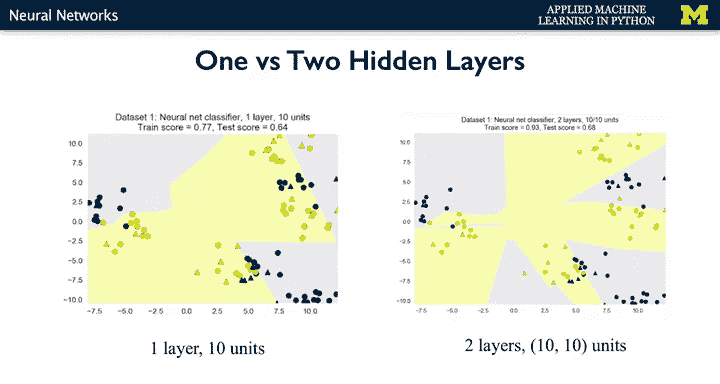

# 课程：密歇根大学《Python用于数据科学实践》第31课 - 神经网络基础 🧠

在本节课中，我们将要学习神经网络的基础知识。神经网络是一系列广泛的算法，构成了近期被称为“深度学习”的计算领域复兴的基础。我们将介绍其基本概念、模型结构，以及如何在Python中应用它们进行分类和回归任务。

## 概述

神经网络算法最早的研究始于20世纪50年代和60年代。近年来，随着深度学习在图像物体分类、快速准确的机器翻译以及游戏对弈等特定任务上取得了令人瞩目的先进成果，人们对它的兴趣重新高涨。本节将介绍构成神经网络以及当今使用的更复杂深度学习方法基础的基本概念和算法。

我们将学习一种称为多层感知机的基本模型，它在Scikit-learn库中得到支持，可用于分类和回归任务。

## 回顾线性与逻辑回归

在深入神经网络之前，让我们先简要回顾一下我们已经学过的用于回归和分类的简单方法：线性回归和逻辑回归。

线性回归预测一个连续输出值 `Y_hat`。其公式为输入变量 `X_i` 的加权和，加上一个截距或偏置项 `B_hat`：

`Y_hat = Σ(W_i * X_i) + B_hat`

我们曾学习过如何使用普通最小二乘法、岭回归或Lasso回归等方法来从训练数据中估计这些模型系数 `W_i` 和 `B_hat`。

逻辑回归在此基础上更进一步，它将输入变量 `X_i` 的线性函数输出，通过一个额外的非线性函数——逻辑函数进行处理，以产生输出 `Y`。由于逻辑函数的特性，`Y` 的值被约束在0和1之间。我们使用逻辑回归进行二元分类，因为可以将 `Y` 解释为在二分类场景中，给定输入数据实例属于正类的概率。

## 引入多层感知机

现在，我们来看一个用于回归的简单神经网络示例，称为多层感知机，有时缩写为MLP。这些网络也被称为前馈神经网络。

MLP采用了我们之前看到的计算输入特征加权和的思想，但它比逻辑回归更进一步，增加了一个称为“隐藏层”的额外处理步骤。隐藏层中的每个框称为“隐藏单元”，每个隐藏单元计算输入特征加权和的非线性函数，产生中间输出值 `V_0, V_1, V_2`。然后，MLP计算这些隐藏单元输出的加权和，以形成最终的输出值 `Y_hat`。

隐藏单元应用的这个非线性函数称为“激活函数”。在这个例子中，激活函数是双曲正切函数，它与逻辑函数相关。可以看到，在预测模型中添加这个额外的隐藏层处理步骤，使得 `Y_hat` 的公式比逻辑回归的公式复杂得多。

具体来说，每个输入和每个隐藏单元之间有一个权重，每个隐藏单元和输出变量之间也有一个权重。实际上，这种非线性激活函数的添加和组合，使得多层感知机能够学习比简单线性或逻辑函数更复杂的函数。这种额外的表达能力使得神经网络在输入和输出之间的关系本身很复杂时，能够进行更准确的预测。

当然，这种复杂性也意味着在训练阶段有更多的权重（模型系数）需要估计，这意味着与线性模型相比，学习神经网络通常需要更多的训练数据和计算。

## 激活函数的选择

顺便提一下，神经网络中应用于隐藏单元的激活函数有多种选择。

以下是三种主要的激活函数，我们将在本讲座后面进行比较：
*   **双曲正切函数**：绿色的S形函数。
*   **修正线性单元函数**：我们将其缩写为ReLU，图中显示为蓝色的分段线性函数。
*   **熟悉的逻辑函数**：图中显示为红色。

ReLU激活函数是Scikit-learn中神经网络的默认激活函数。它将任何负输入值映射为零。双曲正切函数将大的正输入值映射到非常接近1的输出，将大的负输入值映射到非常接近-1的输出。激活函数的这些差异可能会对神经网络学习的回归预测图或分类决策边界的形状产生一些影响。

通常，我们将使用双曲正切函数或ReLU函数作为默认激活函数，因为它们在大多数应用中表现良好。

## 用于分类的神经网络

接下来，我们看看如何在Scikit-learn中使用神经网络进行分类，这里使用一个更复杂的合成二元分类数据集。

要使用神经网络分类器，你需要从 `sklearn.neural_network` 模块导入 `MLPClassifier` 类。以下代码示例展示了分类器如何拟合训练数据，这里使用了单个隐藏层，但层中的隐藏单元数量不同：1个单元、10个单元和100个单元。

与我们已经见过的所有其他分类器类型一样，你可以使用适当的参数创建分类器对象，并在训练数据上调用 `fit` 方法。这里，神经网络分类器的主要参数是 `hidden_layer_sizes`。这个参数是一个列表，每个隐藏层对应一个元素，给出该层要使用的隐藏单元数量。所以这里我们传递一个包含单个元素的列表，意味着我们想要一个隐藏层，其单元数量由变量 `units` 指定。

默认情况下，如果你不指定 `hidden_layer_sizes` 参数，Scikit-learn将创建一个具有100个隐藏单元的单一隐藏层。虽然像我们这里使用的简单数据集，设置为10可能效果很好，但对于真正复杂的数据集，隐藏单元的数量可能达到数千个。我们稍后会看到，也可以通过传递具有多个条目的 `hidden_layer_sizes` 参数来创建具有多个隐藏层的MLP。

我还想提一下 `solver` 这个额外参数的使用，它指定了用于学习网络权重的算法。这里我们使用的是LBFGS算法。我们将在本讲座末尾进一步讨论 `solver` 参数的设置。

另外，请注意，我们在创建MLP分类器对象时传入了 `random_state` 参数，就像我们对 `train_test_split` 函数所做的那样，并且我们恰好将这个 `random_state` 参数设置为固定值0。这是因为对于神经网络，它们的权重是随机初始化的，这会影响学习到的模型。因此，即使不改变相同数据集上的关键参数，相同的神经网络算法也可能学习到两个不同的模型，这取决于所选的内部随机种子值。因此，通过始终为用于初始化权重的随机种子设置相同的值，我们可以确保使用这些示例的每个人都能获得相同的结果。

这个图表展示了运行此代码的结果，显示了单个隐藏层神经网络中隐藏单元的数量如何影响分类的模型复杂度。

*   **1个隐藏单元**：模型在数学上等同于逻辑回归。我们看到分类器返回了熟悉的、简单的、两类之间的线性决策边界。训练集分数很低，测试分数也没有好多少，所以这个网络模型欠拟合。
*   **10个隐藏单元**：我们可以看到MLP分类器能够学习到更复杂的决策边界，捕捉到数据中更多面向线性簇的结构，尽管测试集准确率仍然较低。
*   **100个隐藏单元**：决策边界更加详细，并且在训练集和测试集上都实现了更好的准确率。

## 增加网络深度：多个隐藏层

这是一个具有两个隐藏层的多层感知机的图形描述。添加第二个隐藏层进一步增加了神经网络可以从更复杂数据集中学习的函数的复杂性。

将这种复杂性进一步推进，具有许多计算阶段的庞大神经网络架构，就是为什么深度学习方法被称为“深度”的原因。我们将在本周即将到来的讲座中总结深度学习。

笔记本中有一个示例，展示了我们如何创建一个两层MLP，每层有10个隐藏单元。我们只需在创建MLP分类器时将 `hidden_layer_sizes` 参数设置为一个包含两个元素的列表，表示两个隐藏层各有10个单元。

你可以看到在我们之前看到的分类问题上添加第二个隐藏层的结果。左边是原始的具有一个10单元隐藏层的MLP。右边是使用新的具有两个隐藏层（每层10个单元）的MLP的相同数据集。你可以看到具有两个隐藏层的MLP学习到了更复杂的决策边界，并且在这种情况下，对训练数据的拟合更好，测试数据的准确率也略高。

## 控制复杂度：正则化

一旦我们开始添加更多具有大量隐藏单元的隐藏层，你可以看到神经网络需要估计的权重或模型系数数量会迅速增加。因此，更复杂的神经网络可能拥有成千上万个权重需要估计。

我们可以像处理岭回归和Lasso回归一样，通过添加对权重的L2正则化惩罚来控制这种模型复杂度。请记住，L2正则化惩罚那些所有权重值平方和较大的模型，其效果是神经网络更倾向于权重更接近0的模型。

MLP的正则化参数称为 `alpha`，与线性回归模型一样。在Scikit-learn中，默认设置为一个较小的值，例如0.0001，以提供一点正则化。

这个代码示例展示了将 `alpha` 从一个较小的值0.01改变到一个较大的值5.0，对一个具有两个隐藏层（每层100个节点）的较大MLP的影响。为了多样化，这里我们还设置了激活函数使用双曲正切函数。

这是笔记本代码的图形输出。你可以看到随着 `alpha` 增加，正则化增强的效果。在左侧图中，当 `alpha` 较小时，决策边界更加复杂和多变，分类器过拟合，这可以从非常高的训练集分数和低的测试分数中看出。另一方面，右侧图使用了这里最大的 `alpha` 值5.0，该设置导致决策边界更加平滑，同时仍然捕捉数据的全局结构。这种增加的简单性使其能够更好地泛化，而不会对训练集过拟合，这从本例中高得多的测试分数可以明显看出。

## 数据预处理的重要性

与其他监督学习模型（如正则化回归和支持向量机）一样，在使用神经网络时，对输入特征进行适当的归一化至关重要。

让我们将多层感知机应用于乳腺癌数据集。请注意，我们首先应用 `MinMaxScaler` 来预处理输入特征。这里，我们将结合使用一个更复杂的网络，该网络具有两个隐藏层，每层100个隐藏单元，`alpha` 设置为5.0以进行更高的正则化，并再次使用LBFGS求解器。

你可以看到，使用这个多层感知机，训练集和测试集的准确率都是我们在这个数据集上获得的最高值之一。

## 用于回归的神经网络

像我们见过的许多其他监督学习方法一样，你也可以将多层感知机用于回归以及分类。

我们在这里包含MLP回归作为示例，原因有两个。首先，因为MLP回归本身可能对某些回归问题有用。但更普遍地说，因为一些深度学习问题就是回归问题，因此与分类一样，使用多层感知机是了解用于回归和深度学习的更复杂架构的良好起点。

以下是我们笔记本中一个简单MLP回归模型的示例。

你通过从 `sklearn.neural_network` 模块导入 `MLPRegressor` 类来使用多层感知机回归器，然后创建MLP回归器对象。在创建对象时，我们使用与分类相同的 `hidden_layer_sizes` 参数来设置隐藏层的数量和每个隐藏层内的单元数。此示例使用两个隐藏层，每层有100个隐藏节点。

此笔记本代码有一个循环，遍历激活函数参数和用于L2正则化的 `alpha` 参数的不同设置。这里，我们包含了回归结果，其中顶行使用双曲正切激活函数，底行使用ReLU激活函数。你可以看到激活函数的平滑度在一定程度上影响了相应回归结果的平滑度。

沿着列，图表还显示了使用不同的 `alpha` 设置从左到右增加L2正则化量的效果。同样，与分类一样，通过增加 `alpha` 来增加L2正则化量的效果是约束回归使用越来越简单的模型，这些模型具有越来越少的大权重。你可以在顶部和底部的行中看到这种效果。左侧的回归线比右侧更平滑的正则化模型具有更高的方差。

## 神经网络的优缺点

在积极方面，除了我们在这里展示的简单示例之外，神经网络构成了高级学习架构的基础，这些架构能够捕捉复杂的特征，并在日益广泛的困难学习任务上提供最先进的性能，从围棋的世界冠军对弈到图像中物体的详细而稳健的识别。

然而，随着这种能力的增强，成本也随之增加。这些更大、更复杂的模型通常需要大量的数据、计算和训练时间来学习。此外，需要对输入数据进行仔细的预处理，以帮助确保快速、稳定、有意义地找到最优权重集。

一般来说，当特征类型相似时（例如，全部来自图像的像素），神经网络是一个不错的选择。而当特征类型非常不同时，则不是一个好的选择。

## 关键参数总结

最后，让我们回顾一下Scikit-learn中用于控制模型复杂度的多层感知机的关键参数。

控制MLP模型复杂度的主要方法是控制隐藏单元的大小和结构，使用 `hidden_layer_sizes` 参数，该参数控制隐藏层的数量和每层内的单元数。

`alpha` 控制正则化的量，通过约束模型权重的大小来帮助约束模型的复杂度。

最后，你可以通过使用 `activation` 参数，至少尝试三种不同的非线性激活函数选择。

早些时候，我们看到了用于指定学习网络权重的算法的 `solver` 参数。求解器是实际执行寻找最优权重的数值工作的算法。直观地可视化这个过程的一种方式是，所有的求解器算法都必须在非常崎岖、充满许多局部最小值的“地形”中进行一种“爬山”搜索，每个局部最小值对应一组局部最优的权重，即比附近任何权重选择都更好的权重设置。

因此，在这个充满非常崎岖的局部最小值的整个“地形”中，有些在测试数据上具有较高的验证分数，有些则较低。因此，根据权重的初始随机初始化，以及求解器在这个崎岖地形中搜索路径轨迹的性质，求解器可能最终到达不同的局部最小值，这些局部最小值可能具有不同的验证分数。

默认的求解器 `adam` 在具有数千个训练示例的大型数据集上往往既高效又有效。对于小型数据集，比如我们在这些示例中使用的许多数据集，`LBFGS` 求解器往往更快，并能找到更有效的权重。

你可以在Scikit-learn的文档中找到关于这些更高级设置的进一步详细信息。

## 总结

在本节课中，我们一起学习了神经网络的基础知识。我们从回顾线性回归和逻辑回归开始，引入了多层感知机作为基本的神经网络模型。我们探讨了激活函数的作用和选择，学习了如何在Scikit-learn中构建和训练用于分类和回归的MLP模型。我们还讨论了通过调整隐藏层结构和使用正则化来控制模型复杂度的重要性，并简要介绍了神经网络的优缺点及其关键参数。这些概念构成了理解更复杂的深度学习架构的基础。