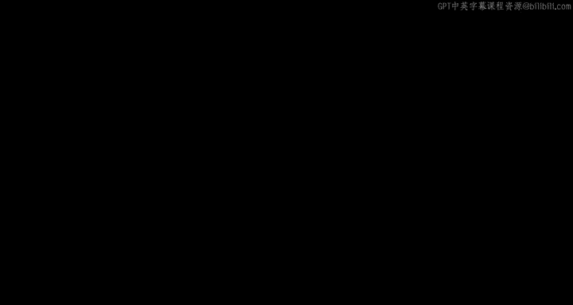
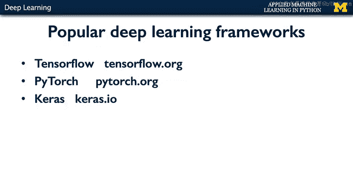

# 87：深度学习（选修）🧠

在本节课中，我们将探讨深度学习的基本概念、其核心优势与挑战，并通过一个简单的代码示例了解如何使用高级框架快速构建深度学习模型。

---

正如我们在课程第一周所讨论的，机器学习的一个关键挑战是为特定问题找到合适的特征，以作为学习模型的输入。

这被称为特征工程，它既是一门艺术，也是一门科学。

特征工程也常常是决定学习任务成败的最重要因素。有时，它甚至比模型本身的选择更为重要。

我们将在课程的最后一周进一步讨论这一点。

由于特征工程的困难性，学界对所谓的特征学习或特征提取算法进行了大量研究，这些算法能够自动找到好的特征。

这就引出了深度学习。从高层次看，深度学习的优势之一在于，它将一个复杂的自动特征学习阶段作为其监督训练的一部分。

此外，深度学习之所以被称为“深度”，是因为这种特征提取通常不只使用一个特征学习步骤，而是使用多个特征学习层构成的层次结构，每一层都馈入下一层。

以下是一个简化的例子，展示了在图像识别任务（例如手写数字识别）中，深度学习架构在实践中可能的样子。

你可以看到自动特征提取步骤由一系列特征层构成，每一层都基于一个进行卷积的网络，卷积可以被视为针对特定模式的过滤器。随后是一个下采样步骤，也称为池化，它可以在图像的任何位置检测到该特征的平移或旋转版本。

这样，特征就能被正确检测出来，用于最终由全连接网络实现的分类步骤。

下采样步骤还具有降低网络计算复杂度的效果。

根据我们想要预测的对象的属性，例如，如果我们只关心图像中是否存在某个物体，而不关心其具体位置，那么架构中的下采样部分可能被包含，也可能不被包含。

这仅仅是深度学习架构的一个例子。根据具体的学习问题，其规模、结构和其他属性可能看起来非常不同。

这张来自密歇根大学 Hong La Lee 及其同事论文的图片展示了用于人脸识别的多层特征学习示意图。

从左到右有三组，分别对应特征学习的第一、第二和第三阶段。每个阶段的矩阵显示了一组图像特征，每个方块代表一个特征。

每个特征可以被视为一个检测器或过滤器，当底层图像中出现该模式时，它就会被激活。

其深度学习架构的第一层提取最原始的低级特征，例如边缘和不同类型的斑点。第二层则从这些第一层特征的组合中创建新特征。

对于人脸，这可能对应于捕获鼻子或眼睛等更高级特征形状的关键元素。

第三层则从第二层特征的组合中创建新特征，形成捕获典型人脸类型和面部表情的更高级特征。

最后，所有这些特征都被用作最终监督学习步骤（即人脸分类器）的输入。

以下是针对不同类型物体（汽车、大象、椅子以及混合物体）进行训练后得到的特征层。这种复杂的特征无法从少数几层中学习到。

算法和计算能力的进步使得当前的深度学习系统能够训练具有数十层线性层次特征的架构。

事实证明，人类大脑在处理视觉信息时，会进行与此非常相关的操作。有特定的神经回路首先进行低级特征提取，例如边缘检测和寻找重复模式的频率。

这些低级特征随后被用于计算更复杂的特征，以帮助估计简单形状及其方向，或者判断一个形状是在前景还是背景中。

接着是更高级的视觉处理层，支持更复杂的任务，如人脸识别和解释多个运动物体的运动。

从积极的一面看，深度学习系统取得了令人印象深刻的进步，并在许多困难任务上达到了最先进的性能。

深度学习的自动特征提取机制也减少了在寻找好特征时对人类猜测的需求。

最后，利用当前的软件，深度学习架构非常灵活，可以适应不同的任务和领域。

然而，从消极的一面看，深度学习可能需要非常大的训练集和计算能力，这可能会限制其在某些场景下的实用性。

实现的复杂性可以被视为深度学习的缺点之一。这也是为什么开发了许多复杂的高级软件包来协助开发深度学习架构。

此外，尽管我们之前看到的人脸例子给出了清晰、易于解释的特征，但在大多数情况下，典型深度学习系统的特征和权重远没有那么容易解释。

也就是说，我们不清楚为什么或是什么特征导致深度学习系统做出特定的预测。

虽然使用 Scikit-learn 的 MLPClassifier 和 MLPRegressor 类进行学习为学习和应用简单神经网络提供了一个有用的环境，但如果你有兴趣深入了解深度学习及其所需的软件工具，我们提供了一些额外资源的链接。

典型的深度学习开发使用多层软件栈完成。以下是一个例子。

高级层提供了一个高级编程接口，允许你仅用几行代码就指定一个深度学习架构。

在这个例子中，我选择 Keras 作为我的顶层编程层，稍后我会向你展示一个实际的 Keras 示例。

高级编程层调用一个或多个低级服务，用于定义描述算法工作流的计算图，或以向量、矩阵、张量等形式操作数据。

TensorFlow 是提供这类核心机器学习框架服务的软件示例，尽管 TensorFlow 也有一个高级编程层。

高级的 Keras 层利用了 TensorFlow 2 的核心服务。

底层是依赖于硬件的层，它执行最低级别的操作，例如矩阵乘法，这种方式通常针对特定的处理器或计算架构进行了优化。

例如，图形处理单元（GPU）是一种最初为显卡开发的特殊处理器，可以进行极快的矩阵运算。这个最底层可以利用这种专用硬件来加速深度学习模型的训练和运行。

让我解释一下这里的几个缩写。BLAS 代表基本线性代数子程序。这是线性代数事实上的标准低级例程。

BLAS 规范相当通用，但具体的实现通常针对给定处理器进行了高度速度优化。

CUDA 代表统一计算设备架构。这是一个并行计算平台和应用程序编程接口，允许软件使用某些类型的 GPU 进行通用处理。

我们还有为机器学习优化的新硬件形式，称为张量处理单元（TPU），正在被部署。

CUDNN 是一个 GPU 加速库，为深度神经网络应用中经常出现的例程提供了高度优化的实现。

因此，这三层协同工作，对于产生高效且有效的深度学习应用都至关重要。

TensorFlow、PyTorch 和 Keras 是目前使用最广泛的深度学习框架。

TensorFlow 是一个端到端的开源机器学习平台。它拥有一个全面、灵活的工具、库和社区资源生态系统，并支持高级编程接口和低级核心计算服务。

PyTorch 由 Facebook 的 AI 研究小组开发，并于 2017 年在 GitHub 上开源。它也用于各种复杂的机器学习应用，尤其是自然语言处理。PyTorch 以简单、易用、灵活、高效的内存使用和动态计算图而闻名。

Keras 现在是 TensorFlow 生态系统的一部分，为开发深度学习模型提供了一个简单、灵活的顶层编程接口。

---

因此，能够开发深度学习框架和机器学习具有多重好处。

使用深度学习，你可以非常快速地生成和迭代新模型，并且可以相对容易地进行调试，这在构建有效的机器学习系统时至关重要。

更具体地说，使用这些高级深度学习框架，你可以获得简单性的优势。使用深度学习，无需进行特征工程，表示学习甚至架构迭代都是自动完成的。

你可以仅使用几种不同的向量、矩阵、张量操作来构建流水线。

这些框架允许你进行高度可扩展的操作。

因此，得益于我们刚刚讨论的多层结构，你的代码非常适合在 GPU 或 TPU 等高性能计算硬件上进行并行化。

你可以通过在小批量数据上进行迭代来训练这些框架，这让你能够处理任意大小的数据集。

使用这些框架的深度学习模型也非常通用和可重用。它们可以在不从头开始的情况下用额外的数据进行训练。因此，可以轻松地“解冻”一个现有模型，添加更多训练数据来更新权重，然后再次“冻结”它，用于你的新任务。

因此，你可以在一个领域（如图像分类）预训练一个模型，然后针对不同问题（如视频分割）调整其训练。

---

我认为向你展示一个使用 Keras 定义简单数字识别器的具体示例会很有趣。这个例子来自 François Chollet 的《Python深度学习》一书。

一个 Keras 脚本通常有四个部分。

第一部分是一些准备数据的代码行。在这个例子中，我们使用 MNIST 数据集。因此，这里有一些代码来加载数据集，并进行一些重塑操作，使其为后续的神经网络准备好正确的格式。

第二部分，在准备好数据之后，你定义模型。这里我们将实现一个非常简单的模型：输入是一个数字，我们让它通过一个有 512 个单元的密集神经网络层，然后是一个有 10 个单元的第二层。

你可以看到，Keras 程序中顺序模型的定义与这里模型的图形描述之间有非常清晰的对应关系。因此，在 Keras 中创建这些模型非常容易：你定义想要的模型类型，添加这些层（每添加一层只需一行代码）。当然，你为每一层指定它有多少个隐藏单元、使用什么激活函数等等。

一旦定义了模型的层，你就进行所谓的“编译”，在这里指定一些重要参数，如使用哪个优化器、使用哪个损失函数等等。这为下一步（即训练步骤）在内部准备好代码。

训练步骤是使用带有标签的训练图像来拟合网络的地方，在这里你可以指定参数，如要运行多少个周期、在训练过程中每个批次要放入多少训练图像等等。

然后，在模型训练步骤之后，最后一步是评估模型。Keras 有非常简单的方法，你只需在网络上调用这个 `evaluate` 方法，使用测试数据，它就会为你提供数据上的损失以及像准确率这样的评估指标。

---

这很好地说明了使用高级框架来构建一个能完成有趣任务的非平凡神经网络是多么容易。

---

在本节课中，我们一起学习了深度学习的基本概念，包括其自动特征提取的核心优势、多层架构的工作原理，以及面临的挑战。我们还了解了主流的深度学习框架（如 TensorFlow、PyTorch 和 Keras）及其软件栈结构，并通过一个 Keras 代码示例直观地看到了构建和训练一个简单神经网络模型的便捷性。