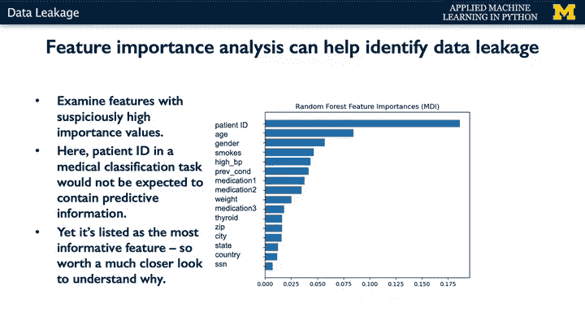

# 课程3：数据泄露问题 🔍

在本节课中，我们将要学习数据科学中的一个关键概念——**数据泄露**。我们将了解数据泄露是什么、它为何重要、它如何发生，以及如何在你的应用中检测和避免它。

---

## 什么是数据泄露？

数据泄露，有时简称为“泄露”，描述的是这样一种情况：你用来训练机器学习算法的数据，恰好包含了关于你试图预测的目标的、意料之外的额外信息。

本质上，**泄露发生在训练期间引入了关于目标标签或值的、在实际使用中本不应合法获得的信息的任何时候**。

也许最简单的数据泄露例子是，如果我们将数据实例的真实标签作为一个特征包含在模型中。模型将学会类似这样的规则：**如果这个对象被标记为苹果，就预测它是苹果**。

我们之前见过的另一个明显的泄露例子是，测试数据意外地被包含在训练数据中，这会导致过拟合。然而，数据泄露也可能因许多其他原因发生，而且方式通常相当微妙，难以察觉。

当数据泄露确实发生时，它通常会导致模型开发阶段的结果过于乐观，随后在预测模型实际部署到新数据上并评估时，会带来令人失望的糟糕结果。换句话说，泄露可能导致你的系统学习到一个次优模型，该模型在实际部署中的表现远不如在无泄露环境下开发的模型。

---

## 为什么数据泄露很重要？

数据泄露在现实世界中可能产生重大影响，范围从对实际上无效的事物进行糟糕的货币和工程投资所带来的财务成本，到损害客户对你系统质量的看法或影响公司品牌的系统故障。

由于这些原因，数据泄露是数据挖掘和机器学习中最严重和最普遍的问题之一，也是作为机器学习从业者必须时刻警惕的事情。

---

## 数据泄露的微妙示例

现在，我们来看看数据泄露问题的一些更微妙的例子。

一个典型的情况是，训练数据中包含了在实际使用中本不应合法获得的关于未来的信息。

假设你正在开发一个零售网站，并构建一个分类器来预测用户是可能留下并查看另一个页面，还是离开网站。如果分类器预测他们即将离开，网站可能会弹出一个提供激励以继续购物的窗口。

一个包含泄露信息的特征例子是用户的**总会话时长**或他们在访问网站期间浏览的**总页面数**。这个总数通常在访问日志数据的后处理阶段被添加为新列。这个特征包含了关于未来的信息，即用户将要进行多少次访问，这在**实际部署中是不可能知道的**。一个解决方案是用“会话中已访问页面数”特征来替换“总会话时长”特征，该特征只知道会话中到目前为止访问的总页面数，而不知道还剩下多少。

第二个泄露示例可能涉及尝试预测银行网站上的客户是否可能开设账户。如果用户的记录包含一个账户号字段，对于仍在探索网站的用户，该字段通常为空，但一旦用户确实开设了账户，它最终会被填写。显然，用户账户字段在这种情况下不是一个合法的特征，因为在用户仍在探索网站时，它可能不可用。

另一个未来信息泄露到过去的例子可能是，如果你正在开发一个诊断测试来预测特定的医疗状况。现有的患者数据集可能包含一个二元变量，该变量恰好标记了患者是否因该状况接受了手术。显然，这样的变量对该医疗状况具有高度预测性。

还有许多其他方式可以使预测信息泄露到这个特征集中。可能存在某种缺失诊断代码的组合，非常能表明该医疗状况。但同样，这些信息在患者状况仍在研究时不可用，因此使用它们是不合法的。

或者，最后，同一个患者数据集中的另一个例子可能涉及患者ID的形式。ID的分配可能取决于特定的诊断路径。换句话说，如果是因为访问了专科医生（初始医生确定该医疗状况可能性很大）的结果，ID可能会不同。

这最后一个例子很好地说明了，在训练集中，数据泄露可能以多种不同方式发生。事实上，通常不止一个泄露问题同时存在。有时，修复一个泄露特征可能会揭示第二个泄露特征的存在。

---

## 数据泄露的主要类型

作为指导，以下是数据泄露的一些额外示例。我们可以将泄露分为两种主要类型：

1.  **训练数据中的泄露**：通常是测试数据或未来数据混入了训练数据。
2.  **特征中的泄露**：关于真实标签的某些高度信息性的内容以某种方式被包含为一个特征。

数据泄露的一个非常重要的原因是在整个数据集上执行某种预处理，其结果影响了训练期间看到的内容。这可能包括以下场景：
*   计算用于归一化和重新缩放的参数。
*   查找最小和最大特征值以检测和移除异常值。
*   使用变量在整个数据集上的分布来估计训练集中的缺失值或执行特征选择。

另一个需要特别谨慎的情况是在处理时间序列数据时，未来事件的记录被意外地用于计算特定预测的特征。我们看到的会话时长例子就是这种情况的一个实例。但如果数据收集或缺失值指示器存在错误，则可能发生更微妙的影响。如果一个特征与在某个时间跨度内收集至少一条记录有关，那么错误的存在可能会泄露关于未来的信息，换句话说，表明不再期望有进一步的观察。

泄露特征包括我们有一个像患者记录中的诊断ID这样的变量，我们将其移除，但却忽略了移除其他包含相同或相似信息的变量，这些变量被称为**代理变量**。患者ID的例子（其中ID号码由于入院过程而包含关于患者诊断性质的线索）就是这种情况的一个例子。

在某些情况下，数据集记录被有意随机化，或者包含用户特定信息（如姓名、位置等）的某些字段被匿名化。根据预测任务，撤销这种匿名化可能会泄露用户或其他敏感信息，这些信息在实际使用中本不应合法获得。

最后，我们在这里讨论的任何上述示例都可能出现在第三方数据集中，这些数据集作为附加特征源被连接到训练集。因此，要始终注意此类外部数据中的特征及其解释和来源。

---

## 如何检测和避免数据泄露？

那么，如何在你的应用中检测和避免数据泄露呢？

在构建模型之前，探索性数据分析可以揭示数据中的意外情况。例如，寻找与目标标签或值高度相关的特征。来自医疗诊断示例的一个例子可能是那个指示患者是否因该状况接受了特定外科手术的二元特征，它可能与特定诊断高度相关。

构建模型后，寻找拟合模型中令人惊讶的特征行为，例如极高的特征权重或与变量相关的非常高的信息增益。

接下来，寻找整体上令人惊讶的模型性能。如果你的模型评估结果远高于相似数据集上相同或类似问题的结果，那么请仔细查看对模型影响最大的实例或特征。

另一个更可靠的泄露检查方法（但也可能成本较高）是对训练好的模型进行有限的真实世界部署，以查看模型训练和开发结果所建议的估计性能与实际结果之间是否存在巨大差异。这种检查模型是否能很好地泛化到新数据的方法是有用的，但可能无法立即深入了解泄露是否发生、发生在哪里，或者任何性能下降是否是由于其他原因（如经典的过拟合）造成的。

让我给你一个例子，说明特征重要性分析如何帮助识别数据泄露的存在。

在这个例子中，我们使用拟合随机森林时计算的 `feature_importances_` 属性。其思想是使用特征重要性分析来检查特征是否存在可疑的高重要性值。在这个例子中，假设我们有一个医疗数据集，其中包含关于患者、他们的健康状况、药物、位置等的各种特征，以及他们在系统中的患者ID。我们训练一个分类器来预测患者未来是否会被诊断出患有某种疾病，这是一个医疗分类任务。我们训练分类器，然后检查特征重要性值。你会期望与健康问题或人口统计相关的特征在此分析中具有较高的特征重要性权重，而像患者ID或社会安全号码这样的通用特征预计不会包含任何关于某人健康状况的预测信息。但当你查看特征重要性数字时，你会发现虽然社会安全号码确实具有较低的特征重要性，但患者ID却被列为信息量最大的特征，这非常令人惊讶。因此，值得更仔细地研究以理解原因。

这种情况实际上在真实数据集中发生过。在一个案例中，患者ID包含一个子ID，该子ID指示患者是由全科医生添加的，还是在预测的问题被识别后由专科医生添加到系统中的。换句话说，通过知道患者ID，系统得到了提前警告，即一个人已经看过专科医生，因此更有可能患有该疾病，从而为这个分类问题贡献了一种形式的数据泄露。

---

## 减少数据泄露的实践方法

你可以遵循一些实践方法来帮助减少应用中数据泄露的机会。

一条重要规则是确保**在每个交叉验证折叠内分别执行任何数据准备**。换句话说，如果你正在缩放或归一化特征，为此估计的任何统计量或参数应仅基于交叉验证分割中可用的数据，而不是整个数据集。你还应确保在相应的保留测试折叠上使用这些相同的参数。

如果你正在处理时间序列数据，请跟踪与处理特定数据实例（如用户在网页上的点击）相关的时间戳，并确保用于计算此实例特征的任何数据不包括时间晚于截止值的记录。这将有助于确保你没有在当前特征计算或训练数据中包含来自未来的信息。

如果你有足够的数据，甚至在开始处理新数据集之前，考虑划分出一个完全独立的测试集，然后仅在最后一步在此测试数据上评估你的最终模型。这里的目标类似于进行真实世界部署，以检查你的训练模型是否能合理地很好地泛化到新数据。如果性能没有显著下降，那很好。但如果有下降，泄露可能是一个促成因素，此外还有像经典过拟合这样的常见嫌疑。

---

## 总结

在本节课中，我们一起学习了数据泄露的概念。我们了解到，数据泄露发生在训练数据包含了关于预测目标、但在实际部署中本不应获得的信息时。它会导致模型在开发阶段表现过于乐观，而在真实应用中表现不佳。我们探讨了泄露的多种形式和原因，包括未来信息混入、代理变量以及预处理不当等。最后，我们学习了通过仔细的探索性数据分析、特征重要性检查、正确的交叉验证流程以及保留独立的测试集等方法来检测和避免数据泄露。作为机器学习从业者，始终保持对数据泄露的警惕至关重要。