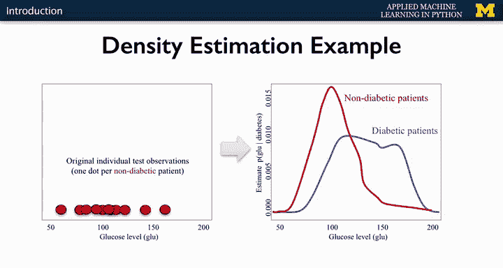

# 课程一：无监督机器学习概述 🧠

在本节课中，我们将要学习无监督机器学习的基本概念、主要任务及其应用场景。我们将了解它与监督学习的核心区别，并初步认识两种主要的无监督学习方法：数据变换和聚类分析。

无监督机器学习包含多种多样的任务。与监督学习不同，无监督学习没有需要预测的目标值。相反，无监督学习算法的任务是处理原始数据，并从中捕捉一些有趣的结构。

这在许多场景中非常有用。例如，探索和可视化复杂数据集中的结构。进行密度估计，以预测事件的概率。压缩数据。在应用监督学习算法之前提取更有效的特征。或者发现重要的结构，例如数据中相似对象的聚类或不寻常的个别离群值。

所有这些以及其他无监督学习任务都有一个共同属性：没有目标值、标签或输出来学习或预测。相反，我们只有数据集中未标记的样本作为输入。

以下是聚类这一无监督方法的示例。假设你负责运营一个允许人们从你公司购买产品的网站，该网站每天有数千次访问。当人们通过点击产品链接或输入搜索词来访问网站时，他们的交互行为会被网络服务器记录，从而生成一个大型日志文件。

对于你的业务而言，通过根据用户的购物行为将他们分组来理解谁在使用你的网站可能很有用。例如，可能有一组更专业的用户，他们使用更高级的功能来寻找非常具体的商品。而另一组非专业用户可能只是喜欢浏览更广泛的商品集合。

通过将用户聚类成组，你可能会对你的典型客户是谁，以及不同类型的用户认为哪些网站功能重要有所洞察。你可以利用从用户聚类中获得的见解来改进针对不同群体的网站功能，或者向更有可能购买产品的特定群体推荐产品。

因此，在本讲中，我们将简要概述无监督学习方法，并将其分为两大类。首先，我们将看一类称为“变换”的无监督方法，因为它们本质上只是将原始数据通过某种有用的过程运行，以提取或计算某种信息。然后，我们将看另一大类无监督学习方法，即聚类方法。就像我们网站的例子一样，聚类方法在数据中寻找组，并将数据集中的每个点分配到其中一个组。

---

## 数据变换方法 🔄

上一节我们介绍了无监督学习的整体概念，本节中我们来看看第一类方法：数据变换。这些方法通过对原始数据进行处理，提取出更有价值的信息或结构。

以下是几种重要的数据变换方法：

### 密度估计

密度估计用于当你有一组测量值散布在一个区域中，并且你想创建一个可以视为覆盖整个区域的平滑版本时，该版本可以给出在该空间某个区域观察到特定测量值的一般可能性估计。

例如，在与诊断糖尿病相关的医疗应用中，单变量密度估计可用于估计特定测试分数的分布，即血液检测中的血浆葡萄糖浓度值，针对患有特定形式糖尿病的人群。利用这个密度估计，我们可以估计任何患有该医疗状况的人具有特定葡萄糖分数的概率，即使该特定分数未在原始数据集中出现。然后，我们可以将其与没有该病症的人的葡萄糖水平范围（此处由红线表示）进行比较。通常，密度估计随后用于进一步的机器学习阶段，作为为分类或回归提供特征的一部分。

更技术性的说法是，密度估计在特征空间上计算连续概率密度，给定该特征空间中的一组离散样本。利用这个密度估计，我们可以估计任何给定特征组合出现的可能性。在 Scikit-learn 中，你可以使用 `sklearn.neighbors` 模块中的 `KernelDensity` 类来执行一种广泛使用的密度估计形式，称为核密度估计。核密度估计在创建地理空间数据的热图时尤其受欢迎。

---

## 聚类方法 🧩

在了解了数据变换方法之后，本节我们将探讨另一大类无监督学习方法：聚类。聚类方法的核心目标是在数据中发现内在的组别结构。

聚类方法，如我们网站的例子所示，在数据中寻找组，并将数据集中的每个点分配到其中一个组。其核心思想是将相似的数据点归为一类，将不相似的点分开。

---

## 总结 📝

本节课中我们一起学习了无监督机器学习的基础知识。我们明确了它与监督学习的核心区别在于没有预设的目标标签。我们探讨了无监督学习的两大主要类别：数据变换方法（如密度估计）和聚类方法。数据变换旨在从原始数据中提取或计算新的信息表示，而聚类则致力于发现数据中内在的组别结构。理解这些基本概念是后续深入学习具体算法和应用的基础。