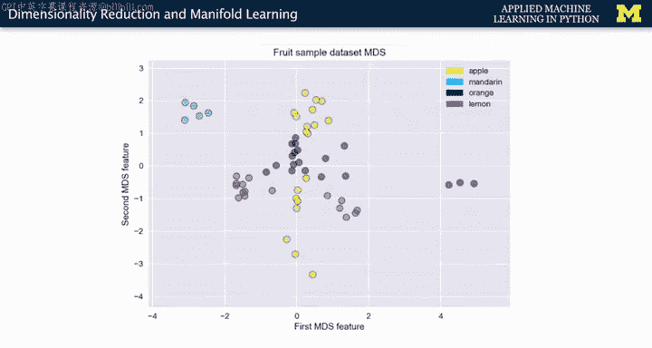

# 90：降维与流形学习 📉


在本节课中，我们将要学习无监督学习中的一个重要类别：降维算法。我们将探讨如何将高维数据转换为低维表示，以便于可视化和理解数据的内在结构。我们将重点介绍主成分分析（PCA）和几种流形学习方法。

---

## 概述

降维算法属于转换类无监督学习方法。这类转换将原始数据集（可能包含数百个特征）转换为一个仅使用少量维度（例如10个）的近似版本。一个常见的需求是在首次探索数据集时，通过二维散点图可视化来理解样本如何分组或相互关联。

---

## 主成分分析（PCA）🔍

上一节我们介绍了降维的基本概念，本节中我们来看看最经典的方法：主成分分析。

直观地说，PCA所做的是获取原始数据点云，并找到一个旋转，使得维度在统计上不相关。PCA随后通常会丢弃除最能捕捉原始数据集变化的最具信息量的初始维度之外的所有维度。

以下是一个使用合成二维数据集的简单示例。如果我们有两个高度相关的原始特征，由这个点云表示，PCA将旋转数据，使得方差最大的方向（称为第一主成分，沿着点云的长轴方向）成为第一个维度。然后，它会找到与第一主成分成直角、能最大程度捕捉剩余方差的方向，即第二主成分。在二维空间中，只有一个这样的方向与第一主成分垂直，但在更高维度中，会有无限多个。对于超过两个维度的情况，寻找与前一个主成分垂直的连续主成分的过程将持续进行，直到达到所需的主成分数量。

应用PCA的一个结果是，我们现在知道了原始二维数据的最佳一维近似。换句话说，我们可以取任何之前使用X和Y两个特征的数据点，并仅使用一个特征（即其在第一主成分上的投影位置）来近似它。

以下是使用Scikit-learn将PCA应用于更高维数据集（乳腺癌数据集）的示例。

要执行PCA，我们从`sklearn.decomposition`导入`PCA`类。首先，转换数据集以使每个特征的值范围具有零均值和单位方差，这一点很重要。我们可以使用`StandardScaler`类的`fit`和`transform`方法来实现，如下所示。

```python
from sklearn.decomposition import PCA
from sklearn.preprocessing import StandardScaler

# 假设 X 是原始数据
scaler = StandardScaler()
X_scaled = scaler.fit_transform(X)

# 创建PCA对象，指定保留前两个主成分
pca = PCA(n_components=2)
pca.fit(X_scaled)
X_pca = pca.transform(X_scaled)
```

然后，我们创建PCA对象，指定我们只想保留前两个主成分以将维度减少到仅两列，并使用我们的归一化数据调用`fit`方法。这将设置PCA，使其学习数据集的正确旋转。然后，我们可以应用这个准备好的PCA对象，将原始输入数据集中的所有点投影到这个新的二维空间。

请注意，由于我们不是在进行监督学习或针对测试集评估模型，因此我们不必将数据集拆分为训练集和测试集。如果我们查看从PCA返回的数组的形状，它会将我们具有30个特征的原始数据集转换为一个只有两列的新数组，本质上是用两个新特征表示每个原始数据点，代表数据点在这个新的二维PCA空间中的位置。

然后，我们可以创建一个使用这两个新特征的散点图，以查看数据如何形成聚类。在这个例子中，我们使用了一个带有监督学习标签（即癌细胞的恶性和良性标签）的数据集，以便我们可以看到PCA在寻找数据聚类方面的效果如何。

以下是使用PCA计算的两个新特征绘制所有30个特征数据样本的结果。我们可以看到，恶性和良性细胞在这个空间中确实倾向于聚集成两组。事实上，我们现在可以将线性分类器应用于原始数据集的这个二维表示，并且可以看到它可能会表现得相当好。这说明了像PCA这样的降维方法的另一个用途：寻找信息丰富的特征，然后可以在后续的监督学习阶段使用。

我们可以创建一个热图，可视化乳腺癌数据集的前两个主成分，以了解每个成分与哪些特征分组相关联。请注意，我们可以获取表示定义PCA空间的两个主成分轴的数组，使用在数据上使用PCA的`fit`方法后填充的`PCA.components_`属性。

我们可以看到，第一主成分全是正值，显示了所有30个特征之间的一般相关性。换句话说，它们倾向于一起上下变化。第二主成分有正负符号的混合，但特别是，我们可以看到一组负号特征共同变化，并且与剩余特征的方向相反。查看名称，这个子集共同变化是有道理的。我们看到“平均纹理”和“最差纹理”这对，以及“平均半径”和“最差半径”这对一起变化，等等。

---

## 流形学习 🗺️

上一节我们介绍了PCA，它是一种探索数据集的好工具，但对于更复杂的数据集，可能无法找到产生更好可视化的更细微的分组。本节中我们来看看另一类算法：流形学习。

有一类称为流形学习算法的无监督算法，非常擅长在高维数据中找到低维结构，并且对可视化非常有用。高维空间中低维子集的一个经典例子是这个三维数据集，其中所有点都位于一个形状有趣的二维薄片上。这个高维空间内的低维薄片被称为流形。PCA不够复杂，无法找到这种有趣的结构。

一种广泛使用的流形学习方法称为多维缩放（MDS）。MDS有很多变体，但它们都有相同的总体目标：可视化高维数据集并将其投影到低维空间（在大多数情况下是二维页面），以一种保留原始数据空间中点之间接近程度信息的方式。这样，您可以在高维数据中找到并可视化聚类行为。

在Scikit-learn中使用像MDS这样的技术与使用PCA非常相似。与PCA一样，每个特征都应归一化，使其特征值具有零均值和单位方差。从`sklearn.manifold`导入`MDS`类并转换输入数据后，您创建MDS对象，指定组件的数量（通常设置为二维以进行可视化）。然后，您使用转换后的数据拟合对象，这将学习映射，然后您可以将MDS映射应用于转换后的数据。

以下是应用MDS到水果数据集的示例，您可以看到它在可视化不同水果类型确实倾向于聚集成组的事实方面做得相当好。

```python
from sklearn.manifold import MDS

mds = MDS(n_components=2)
X_mds = mds.fit_transform(X_scaled)
```

---

## T-SNE：强大的可视化工具 ✨

一种特别强大的用于可视化数据的流形学习算法称为T-SNE。T-SNE找到数据的二维表示，使得二维散点图中点之间的距离尽可能接近原始高维数据集中相同点之间的距离。特别是，T-SNE更重视保留关于相邻点之间距离的信息。



以下是T-SNE应用于手写数字数据集图像的示例。您可以看到，这个二维图保留了在像素方面相似的图像之间的邻居关系。例如，大多数数字8样本的聚类更接近数字3和5的聚类（在手写中可能看起来更相似），而不是距离更远的数字1的聚类。

以下是应用T-SNE到水果数据集的示例。代码与应用MDS非常相似，本质上只是用TSNE替换MDS。有趣的是，T-SNE在这个相当小且简单的水果数据集上在寻找结构方面表现不佳，这提醒我们，在使用流形学习可视化数据时，应该至少尝试几种不同的方法，看看哪种方法对特定数据最有效。T-SNE倾向于在具有更明确局部结构的数据集上效果更好。换句话说，具有更清晰定义的邻居模式。

```python
from sklearn.manifold import TSNE

tsne = TSNE(n_components=2)
X_tsne = tsne.fit_transform(X_scaled)
```

---

## 总结

本节课中我们一起学习了降维与流形学习。我们首先介绍了降维的概念及其在数据探索和可视化中的重要性。然后，我们深入探讨了主成分分析（PCA）的原理和应用，学习了如何使用它来减少数据维度并发现潜在结构。接着，我们介绍了流形学习，特别是多维缩放（MDS）和T-SNE，这些方法能够更好地捕捉复杂数据集中的非线性结构，并生成有意义的二维可视化。最后，我们通过实际代码示例演示了如何在Python中应用这些技术，并讨论了不同方法在不同类型数据集上的适用性。掌握这些工具将帮助您更有效地理解和呈现高维数据。