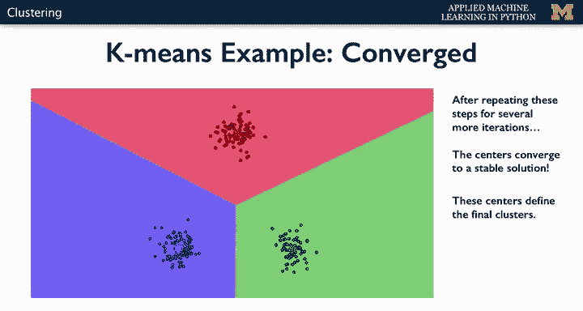
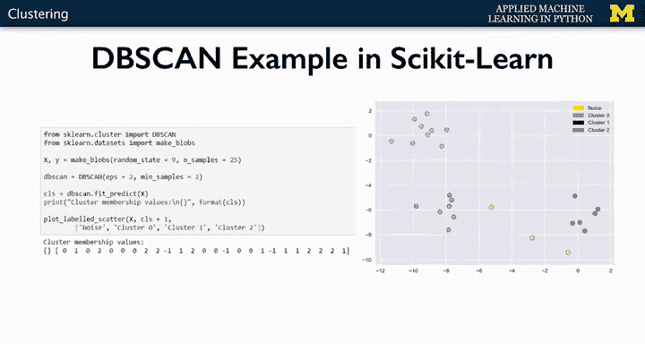

# 91：聚类分析 🧩

在本节课中，我们将学习无监督学习中的另一类重要方法：聚类分析。我们将探讨三种主流的聚类算法：K均值聚类、凝聚层次聚类和DBSCAN密度聚类，并了解它们的工作原理、应用场景以及如何用Python实现。

除了数据变换，无监督学习的另一大类方法是聚类方法。

聚类的目标是将数据集划分成若干个称为“簇”的组，使得相似的数据实例被分配到同一个簇中，而非常不相似的对象则被分配到不同的簇。

如果随着时间的推移有新的数据点加入，一些聚类算法也能预测新数据实例应该被分配到哪个簇。这类似于分类任务，但聚类模型无法预先使用带标签的示例进行训练。

## K均值聚类 🎯

K均值聚类是最广泛使用的聚类算法之一。它的核心思想是在特征空间的不同区域找到K个簇中心，这些中心被认为代表了不同的数据组。

你需要预先指定K的值，这是K均值算法的一个缺点。对于某些问题，我们可能知道数据应该分为几类，但对于许多其他任务，我们可能并不知道。

K均值算法的运行过程如下：首先，随机选取K个簇中心的位置。然后，它在两个步骤之间反复迭代。

以下是算法的两个核心步骤：

1.  **分配步骤**：给定现有簇中心的位置，根据每个数据点到中心的距离，将其分配给最近的簇中心。
2.  **更新步骤**：调整每个簇中心的位置。具体做法是将新的簇中心设置为该簇内所有数据点位置的平均值。

经过一段时间的迭代，连贯的簇开始形成，簇中心以及每个数据点对应的簇分配最终会稳定下来。

K均值的一个特点是，簇中心不同的随机起始点通常会导致非常不同的聚类结果。因此，在scikit-learn中，K均值算法通常会以10个不同的随机初始化运行，并选择出现次数最多的那个解。

### 在Scikit-learn中应用K均值

K均值聚类在scikit-learn中应用简单。你需要从`sklearn.cluster`导入`KMeans`类，创建`KMeans`对象时通过`n_clusters`参数指定K值，然后在数据集上调用`fit`方法来运行算法。

这里需要区分能够预测新数据点应分配到哪个中心的聚类算法和不能进行此类预测的算法。K均值支持`predict`方法，因此我们可以分别调用`fit`和`predict`方法。我们稍后将看到的凝聚层次聚类等方法则不支持，必须在一个步骤中执行拟合和预测。

以下是应用于水果数据集的笔记本代码输出结果，在这个例子中我们预先知道K值。请注意，K均值对特征值的范围非常敏感。因此，如果你的数据特征具有非常不同的范围，使用最小-最大缩放进行归一化非常重要，就像我们对一些监督学习方法所做的那样。

由于K均值聚类中的每个簇完全由其中心点定义，因此它只能捕获相当简单的簇类型。当数据点形成大小大致相同、形状简单且分离良好的球形组时，K均值聚类往往效果很好。如果数据形成长而不规则的簇，K均值的效果往往不佳。

此外，我们在这里看到的K均值版本假设数据特征是连续值。然而，在某些情况下，我们可能具有分类特征，此时计算平均值没有意义。在这种情况下，存在K均值的变体，可以使用更通用的距离定义，例如能够处理分类特征的K中心点算法。

## 凝聚层次聚类 🌳

凝聚层次聚类指的是一类通过迭代自底向上方法工作的聚类方法。首先，每个数据点被放入自己的单一项簇中。然后进行一系列聚类，在每个阶段将最相似的两个簇合并成一个新簇，重复此过程直到满足某个停止条件。在scikit-learn中，停止条件是簇的数量。

以下是凝聚层次聚类如何在样本数据集上进行的可视化示例，直到达到三个簇。

在阶段1，每个数据点都在自己的簇中，由点周围的圆圈表示。在阶段2，两个最相似的簇（在此阶段相当于找到最近的点）被合并。这个过程继续进行，如表示每个簇的不断扩大的封闭区域所示。

你可以通过指定几种可能的连接标准之一，来选择凝聚层次聚类算法如何确定最相似的簇。在scikit-learn中，提供了以下三种连接标准：Ward、average和complete。

以下是三种连接标准的说明：

*   **Ward方法**：选择合并能使所有簇内总方差增加最小的两个簇。
*   **平均连接**：合并两个点之间平均距离最小的簇。
*   **完全连接**：也称为最大连接，合并两个点之间最大距离最小的簇。

通常，Ward方法在大多数数据集上效果良好，是我们通常选择的方法。在某些情况下，如果你期望簇的大小差异很大（例如，一个簇远大于其他簇），也值得尝试平均连接和完全连接标准。

### 在Scikit-learn中执行凝聚层次聚类

要在scikit-learn中执行凝聚层次聚类，你需要从`sklearn.cluster`导入`AgglomerativeClustering`类。初始化对象时，指定`n_clusters`参数，该参数使算法在达到该簇数时停止。你使用数据集作为输入调用`fit_predict`方法，它会返回数据点的一组簇分配，如下所示。

凝聚层次聚类的一个优点是，作为算法的效果，它会自动将数据排列成一个层次结构，反映了每个数据点被分配到连续簇的顺序和簇距离。这种层次结构可以使用称为**树状图**的工具进行可视化，即使对于高维数据也很有用。

以下是前一个数据集示例的Ward方法聚类对应的树状图。数据点在底部并编号，Y轴代表簇距离，即两个簇在数据空间中的距离。数据点构成树底部的叶子，随着每对连续簇的合并，树中添加一个新的父节点。父节点沿Y轴的高度捕获了两个簇在合并时的距离，向上的分支代表新合并的簇。请注意，你可以通过树中每个分支的长度来判断合并的簇相距多远。

树状图的这个特性可以帮助我们找出正确的簇数。通常，我们希望每个簇内的项目高度相似，但与其他簇相距甚远。例如，我们可以看到从三个簇变为两个簇发生在一个相当高的Y值处，这意味着被合并的簇相距甚远。我们可能希望避免选择两个簇，而坚持使用三个簇，这样就不会迫使包含非常不相似项目的簇强行合并。

Scikit-learn不提供绘制树状图的功能，但SciPy可以。SciPy处理聚类的方式与scikit-learn略有不同，但这里有一个示例。我们首先从`scipy.cluster.hierarchy`模块导入`dendrogram`和`ward`函数。`ward`函数返回一个数组，指定了凝聚层次聚类期间跨越的距离。这个`ward`函数返回一个连接数组，然后可以传递给`dendrogram`函数来绘制树。

通常，当基础数据本身遵循某种层次过程，使得树易于解释时，利用这种层次结构最有用。例如，层次聚类对于遗传学和其他生物学数据特别有用，其中层级代表突变或进化的阶段。

## DBSCAN密度聚类 🌌

但是，有些数据集K均值聚类和凝聚层次聚类都表现不佳。因此，我们现在将概述第三种聚类方法，称为DBSCAN。

DBSCAN是一个缩写，代表“基于密度的含噪声应用空间聚类”。DBSCAN的一个优点是你不需要预先指定簇的数量。另一个优点是它能很好地处理具有更复杂簇形状的数据集。你还可以找到不应合理分配给任何簇的离群点。DBSCAN相对高效，可用于大型数据集。

DBSCAN背后的主要思想是，簇代表数据空间中数据点更密集的区域，同时被空的或至少人口密度低得多的区域分隔开。

DBSCAN的两个主要参数是`min_samples`和`eps`。所有位于更密集区域的点都称为**核心样本**。对于一个给定的数据点，如果在距离`eps`内有`min_samples`个其他数据点，则该给定数据点被标记为核心样本。然后，所有彼此距离在`eps`单位内的核心样本被放入同一个簇中。

除了被归类为核心样本的点之外，最终不属于任何簇的点被视为**噪声**。而距离核心点`eps`单位内，但本身不是核心点的点被称为**边界点**。

以下是DBSCAN应用于样本数据集的示例。与其他聚类方法一样，DBSCAN从`sklearn.cluster`模块导入。就像凝聚层次聚类一样，DBSCAN不会为新数据进行簇分配，因此我们使用`fit_predict`方法一步完成聚类并获取簇分配。

### 参数设置注意事项

如果你的特定数据集没有正确设置`eps`和`min_samples`参数，可能导致DBSCAN返回的簇成员资格全部被分配标签`-1`，这表示噪声。基本上，`eps`设置隐式地控制了找到的簇的数量。

使用DBSCAN时，如果你已经使用`StandardScaler`或`MinMaxScaler`缩放数据以确保特征值具有可比范围，则更容易找到合适的`eps`值。最后一点需要注意的是，当你使用DBSCAN的簇分配时，请检查并适当处理`-1`这个噪声值，因为这个负值可能会引发问题，例如，如果簇分配稍后被用作另一个数组的索引。

## 聚类评估的挑战 ⚖️

与监督学习不同，在监督学习中我们有现有的标签或目标值可用于评估学习方法的有效性，而无监督学习算法通常很难自动评估，因为通常没有真实情况可供比较。

在某些情况下，例如在乳腺癌示例中，我们可能有现有的标签，可以通过比较数据点到簇的分配与同一数据点的标签分配来评估聚类的质量。但在许多情况下，标签并不可用。

此外，在聚类的情况下，存在模糊性，因为通常可以有多个看似合理的聚类分配给给定的数据集，除非我们有额外的标准（例如在具有客观评估基础的特定应用任务上的性能），否则没有一个明显优于另一个。例如，在聚类结果用作监督学习的特征的情况下，我们可以使用添加这些基于聚类的特征所带来的整体分类器准确率提升，作为底层聚类成功与否的衡量标准。

评估聚类算法的另一个问题是，很难自动解释或标记所找到簇的含义。这仍然是一个需要人类专业知识来判断的步骤。

## 总结 📝

在本节课中，我们一起学习了三种核心的聚类算法。我们首先介绍了**K均值聚类**，它通过迭代寻找簇中心来划分数据，适合处理球形、分离良好的簇，但需要预先指定簇数K。接着，我们探讨了**凝聚层次聚类**，它通过自底向上合并最相似的簇来构建层次结构，并可通过树状图可视化，适合探索数据的自然分组层次。最后，我们学习了**DBSCAN密度聚类**，它基于数据点的密度分布来发现任意形状的簇，并能有效识别噪声点，无需预先指定簇数。

每种方法都有其适用场景和局限性：K均值简单高效但对初始值和数据尺度敏感；层次聚类能提供丰富的层次信息但计算成本较高；DBSCAN能处理复杂形状和噪声但对参数设置敏感。在实际应用中，需要根据数据特性和分析目标选择合适的算法，并理解评估无监督学习结果通常需要结合领域知识进行判断。