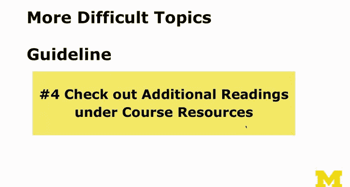

# 课程1：数据理解与可视化指南 📊


在本节课中，我们将学习如何高效利用《使用Python的统计学》课程资源，特别是Jupyter Notebook，以最大化学习效果。课程重点在于理解数据、数据可视化以及如何通过Python应用统计概念。

---

## 概述

本课程将大量使用Jupyter Notebook来演示和讲解Python中的数据理解与可视化概念。为了帮助您更好地掌握内容，本节提供了一系列实用指南和建议。

---

## 课程结构与资源使用

上一节我们介绍了课程的整体目标，本节中我们来看看课程的具体结构和资源使用方法。

您会注意到，课程内容通常按周组织。每周包含视频讲座、阅读材料、讨论提示、测验，最后是Jupyter Notebook。

**代码示例：课程周结构**
```python
# 示例：每周课程结构
week_structure = {
    "videos": "系列讲座视频",
    "readings": "补充阅读材料",
    "discussion": "讨论主题",
    "quizzes": "知识测验",
    "notebooks": "Jupyter Notebook实践"
}
```

**公式：学习效率最大化**
`学习效果 = 理论理解 + 实践操作`

---

## 高效学习策略：同步使用Notebook

我们强烈建议您不要等到课程最后才打开Notebook。相反，请在观看讲座视频时同步打开对应的Notebook。

以下是具体操作建议：

1.  **准备多显示器环境**：使用大显示器或双显示器，一边播放视频，一边操作Notebook。
2.  **跟随操作**：在视频讲解概念时，暂停播放，在Notebook中尝试相同的步骤。
3.  **即时实践**：通过动手操作加深对Python代码和统计概念的理解。

过往学员反馈表明，这种方法能显著提升信息吸收率和实际应用能力。

---

## 数据理解的核心重点

本课程的一个核心重点是理解数据本身。这包括数据的定义、类型以及来源。

当您准备进行数据分析时，了解数据来源至关重要。在课程第四周，您将深入学习数据来源，包括如何选择样本以及如何在数据分析中考虑抽样设计。

为了帮助您掌握这些重要概念，课程视频中嵌入了多种问题。请充分利用这些互动问题，使抽象概念具体化。

---

## 提问与资源利用

课程讲师欢迎您就课程内容提出个人问题。虽然问题可能无法立即得到解答，但已回答的问题会被归档到FAQ中，供未来学员参考。

许多问题可以在讨论论坛中得到快速解答。但您也可以随时提出更复杂的问题，这些问题将被转交给讲师团队。

此外，课程团队也在向学员学习。针对过去学员反馈较难掌握的主题，我们准备了补充阅读材料列表。

请务必查看“课程资源”下的“补充阅读”部分，这些材料旨在帮助澄清难点概念。

---

## 总结



本节课中我们一起学习了如何高效利用《使用Python的统计学》课程资源。关键要点包括：同步使用Jupyter Notebook与视频讲座以最大化学习效果；重视对数据来源和类型的理解；积极利用课程中的互动问题、讨论论坛和补充阅读材料来解决疑问。

希望这些指南和技巧能帮助您更好地学习后续的精彩内容。😊