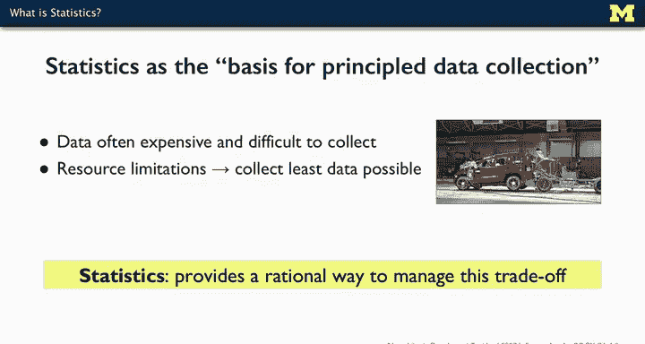

#  2：统计学本质解析 📊

在本节课中，我们将探讨统计学的定义、核心概念、历史背景及其相关领域。我们将学习如何从数据中学习，理解统计学的不同视角，并了解它如何帮助我们做出基于数据的决策。

---

## 什么是统计学？

统计学是一门涵盖从数据中学习所有方面的学科。作为一种方法论，它涉及使我们能够处理和理解数据的工具与方法。统计学家开发数据分析方法，并不断研究这些方法的特性，以了解它们在何时能提供洞见，何时可能产生误导。

**统计量**与**统计学**之间存在区别。我们每天遇到的“统计量”是指数据集合的数值或图形摘要。例如，我向学生报告的期末考试平均分、某地一段时间内的最低温度，或调查中退休人员的比例。这些都是统计量。

而“统计学”这一学科领域，则专注于研究方法论。统计学家开发新的统计工具，从数据中计算统计量，并与领域专家合作，以恰当的方式解释这些结果。

---

## 统计学的挑战与机遇

统计学是一个不断发展和充满活力的领域，随之而来的是挑战与机遇。各种统计方法的特性被持续研究，以确定何时以恰当的方式使用它们。大量新的应用领域涌现，这些新领域催生了开发新分析方法的需求。新的测量方式和传感器带来了需要分析的新型数据。此外，计算技术的进步使我们不仅能够进行数据分析，还能对收集到的大量数据进行更复杂的分析。

---

## 统计学的不同视角

统计学是一个包容性很强的学科，它融合了来自理论、实践及相关领域的新思想。以下是关于统计学领域以及数据工作者如何看待这个领域的一些不同视角。

### 数据摘要的艺术

数据可能令人不知所措，因此需要理解数据，这通常涉及数据的简化和摘要。数据简化的主要目标之一是使数据集对人类观察者来说易于理解。统计学家拥有多种不同的数据摘要技术，这些技术需要与数据使用者的目标保持一致才能有意义。因此，统计学家接受过良好训练，能够使用恰当、严谨且有效的方法来摘要数据。

### 评估数据主张的框架

发展统计学领域的一个主要动机是提供一个结构和框架，用以评估基于数据的主张是否有意义。通常，从数据中获得的洞见并非100%准确。但幸运的是，我们有一种方法来量化报告结果与真实情况之间的潜在差距。许多民意调查在报告结果时会附带一个误差范围。这个误差范围提供了报告结果与实际民意状态之间可能存在的差异的概念。

### 基于不确定性的决策

理解数据非常重要，但这自然引出了能够根据所学知识采取行动的需求。在某些统计学分支中，决策是任何统计分析的最终目标。在我们的个人和职业生活中，我们都在面对不确定性时做出决策。我们必须权衡不同方法的成本和收益。例如，一个人发现自己患某种癌症的风险高于平均水平，是否应该接受预防性手术？统计学可以帮助为这一决策过程提供信息。

### 理解变异性

当我们摘要数据时，通常首先关注典型值或中心值。但在统计学中，我们非常重视理解数据中的变异性。如果我们知道美国人平均拥有约6000美元的信用卡债务，我们就对这个信用卡债务分布的中心值有了很好的了解。但如果我们得知大约10%的人拥有超过30000美元的信用卡债务，那么这个百分位数就为我们提供了关于人群中信用卡债务变异性的更多信息。

### 预测与预报

统计学的核心任务之一是预测。我们无法绝对确定地知道未来，但如果我们能有效利用现有数据，有时可以对未来做出相当准确的预测。例如，天气预报、地震风险预测、新产品未来市场需求估计、选举结果预测，或患者是否会对某种治疗产生良好反应。

### 测量与评估

我们收集大量数据，其中一些变量可以相当准确地测量，例如一个人的年龄或身高。而另一些变量则较难测量，例如血压实际上每分钟都在变化。此外，还有一些构念，如情绪、个性、政治意识形态，这些更难定义和量化。统计学在构建和评估测量这些难以定义概念的严谨方法，以及评估各种方法的质量方面发挥着重要作用。

### 有原则的数据收集基础

有时数据收集可能非常昂贵和困难。例如，如果必须破坏产品才能对其进行测量，我们当然希望有能力收集尽可能少的数据。资源限制限制了可以收集的数据量。但如果数据太少，可能导致研究结果不佳。因此，统计学提供了一种合理的权衡方法，既希望获得更多数据，又了解和允许这些资源限制。

---

## 📜 统计学简史

以下是一些关键的历史里程碑：

*   **古代**：文明开始收集关于收成、洪水和人口规模的数据。
*   **18世纪**：概率论发展，使得随机性和变异性能够用数学更精确地定义。
*   **19世纪**：现代统计学出现，主要源于解决遗传学和计量经济学领域的问题。
*   **20世纪**：统计理论在科学和工业的许多新应用领域推动下取得进展，计算机开始用于数据分析。
*   **当代**：我们进入大数据、海量数据、数据科学和机器学习的时代。

---

## 🤝 统计学的相关领域

统计学与多个相关领域有交集：

*   **计算机科学**：提供处理数据的算法、结构以及操作数据的编程语言。
*   **数学**：提供表达统计概念的简洁语言和符号，以及评估和理解统计方法特性的工具。
*   **概率论**：数学的一个分支，是统计学基础的关键部分，使我们能够表达随机性和不确定性的概念。
*   **数据科学**：提供数据库管理、机器学习以及执行数据分析所需的基础设施。

---

## 🚀 统计学的现代应用

统计学已从一个虽小但重要的领域，发展成为研究和工业中的关键支柱。一些新兴应用包括：

*   计算机视觉
*   自动驾驶
*   人脸识别
*   在线搜索和购物中的推荐系统
*   医疗健康领域的预测分析和精准医疗
*   欺诈检测
*   环境和基础设施风险评估
*   社会与政府服务，如职业培训和行为治疗

---

## 总结

在本节课中，我们一起学习了统计学的本质。我们了解到统计学是从数据中学习的学科，它既是工具也是方法论。我们探讨了统计学的不同视角，包括数据摘要、决策框架、变异性理解、预测、测量评估和有原则的数据收集。我们还回顾了统计学的简史，认识了其与计算机科学、数学、概率论和数据科学等相关领域的紧密联系。最后，我们看到了统计学在现代众多前沿领域的广泛应用。统计学和统计思维帮助我们理解围绕我们的数据和信息。祝愿你在接下来的统计学旅程中一切顺利！