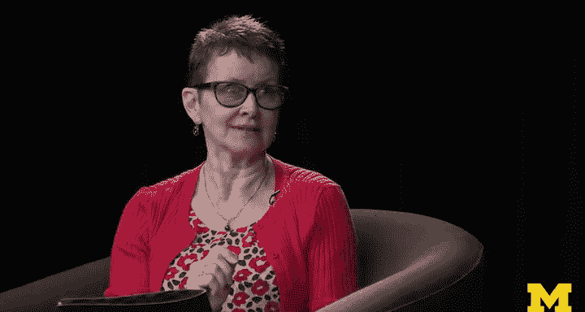

# 4：现实中的统计学应用访谈 🎙️

在本节课中，我们将通过密歇根大学两位教授的访谈，了解统计学与Python在现实世界中的具体应用。我们将探讨他们的研究项目、教学经验以及对学习者的建议。

---

## 访谈嘉宾介绍

大家好，我是Brenda Gunderson。今天我们邀请了两位特别的嘉宾，Brady West和Ambuj Tewari。他们将分享他们与统计学的联系以及对Python统计学的热情。

欢迎你们。谢谢。

我们从Brady开始。你的正式头衔是密歇根大学社会研究所调查研究中心的研究副教授。请分享一下你的实际工作内容。

这个头衔确实很长。关键部分是“研究”，我的主要职责是撰写研究提案，向政府或私营公司等不同资助机构申请资金，以获得进行基础研究的经费。我从事调查方法论和调查统计学的研究。主要工作是撰写这些提案，如果幸运获得资助，这些资金将支持我开发原创方法、撰写论文，并资助一些学生。我的职位有些独特，大多数校园内的研究型教授主要职责是研究，但我在ISR（社会研究所）还有一个教学项目。我们提供调查方法学的硕士和博士学位。因此，除了撰写提案和进行基础研究，我每个学期通常还教授一门课程，全年都有教学任务，包括ISR的暑期项目。所以教学也是这个职位的重要组成部分。我的工作涉及平衡教学、指导学生、开发课程新材料以及与其他研究人员合作。这是一个简短的总结，但非常令人兴奋。我从事许多不同的工作，喜欢与学生合作，热爱调查统计学，所以每次工作都很有趣。

---

## Brady的研究项目

请分享一个你最近或觉得特别有趣的研究项目。

在我的博士论文中，我与世界著名的统计学家Roderick Little博士合作。我希望申请另一个资助项目，以便与Rod继续扩展我论文中的一些工作。我们很幸运地从NIH获得了一些资金，用于扩展我与Rod在论文中做过的工作。我们在这个特定领域发表了一篇论文，研究的是评估非概率样本中的潜在偏差。在这个专项课程中，我讨论了概率抽样和非概率抽样的区别。Rod、我的同事Phil Boonstra以及我的学生Jingwei和Chen Chen正在合作开发原创的度量方法，用于量化给定非概率样本中可能存在的偏差量。例如，如果你试图从Facebook收集数据，或通过Facebook招募人员，或分析Twitter等数据，我们能否使用良好的理论度量来量化从这些非标准数据集中产生的估计值的潜在偏差？这些数据集并非来自设计良好的概率样本，而概率样本的估计计算相对直接。我对此感到非常兴奋。我们实际上正在与密歇根大学生物统计学系的另一个大型项目合作，名为“Genes for Good”项目。他们通过Facebook招募参与者。我们联系了该项目的主要负责人，看看是否可以应用我们提出的方法来评估其项目中的潜在偏差。他们测量了许多重要的癌症风险因素，收集了大量遗传数据。我们正在使用这些遗传数据，学习关于遗传数据和多基因评分等知识，试图量化基因组上的内容。这非常有趣。我们使用这些数据来查看“Genes for Good”项目产生的测量结果是否与另一个基准概率样本“Health and Retirement Study (HRS)”更为一致。HRS收集相同的遗传数据。我们希望比较HRS的遗传特征与“Genes for Good”的遗传特征，从而有机会应用我们与Rod正在开发的度量方法。这是一个非常幸运的位置，另一个与学生合作、做出新颖贡献的机会，所以非常令人兴奋。这只是我最近从事的项目之一。

你总是在学习新东西，对吗？是的，这种职位以及统计学本身的特点就是永远不会有无聊的时刻。你总是在学习新的东西，学习应用统计方法的新方式，或者现实世界中可以从良好统计分析中受益的事物。就像我说的，我每天工作都很快乐。这很酷。

---

## Ambuj的背景与工作

好的，Ambuj，现在轮到你了。你的正式头衔是密歇根大学统计学副教授、电气工程与计算机科学副教授。请分享一下你的实际工作内容。

我经常被问到这个问题：你怎么同时是统计学和计算机科学的教授？实际上，这两个学科因为数据科学运动正变得越来越接近。我的研究领域是机器学习，历史上源于人工智能的努力。其理念是，如果你想创造智能机器，可能需要让它们自主学习，不能仅仅编程一切。因此，计算机科学家开始研究如何创建能从经验中学习的程序，而无需编程所有内容。现在机器学习无处不在，它存在于我们的手机、Google、Facebook中。随着机器学习领域的发展，它越来越接近统计学。这就是为什么我现在的主要职位在统计学系，但我参与了许多跨学科活动，比如本科数据科学专业（密歇根大学现已提供），以及2018年秋季推出的数据科学硕士项目。数据科学的核心是融合计算思维和推断思维，以解决科学、商业或任何应用领域的问题。这就是为什么我在两个系都有职位。

---

## Ambuj的研究项目

请分享一个你最近从事或觉得非常有趣的项目。

当我加入密歇根大学时，令人兴奋的事情之一是我有机会与Susan Murphy合作，她刚刚进入移动健康领域，现在我也对此产生了浓厚兴趣。一件令人兴奋的事情是我们提交了一款用于成瘾研究数据收集的手机应用，并参加了由国家药物滥用研究所（NIDA）赞助的全国竞赛。目前正在进行的一项研究是“Intern Health Study”，由精神病学系的Srijan Sen教授领导。这项研究帮助我们了解医学生实习期间的情绪或抑郁症状如何发展。因为医学生实习压力非常大，工作时间长，没有固定日程，他们经历了许多情绪起伏。相当一部分医学生实习期间会出现抑郁。我们给他们提供了智能手机，收集情绪数据、活动数据、睡眠数据。这些数据将用于进一步了解我们如何预测抑郁发作，从而进行干预。我对在移动健康领域的工作感到非常兴奋。

---

## 关于NHANES数据

说到数据，我们在这门课程中将大量使用的一个数据集来自NHANES。Brady，你能分享一下NHANES的历史或一些有趣的事实吗？

当然。NHANES代表国家健康与营养检查调查，这是政府（疾病控制与预防中心）进行的一项重要的全国性健康研究，旨在了解美国人口的健康状况、新兴健康需求、不同亚组之间的健康差异等。本专项课程中的许多数据集将是NHANES数据的变体，这些数据几乎每两年持续收集一次。NHANES的一个很酷的特点是它是全国性调查，需要从家庭中抽取全国个体样本。NHANES是所谓“整群抽样”的一个很好的例子。它不是简单地从全国随机选择个体，而是先从全国随机选择地理区域，然后从这些区域随机抽样个体，邀请他们参与主要调查。NHANES的主要调查涉及物理测量，例如血压、血液特征、体重等，而有些个体仅被询问关于其医疗史的问题。为了对这些来自全国各地的随机抽样个体进行物理测量，CDC驾驶着满载医疗设备和训练有素专业人员的巨型半挂车，前往这些随机抽样的地理区域。然后，从这些区域随机抽样的人员被邀请前来参与数据收集，进行这些测量等。因此，这是一个很好的整群抽样例子，因为CDC不能简单地将这些巨型半挂车开到个别家庭的车道上说“我们来为你测量”。他们需要能够将车开到一个区域，然后与该区域良好的随机样本合作。所以，NHANES是美国人口健康极其重要的数据来源，同时也是整群抽样重要性的一个很好的教学示例。由于他们用于收集健康数据的设备，这是该调查的一个独特特征，但它是一项非常重要的调查，数据对健康政策等具有重要的现实意义。因此，它既是很好的教学示例，也是研究人员的非常重要的数据资源。研究人员可以下载NHANES数据，生成各种关系或变量分布的国家估计。所以，它是研究人员极其重要的数据来源，这也是我们在本课程中使用它的一个重要原因。本专项课程的参与者将能够使用NHANES数据，并对人口做出一些有趣的推断。所以，它是很好的教学工具，也是整个美国非常重要的资源。我们拥有这些数据，它已经持续了很长时间，并且继续是了解美国人口健康状况的优秀信息来源。

---

## 关于Python的激情

好的，这是一门关于使用Python进行统计学的课程。我已经看到你的眼睛闪闪发光了。Ambuj，你是一个热情的Python用户，对吗？

绝对是的。事实上，我教授一门博士级别的课程，这是我们博士课程计算序列的一部分，也非常受硕士生欢迎。我以前经常使用MATLAB，整个机器学习领域也曾经大量使用MATLAB。但Python最初是作为通用语言开发的，随着社区的努力，它逐渐获得了优秀的数据科学生态系统以及数值和科学计算工具，比如NumPy、SciPy和pandas等库。现在，Python拥有出色的库生态系统，可以开箱即用，并且有一个惊人的在线社区。你可以提问，可以回答问题，这是另一种学习方式。我喜欢Python的原因之一是它是一种优秀的教学语言，因为它可以很快上手。这种语言可以随着你的成长而成长，所以入门所需努力很小，但你能达到的高度没有限制。无论你想进行手机开发、网络开发还是数据科学，Python都能适用于许多不同的问题领域。所以我热爱它。

听起来不错。我能看到你在谈论这个时眼中的光芒。

---

## 给研究者的建议

我的下一个问题是给你们两位的。你们多年来进行了许多咨询和研究工作。你们希望每个人在考虑进行自己的研究时知道或记住什么？

我想我先开始。我非常幸运在密歇根大学的一个咨询小组工作多年，正是在那里我学到了对应用统计学的热爱，通过与CcarR（咨询小组）的不同客户合作。根据近20年与大学研究生、教职员工的咨询经验，我想说的一点是，当你考虑设计一个研究项目时，永远不要害怕在项目一开始就寻求帮助。很多教职员工和研究人员认为他们知道一切，可以独自完成所有工作而不需要任何协助。但特别是如果你想进行高质量的研究，你真的需要与统计学家交谈（如果你想进行调查，则需要与调查方法学家交谈），这些人在你设想的研究的各个不同维度都有专业知识。所以，你需要与统计学家交谈：我需要多大的样本量？我最终想使用哪些分析技术来回答我的研究问题？为了从给定人群收集数据，我需要设计哪些工具？试图仅凭过去学过的一学期课程来完成所有这些，可能不会有好结果。所以，大学提供像Ccar这样的地方非常好，研究人员可以在起点进行对话，说“这是我真的想做的，这些是我想回答的研究问题，我如何最好地设计这个研究项目？”然后顾问可以说“这是你想使用的工具，这是你设计问题的方式，这是你为你最终要收集的数据集做准备的方式，这是你可能用来回答研究问题的分析计划。”但当人们已经完成了75%的设计，并且设计中存在一大堆本可以通过最初对话避免的缺陷时，总是让我有点不寒而栗。所以，我对研究人员的建议是，特别是如果你要进行大量统计分析，一定要在一开始就与某人交谈，确保在设计过程中得到合理的建议，因为这将节省大量时间，并提前解决许多问题。如果你等待太久，可能会对实际进行研究产生严重影响。所以，与那些在你可能不擅长的其他领域有专业知识的人进行前期对话非常重要。

非常好的建议。Ambuj，有什么要补充的吗？

是的，我完全同意Brady所说的一切。我想提出另一个我认为非常及时的问题，即伦理和责任，特别是在数据驱动决策和算法决策方面。现在有些决策是关于将谁送进监狱、招聘谁或解雇谁，必须有一定的问责制。你可以说“是的，是算法在做决定”，但必须有机制，以便如果出现问题，可以进行调查。所以我的观点是，研究人员在进行研究时，也必须投入一定精力考虑其伦理及其对社会的影响。资助机构知道这一点。你可能知道，NSF（国家科学基金会）在接受资助提案时，不仅根据智力价值进行评判，还根据更广泛的影响进行评判。所以我认为，在当今世界，科学家和研究人员思考他们工作的更广泛影响，而不仅仅是他们正在做的技术研究，是非常重要的。我们可能很快就会有自动驾驶汽车，那么如果发生事故，谁负责？所以我认为，关于责任、信任、隐私、公平等问题的关注现在都非常重要。

非常好的观点，是的。

---

## Brady的教学经验

好的，让我们回到教学。Brady，你提到你也从事一些教学。我也是，教学是我的热情之一。请进一步解释一下你教授的一些内容，以及教学角色中最好的部分是什么？

回想一下过去一年我所做的，我在秋季开始教授一门我从头设计的课程，关于统计建模的应用。这是为研究生和博士生开设的，介绍他们可能在基础统计方法或回归课程中学不到的各种建模方法，比如多级建模、结构方程建模、构建分类和回归树、纵向数据分析等。我想让他们接触这些不同种类的统计建模应用。在这门课程中，他们必须在这四个主要领域各提出一个研究问题，找到一个他们想用来尝试回答该问题的数据集，然后拟合一些模型，指定他们拟合的模型，解释模型拟合过程的结果，并最终在一个学期内撰写四篇论文来描述分析结果。我们的一些学生试图将这些论文转化为实际出版物。我与他们合作完成这些。他们必须提供一个附录，展示他们在每篇论文中使用的所有代码。所以他们正在学习如何编写适当的代码，他们可以使用任何他们想要的软件，比如R、Python等，但他们只需要证明他们已经掌握了使用这些模型来解决研究问题。我设计这门课是因为我们的教职员工认为这是我们课程中缺乏的一个领域，教授这门课一直是一种乐趣。有些学期我让他们组成大团队，有些学期我让他们独立工作。我仍在稍微调整这一点，但这给了他们合作进行这类建模项目的机会。所以这是一门有趣的课程。然后在上一个冬季学期，我教授了应用抽样。这是一门我们教授从更大总体中抽样的应用的课程，涉及分层抽样、整群抽样等技术，以及如何处理从概率样本中选择时计算的权重等。非常注重应用，它使调查方法学的学生获得从头设计样本的专业知识，比如一个良好的科学概率样本，他们可以用来对总体进行良好的推断。作为该课程的一部分，他们有一个抽样项目，必须与团队合作，撰写一份备忘录，描述针对给定研究问题或客户需求的样本设计。他们也会获得这种经验。然后我提到我在ISR暑期调查研究技术学院教学，这实际上正在发生。我正在教授一门关于调查数据分析的课程，处理来自复杂样本设计的数据，例如如何使用权重和估计，如何基于调查数据进行总体推断。再次强调，非常注重软件。我们有一个实验室，我们监督学生在实验室中做什么以及他们如何处理数据集和执行分析。许多学生喜欢这门课，因为他们再次获得了良好的实用技巧，当他们实际处理调查数据并希望正确处理并做出良好的总体推断时可以使用。这是三门课程。我们刚刚启动了一个新的研究教育项目，一系列关于“响应式调查设计”的短期课程。这是一种非常数据驱动的调查设计，你在数据收集过程中修改调查设计参数，做出关于改变数据收集模式的决定，例如从面对面切换到邮件，或从邮件切换到网络等。你试图根据数据收集中发生的模式，找出哪些设计特征对某些个体最有效。这是调查方法学中一个非常酷的新领域。我们从NIH获得了一项名为R25机制的资助，用于资助这类研究教育项目的发展。我们在过去几周刚刚教授了11门关于响应式设计各个方面的短期课程，这是我们首次推出整个项目。在分析课程和帮助所有这些11门短期课程之间，我们有许多访问讲师，我实际上教授了其中四门，但监督一切仍然需要大量工作。但一切进展顺利。我们正在整理评估，试图向非统计学家、非调查方法学家介绍自适应和响应式调查设计的理念，这些领域将从这些技术中受益。我们对此了解很多，但我们试图传播关于这如何在数据收集中节省资金、提高效率等信息。所以这非常令人兴奋。过去几周有点紧张，但启动这个项目真的很令人兴奋。就像我说的，我们正在整理评估，所以我认为每个人都很高兴，我们将继续下去。这是一项为期五年的资助，旨在真正使这个项目成为现实，我们对此感到非常兴奋。这是第二年，我们将看看一切进展如何。

所以是教授那些非统计学家，让他们在早期就知道该问什么问题？

正是如此，回到最初的观点。这样他们就能理解所有这些设计含义，并知道在考虑自己的研究时前期该问什么问题。

---

## Ambuj的教学经验

Ambuj，谈谈你教授的一些课程。

我教过概率论导论、R语言数据科学导论，以及我已经提到的Python课程。正如你所见，我教授许多基于编程的课程。教授基于编程的课程（包括我们在这里的这门课）的有趣之处在于，你立即可以看到学生能用它做些什么。你给他们这个非常强大的工具——编程语言，以及像NHANES这样的数据集的访问权限，学生们会回来告诉你“看，这是我做的”，这真是一件美好的事情。我有过学生来说“因为我在R或Python方面的技能，我得到了这份工作或这次研究经历”的例子。所以看到这种成长是很好的。我热爱教学的另一个部分是，如果你在学术界之外可能不知道，大多数人教学不是因为他们想教，而是因为他们想学。学习某件事的最好方法就是教它，它会残酷地暴露你知识中的所有缺陷和漏洞。虽然准备可能非常紧张，但完成教学后，你确实会感到自己作为学习者成长了。

非常正确。

---

## 教学中的互动与激励

我也从事一些教学，我教授那门入门统计课程，有数千名学生，可能与你那些动手实践的小班课有些不同。但我为了打破讲座节奏所做的一件事是，给他们一些机会通过“答题器”问题来测试他们的知识。当学生们开始做这些题，并在这个大课堂环境中开始互相交谈时，你会看到答对问题的学生百分比通过他们之间的对话和讨论而增加，这真是太棒了。现在，你们知道我为了激励学生，让他们在答题器问题上尽力做到最好，会做什么吗？我听说过。我承诺，如果他们在答题器问题上100%正确，我就做一个侧手翻。有些班级得到了几个侧手翻，有些则没有。非常有趣。我们课程中的一个数据集是关于侧手翻的，这是一个有趣的探索数据集。我们让团队中的一些同事和其他人做了侧手翻，我们测量了他们完成侧手翻所需的距离、可能与此相关的不同特征，以及该侧手翻在1-10量表上的质量评分。但我想我们还缺少一些数据点。我认为我们还没有你的数据，所以我们采访后再谈这个。

---

## 给学习者的建议

好的，也许我们用一些建议来结束。你们会给我们的学习者什么建议？无论是关于学习统计学、参加这门课程、学习Python，你们想从自己的个人学习经历中分享些什么？因为正如我们所讨论的，我们在教学和研究活动中也在不断学习。

任何基本建议？

我真的很赞同Ambuj刚才说的。我最喜欢的教授之一，Julian Faraway，曾经在密歇根大学统计学系，现在在英国巴斯大学，他说过：除非你坐下来动手做，否则你永远不会真正学会统计学。观看视频并说所有这些概念都有道理是一回事，但直到你拿到一些数据，坐下来写一点代码，尝试实际做一些分析，解释这些分析的结果，统计学才不仅仅是你在概念上掌握的东西。你需要确保掌握了关键概念，同时也精通如何实际完成一些事情：坐下来处理一些数据，运行一些分析，理解这些分析的意义。所以我想给的最重要的建议是，利用这些机会，拿一些数据集，运行一些分析，理解代码的含义以及它为你做了什么。你越多地练习编写自己的代码，学习如何管理数据、操作数据、理解数据的来源，从长远来看，你就会成为一个更好的统计学家或数据分析师，因为实践真的能造就完美。我认为这对统计学尤其正确。犯一些错误，运行一些代码，看到一些错误信息，只有当你开始动手做并经历这个过程时，它才会真正理解。我想我能给的最重要的建议是，甚至超越专项课程中已有的数据集，去找一些其他数据，尝试运行相同的技术，并意识到“哇，我可以