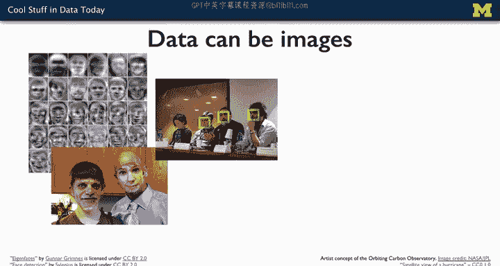
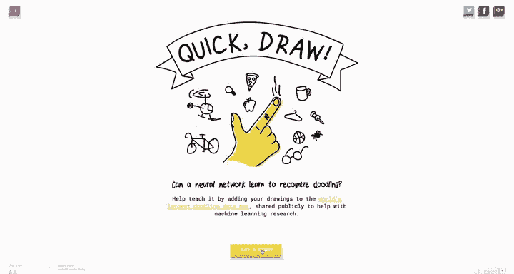
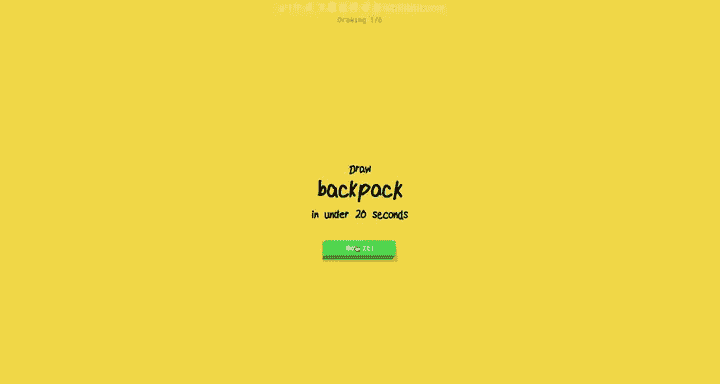
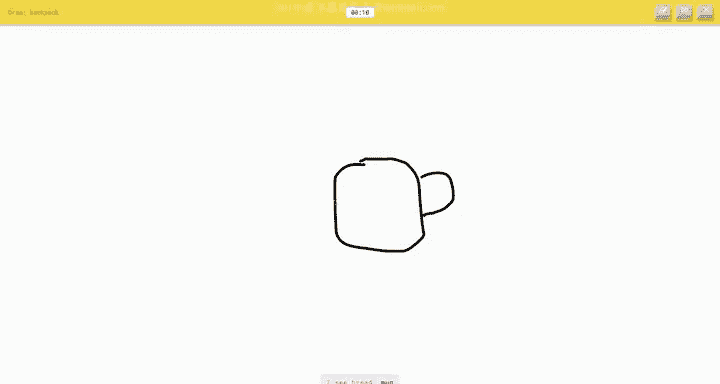
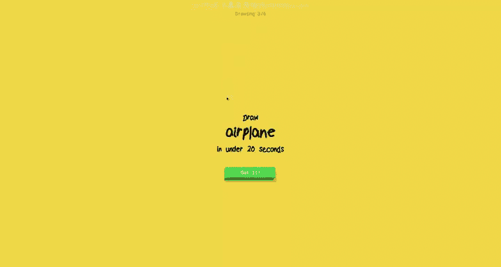
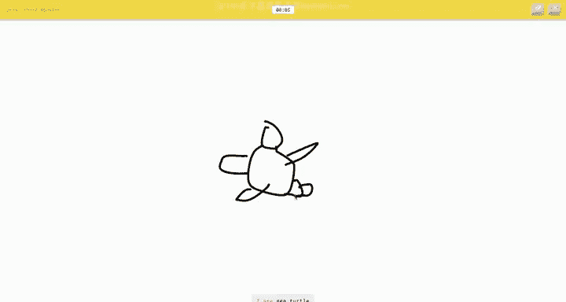
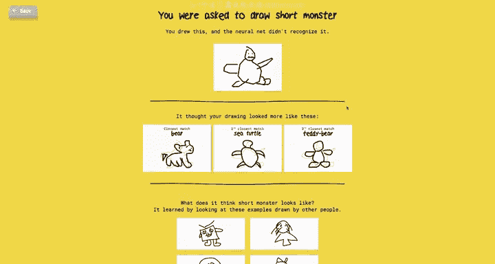
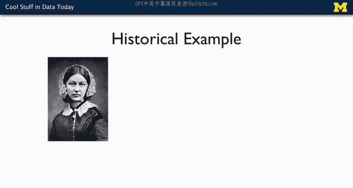

# 课程04：数据中的精彩发现 📊

在本节课中，我们将探讨数据的多种形态及其应用。数据不仅仅是数字，它可以是图像、文字、音频等多种形式。我们将通过具体例子，了解如何从这些不同类型的数据中提取信息，并展示统计学在其中的作用。

---

## 数据可以是数字

上一节我们介绍了数据的多样性，本节中我们来看看最常见的数据形式：数字。人们通常将数据与电子表格或数字列表联系起来。在本课程中，我们将使用一个名为“国家健康与营养检查调查”（NHANES）的数据集，该数据集由美国疾病控制与预防中心收集。

以下是NHANES数据集中的一些变量示例：

*   **SEQN**：受访者序列号。
*   **RIAGENDR**：性别。例如，`1` 可能代表男性，`2` 代表女性。
*   **RIDAGEYR**：受访者年龄。

---

## 数据可以是图像

除了数字，数据也可以是图像。图像数据可以通过算法转化为数字信息，从而进行分析和处理。

以下是图像数据的一些应用：

*   **特征脸（Eigenfaces）**：这是一种将人脸图像表示为数字向量的技术。公式上，一张人脸图像可以表示为一系列“特征脸”的线性组合：`人脸 ≈ a1*特征脸1 + a2*特征脸2 + ... + an*特征脸n`。
*   **人脸识别与交换**：例如，Snapchat等应用利用类似技术定位人脸并进行换脸。
*   **自动标记**：Facebook等平台使用面部识别软件，在用户上传照片时自动标记图中人物。

---

## 卫星图像的应用

卫星图像是另一种重要的图像数据形式，它能提供宏观的地理和环境信息。

以下是卫星图像的几种用途：

*   **测绘**：估算海岸线位置或特定区域的森林覆盖率。
*   **气象追踪**：跟踪风暴系统的移动路径。
*   **灾害评估**：回顾并评估风暴系统造成的破坏程度。

---

## 交互示例：谷歌“猜画小歌”

为了更直观地理解图像识别，我们可以看一个交互例子：“谷歌猜画小歌”。在这个游戏中，用户绘制简笔画，系统尝试实时识别所画内容。

其核心是神经网络模型。当你绘画时，系统将你的笔画坐标序列 `[(x1, y1), (x2, y2), ...]` 输入模型，模型会输出一个概率分布，预测你所画物体属于各个类别（如“背包”、“飞机”）的可能性。

如果模型未能正确识别，例如将“短怪物”识别为“熊”、“海龟”或“泰迪熊”，我们可以查看其他用户是如何成功绘制“短怪物”的。这有助于理解模型是如何“学习”和“理解”这些视觉概念的。

---

## 数据可以是文字

文字是信息的载体，同样构成了一种数据形式。通过分析文本，我们可以发现模式、生成新内容或进行分类。

以下是文本数据的一些应用：

*   **文本生成**：例如，有人利用所有七部《哈利·波特》书籍的全文，通过算法训练模型，生成了新的章节。这展示了从大量文本数据中学习语言模式并创造新内容的能力。
*   **电子健康记录**：其中包含大量描述性文字，通过匹配姓名等标识符，可以整合来自不同机构的记录，形成完整的个人健康史。
*   **文档分类**：通过分析文档中的用词，可以自动判断其所属类别，例如将其归类到报纸的“商业”、“体育”或“本地”板块。这通常涉及计算文档中特定词汇的频率向量，并与已知类别的特征进行比较。
*   **词嵌入与去偏**：词语在模型中被表示为高维空间中的向量（即词嵌入），这些向量包含了语义关联。例如，“男人”之于“程序员”可能类似于“女人”之于“家庭主妇”，这反映了社会偏见。当前的研究正致力于开发技术，以减少词嵌入中存在的这类偏见。

---

## 数据可以是音频

我们周围的声音也是一种数据。音频数据可以被记录、分析、编辑甚至合成。

以下是音频数据处理的几个例子：

*   **歌曲识别**：Shazam等应用能够录制一段音频片段，提取其声学指纹（一种数字摘要），并与数据库进行匹配，从而识别歌曲。
*   **语音编辑**：使用Adobe Audition等软件，可以改变音高、消除噪音或进行其他编辑，从而改变声音效果。
*   **语音合成与复制**：近年来，技术已经发展到仅需某人约50个单词的录音，就能训练模型合成出模仿该人声音的新音频，使其“说出”原本未说过的话。

---

## 历史案例：弗洛伦斯·南丁格尔

最后，我们以一个历史案例来总结。弗洛伦斯·南丁格尔不仅是现代护理学的奠基人，也是统计学的先驱之一。在克里米亚战争期间，她系统记录了士兵病人的信息。

她创造了一种名为“鸡冠花图”（coxcomb）的图表，这实际上是现代时间序列图、箱线图和饼图等多种图表的基础。通过分析这些数据，她比较了不同季节中由疾病（可预防）、创伤和其他原因导致的死亡率变化。

她的工作清晰地表明，通过系统收集和可视化数据，可以揭示重要规律，并推动切实的改进。

---

本节课中我们一起学习了数据的多种形态——数字、图像、文字和音频，并了解了如何从这些数据中提取有价值的信息。从谷歌“猜画小歌”的实时识别，到《哈利·波特》的文本生成，再到南丁格尔的开创性图表，我们看到数据无处不在，且通过适当的分析方法，我们可以从数据中发现精彩的故事和深刻的见解。