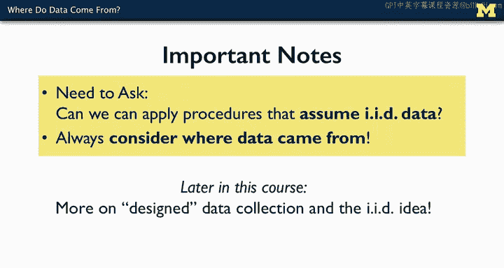

# 课程 5：数据来源探析 📊

在本节课中，我们将深入探讨数据的来源及其重要性。理解数据如何产生，是选择正确统计分析方法的关键前提。我们将介绍两种主要的数据类型，并讨论一个核心的统计假设——数据的独立同分布性。

## 🔄 两种主要的数据来源

上一节我们强调了理解数据来源的重要性，本节中我们来看看数据主要来自哪两种途径。

数据主要分为两大类：一类是**有机过程数据**，另一类是**设计收集数据**。

### 有机过程数据

有机过程数据是由计算机信息系统生成，或从音视频记录中提取的数据。其共同点是，它们作为某个过程的**有机结果**自然产生，并且通常是**随时间推移**生成的。

以下是几个常见的例子：

*   **金融或销售交易**：例如股票市场交易，每天发生大量事件并被记录，形成庞大的数据集。
*   **Netflix观看历史**：平台记录用户的完整观看历史，这些数据自然产生，构成了用于预测用户兴趣的大数据集。
*   **网络浏览活动**：记录用户访问了哪些网页、停留了多久。所有用户的这些活动叠加，形成了海量的浏览数据。
*   **体育赛事数据**：从职业联赛到学校比赛，关于球队和个人表现的各种指标和结果被记录下来。
*   **温度与污染传感器**：设置在各地的监测站持续收集环境数据，每秒可能产生多次测量值。

所有这些过程都会生成**海量数据**，这正是我们常听到的“**大数据**”一词所指。处理这些大数据集需要大量的计算资源。数据科学家的任务就是从这些数据中挖掘趋势和有趣的关系，但仅将数据整理成适合分析的格式，本身就需要巨大的计算投入。

### 设计收集数据

另一种主要的数据类型来源于更具**设计性**的数据收集。这不是像棒球比赛那样自然的有机过程，而是为了**专门解决特定研究目标**而设计的特定研究。

以下是设计数据收集的常见形式：

*   **从总体中抽样调查**：从感兴趣的目标总体中抽取个体样本，并就特定话题进行访谈。因为我们很难测量总体中的每一个人，所以通过设计样本并询问问题来了解总体情况。
*   **推文内容分析**：从推特上提取推文，然后由研究团队根据特定编码方案进行分析，以了解人们对某个话题的表达频率和方式。这是从每日产生的海量推文总体中，设计提取一个子集进行研究。

设计数据通常具有以下特点：涉及从总体中**抽样**、对样本实施**精心设计的调查问题**。与有机过程数据相比，这些数据集通常**规模小得多**，从计算角度更容易处理，并且数据收集具有**非常明确的目的**。

在本系列课程中，我们将同时使用这两种类型的数据。稍后我们会更详细地讨论抽样，但在不同的示例中，我们都会考虑这两种数据类型及其带来的不同考量。

## ⚖️ 核心概念：数据的独立同分布性

在探讨了数据的两大来源后，一个随之而来的重要问题是：无论数据来源如何，我们都需要问，数据是否可以被视为 **IID**？

**IID** 代表 **独立同分布**。这是一个核心的统计假设。

*   **独立**：指的是感兴趣变量的观测值**完全独立**于所有其他观测值。不同个体（如不同股票交易、不同棒球比赛、不同调查受访者）的测量值之间没有相关性。
*   **同分布**：指的是我们观察到的所有值都来自**同一个统计分布**。

**公式表示**：如果一组随机变量 \( X_1, X_2, ..., X_n \) 是 IID 的，则满足：
1.  **独立性**：\( P(X_1, X_2, ..., X_n) = P(X_1)P(X_2)...P(X_n) \)
2.  **同分布**：所有 \( X_i \) 都服从相同的概率分布 \( F \)。

### IID 数据的例子与意义

设想一所大学大型统计学导论课程的期末考试成绩。我们可以将其视为 IID 观测值：
*   每个学生独立作答并获得分数。
*   所有分数可能共同服从一个自然的**正态分布**（钟形曲线）。

在数据满足 IID 的假设下，我们可以有效地估计该分布的特征（如平均分、方差、极端百分位数），并对这些特征进行统计推断（例如估计总体平均分），同时还能确定这些估计值的精确度。IID 假设是许多统计方法能够有效应用的基础。

### 非 IID 数据的情况

那么，如果数据不满足 IID 假设呢？以下是一些非 IID 数据的例子：

*   **违反独立性**：如果考场中学生互相作弊，相邻学生的分数会相似，那么这些分数就依赖于其他学生的分数，不再独立。
*   **违反同分布性**：男性和女性的平均分数可能不同，这意味着考试成绩存在不同的子分布。或者，来自同一讨论班的学生，因为助教教学效果不同，分数分布也可能不同。

当数据非 IID 时，我们需要在分析中**考虑这些依赖性和差异**，这可能意味着需要使用不同的分析程序。我们后续课程中将讨论在不同设定下的分析方法。

## 📝 重要注意事项与总结

在开始任何数据分析之前，我们必须始终考虑数据的来源。需要问的关键问题包括：

*   我们能否对数据应用那些**假设数据为 IID** 的统计程序？
*   数据是来自**有机过程**吗？该过程是否在数据中引入了依赖性？
*   数据是来自**设计收集**吗？在进行最终分析时，我们是否需要考虑该设计的特点？

理解数据来源是决定使用何种分析程序的重要信息。在本课程后续部分，当我们开始讨论抽样以及用于设计样本的分析程序时，我们将更详细地阐述设计数据收集和 IID 的概念。

本节课中，我们一起学习了数据的两种主要来源（有机过程数据与设计收集数据），并深入探讨了“独立同分布”这一核心统计假设的含义、重要性以及当该假设不成立时的影响。牢记数据来源是进行严谨统计分析的第一步。