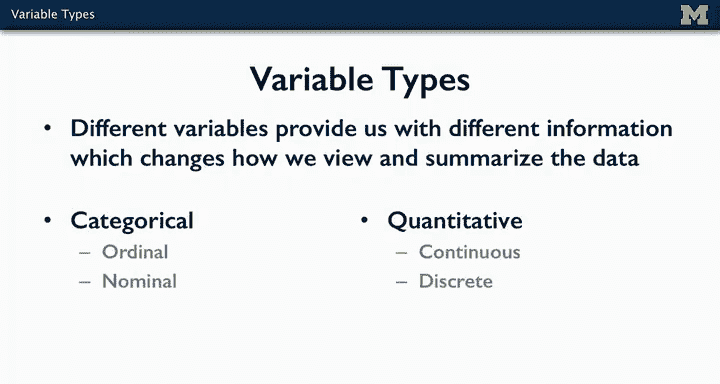

# 📊 课程 P7：变量类型详解


在本节课中，我们将学习统计学中不同类型的变量。理解变量类型至关重要，因为它决定了我们如何查看、总结和分析数据。

---

## 概述

我们将从美国国家健康与营养调查（NHANES）数据集中选取四个变量作为示例，探讨定量变量与分类变量的区别及其子类型。

---

## 变量示例

以下是NHANES数据集中的五个个体及其四个变量：

| 个体ID | 身体质量指数 (BMI) | 种族 | 年龄 | 成人指示变量 |
|--------|-------------------|------|------|--------------|
| 1      | 25.3              | 3    | 34   | 1            |
| 2      | 22.1              | 1    | 12   | 0            |
| 3      | 28.7              | 4    | 45   | 1            |
| 4      | 19.8              | 2    | 8    | 0            |
| 5      | 30.2              | 5    | 50   | 1            |

**种族编码说明**：
- 1：墨西哥裔美国人
- 2：其他西班牙裔
- 3：非西班牙裔白人
- 4：非西班牙裔黑人
- 5：其他

**成人指示变量编码**：
- 1：年龄 ≥ 18岁
- 0：年龄 < 18岁

---

## 定量变量与分类变量

上一节我们介绍了数据集中的变量。现在，我们来思考一个问题：能否分别计算BMI和种族的平均值？

对于BMI，计算平均值是合理的，因为它是一个数值型测量值。例如，我们可以计算数据集中所有个体的平均BMI，以了解该变量的中心趋势。

```python
# 示例：计算BMI平均值
bmi_values = [25.3, 22.1, 28.7, 19.8, 30.2]
average_bmi = sum(bmi_values) / len(bmi_values)
print(f"平均BMI: {average_bmi}")
```

然而，对于种族变量，计算平均值则缺乏直观意义。因为种族是分类编码，平均值（如2.7）无法提供有意义的解释。尽管某些分析方法可能对分类变量取平均，但通常我们将其视为分类变量处理。

---

### 📈 定量变量

定量变量是数值型、可测量的量，通常支持算术运算（如BMI）。定量变量进一步分为连续型和离散型。

#### 连续型定量变量

连续型变量可以在区间内取任意值，有无限多个可能值。例如：
- 身体质量指数 (BMI)
- 身高或体重
- 时间（如跑一英里所需时间）

**公式表示**：  
若变量 \( X \) 表示身高，则 \( X \in \mathbb{R}^+ \)，可取值如 170.5 cm、175.2 cm 等。

#### 离散型定量变量

离散型变量是有限个可数值的集合。例如：
- 家庭中的子女数量（如1、2、3，但不能是2.3个孩子）

**代码表示**：
```python
# 示例：离散变量“子女数量”
children_count = [1, 2, 3, 0, 4]  # 只能为整数
```

---

### 🏷️ 分类变量

分类变量（也称定性变量）将个体或项目分为不同组别（如种族）。分类变量进一步分为有序型和无序型。

#### 有序分类变量

有序变量具有内在的顺序或排名。例如：
- 学校年级：大一、大二、大三、大四（有自然顺序）

#### 无序分类变量

无序变量没有排名意义，类别顺序不影响含义。例如：
- 种族
- 婚姻状况（如已婚、单身、离异）

---

## 📝 随堂测验解析

以下是两个测验题及其解析，帮助巩固所学概念：

**问题1**：年龄变量（报告为整数）应视为哪种类型？  
**答案**：尽管年龄常以整数报告，但它本质上是连续型定量变量。因为年龄可以包含小数（如8.5岁），且时间相关变量通常按连续型处理。

**问题2**：成人指示变量（1=成人，0=未成年人）属于哪种类型？  
**答案**：这是一个无序分类变量。虽然它由年龄（定量变量）转换而来，但编码为类别（成人/未成年人），且类别间无顺序意义。

---

## 总结

本节课我们一起学习了变量的主要类型：
- **定量变量**：数值型、可测量，包括连续型和离散型。
- **分类变量**：用于分组，包括有序型和无序型。



理解变量类型是数据分析的基础。在后续课程中，我们将学习如何根据不同变量类型选择合适的汇总和可视化方法。