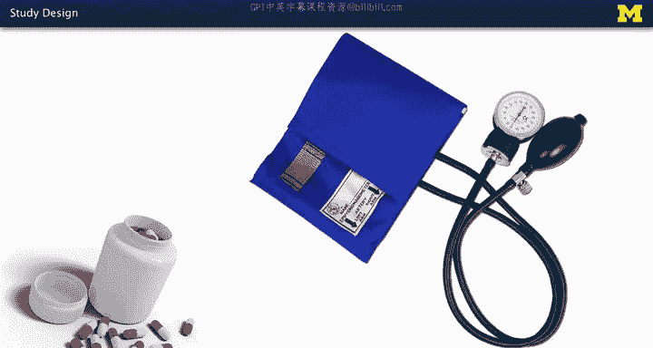
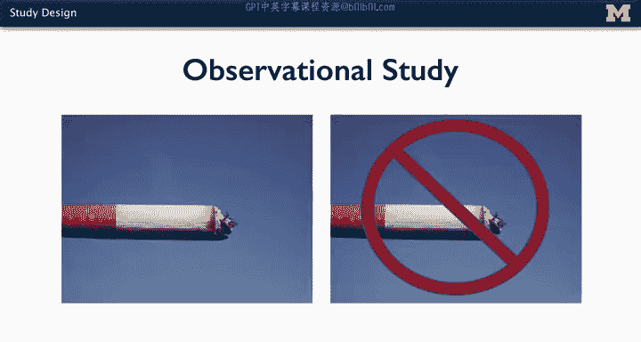
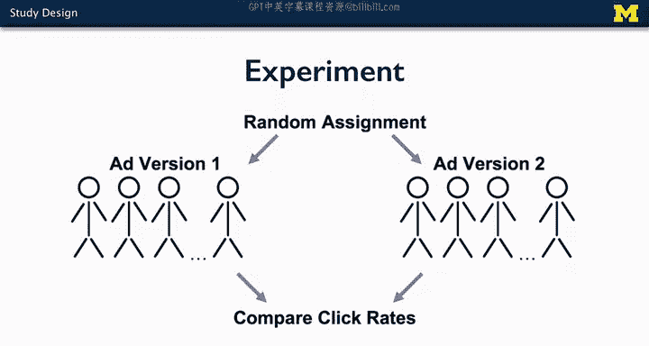

# 课程 7：研究设计方法论 📊

在本节课中，我们将学习研究设计的基本概念。研究设计涵盖了从数据驱动研究的准备到具体问题分析的全过程。我们将探讨不同类型的研究设计，包括探索性与验证性研究、比较性与非比较性研究，以及观察性研究与实验研究。理解这些概念对于设计有效的数据分析至关重要。

---

## 🔍 探索性与验证性研究

上一节我们介绍了研究设计的整体范畴，本节中我们来看看研究设计的两种主要类型：探索性研究与验证性研究。

科学方法的目标是提出一个可证伪的假设，然后通过收集数据来检验它。这种针对单一预设问题进行数据收集和分析的研究，被称为**验证性研究**。

相比之下，**探索性研究**是在没有预设具体问题的情况下，直接收集和分析数据。虽然探索性研究也能提供信息，但我们必须警惕模型过拟合、多重检验和P值操纵等问题。从一个探索的数据集中提出的问题越多，得出误导性结论的可能性就越大。

---

## ⚖️ 比较性与非比较性研究

了解了研究的目的性分类后，我们来看看研究在内容上的另一种分类：比较性与非比较性。

许多研究本质上是**比较性**的，其目标是将一个量与另一个量进行对比。

以下是几个比较性研究的例子：
*   比较使用不同肥料的土地上的橙子产量。
*   比较选民对一位候选人与另一位候选人的偏好。
*   比较观众点击两个不同版本在线广告的比率。

在**非比较性**研究中，重点在于估计或预测绝对量，而非进行明确的比较。

以下是几个非比较性研究的例子：
*   预测一家公司一年后的股票价值。
*   估计服用某种药物后血压的绝对降低值。

---

## 👁️ 观察性研究与实验研究

上一节我们根据研究内容进行了分类，本节中我们将探讨数据收集方式上的一个根本区别：观察性研究与实验研究。

基于数据的实证研究，其最重要的方面之一在于比较是通过观察还是实验进行的。

**观察性数据**是自然产生的。其对比基于个体**自我选择**进入不同的组别。

而在**实验**中，研究者会**刻意地**以不同方式处理不同的个体。通常涉及对受试者进行**操纵**或**分配**处理。

以下是观察性研究的例子：
*   为了识别吸烟对健康的影响，我们可能会比较吸烟者与非吸烟者的寿命或其他结果变量（如肺癌状况）。
*   为了确定教师经验对学生学习的影响，我们可能会比较经验较少教师班级的学生与经验较多教师班级学生的标准化测试分数。

以下是实验研究的例子：
*   为了比较施肥与不施肥田地的生菜产量，我们可以将田地划分为若干地块，并随机分配某些地块施肥，其他地块不施肥。
*   为了评估人们是否更可能点击两个版本中的一个在线广告，我们可以随机让人们看到其中一个版本，然后比较点击率。

在实验中，我们通常关注将受试者**随机分配**到不同的处理组。在观察性研究中，更常说的是受试者**暴露于**某种条件，而非被分配。因此，观察性研究更为被动，且基于自我选择。当然，观察性研究很重要，当随机分配不切实际或不道德时，必须使用它们。

---

## ⚠️ 研究设计中的关键考量

在讨论了主要的研究设计类型后，我们需要了解影响研究有效性的几个关键因素。

一般来说，更多的数据能产生更多信息。但**数据收集的方式**至关重要。如果一项研究收集的数据包含关于感兴趣问题的信息太少，那么结果将不会很有信息量。

**功效分析**是一个评估给定研究设计是否可能产生有意义发现的过程。功效的计算方式取决于将要执行的分析，我们将在后续课程中涉及。

**偏差**是另一个问题，当测量系统性地偏离目标，或者样本不能代表感兴趣的总体时，就会出现偏差。偏差在任何类型的研究中都可能成为问题，但观察性研究对此稍微更脆弱一些。

---

## 📝 总结

本节课中，我们一起学习了研究设计的基本方法论。我们探讨了探索性研究与验证性研究的区别，比较性与非比较性研究的目标差异，以及观察性研究与实验研究在数据收集方式上的根本不同。我们还简要提及了数据量、功效分析和偏差等影响研究质量的关键因素。这些概念在我们开始处理实际数据并查看更多示例时，将变得更加清晰。