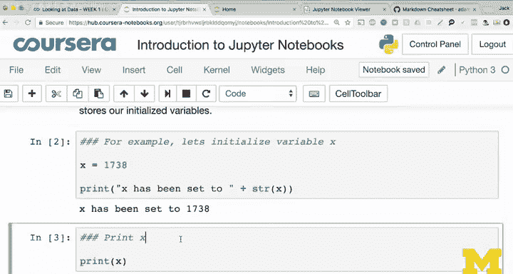
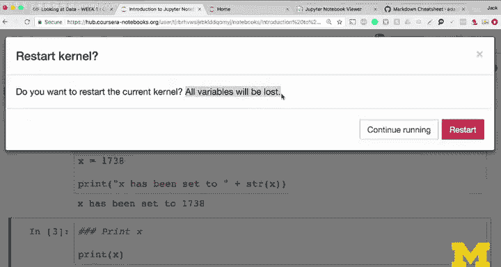
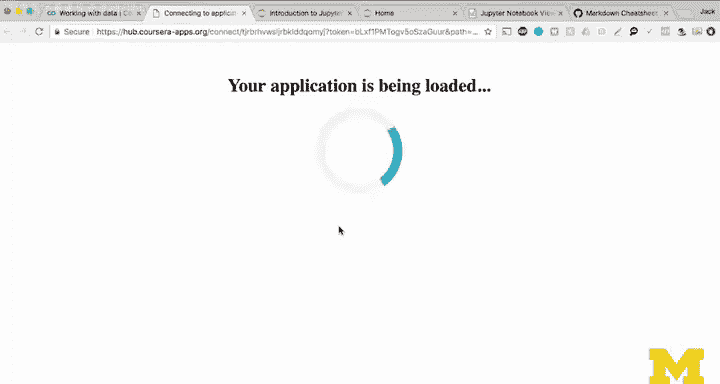

# 课程09：Jupyter Notebook入门（选读）📓


## 概述

在本节课中，我们将学习Jupyter Notebook的基础知识。Jupyter Notebook是一个基于网页的交互式开发环境，它将成为本课程中运行Python代码的主要工具。通过学习，你将能够使用Jupyter Notebook创建自己的交互式文档。


---

## 什么是Jupyter Notebook？🤔

Jupyter是一个基于网页的交互式开发环境，支持多种编程语言，但最常与Python编程语言一起使用。

Jupyter提供的交互式环境使学生、科学家和研究人员能够在单个文档中创建可重复的分析并构建叙述。

现在，让我们来看一个由密歇根大学的Richard Steyren完成的Jupyter Notebook示例。

你可以看到，他实际上利用一个交互式文档来整理和撰写了一篇完整的研究论文。有趣的是，它不仅包含文本，还能够将Python代码直接嵌入到文档中，这正是Jupyter Notebook如此特别的原因。

---

## Jupyter Notebook的核心功能

接下来，我们将了解Jupyter Notebook的几个核心功能：文件浏览器、Markdown单元格与语法、内核、变量与环境、命令模式与编辑模式，以及提高工作效率的快捷键。

### 文件浏览器

要使用文件浏览器，你可以点击菜单栏中的“文件”，然后选择“打开”。

你会看到它带我进入了一个包含我所有文件的目录。你可以从自己的电脑上传文件，然后创建新的文本文件、文件夹、终端或任何特定库或编程语言的Notebook。

---

### Markdown简介

现在我们已经了解了文件浏览器的样子，让我们来讨论一下Markdown是什么。

本质上，Markdown是一种使用纯文本格式化语法的标记语言。这意味着我们可以使用键盘上的各种符号作为指示符来修改文本。

我们可以实现的功能包括：创建标题、使用粗体或斜体修改文本、创建有序和无序列表、链接到不同的网站和URL、制作表格、嵌入图像等等。

现在，我将展示一些如何完成这种格式化的例子。

**创建标题**
要创建标题，我们只需使用井号（`#`）。使用的井号数量决定了标题的大小。
```markdown
# 一级标题
## 二级标题
### 三级标题
```

**文本修饰**
我们可以使用星号（`*`）或下划线（`_`）来创建斜体或粗体，具体取决于使用的符号数量。
```markdown
*斜体文本* 或 _斜体文本_
**粗体文本** 或 __粗体文本__
***粗斜体文本*** 或 ___粗斜体文本___
```
我们还可以使用波浪号（`~`）来划掉文本。
```markdown
~~删除线文本~~
```

**列表**
你可以通过指定数字来创建有序列表，也可以创建子列表。无序列表可以使用星号、减号或加号。
```markdown
1. 第一项
2. 第二项
   * 子项
   - 另一个子项
```

**链接**
你可以链接到网站，并为链接创建标题。
```markdown
[密歇根大学网站](https://umich.edu)
```

我想提一下，网上有很多Markdown语法参考。我在此Notebook中包含了一个，链接在这里。这是一个非常全面的示例，展示了如何在Jupyter Notebook中创建所有这些不同的格式。

---

### 内核、变量与环境

在Jupyter Notebook中，Notebook内核是一个计算引擎，用于执行Notebook文档中包含的代码。有针对各种编程语言的内核，但我们只使用Python内核，它在我们的文档中执行Python代码。

作为补充说明，当打开一个Notebook时，关联的内核会自动为你启动，这非常方便。你可以在右上角看到我们的内核状态，显示为“Python 3”，这正是我们想要的。

此外，你可以转到菜单栏，点击“内核”->“更改内核”，并选择所有这些不同的选项，但我们将坚持使用Python 3。

现在，我来展示一下Python代码单元格的样子。你可以通过点击顶部工具栏上的“运行”按钮来执行此代码。



你可以看到，这个Python单元格已经运行，并且我们打印了输出，这就是一个Python代码单元格。

重申一下，内核是我们Notebook的后端，它不仅执行我们的Python代码，还存储已初始化的变量和环境。



让我们看一个例子，了解当我们初始化一个变量时，它如何被存储在我们的环境中。这里我们将用数字1738初始化变量`x`，然后打印它，我们可以看到输出在那里。

然后让我们再打印一次。正如我提到的，我们的变量存储在内核环境中。现在，如果我们重启内核，我们所有的变量都会丢失。因此，重要的是要注意，如果你的内核出现任何问题，你将不得不重新初始化你的变量。

例如，因为我们现在已经重启了内核，我们的变量`x`现在未定义，我们在文档中得到了一个错误。现在，如果我们重新初始化`x`，这段代码就能正确执行。

我想补充的一点是，你实际上可以在文档中嵌入用户输入。这正是这段代码块所做的。`name = input(“What is your name? “)`，然后打印你输入的名字。例如，我的名字是Jack，然后这个代码单元格正确执行。

现在，需要提及的一个重要点是，Jupyter Notebook具有内联单元格执行功能。这意味着一个单元格必须在其操作完成后，另一个单元格才能被执行。

一个例子是，如果我们运行接受输入的代码块，然后尝试运行下面的这一行。我们可以看到，这个星号（`*`）表示我们之前尝试运行的单元格尚未完全执行。

现在你可以看到，如果我们在这里再次输入我们的名字，星号消失了，被一个数字取代，并且这些单元格现在被打印出来。这绝对是你需要牢记的一点，它可以在未来使用这些Notebook时避免许多复杂情况。

---

### 命令模式与编辑模式及快捷键

我想讨论的最后一件事是命令模式与编辑模式，并讨论快捷键以及它们如何提高你的工作效率。

Jupyter Notebook有编辑模式和命令模式，模式可以通过单元格左侧边框的颜色轻松识别。例如，这里我们看到是绿色的，我们处于编辑模式，所以我们可以添加或删除文本。然而，如果我们想进入命令模式，我们可以看到单元格边框是蓝色的。

这使我们能够在这里输入不同的设置。例如，如果我们想切换单元格行号，当我们在命令模式下时，我们就能做到这一点。现在你可以在左侧看到，我们的行号出现了。

为了过渡到快捷键，我们可以简单地通过按键盘上的字母`L`来切换行号。当然，首先我们必须处于命令模式，由蓝色边框指示。按`L`可以移除或切换你的行号。

最后，我想讨论一下额外的快捷键，因为有很多快捷键可以提高你在使用Jupyter Notebook时的工作效率。与其必须去菜单栏（文件、编辑、视图、插入），你可以简单地使用命令模式，结合键盘上不同的按键组合。这个资源稍后可供你查看，我真心推荐。

---

### 如何安装Jupyter Notebook

需要注意的是，Coursera在课程内提供了嵌入式的Jupyter Notebook，因此除非你希望在自己的计算机上进一步探索Jupyter，否则不需要下载。

你可以查看官方安装指南。实际上，它只会推荐你使用Anaconda平台，该平台兼容Windows、Mac OS和Linux系统，实际上这就是我在个人电脑上使用的。下面在我的程序坞中有我的Anaconda Navigator。

我想谈的最后一件事是，作为学习者，你将如何查看这些Notebook。

如果我们进入第一周，重新滚动到作业部分，我们可以看到这里有一个Notebook。如果我们点击它，我们可以打开一个Notebook。这就是你在整个课程中操作的方式。应用程序正在加载，它很快就会弹出来。

---



## 总结

本节课中，我们一起学习了Jupyter Notebook的基础介绍。我们了解了Jupyter Notebook是什么，探索了其核心功能如文件浏览器和Markdown语法，理解了内核、变量与环境的概念，并区分了命令模式与编辑模式以及相关的快捷键。希望这个基础的Jupyter Notebook入门教程对你非常有帮助，并希望你对在课程中进一步深入学习它们感到兴奋。