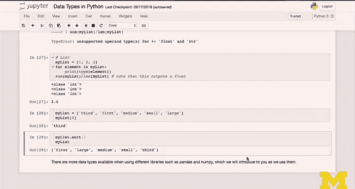

# 10：Python数据类型（选读）📊


在本节课中，我们将学习Python中的基本数据类型。我们将了解每种类型的特点，并通过示例展示它们如何与之前课程中介绍的变量类型（数值型、分类型）相关联。掌握这些基础知识对于后续的数据处理和分析至关重要。

## 概述：数据类型与变量类型

上一节我们介绍了变量类型。本节中，我们将具体看看Python如何实现这些类型。Python内置了多种数据类型，它们可以分为两大类：**数值型**和**分类型**。数值型数据可以进行数学运算（如求平均值），而分类型数据则用于表示类别。

以下是本节课将涵盖的Python基础数据类型：
*   **数值型**：整数（`int`）、浮点数（`float`）
*   **分类型**：布尔值（`bool`）、字符串（`str`）、空类型（`NoneType`）
*   **容器型**：列表（`list`），它可以容纳多种类型的数据。

## 数值型数据

数值型数据意味着对其进行数学运算（如求平均值）是有意义的。它进一步分为**离散型**和**连续型**。在Python中，离散型对应**整数**，连续型对应**浮点数**。

整数和浮点数的主要区别在于它们在计算机内存中的存储方式。存储一个整数或浮点数所占用的内存大小相同，但整数以其二进制形式精确存储，而浮点数则采用一种包含指数和小数部分的科学计数法形式存储，这可能导致微小的精度误差。

### 整数（int）

整数是没有任何小数部分的数字。我们可以使用Python的`type()`函数来查看任何对象的类型。

```python
type(4)      # 输出: <class 'int'>
type(0)      # 输出: <class 'int'>
type(-3)     # 输出: <class 'int'>
```

由于整数是数值型，我们可以计算其平均值。但请注意，在Python 3中，即使输入全是整数，求平均值的结果也会是浮点数。

```python
# 计算整数列表的平均值
numbers = [2, 3, 4, 5]
mean_value = sum(numbers) / len(numbers)
print(mean_value)  # 输出: 3.5
print(type(mean_value))  # 输出: <class 'float'>
```

### 浮点数（float）

浮点数用于表示带有小数点的数字，包括有理数和无理数。

```python
type(3 / 5)   # 输出: <class 'float'>， 值为0.6
type(4.0)     # 输出: <class 'float'>， 即使4是整数，加上小数点就变成了浮点数

import math
type(math.pi) # 输出: <class 'float'>， π是一个无理数
```

浮点数的存储方式解释了为什么有时会出现`0.6`显示为`0.6000000000000001`这样的情况，这是二进制浮点数表示法带来的精度问题。计算浮点数列表的平均值同样会得到一个浮点数结果。

```python
floats = [math.pi, 3/5, 4.1]
mean_float = sum(floats) / len(floats)
print(type(mean_float))  # 输出: <class 'float'>
```

## 分类型数据

分类型数据用于表示类别或品质，对其进行数学运算通常没有意义。它分为**名义型**和**有序型**。在Python基础类型中，布尔值、字符串和空类型属于名义型。有序型数据本身没有专门的类型，而是通过你如何使用其他类型（如列表）来体现顺序。

### 布尔值（bool）

布尔值只有两个可能的值：`True`（真）或`False`（假）。在Python中，它们是保留字，首字母必须大写。

```python
type(True)   # 输出: <class 'bool'>
type(False)  # 输出: <class 'bool'>
```

布尔值在逻辑判断中非常有用。在底层，`True`被当作数值`1`处理，`False`被当作数值`0`处理。这意味着虽然布尔值是分类型，但有时计算其“平均值”可以理解为计算列表中`True`的比例。

```python
bool_list = [True, 6 < 5, 1 == 3, None is None]
# 检查每个元素的类型
for item in bool_list:
    print(type(item))  # 全部输出: <class 'bool'>

# 计算“平均值”（True的比例）
mean_bool = sum(bool_list) / len(bool_list)
print(mean_bool)  # 输出: 0.5 (因为一半是True)
print(type(mean_bool))  # 输出: <class 'float'>
```

### 字符串（str）

字符串是由引号（单引号`'`或双引号`"`）包围的任何文本。引号内的内容会被Python原样解读为文本，而不是代码。

```python
type("This sentence makes sense.")  # 输出: <class 'str'>
type("makes sentence this sense")   # 输出: <class 'str'>
type("math.pi")                     # 输出: <class 'str'>， 注意这里不是数字π，而是文本"math.pi"
```

尝试对字符串列表进行数学运算（如求平均值）会导致错误，因为这没有数学意义。

```python
string_list = ["dog", "koala", "goose"]
# mean(string_list)  # 这行代码会引发 TypeError
```

### 空类型（NoneType）

`None`是Python中表示“空”或“无”的特殊值，它有自己的类型`NoneType`。它通常用于初始化变量或表示函数没有返回值。

```python
type(None)          # 输出: <class 'NoneType'>
x = None
type(x)             # 输出: <class 'NoneType'>
```

与字符串类似，对`None`值进行数学运算也没有意义。

```python
none_list = [None, None, None, None, None]
# mean(none_list)  # 这行代码会引发 TypeError
```

## 列表（list）：多功能容器

列表是一种可以容纳多个有序元素的容器。它的强大之处在于可以存储**任意类型**的数据组合，因此它既可以存储数值型数据，也可以存储分类型数据，其“类型”取决于你如何使用它。

以下是列表的一些关键特性示例：

```python
# 列表可以包含混合类型
mixed_list = [42, 3.14, "hello", None]
for item in mixed_list:
    print(type(item))
# 输出:
# <class 'int'>
# <class 'float'>
# <class 'str'>
# <class 'NoneType'>

# 对混合类型列表求平均值会报错
# mean(mixed_list)  # TypeError

# 对纯数值列表求平均值有效
num_list = [1, 2, 3]
print(sum(num_list) / len(num_list))  # 输出: 2.0

# 列表通过索引（从0开始）保持顺序，可用于存储有序数据
ordinal_list = ["third", "first", "medium", "small", "large"]
print(ordinal_list[0])  # 输出: 'third'

# 列表可以排序，但对字符串排序是按字母顺序，这可能不符合业务逻辑
ordinal_list.sort()
print(ordinal_list)  # 输出: ['first', 'large', 'medium', 'small', 'third']
```

## 总结与扩展

本节课中我们一起学习了Python的核心基础数据类型：用于数值计算的**整数**和**浮点数**；用于表示类别的**布尔值**、**字符串**和**空值**；以及可以容纳各种数据的**列表**。我们了解了它们的特性、如何用`type()`函数进行识别，以及哪些操作对它们是有意义的。

> 重要的是理解数据类型决定了你能对数据做什么操作。尝试对字符串求平均值或比较整数和`None`的大小都会导致错误。

这些只是Python内置的基础类型。在实际的数据分析中，我们会使用如`pandas`和`NumPy`这样的强大库，它们引入了更专业的数据类型，例如`DataFrame`、`Series`和`datetime`对象。我们将在后续课程中逐步介绍它们。现在，你已经掌握了理解这些高级类型的坚实基础。



---
**课程资源信息**：
*   来源：密歇根大学《Statistics with Python》
*   章节：P10 - 9_Python数据类型(选读)
*   字幕：BV1dV411Q7j3