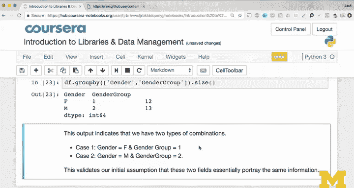

# 11：Python库与数据管理入门 🐍📊


在本节课中，我们将学习Python库的基本概念、如何查阅官方文档，以及使用Pandas库进行数据管理的基础操作。这些技能是进行统计分析和数据科学工作的基石。


---

## Python库简介 📚

上一节我们介绍了课程概述，本节中我们来看看什么是Python库。

Python与其他编程语言一样，拥有大量额外的模块或库。这些库扩展了语言的基础框架和功能。可以将库视为一个函数集合，用于完成特定的编程任务，而无需自己编写算法。

在本课程中，我们将主要关注以下库：
*   **NumPy**：用于处理数据数组和其他数学运算的库。
*   **Pandas**：提供高性能、易用的数据结构和数据分析工具（如DataFrame）。
*   **SciPy**：用于数值和科学计算的技术库。
*   **Matplotlib**：用于制作图表和其他可视化的库。
*   **Seaborn**：与Matplotlib类似，用于可视化和绘图任务。
*   **Statsmodels**：实现许多统计技术的库。

---

## 理解文档 📖

上一节我们介绍了核心库，本节中我们来看看如何利用官方文档进行学习。

学习新编程语言时，文档极其重要。可靠且易于获取的文档对于编程语言的知识传递是绝对必要的。幸运的是，Python提供了大量详细的文档，解释了语言的语法、库等方方面面。

理解如何阅读文档对任何程序员都至关重要，它将成为学习Python复杂细节时的绝佳资源。

以下是Python标准库文档的链接，在本课程中你会逐渐熟悉它：
`https://docs.python.org/3/library/`

如果滚动到底部，可以看到文档讨论了内置函数、常量、内置类型等。例如，查看数值类型部分，数值类型包括`int`（整数）、`float`（浮点数）和`complex`（复数）。文档还提供了Python支持的算术和操作说明。

---

## 导入与使用库 ⬇️

上一节我们了解了文档的重要性，本节中我们来看看如何在代码中实际导入和使用库。

使用Python时，必须在脚本开头导入将要使用的库，以避免错误。以下语句导入了NumPy和Pandas库，并为它们指定了缩写名称，以使代码更整洁、易读。

```python
import numpy as np
import pandas as pd
```

运行上述代码单元格后，我们就成功导入了NumPy（别名为`np`）和Pandas（别名为`pd`）。

导入库后，如何调用其中的功能呢？导入库后，可以通过在函数名前加上库名来调用其函数。例如，要使用NumPy库中的`mean`（平均值）函数，你需要输入`np.mean`。

为了避免在脚本中反复输入库名，通常为每个库定义一个两到三个字母的缩写。例如，NumPy缩写为`np`（如上所示），Pandas库通常缩写为`pd`。这允许我们使用`np.mean`而不是`numpy.mean`。

以下单元格展示了如何调用已导入库中的函数：

```python
# 初始化变量a为一个NumPy数组
a = np.array([0, 1, 2, 3, 4, 5, 6, 7, 8, 9, 10])
# 计算数组a的平均值
print(np.mean(a))
```

我们使用NumPy库的`mean`函数计算了NumPy一维数组的平均值，如上所示，输出结果为`5.0`。

---

## 数据管理基础 🗃️

上一节我们学会了如何导入和使用库，本节中我们进入数据管理部分。

数据管理是统计分析和数据科学工作的关键组成部分。以下代码将展示如何通过Pandas库导入数据、查看数据和转换数据。

Pandas主要使用的数据结构称为**DataFrame**。这是一个二维数据表，其中行通常代表个案（例如，稍后将看到的卡特维尔测试参与者），列代表变量。Pandas还有一个一维数据结构称为**Series**，当访问DataFrame的单个列时会遇到它。

Pandas有一系列名为`read_xxx`的函数（其中`xxx`是占位符），用于读取不同格式的文件，例如`read_csv`。CSV代表逗号分隔值。其他文件格式包括Excel、JSON和SQL。

为了了解CSV文件的实际样子，我们查看原始的卡特维尔数据。可以看到，第一行包含列标题，如ID、age、gender等，它们都由逗号分隔，因此得名“逗号分隔值”。

接下来，我们将导入这个CSV文件。

```python
# 首先，存储托管我们CSV文件的URL字符串
url = "https://raw.githubusercontent.com/UMstatspy/UMStatsPy/master/Course_1/Cartwheeldata.csv"
# 读取CSV文件，并通过调用Pandas库中的read_csv函数将其存储为Pandas DataFrame
df = pd.read_csv(url)
# 输出对象类型
print(type(df))
```

我们使用了`read_csv`函数，变量`df`（DataFrame）的类型是`pandas.core.frame.DataFrame`。

现在，我们如何在环境中访问并查看这些数据呢？我们可以使用DataFrame的`head`函数，它将显示数据的前五行，包括所有列标题。这是了解DataFrame和数据内容的好方法。

```python
# 查看数据的前5行
print(df.head())
```

如果我们想输出整个DataFrame，可以直接打印变量`df`。总共有25条记录。建议使用`head`函数，尤其是在处理较大的数据集时，因为打印全部数据可能会显得混乱。

如果我们想收集关于数据的更多信息，可以使用以下函数查看列名和每列的数据类型。

```python
# 输出列标题
print(df.columns)
# 输出各列数据类型
print(df.dtypes)
```

输出显示我们有以下数据类型：由`int64`指定的整数、浮点数（`float`）和对象（`object`）数据类型。

---

## 数据选择与切片 ✂️

上一节我们学会了如何查看数据概览，本节中我们来看看如何选择数据的特定部分。

数据管理中极其重要的一点是能够对DataFrame进行切片，仅选择数据的特定部分。有三种方法可以做到这一点：`.loc`函数、`.iloc`函数和`.ix`函数。但在本教程中，我们只介绍`.loc`和`.iloc`。

首先，`.loc`函数接受两个由逗号分隔的单个列表/范围操作符，第一个指定行，第二个指定列。

以下是使用`.loc`的一些示例：

```python
# 示例1：选择所有行的‘Cartwheel Distance’列
print(df.loc[:, ‘Cartwheel Distance‘])
# 示例2：选择所有行的多个列（‘Cartwheel Distance‘, ‘Height‘, ‘Wingspan‘）
print(df.loc[:, [‘Cartwheel Distance‘, ‘Height‘, ‘Wingspan‘]])
# 示例3：选择前10行（0到9）的所有列
print(df.loc[0:9, :])
# 示例4：选择第10到15行（包含）的所有列
print(df.loc[10:15])
```

接下来是`.iloc`函数。`.iloc`函数是基于整数位置的切片，而`.loc`使用标签和列名。

以下是使用`.iloc`的一些示例：

```python
# 示例1：选择DataFrame的前4行（基于整数位置0-3）
print(df.iloc[:4])
# 示例2：选择第1到5行（位置1-5），第2到4列（位置2-4）
print(df.iloc[1:6, 2:5])
```

`.iloc`函数不允许在函数内部使用标签和字符串。这是一个`.loc`和`.iloc`之间的重要区别。

---

## 探索数据内容 🔍

上一节我们学会了如何选择数据，本节中我们来看看如何探索数据的具体内容。

我们可能想观察特定列中的不同唯一值。让我们对`Gender`列进行此操作。

```python
# 获取‘Gender‘列的唯一值
print(df[‘Gender‘].unique())
```

我们得到返回值`[‘F‘ ‘M‘]`，代表女性和男性。因此，在我们的DataFrame的`Gender`列中，值只有`M`和`F`。

如果我们对`GenderGroup`列做同样的事情，会看到只有`1`和`2`，这很有趣。看起来这两个字段可能用途相同，都是用于指定男性与女性。

我们可以快速检查一下，通过仅观察这两列。

```python
# 观察‘Gender‘和‘GenderGroup‘列
print(df.loc[:, [‘Gender‘, ‘GenderGroup‘]])
```

快速浏览一下，可以看到`F`对应`GenderGroup`中的`1`。在处理可能并非总是如此的数据时，我们可能想使用`groupby`之类的函数。

`groupby`函数将基本创建`Gender`和`GenderGroup`所有值的组合，以便查看不同的组合是什么。

```python
# 按‘Gender‘和‘GenderGroup‘分组，查看组合
grouped = df.groupby([‘Gender‘, ‘GenderGroup‘]).size()
print(grouped)
```

输出表明我们只有两种类型的组合：`(F, 1)`和`(M, 2)`。这验证了我们最初的假设，即这两个字段本质上传达了相同的信息。

---



## 总结 📝

本节课中，我们一起学习了Python库的基础知识、查阅官方文档的重要性，以及使用Pandas进行数据管理的基本操作。我们介绍了如何导入库、查看和导入数据、使用`.loc`和`.iloc`进行数据选择与切片，以及探索数据内容（如查看唯一值和分组）。这只是数据管理的入门，在课程后续部分，将有阅读材料更深入地探讨Pandas的功能，以及如何利用其函数进行更高级的数据管理。