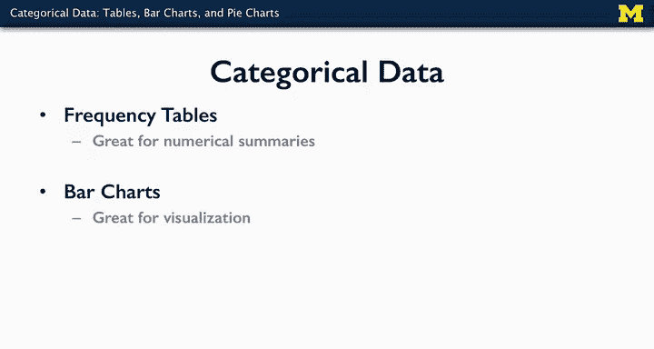

# 课程12：分类数据 📊 - 列联表、条形图与饼图

在本节课中，我们将学习如何处理和可视化分类数据。我们将重点介绍如何通过列联表（频率表）来总结分类数据，以及如何使用条形图和饼图来直观地展示这些数据。请注意，我们将避免使用语气词，并确保内容简单明了，适合初学者理解。

---

## 概述

分类数据是将个体或项目划分到不同组别的数据。本节课将以婚姻状况为例，展示如何总结和可视化这类数据。

## 数据示例与编码

我们使用的示例数据是婚姻状况。数据编码如下：1代表已婚，2代表丧偶，3代表离异，4代表分居，5代表从未结婚，6代表与伴侣同居，7代表拒绝回答，8代表不知道。幻灯片底部展示了一个包含六位不同个体及其婚姻状况的示例表格。

## 总结分类数据：频率表

总结分类数据最常用的方法是使用频率表，可以包含计数或百分比。我们创建一个表格，列出所有不同的类别（本例中有八个婚姻状况类别）、对应的计数以及各类别的百分比。

例如，在数据集的5560个个体中，有2683人已婚，467人丧偶，依此类推。要计算每个类别的百分比，只需将该类别的计数除以总计数。例如，已婚个体的百分比计算为 2683 / 5560 = 48.3%。

**公式**：
`百分比 = (类别计数 / 总计数) * 100%`

这是总结分类数据最常用的方法。

## 可视化分类数据：条形图

可视化分类数据最常用的方法是条形图。在条形图中，X轴代表婚姻状况的八个不同类别，Y轴代表每个类别的频率或计数。

例如，第一个条形显示已婚个体在我们的数据集中有2683人。

我们也可以将条形图中的计数替换为频率表中的百分比。这样，条形的形状和整体图形不会改变，但Y轴变为百分比而非计数。有时，显示百分比信息比实际计数值更有用。

对于名义数据（如婚姻状况），其变量顺序无关紧要，有时我们可能希望按降序重新排列条形。如果我们想知道哪些组别在总体中占比最大，这种排列会更有帮助。例如，我们可以看到已婚、从未结婚和离异是前三个类别。

因此，对于名义数据，可以以更有用的方式重新排列条形。

## 另一种选择：饼图

分类数据的另一种图形选择是饼图。但我们通常更推荐条形图，原因如下。

首先，如标签所示，对于非常小的切片，有时会出现重叠。例如，“拒绝回答”和“不知道”的标签相互重叠，难以阅读。根据所使用的程序，这可能难以解决。

饼图的另一个主要问题是，如果没有适当的标签，很难看出哪个切片更大。例如，在这个例子中，丧偶、离异和与伴侣同居的切片非常相似。如果没有显示百分比，可能很难辨别哪个部分在整体图形中占比更大。

这里我们可以看到离异是10.3%，但如果没有这个标签，可能难以分辨。因此，我们尽量避开饼图，更多地使用条形图。

## 总结

本节课中，我们一起学习了如何处理分类数据。我们看到，总结分类数据的最佳方法通常是使用包含计数或百分比（或两者）的频率表。同样，条形图是一种很好的可视化方法，可以使用计数或百分比。

如果你选择使用饼图，请务必谨慎。

---

**图示说明**：课程中使用的幻灯片展示了婚姻状况数据的频率表、条形图和饼图示例，帮助直观理解不同可视化方法的优缺点。