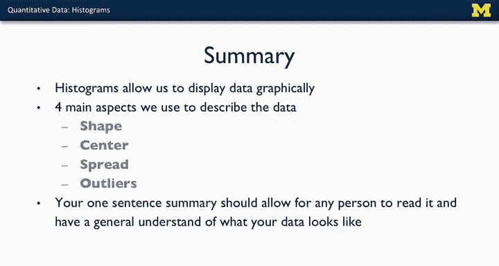

# 课程13：定量数据可视化 - 直方图绘制教程 📊

在本节课中，我们将学习如何使用直方图来初步探索和可视化定量数据。直方图是一种强大的工具，能帮助我们快速理解数据的分布特征。

## 什么是定量数据与直方图？

上一节我们介绍了数据类型，本节中我们来看看如何可视化定量数据。

定量变量是可以用数学运算处理的数值。例如身高、体重、收入、考试成绩、鞋码或抛硬币10次后正面向上的次数。定量变量分为离散型和连续型。

离散型随机变量，例如抛硬币10次后正面向上的次数，只能取整数值。而身高和体重可以取任意值，属于连续型变量。例如身高可以是5英尺6英寸、5英尺7英寸或5英尺7.5英寸，可以是这些数字之间的任何值。

直方图是对数据进行首次图形化展示的绝佳选择。它能让我们快速了解数据的样貌，以及后续可能想要分析的方向。

## 直方图的构成

以下是直方图的主要组成部分：

*   **Y轴**：表示**频率**，即我们看到某个特定响应值的次数。
*   **X轴**：表示我们的**变量**，在本例中是身高（英寸）。
*   **矩形条（Bins）**：这些矩形被称为“箱”。箱的宽度可以根据你使用的软件进行调整。在本例中，使用Python并设置了10个箱，直方图会计算并显示落在每个特定范围内的个体数量。例如，在最左边的第一个箱中，我们可以看到样本中大约有3个人的身高约为62英寸。

## 描述直方图的四个核心方面

在分析直方图时，我们主要关注四个核心方面：形状、中心、离散程度和异常值。

### 1. 形状

形状是直方图的整体外观。它可以是对称的、钟形的、左偏的或右偏的。

### 2. 中心

中心指的是数据的集中趋势，通常用**均值**或**中位数**来描述。

### 3. 离散程度

离散程度描述数据的分散范围。我们可以讨论**极差**、**四分位距**、**标准差**或**方差**。对于直方图的初步分析，我们主要讨论**极差**。我们将在未来的课程中更详细地讨论四分位距、标准差和方差。

### 4. 异常值

异常值是那些远离数据主体的数据点。

## 实例分析：成年男性身高

现在，让我们再次查看成年男性身高的直方图，并应用这四个方面进行分析。

首先，我们来看形状。可以想象用一块布盖在数据上，可以看到它大致呈钟形分布。钟形分布在统计学中非常常见，且易于进行统计分析。我们还可以说它是**单峰**的，意味着它只有一个众数，因为我们在形状中只看到一个峰值。

接下来，我们讨论中心。由于它是钟形且对称的，中心正好在中间，大约在68英寸处。这里我描述的是**中位数**，大约是68。因为分布对称，**均值**也大约在68。

然后，我们讨论离散程度，这里我们主要讨论**极差**。极差是最大值减去最小值。我们可以看到最右边的最大值大约在75英寸，最左边的最小值接近62英寸。因此，极差大约是13英寸。请注意，我说的是“大约”，因为我是从图形上观察，而不是获取精确的数值。

最后，我们讨论异常值。对于这个案例，所有数据都相当集中，因此我们可以说**没有明显的异常值**。

### 综合描述

将这四个方面整合成一句话，可以这样描述：
> 成年男性身高的分布大致呈钟形，中心约在68英寸，极差为13英寸（从62英寸到75英寸），且没有明显的异常值。

这样一句话，你就可以传达给他人，让他们理解你所观察数据的形状、中心、范围和任何他们真正想了解的信息。

## 重要区别：直方图 vs. 条形图

关于直方图，需要知道的一个重要点是它与条形图不同。条形图用于**分类数据**，而直方图用于**定量数据**。

## 更多实例分析

上一节我们分析了一个对称分布的例子，本节中我们来看看偏态分布的情况。

### 实例二：旧金山薪资分布

以下是描述该直方图的要点：

*   **形状**：分布呈**双峰**（有两个峰值，一个在0附近，一个在约6万美元附近）且**右偏**（有一条长长的右尾）。
*   **中心**：**中位数**约为8万美元。由于右偏，**均值**会被拉向右方，大于中位数，可能约为8.5万美元。
*   **离散程度**：**极差**约为60万美元（最大值约60万，最小值0）。
*   **异常值**：在分布的高端存在**异常值**（例如，超过20万美元可能被视为异常值）。

综合描述如下：
> 旧金山薪资的分布呈双峰且右偏，中心约在8万美元，大部分数据集中在4万到12万美元之间，极差约为60万美元，高端存在异常值。

注意，这里我加入了“大部分数据集中在4万到12万美元之间”。这是因为对于右偏分布，我们需要告知他人数据的主体部分在哪里。高端的一些异常值可能不能代表大部分数据，因此大多数人收入在4万到12万美元之间是一个很好的补充信息。

### 实例三：考试成绩分布

以下是描述该直方图的要点：

*   **形状**：分布呈**左偏**（尾部向左延伸）且为**单峰**。
*   **中心**：**中位数**约为80分。由于左偏，**均值**会小于中位数，可能约为75分。
*   **离散程度**：**极差**约为85分（最高约100分，最低约15分）。
*   **异常值**：在分布的低端存在**异常值**（例如，低于50分可能被视为异常值）。

综合描述如下：
> 考试成绩的分布呈左偏，中心约在80分，大部分分数集中在65到90分之间，极差约为85分，低端（50分以下）存在一些异常值。

同样，我加入了“大部分分数集中在65到90分之间”。这是为了给听者一个概念，即大多数人的得分情况。如果我只告诉你极差是85分，你可能会以为也许大部分人都没考好，只有少数人考得好。但实际上，这次考试大多数人都考得不错。

## 总结

本节课中我们一起学习了如何使用直方图对数据进行初步的图形化展示。

我们讨论了描述直方图的四个主要方面：**形状**、**中心**、**离散程度**和**异常值**。利用这四个方面，我们可以构建一个一句话的摘要。通过这个摘要，你应该能够向任何人清晰地传达你的数据大致是关于什么以及它看起来是什么样子。

这是分析数据、为进一步探索数据提供思路的一个绝佳起点。