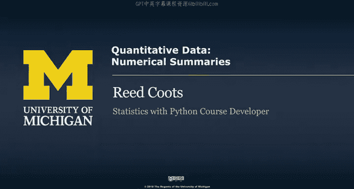
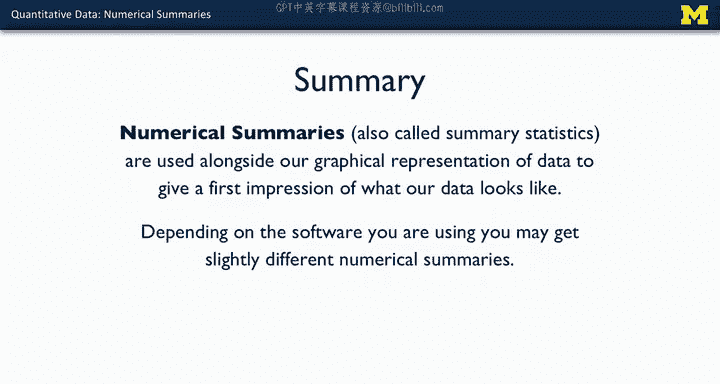

# 课程13：定量数据的数值摘要分析 📊




在本节课中，我们将学习如何为定量数据计算数值摘要。数值摘要能为我们提供关于数据分布的中心、离散程度和形状的精确数值描述，是对图形化表示（如直方图）的有力补充。

## 概述

上一节我们通过直方图等图形直观地了解了数据的分布。本节中，我们将深入探讨如何用具体的数字来量化描述数据的特征，包括中心趋势、离散程度以及识别异常值。

## 数值摘要的核心构成

以下是数值摘要中常见的核心统计量，它们共同构成了数据的“五数概括法”。

*   **最小值**：数据集中的最小数值。
*   **第一四分位数**：也称为第25百分位数，表示有25%的数据小于或等于此值。
*   **中位数**：也称为第50百分位数，表示有50%的数据小于或等于此值。其计算公式为：当数据量n为奇数时，`中位数 = 数据[(n+1)/2]`；当n为偶数时，`中位数 = (数据[n/2] + 数据[n/2 + 1]) / 2`。
*   **第三四分位数**：也称为第75百分位数，表示有75%的数据小于或等于此值。
*   **最大值**：数据集中的最大数值。

## 实例分析：成年男性身高

让我们回顾之前提到的成年男性身高数据，其直方图大致呈钟形（对称分布）。以下是其数值摘要示例：

```
最小值: 61.7 英寸
第一四分位数: 66.5 英寸
中位数: 68.3 英寸
第三四分位数: 70.1 英寸
最大值: 75.1 英寸
```

在此例中，中位数与均值相同（均为68.3英寸），这符合对称分布的特征。我们还可以计算**四分位距**，它是衡量数据离散程度的另一个指标。

**四分位距** = **第三四分位数** - **第一四分位数** = `70.1 - 66.5 = 3.6` 英寸。

## 实例分析：旧金山薪资

接下来，我们分析呈双峰且右偏分布的旧金山薪资数据。在右偏分布中，我们预期均值会大于中位数。以下是Python中`describe()`函数输出的摘要：

```python
count    148654.000000  # 样本量 n
mean      74768.000000  # 均值
std       50517.000000  # 标准差
min      -618.100000    # 最小值
25%       50416.000000  # 第一四分位数 Q1
50%       71427.000000  # 中位数
75%       93284.000000  # 第三四分位数 Q3
max      567595.000000  # 最大值
```

观察结果与预期一致：均值（$74，768）确实大于中位数（$71，427）。**标准差**约为$50，517，表示数据点平均偏离均值约5万美元。此外，最小值为负值（-$618.1），这提示数据可能存在录入错误或需要进一步调查的特殊情况。

## 实例分析：考试成绩

最后，我们查看呈左偏分布的成绩数据。对于左偏分布，我们预期均值会小于中位数。其数值摘要如下：

```
样本量 n: 100
均值: 76.3
标准差: 14.4
最小值: 14
第一四分位数 Q1: 68
中位数: 78
第三四分位数 Q3: 87
最大值: 100
```

结果再次验证了我们的猜测：均值（76.3）小于中位数（78）。中位数对异常值不敏感，是更稳健的中心度量。此数据的**四分位距**为 `87 - 68 = 19`。与全距（14到100）相比，IQR能更好地描述大部分数据的分布范围。

## 总结

本节课中，我们一起学习了定量数据的数值摘要分析。我们了解到：

1.  **五数概括法**（最小值、Q1、中位数、Q3、最大值）和**均值**、**标准差**是描述数据核心特征的关键统计量。
2.  数据的分布形态（对称、左偏、右偏）会直接影响均值与中位数的关系。
3.  **四分位距**是比全距更稳健的离散程度度量，尤其当数据存在异常值时。
4.  数值摘要应与直方图等图形化工具结合使用，以对数据形成全面而准确的理解。
5.  分析数值摘要时，需保持批判性思维，对异常值（如负薪资）提出合理疑问。



通过掌握这些数值摘要，你将能够更精确、更深入地解读任何定量数据集。