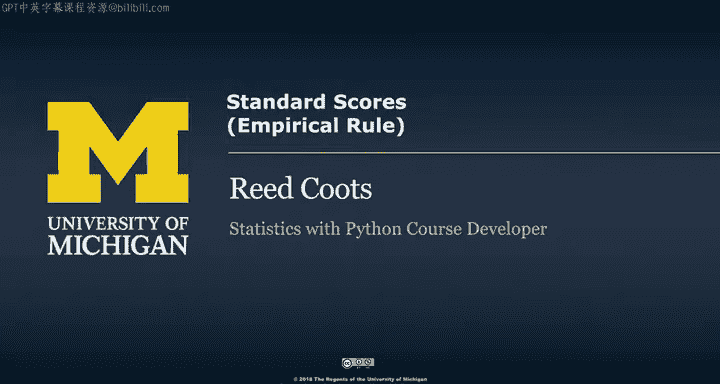
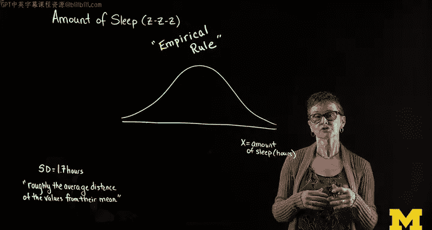
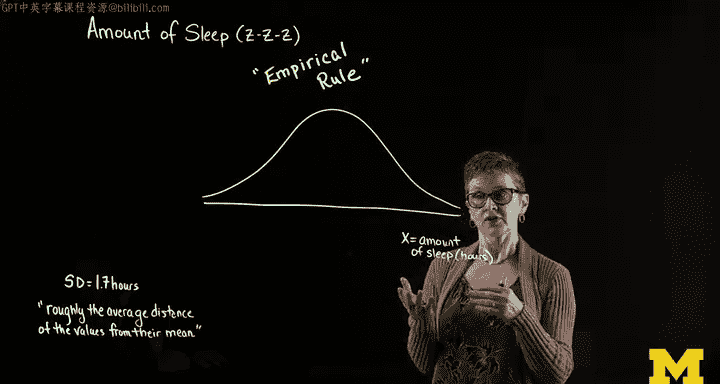

# 课程14：标准分与经验法则 📊

在本节课中，我们将学习两个用于理解数据分布的重要工具：**经验法则**和**标准分**。我们将了解如何利用数据的平均值和标准差，快速判断一个数值在分布中的相对位置和“罕见”程度。

上一节我们介绍了描述数据分布形状的概念。本节中我们来看看一种非常常见且重要的分布形状——钟形分布，并学习与之相关的两个实用规则。

## 钟形分布与经验法则

许多变量和统计估计量会呈现出**钟形分布**，也称为正态分布。这种分布的特点是中间高、两边低，形状对称。

假设我们研究大学生在工作日晚上的睡眠时长，其分布近似钟形。数据显示，平均睡眠时长约为7小时。我们可以在对称分布的中心位置标记这个**平均值**。

为了解数据的分散程度，我们需要一个衡量离散度的指标。常与平均值一同报告的是**标准差**。在本例中，睡眠时长的标准差是1.7小时。标准差可以粗略地理解为：**数值与平均值之间的平均距离**。因此，大学生的睡眠时长平均会偏离7小时约1.7小时。

我们可以利用标准差这把“尺子”，在分布图上标记更多位置。

以下是基于经验法则的关键数值范围：

*   如果我们从平均值向两侧各移动**1个标准差**（即到达约8.7小时和5.3小时），在钟形分布中，我们预计会看到大约**68%** 的观测值落在这个区间内。
*   如果向两侧各移动**2个标准差**（即到达约10.4小时和3.6小时），我们预计大约**95%** 的观测值会落在这个更宽的区间内。
*   如果向两侧各移动**3个标准差**（即到达约12.1小时和1.9小时），我们预计几乎所有的观测值，约**99.7%**，都会落在此区间内。

这个关于钟形分布的规律被称为 **68-95-99.7法则**，也常叫做**经验法则**。它为我们判断一个数值是否“不同寻常”提供了便捷的参考框架。

## 标准分（Z分数）

经验法则给出了大致的范围。为了更精确地量化一个具体数值在分布中的位置，我们使用**标准分**。

标准分的计算公式是：
`标准分 = (观测值 - 平均值) / 标准差`

这个公式计算的是观测值偏离平均值多少个标准差单位。

让我们通过几个例子来理解标准分：

*   **例1：睡眠10小时**
    如果一名学生通常睡10小时，其标准分计算如下：
    `(10 - 7) / 1.7 ≈ 1.76`
    这个**正**的1.76表明，该学生的睡眠时长比平均值高出约1.76个标准差。结合经验法则，我们知道95%的数据在平均值±2个标准差内（3.6至10.4小时）。10小时接近上限10.4，因此这个睡眠时长相对较长，较为少见。

*   **例2：睡眠6小时**
    如果另一名学生通常睡6小时，其标准分为：
    `(6 - 7) / 1.7 ≈ -0.59`
    这个**负**的-0.59表明，该学生的睡眠时长比平均值低约0.59个标准差。这个值离平均值不远，属于比较常见的范围。

*   **例3：已知标准分求观测值**
    假设朋友马克说他的睡眠时长远低于平均水平，标准分是-2.7。我们可以反推他的实际睡眠时长：
    `观测值 = 平均值 + (标准分 × 标准差)`
    `观测值 = 7 + (-2.7 × 1.7) ≈ 2.41小时`
    计算可知，马克的平均睡眠时长只有约2.41小时，这解释了他为何常在凌晨2-3点回复邮件。

## 总结

本节课中我们一起学习了如何利用**经验法则**和**标准分**来理解数据。

*   **经验法则**适用于钟形分布，它告诉我们：约有68%、95%和99.7%的数据分别落在距离平均值1个、2个和3个标准差的范围内。
*   **标准分**则是一个通用工具，通过公式 `(观测值 - 平均值) / 标准差` 计算，它能精确地告诉我们任何一个观测值相对于平均值的位置（以标准差为单位）。正分数表示高于平均值，负分数表示低于平均值，分数的绝对值大小表示偏离的程度。

掌握这两个工具，能帮助我们对数据的分布和单个数据点的相对位置形成快速、直观的判断。