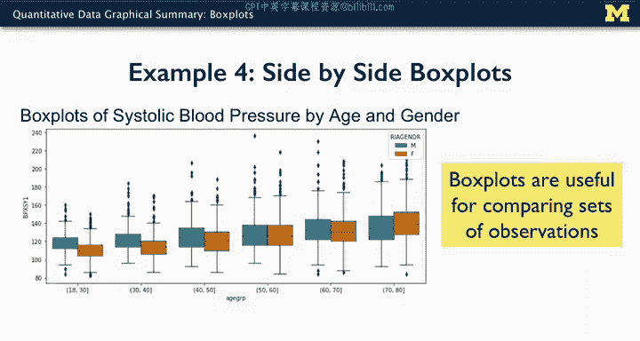

# 16：📊 定量数据：箱线图解析

在本节课中，我们将学习一种名为箱线图的定量数据图形表示方法。我们将了解它的构成、如何解读，以及它如何帮助我们总结和比较数据集。

## 概述：什么是箱线图？

上一节我们介绍了定量数据的图形表示方法。本节中，我们来看看另一种强大的工具——箱线图。

箱线图本质上是对“五数概括法”的可视化呈现。如果你还记得，五数概括法包括：
*   **最小值**
*   **第一四分位数**
*   **中位数**
*   **第三四分位数**
*   **最大值**

箱线图将这五个统计量转化为一个简洁的图形，让我们能快速把握数据的中心、分布范围和潜在异常值。

## 箱线图的构成 🧩

以下是箱线图各部分的构成说明：

*   **箱体**：由第一四分位数和第三四分位数构成。箱体的长度就是**四分位距**，它衡量了中间50%数据的离散程度。
*   **中位线**：在箱体内部，用一条线标记**中位数**的位置，这是一个稳健的中心度量。
*   **须线**：从箱体边缘延伸出的线条，分别连接到**最小值**和**最大值**（在排除异常值的情况下）。因此箱线图也常被称为“盒须图”。

## 实例解析 📈

让我们通过几个例子来具体理解箱线图。

### 示例一：成年男性身高

我们首先看一个成年男性身高的数据。其直方图大致呈对称的钟形分布，中心大约在68英寸。对应的箱线图如下所示。

从箱线图中，我们可以清晰地读出中位数为68.3英寸，并且能直接看到最小值和最大值（约62英寸和75.1英寸），这是直方图无法精确提供的。这个对称的直方图也对应了一个中位数位于箱体中央的对称箱线图。

### 示例二：收缩压

现在来看收缩压的数据。这个分布明显不是对称的，它向右倾斜（即存在少数异常高的血压值）。箱线图能有效地展示这些异常值。

箱线图内置了识别异常值的规则，并将它们单独绘制出来，从而引起我们的注意。这些异常值可能是数据集中最有趣的部分。

### 示例三：小规模测验分数

这个例子展示了一个小数据集的箱线图，该数据在中间存在缺口，形成两个分数集群。然而，箱线图本身只是一个“箱子”，我们无法从图中直接看出数据中间有缺口或存在分组的情况。

这是箱线图的一个局限性：它有时会掩盖数据分布的某些形状特征，而直方图在展示形状方面通常做得更好。

### 示例四：多组数据比较

最后，我们来看一组并排展示的箱线图，它们显示了不同年龄和性别群体的收缩压情况。

以下是观察这些箱线图可以得出的结论：

*   **年龄趋势**：从年轻到年老，血压总体呈上升趋势。同时，箱体长度显示，年长群体的血压值通常比年轻群体更分散。
*   **性别差异**：在年轻群体中，男性的血压通常高于女性。但这种差异随着年龄增长而减小，并在最年长的群体中发生逆转，男性的血压反而低于女性。这可能是因为患有高血压的男性更早去世，导致该年龄组中参与比较的男性群体整体更健康。

这个例子表明，并排展示的箱线图在比较两个或更多观测数据集时非常有用，能让我们对数据有一个全面而直观的了解。

## 总结 ✨

本节课中我们一起学习了箱线图。

*   箱线图为五数概括法提供了出色的图形化展示。
*   它通过**中位数**展示中心，通过**四分位距**（箱体长度）和**全距**展示离散程度。
*   它内置算法，能识别并单独标出潜在的**异常值**。
*   箱线图的局限性在于可能隐藏数据分布的某些形状细节。
*   当需要比较多个数据集时，并排显示的箱线图是一个极其有效的工具。