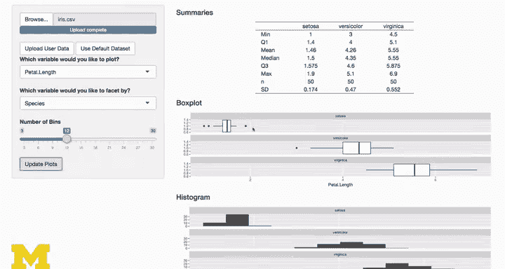

# 17：交互式直方图与箱线图演示 📊📈

在本节课中，我们将学习如何使用一个交互式在线应用来探索数据。我们将重点了解如何生成和解读数据的箱线图与直方图，并学习如何上传自己的数据集进行分析。

---

## 概述

本节课我们将使用一个交互式工具，通过箱线图和直方图来可视化数据。我们将从默认的汽车数据集开始，然后学习如何上传并分析自定义数据集（如鸢尾花数据集）。通过分面功能，我们还能基于分类变量（如气缸数或花的种类）来比较不同组别的数据分布。

---

## 使用默认数据集

首先，我们使用应用提供的默认数据集。这是一个关于数十辆汽车的数据集，包含每加仑英里数、车重、排量、气缸数等变量。

我们将查看数据的数值摘要、箱线图和直方图。

点击“使用默认数据集”后，再点击“更新图表”。

以下是分析每加仑英里数（MPG）的结果：
*   **数值摘要**：包含五数概括（最小值、第一四分位数、中位数、第三四分位数、最大值）、均值、样本量（32）和标准差（6.07）。
*   **箱线图**：展示了MPG数据的分布范围、中位数和异常值。
*   **直方图**：以条形图形式展示了MPG的频率分布。

我们可以将分析变量更改为其他数值变量，例如车重（WT）。点击“更新图表”后，图表和摘要将相应更新。

---

## 使用分面功能比较组别

上一节我们查看了整体数据的分布，本节中我们来看看如何利用分类变量进行分组比较。

分面功能允许我们根据一个分类变量（如气缸数）将数据分成不同组，并分别绘制图表。

选择“气缸数”（Cylinders）作为分面变量，气缸数有4、6、8三种。点击“更新图表”后，我们将得到三组图表和数值摘要。

以下是观察结果：
*   **箱线图**显示，四缸汽车的MPG通常优于六缸汽车，而六缸汽车又优于八缸汽车。
*   **直方图**也清晰地展示了这一趋势。

我们还可以调整直方图的箱宽（bin size）。减少箱数会使每个条形更宽，从而改变数据分布的呈现粒度。每次调整后，都需要点击左下角的“更新图表”按钮。

---

## 分析其他变量与分面

我们也可以分析其他变量。例如，将分析变量改为“马力”（Horsepower），同时仍以“气缸数”进行分面。

点击“更新图表”后，我们能看到相反的趋势：马力越大，通常气缸数也越多。八缸汽车的马力最高，而四缸汽车的马力则相对较低。直方图同样在下方面板中展示了这一分布。

---

## 上传并分析自定义数据

这个应用的一个强大功能是支持上传用户自己的数据进行分析。

以下是上传和分析自定义数据的步骤：
1.  点击“浏览”按钮。
2.  在文件夹中找到目标数据集文件（例如著名的鸢尾花数据集 `iris.csv`）。
3.  选择文件后，点击“上传用户数据”。
4.  应用会读取数据，识别其中的分类变量和数值变量。

上传成功后，变量列表中会出现如“花萼长度”（sL length）、“花萼宽度”（sL width）、“花瓣长度”（pal length）、“花瓣宽度”（pal width）等变量。鸢尾花数据集包含三种相似但具有不同测量特征的鸢尾花。

首先，我们分析所有150朵花的“花萼长度”。更新图表后，可以看到整体的箱线图和直方图。

接着，我们使用分面功能，按花的“种类”（Species）进行分组。三种类分别为：山鸢尾（Setosa）、杂色鸢尾（Versicolor）、维吉尼亚鸢尾（Virginica）。

分组后可以发现，不同种类花的花萼长度差异显著。这正是我们区分花种类的依据之一。

我们还可以将分析变量改为“花瓣长度”（petal length）。结果显示，山鸢尾的花瓣长度非常短，而杂色鸢尾和维吉尼亚鸢尾的花瓣则长得多。

---

## 总结

本节课中，我们一起学习了如何使用交互式工具进行数据探索。
*   我们学会了如何生成和解读数据的**数值摘要**、**箱线图**和**直方图**。
*   我们掌握了**分面**功能，能够根据分类变量（如气缸数、花的种类）来比较不同子组的数据分布。
*   我们实践了**上传自定义数据集**（如鸢尾花数据集）并对其进行分析的全过程。

这个工具能帮助你快速感知数据的分布特征，是进行初步数据探索和可视化的有效手段。