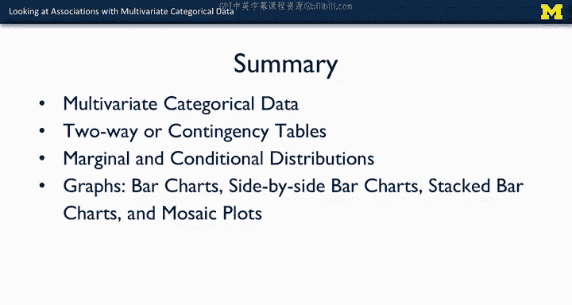

# 18：多元分类数据关联分析 📊

在本节课中，我们将学习如何分析多元分类数据之间的关联。我们将探讨什么是多元分类数据，如何用表格和图形来展示它们，以及如何解读变量之间的关系。

---

## 什么是多元分类数据？ 🤔

上一节我们介绍了课程主题，本节中我们来看看什么是多元分类数据。

想象一下，我们正在进行一项调查。我们可能会问受访者一个问题，例如：“你的性别是什么？” 请思考一下，性别属于哪种类型的变量。

性别是一个**分类变量**，因为回答属于不同的类别或组别。在这个例子中，我们有一个分类变量。但我们可能不只对性别感兴趣，还想知道“你的婚姻状况是什么？”

在这种情况下，我们测量了两个不同的变量，这被称为**双变量**。双变量就是两个变量。它也是**多元**的，多元指的是两个以上的变量。

我们可能不满足于只有这两个变量，还想了解更多信息。因此我们可能会问：“你的最高教育水平是什么？” 我们还可以问：“你的年龄组别是什么？”

在以上每个例子中，这些都是分类数据。一旦我们收集了这四个变量，我们就拥有了**多元分类数据**。

我们可以以电子表格或表单的形式来思考这些变量的回答。

我们可以记录一个人的所有回答。例如，我们交谈的第一位受访者是男性，拥有高中文凭或GED，未婚且从未结过婚，年龄在18至29岁之间。

我们可能不满足于只了解一个人的信息，因此可以继续收集第二位受访者的信息。这个人可能是女性，拥有一些大学学历或副学士学位，目前已婚或与伴侣同居，年龄在30至44岁之间。

我们可以为15个人重复这个过程，直到收集到大量信息。

---

## 数据整理与展示 📋

在这一点上，仅从这张图片很难全面了解我们的样本情况。很难把握样本的整体面貌，因此我们将探讨以更易于管理的形式展示所收集数据的不同方法。

收集完整样本后，我们可以选择以表格形式记录变量。

例如，我们可以查看获得的最高教育水平。从整个样本中，我们可以看出恰好有1,331人的学历低于高中。

此时，一眼就能更容易地了解整个样本的情况。

这引出了本视频剩余部分的研究问题：**哪些因素会影响获得的最高教育水平？**

如果我们想知道哪些因素影响最高教育水平，我们首先需要查看其他因素之一。

因此，我们将这个单变量分类数据表拆分为两个变量，形成一个**双向表**或**列联表**。在本例中，我们可以将每个类别按受访者是女性还是男性进行拆分。

没有额外背景信息，很难理解这个表格，因此我们将添加总计行和总计列，以便查看每个类别中有多少个体。

首先，思考一下表格内部所有这些值的含义。我们可以看到，有644位受访者是女性且学历低于高中。

我们需要一些额外的背景信息，因此了解总共有5,549位受访者会有所帮助。然后，将644除以5,549，我们可以计算出样本中女性且学历低于高中的比例。

这里我们可以看到是11.6%。我们可以对表格内部的每个条目重复此过程，以了解整个样本的情况。例如，我们可以看到，在整个样本中，近10%是女性且拥有高中文凭或GED。

让我们回到几页幻灯片前展示的原始表格。

这里我们进行了修改，添加了额外的百分比。这有助于我们更好地了解样本在四个类别中的分布情况。

---

## 数据的图形化展示 📈

看到这里的数值很好，但以图形方式查看它们也很有帮助。在本例中，这是一个关于最高教育水平获得的条形图，它显示了与上一张幻灯片表格相同的内容。

我们可以看到，最常见的类别是“一些大学或副学士学位”。这有助于我们快速、一目了然地了解情况，而数字有时会让人感到有些困惑。

回到我们最初的研究问题，我们感兴趣的是弄清楚其他因素如何影响获得的最高教育水平。因此，在本例中，我们将查看基于性别的教育水平的**条件分布**。

我们可以做的一件事是，根据受访者是女性还是男性，制作两个关于教育水平的条形图。

在这里，与男性相比，拥有一些大学或副学士学位的女性似乎更多，但很难准确比较这两个分布。

我们可以做的一件事是将每个分布转换为比例或百分比。这样，我们可以直接比较两种不同性别的分布，而不是比较可能无法直接比较的计数。

需要注意的是，在本例中，当我们创建比例时，我们将除以该类别中的个体总数。因此，对于女性，我们将除以2,814；对于男性，将除以2,735。这样，你可以看到我们两列各自加起来都是100%。

我们也可以使用**并排条形图**来展示这一点。在并排条形图中，你可以直接比较两个性别类别中，属于四个教育水平类别中每一个的个体比例。由此我们可以快速看出，确实，基于比例，拥有一些大学或副学士学位水平的女性多于男性，并且这是女性和男性教育水平之间最大的差异。

展示我们分布的另一种方式是查看**堆叠条形图**。堆叠条形图显示每个组中属于四个类别中每一个的个体比例。因为它们彼此相邻，我们也可以看到这两个组如何相互比较。

我们可以查看的另一种图形是**马赛克图**。在本例中，每个框的面积与该类别中的个体数量成比例。这是一目了然地查看数据的好方法，我们可以很好地了解数据的分布情况。

我将在其中画一条线，将拥有高中文凭的人和拥有一些大学学历的人分开。

我们可以清楚地看到，拥有一些大学学历的个体比例在18至29岁年龄组中最高，并且在此之后的每个年龄组中逐渐降低。如果这两个变量完全独立或没有关联，那么我们期望看到的是一个所有线条都是笔直的网格。我们可以看到，我在这里添加的线有很多起伏，在马赛克图中显得有些锯齿状。

查看马赛克图的另一种方式是在每个年龄类别中按性别分开。这样，我们可以查看三个变量（年龄、性别和教育）之间的关联。同样，当我们查看不同的年龄组时，可以看到类似的锯齿状。例如，在45至59岁这个类别中，男性和女性之间的差异相当相似。在高中和大学的分界处有一点起伏，但线条相对较直，表明性别在45至59岁年龄类别中作用不大。

当我们查看30至44岁时，可以看到这个起伏要强得多，表明性别在该年龄类别内有更大的关联。

---

## 总结 ✨

本节课中我们一起学习了：
*   什么是多元分类数据。
*   如何使用双向表或列联表来展示数据。
*   如何改变查看这些表格的方式，以包含边际分布或条件分布。
*   最后，我们探讨了以图形方式展示数据的方法，无论是条形图、并排条形图、堆叠条形图还是马赛克图。