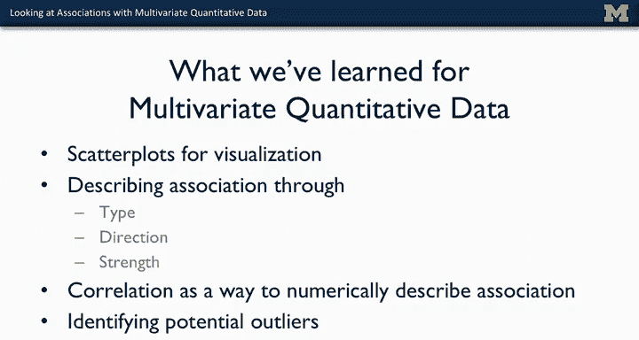

# 课程19：多元定量数据关联分析 📊

在本节课中，我们将学习如何分析和可视化多元定量数据，特别是探索两个或多个定量变量之间的关联。我们将介绍散点图、关联的类型、方向和强度，以及皮尔逊相关系数等核心概念。

---

大家好，我是密歇根大学统计系的博士生 Tim Neamp。我对统计学产生兴趣，是因为它有能力帮助做出更好的医疗决策，实现个性化教育，并协助非营利组织和社区组织做出更明智的决策。

在本视频中，我将讨论如何分析多元定量数据之间的关联。

## 什么是多元定量数据？🔍

首先，多元定量数据从何而来？假设我们有一个研究对象。对于这个人，我们测量了他的年龄，同时也测量了他的身体质量指数、血压和胆固醇水平。由此产生的数据就是多元定量数据。

*   之所以是“多元”，是因为我们在每个个体或每个研究对象上测量了不止一个特征。
*   之所以是“定量”，是因为我们测量的数值是数字。

假设我们收集了这样的数据，可能来自15个人，或者像NHANES数据集那样来自成千上万的人。仅仅拥有这些数据本身，并不能帮助我们理解样本中存在的模式或样本中个体的特征。因此，我们可能需要将其可视化。

## 数据可视化方法 📈

一种可视化方法是使用单变量直方图。通过这些直方图，我们可以了解年龄的中位数和分布范围，也可以了解收缩压的中位数和分布范围。

但是，如果我们对这两个变量之间的关联感兴趣呢？例如，年龄较大的人血压是倾向于更高还是更低？目前，我们无法将年龄直方图中的某个人与收缩压直方图中的同一个人对应起来。

解决这个问题的方法是制作散点图。散点图将两个定量变量绘制在一起。这里，X轴代表年龄，Y轴代表收缩压。每个点代表一个人。例如，这个点代表一个大约26岁、收缩压约为180的人。

散点图的优势在于它能告诉我们这两个变量之间的关联：这两个变量是如何相关的？在这个散点图中，我们看到年龄较大的人倾向于有更高的血压。

## 关联的特征 🧩

我们主要关注关联的几个具体方面。

### 关联的类型

以下是三种不同类型的关联：
*   **线性关联**：点之间的模式形成一条直线。
*   **二次关联**：点之间的模式呈抛物线形，即先上升后下降。
*   **无关联**：随着年龄增长，高密度脂蛋白胆固醇既不增加也不减少。

### 关联的方向

关联的方向对应于关联直线的斜率。
*   **正线性关联**：当X增加时，Y也增加。例如，年龄增加，收缩压也增加。
*   **负线性关联**：当X增加时，Y减少。例如，车辆越重，每加仑行驶里程数越少。

### 关联的强度

除了类型和方向，我们还关心关联的强度。
*   **弱线性关联**：点沿着直线广泛分散。
*   **中等线性关联**：点的分散程度较小。
*   **强线性关联**：点的分散程度非常小，关联最强。

请注意，关联的强度不依赖于符号，你可以有很强的正关联和很强的负关联。

## 量化关联：皮尔逊相关系数 🔢

除了定性描述关联，还有一种方法可以量化线性关联的强度和符号，这被称为皮尔逊相关系数。

*   皮尔逊相关系数的符号就是关联的方向符号。
*   皮尔逊相关系数越接近1或-1，关联就越强。

在第一个例子中，我们看到一个弱的正线性关联，这意味着我们的相关系数为正，但不接近1。
在第二个例子中，随着关联变强，皮尔逊相关系数增加，但仍不接近1。
在第三个例子中，由于关联是负的，我们的皮尔逊相关系数现在也是负的，并且由于关联极强，它非常接近-1，值为-0.99。
在最后一个例子中，基本上没有关联，皮尔逊相关系数非常接近0，为-0.01。

**公式**：皮尔逊相关系数 `r` 的计算公式为：
`r = Σ[(xi - x̄)(yi - ȳ)] / √[Σ(xi - x̄)² Σ(yi - ȳ)²]`
其中 `xi` 和 `yi` 是数据点，`x̄` 和 `ȳ` 是均值。

## 重要警示：相关不等于因果 ⚠️

我们所见的所有关联都有一个重要的警示：**相关不等于因果**。

这是什么意思呢？虽然在我们的例子中，我们看到随着年龄增长，收缩压也在增加，但这并不一定意味着年龄是收缩压增加的原因或导致因素。

这里有一个假设性的例子来说明为什么不是：也许红色方框内的所有人都恰好吸烟。那么，可能吸烟才是导致高血压的真正原因，而年龄实际上并没有导致高血压。只是在我们数据中，样本中年龄较大的人吸烟更多，使得年龄看起来像是原因。

**仅仅因为两件事有关联，并不意味着其中一件事导致了另一件事。**

## 识别异常值 🎯

除了探究关联，我们可能还会问：我们的数据集中是否有任何不寻常的个体？这些点被称为异常值。对于多元定量数据，一个潜在的异常值是指与数据其余部分的模式严重偏离的点。

例如，这里是我们数据中的模式。你可以看到，与其余点相比，其中一些点离该模式相当远。这些就是潜在的异常值。

## 结合分类变量 🌈

最后我想展示的是，除了拥有多元定量数据，你可能还会对一个分类变量感兴趣。例如，这里我们记录了血压和年龄，但我们也记录了性别。如果我想同时表示这三个变量，我可以根据分类变量为点着色。

从这张图中我们可以注意到几个有趣的现象：男性倾向于有更高的血压，尤其是在年轻时。而随着年龄增长，血压的升高在女性中更为显著（粉色点比黑色点平缓得多）。

---

## 总结 📝

本节课中，我们一起学习了如何处理多元定量数据。我们学会了如何使用散点图进行可视化，学会了用类型、方向和强度来描述关联，了解了皮尔逊相关系数是量化关联的一种数值方法，并且也学会了如何识别潜在的异常值。