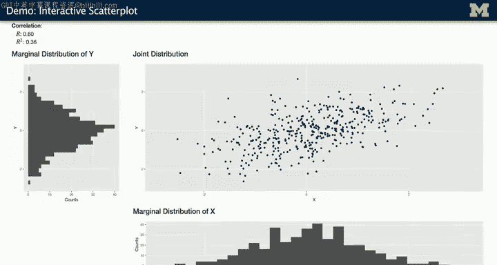
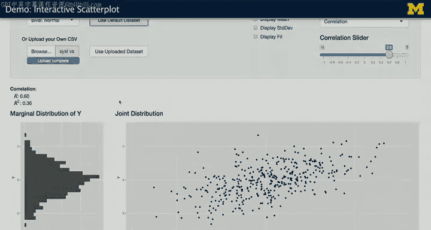

# 20：交互式散点图演示 🎨📊

在本节课中，我们将学习如何使用一个交互式应用程序来可视化多元定量数据，并更好地理解变量之间的相关性。这个工具能帮助我们探索数据、上传自己的数据集，甚至根据指定的相关系数生成模拟数据。

## 概述

上一节我们讨论了多元定量数据的关联性。本节中，我们将通过一个具体的交互式工具，直观地探索散点图、直方图以及相关系数。

这个应用程序有三个主要功能：
1.  查看默认数据集的散点图和直方图。
2.  上传自己的CSV文件并进行分析。
3.  根据指定的相关系数生成模拟数据。

## 功能一：查看默认数据集

首先，访问应用程序网站并确保位于“双变量绘图”标签页下。

应用程序的默认数据集展示了汽车重量与其每加仑英里数（油耗）之间的关系。

以下是操作步骤：
*   点击“使用默认数据集”按钮。
*   页面将显示油耗与车重的散点图，以及两个变量的直方图。

若要查看这两个变量之间的相关系数：
*   点击右上角的“相关性”选项。
*   结果显示，这两个变量的相关系数为 **-0.87**。

## 功能二：上传并分析自定义数据

接下来，我们看看如何上传自己的数据进行分析。

首先，需要准备一个CSV格式的数据文件。文件内容应包含变量名和数据行，例如，一个包含“年龄”和“收缩压”两列数据的文件。

以下是操作步骤：
*   点击“上传文件”按钮，选择准备好的CSV文件并打开。
*   点击“使用上传的数据集”按钮。
*   页面将显示年龄与收缩压的散点图和直方图。

这个可视化效果与课程视频中用于观察多元定量数据关联性的图表一致。

同样，可以点击“相关性”来查看这两个变量之间的相关系数，本例中为 **0.58**。

## 功能三：根据指定相关系数生成数据

最后，我们可以根据预设的相关系数来生成模拟数据。

操作步骤如下：
*   将默认数据集选项更改为“二元正态分布”。
*   点击“使用默认数据集”按钮。
*   此时会出现一个“相关系数”滑动条，初始值设置为0，生成的散点图显示两个不相关的变量。

假设我们想生成具有中等正相关的数据：
*   将滑动条拖动到目标值，例如 **0.6**。
*   再次点击“使用默认数据集”按钮。
*   现在，散点图将显示两个具有中等正线性关联的变量，并且显示的相关系数也为 **0.6**。

## 总结

本节课我们一起学习了如何使用交互式应用程序来探索数据。我们实践了三种方法：分析默认数据集以理解负相关关系，上传自定义CSV文件进行实际数据分析，以及通过调整相关系数滑动条来生成和观察不同关联强度的模拟数据。这个工具是理解和可视化多元定量数据之间关系的有效手段。