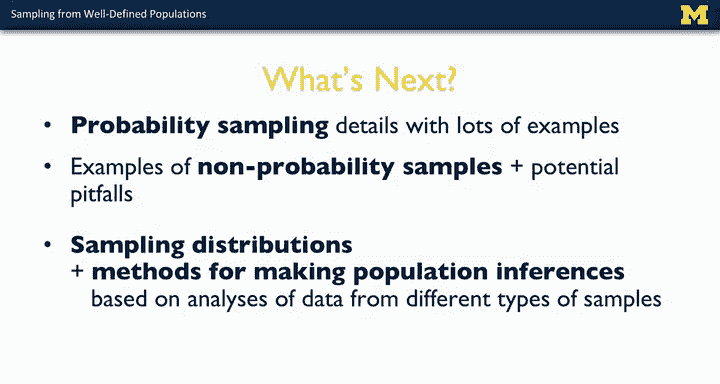

# 📊 课程 22：明确总体与抽样方法

在本节课中，我们将学习数据的来源，特别是如何通过从明确定义的总体中抽取样本来获取用于分析的数据。我们将重点介绍概率抽样与非概率抽样的核心区别及其重要性。

---

## 概述：数据从何而来？

在20世纪早中期之前，研究人员可用的工具非常有限。他们通常试图进行**普查**，即测量给定总体中的每一个单位。到了20世纪30年代，杰西·内曼博士在这一领域取得了重要突破，他的工作使其他研究人员能够使用**随机抽样**作为测量总体的技术。这意味着我们无需测量总体中的每一个单位，就能对总体做出推断。

当我们思考基于样本数据对总体进行推断时，一个非常重要的第一步是**用具体的术语明确定义目标总体**。

---

## 定义目标总体

为了对总体进行推断，我们必须首先明确我们想要谈论的对象。这包括以下几个关键方面：

*   **谁**：我们测量的是谁？是男性、非裔美国男性，还是年长的非裔美国男性？“年长”具体指什么？在思考你真正希望推断的总体时，这些初始阶段必须非常具体。
*   **什么与何地**：我们感兴趣的是什么时间范围？是2018年、2018年4月，还是2018年4月上半月？其次，总体位于何处？我们必须考虑地理因素，是美国中西部、密歇根州、密歇根州的某个县（如沃什特瑙县），还是安娜堡市？

在开始对总体进行推断之前，我们需要明确这些具体细节，必须清楚我们谈论的是谁、什么时间以及何地。

**一个重要建议是：将总体定义写在纸上。** 写下定义——谁、什么时间、何地。如果你与团队合作，确保每个人都有一份该总体声明的确切副本。目标总体应以每个人都能理解的方式明确定义，在分析数据集时，每个人都应对你想要谈论的总体有共同的理解。

---

## 获取数据的三种方法

假设你已经为目标总体写下了具体定义，接下来该怎么办？我们有一个明确定义的目标总体，但最终如何对该总体做出推断性陈述？

以下是三种不同的方法：

1.  **进行普查**：即尝试测量那个具体定义的总体中的每一个人。可以想象，这是一项相当昂贵的任务，但它仍然是我们的选项之一。
2.  **从总体中选取一个科学的概率样本**，并尝试测量样本中的所有单位。本周我们将仔细定义“科学的概率样本”的含义。
3.  **从总体中选取一个非概率样本**，并再次尝试测量样本中的所有单位。

---

### 方法一：进行总体普查

当我们谈论较小的目标总体、定义非常明确、地理范围较小，以至于尝试接触和测量总体中的每个人并不困难时，进行普查往往容易得多。对于较大的总体，普查可能极其昂贵。例如在美国，每十年进行一次人口普查，这是一项大规模的努力，试图测量美国的每一个人并收集他们的选定变量，这是一项极其昂贵的操作。

普查还需要仔细评估测量所有总体单位的成本，以及哪些行政数据源已经可用。也就是说，我们真的需要测量每个人吗？还是可以从其他现有来源获取一些信息？

---

### 方法二：概率抽样

上一节我们介绍了进行普查的方法，本节中我们来看看概率抽样。我们将在本周晚些时候提供更多细节，但首先了解一些概率抽样的基础知识。

以下是概率抽样的基本步骤：

1.  **构建总体所有单位的列表**：这有时被称为**抽样框**。这是我们最终将尝试测量的样本的来源列表。
2.  **确定列表中每个单位的入选概率**：在概率抽样中，列表上的每个单位（无论是个人、家庭、企业还是机构）都有一个已知且非零的被选入样本的概率。这就是我们所说的概率抽样。
3.  **根据入选概率随机选择单位**：不同亚组的抽样率由这些入选概率决定，因此某些亚组可能比其他亚组有更高的入选概率。
4.  **尝试测量那些随机选择的单位**：这就是我们从样本中获取数据的地方，我们可能会问他们问题、采访他们，或者从其他来源收集关于这些随机选择单位的数据。

---

### 方法三：非概率抽样

非概率抽样通常不涉及根据入选概率随机选择个体。这是从样本收集数据的各种技术中的一个关键缺点。与概率抽样不同，我们不是随机选择进入样本的单位。

此外，无法确定总体单位的入选概率。这使得在分析数据时，更难做出具有代表性的推断性陈述。了解这些入选概率非常重要，而顾名思义，在非概率抽样中，我们事先并不知道这些概率。

以下是一些非概率抽样的常见例子：

*   **自愿网络调查**：你可能在网上看到过加入“自愿网络调查”的邀请。在这些调查中，你只是试图让任何对参与该网络调查感兴趣的人参加，而不是从某个明确定义的列表或抽样框中随机选择人。
*   **配额抽样**：即你尝试招募尽可能多的符合特定亚组定义的人（例如，年长的非裔美国男性），直到达到某些目标数量。在某些配额抽样案例中，研究人员试图根据任何概率方案，而是基于任何可用的人，只要他们达到目标或配额。
*   **滚雪球抽样**：顾名思义，就像雪球滚下山坡会越滚越大一样。你招募某人参与研究，然后他们可能会告诉朋友，朋友再告诉朋友，你的样本最终通过这种链条收集个体而变大。在这种情况下，朋友招募朋友，我们无法控制他们招募谁或招募这些其他人的概率。
*   **便利抽样**：这是另一种收集非概率样本的方式。例如，你可能上街与任何可用的人交谈以收集数据和提问；如果你在大学或商业环境中教学，你可能只是从你的课程中的个人、你的同事或任何离你近的人那里收集数据。同样，没有涉及入选概率，你只是试图从方便且离你近的个人那里收集数据。

在这些情况下，我们都无法将入选概率应用于这些个体，这阻碍了我们关于更大总体做出具有代表性的陈述。

---

## 非概率抽样的主要问题

总结来说，非概率抽样的主要问题在于：

*   **没有对目标总体进行推断的统计基础**。
*   **存在非常高的偏差风险**。例如，如果你决定在城镇的某个特定区域进行街头调查，而只有特定类型的人经常光顾该区域的场所，那么你将只从一个非常具体的子集收集数据，而不是整个更大总体的随机代表性样本。我们刚刚介绍的所有其他类型的非概率抽样也是如此，存在很高的偏差风险，因为你招募的是非常特定类型的人并测量这些人，而没有获得更大目标总体的完整代表性样本。

---

## 为什么选择概率抽样？

到目前为止，我试图论证概率抽样具有一些重要特性。在概率抽样中，**总体中所有单位的已知入选概率**，正是这一点使我们能够对**总体特征**（即我们分析数据时试图估计的东西）以及**调查估计值的不确定性**做出无偏的陈述。

除了说明平均收入是多少或总体中具有某种特征的人的比例是多少之外，我们还希望说明我们对这些估计值的不确定程度。因为我们没有测量总体中的每个人，我们测量的是一个样本，我们希望陈述我们对作为总体特征估计值的计算估计值的不确定程度。

概率抽样中从预定义的抽样框或列表中**随机选择总体单位**，这保护我们免受样本选择机制可能带来的偏差影响。概率抽样允许我们基于所谓的**抽样分布**进行总体推断。

---

## 抽样分布的核心概念

本周我们将花大量时间讨论抽样分布的含义。简而言之，如果我们考虑重复多次抽取样本的过程，并为每一个我们可能假设选择的样本计算估计值，那么一个估计值的分布将会出现。当我们思考对总体做出陈述时，我们希望基于这个所有可能估计值的分布来做出陈述。

在现实中，我们只会抽取一个样本并基于该样本计算估计值。但从统计上讲，我们所有的推断都将基于那些假设的抽样分布——如果我们根据指定的设计一遍又一遍地重复抽样过程，我们会期望看到什么？这将告诉我们对自己所做的总体陈述有多确定。

---

## 核心结论

**核心思想是**：通过遵循良好的科学抽样原则进行非常仔细的样本设计，概率样本能够从更大的总体中产生**具有代表性的、现实的随机样本**。这些类型的样本具有非常重要的统计特性。

抽样通常用于从人和总体中收集数据，但我们必须投入足够的时间来设计这些样本，提出明确定义的目标总体，并非常小心地选择这些样本，以便我们能够遵循内曼博士奠定的这些统计特性做出重要的陈述。因此，概率抽样是一个我们将持续关注的重要概念。

---

## 总结与展望

本节课中，我们一起学习了数据的来源以及获取数据的三种主要方法：普查、概率抽样和非概率抽样。我们明确了明确定义目标总体的重要性，并深入探讨了概率抽样的基本原理及其相对于非概率抽样的优势，特别是其允许进行统计推断和量化不确定性的能力。

接下来，我们将更详细地讨论概率抽样技术及其示例，同时也会进一步探讨非概率抽样的潜在缺陷。我们还将深入探讨**抽样分布**的概念，理解这一概念对于基于不同类型样本的数据分析做出具有代表性的总体推断至关重要。